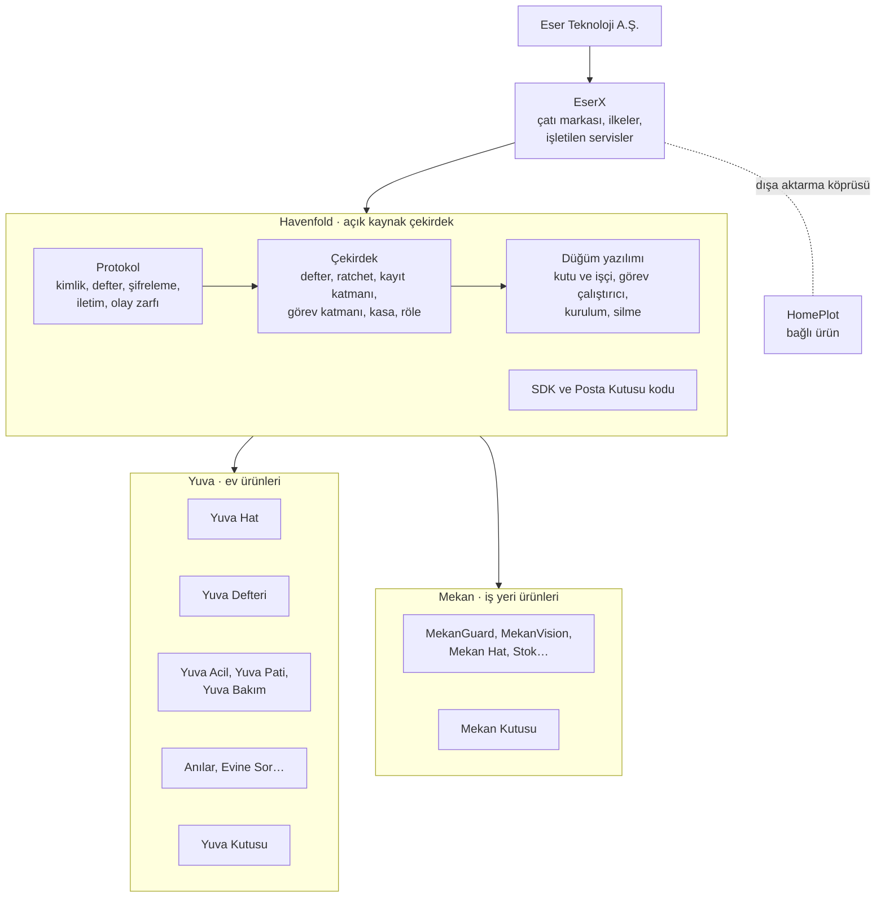
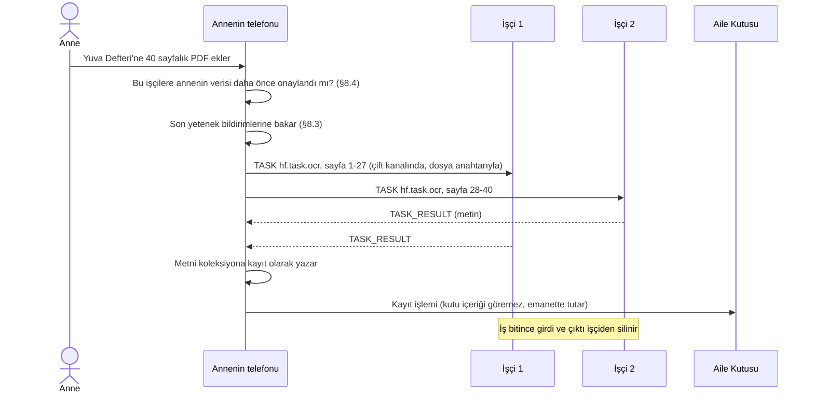

# Havenfold Kurucu Belgesi

> Sürüm 1.24 · 25 Ekim 2026 · Eser Teknoloji
> Durum: **Yürürlükte.** 1.0'ı Kerem 23 Ekim 2026'da onayladı. 1.1, onaylı RFC-0001–0004'ü işler (aynı gün). 1.2, onaylı RFC-0005–0016'yı işler (aynı gün). 1.3, Yuva Defteri'nin ayrı uygulama olması kararını ve RFC-0017'yi işler (aynı gün). 1.4, Yuva Defteri'nin kapsamını (RFC-0018) işler (aynı gün). 1.5, uygulamadan dönen ekleri (RFC-0019) işler (aynı gün). 1.6, defter incelemesinden gelen kararları (RFC-0020) işler (aynı gün). 1.7, kasa ve kap incelemesinden gelen kararları (RFC-0021) işler (aynı gün). 1.8, ekip incelemesinden gelen kararları (RFC-0022) işler (aynı gün). 1.9, uygulama ekleri 3'ü, kriz anlam katmanını ve yapay zeka çekirdeği kararlarını (RFC-0023) işler (aynı gün). 1.10, uygulama ile telefondaki çekirdek arasındaki komut kanalını ve kriz tespitinde kademeli cevabı (RFC-0024) işler (aynı gün). 1.11, yeni dosyanın sınıfını ve kanalın eksik komutlarını (RFC-0025) işler (aynı gün). 1.12, düğümde güncelleme güvenliğini (RFC-0026) işler (aynı gün). 1.13, telefondaki çekirdeğin kalıcılığını, kasa kurtarmayı, kişisel köprüyü ve türetme kuralını (RFC-0027) ve telefon taşıyıcısını (RFC-0028) işler (24 Ekim 2026). 1.14, Yuva Acil, Yuva Pati ve Yuva Bakım'ın ayrı uygulama olmasını (RFC-0029) işler (aynı gün). 1.15, misafirin sınırlı yazmasını (RFC-0030) işler (aynı gün). 1.16, SOS alanlarını ve bakıcının SOS'unu (RFC-0031) işler (aynı gün). 1.17, kuralda gün saatini, çok günlük pencereyi ve kapatan olayı (RFC-0032) işler (aynı gün). 1.18, herkese açılış takvimini ve açılış işlerinde çıkan ekleri (RFC-0033) işler (aynı gün). 1.19, bir telefonda birden çok aileyi (RFC-0034) işler (25 Ekim 2026). 1.20, açılış kapısının daraltılmasını (RFC-0035) işler (aynı gün). 1.21, katılımda uygulama bildirimini ve aile adını (RFC-0036) işler (25 Ekim 2026). 1.22, SOS'ta kişi başına teslimi (RFC-0037) işler (25 Ekim 2026). 1.23, açılış öncesi içerik düzeltmelerini (RFC-0038) işler (aynı gün). 1.24, ekran kenarı kuralını (§16.2) ekler (aynı gün; Kerem).
> Bu belge EserX altındaki bütün yazılımların üst belgesidir. Yeni bir uygulama, modül, cihaz desteği ya da depo açılmadan önce baştan sona okunur.

---

## 0. Bu belge nasıl kullanılır

| Konu | Kural |
|------|-------|
| Kim okur | EserX'te kod, doküman ya da ürün kararı yazan herkes: Kerem, her Claude oturumu, her ajan makinesi, ileride dış katkıcılar. |
| Ne zaman okunur | Yeni uygulama ya da modül başlarken, yeni depo açılırken, protokole ya da çekirdeğe dokunan her işte, bir ürünün mimarisi değişirken. |
| Onaylı RFC'ler | Onaylanan RFC'ler (`docs/rfc/`) bu belgenin bağlayıcı parçasıdır. Bu belge bir konuyu özetleyip ayrıntı için RFC'ye bağlıyorsa ayrıntıda RFC geçerlidir. Bugün onaylı olanlar: RFC-0001 kayıt katmanı, RFC-0002 görev katmanı, RFC-0003 defter v2.1, RFC-0004 kasa, RFC-0005 Mekan ekip topluluğu, RFC-0006 olay ve rutin, RFC-0007 düğüm yazılımı ve güncelleme, RFC-0008 konteynersiz işçi ve Android uç, RFC-0009 Yuva Bağlantı, RFC-0010 hizmet paylaşımı, RFC-0011 konteyner uygulamaları ve yerel tünel, RFC-0012 afet modu, RFC-0013 yapay zeka katmanı, RFC-0014 dışa aktarma kabı, RFC-0015 SDK ortak alanları, RFC-0016 onaylı belgelere ekler, RFC-0017 aynı ailede birden çok uygulama, RFC-0018–0038 (tam liste: `docs/rfc/README.md`). |
| Öncelik | Mimari, ilke, isim ve numara ayırma konusunda **bu belge** geçerlidir. Bu belgenin ayırdığı bir numara ya da alan koda yazılıp `KARARLAR.md`'ye işlendiği andan itibaren bayt düzeyinde **`KARARLAR.md`** bağlayıcıdır. Ürün dokümanları ikisine uyar. |
| Çelişki | Bir ürün dokümanı bu belgeyle çelişiyorsa ürün dokümanı düzeltilir. Bu belge yanlışsa §23'teki yolla değiştirilir. Sessizce farklı davranılmaz. |
| Değişiklik | Yalnız yazılı değişiklik önerisiyle (RFC) ve Kerem onayıyla. Her değişiklik sürümü artırır ve §22'ye satır ekler. |
| Dil | Türkçe. Depo herkese açılırken İngilizce karşılığı yazılır; çelişirse Türkçe geçerlidir. |

---

## 1. Yönetici özeti

**Havenfold, evdeki ve iş yerindeki cihazları tek bir güvenli yerel buluta çeviren açık kaynak çekirdektir.** Telefonlar, eski laptoplar, eski Android'ler, kameralar ve Eser'in satacağı kutular aynı protokolü konuşur, aynı topluluğa katılır ve tek bir bütün gibi görünür. Eser'in bütün ürünleri bu çekirdeğin üstünde çalışır.

**Beş cümlede Havenfold:**

1. Kimlik cihazda durur. Sunucuda kullanıcı hesabı yoktur.
2. Bir topluluğa (aile ya da ekip) insanlar yüz yüze tören ve imzayla katılır. Cihazlar da aynı törenle eklenir ama oy vermez.
3. Topluluğun içinde merkez yoktur: ana cihaz, ana sunucu, ana düğüm yoktur. Bir cihaz kapanınca, kaybolunca ya da çalınınca topluluk kilitlenmez.
4. İçerik uçtan uca şifrelidir. Eser'in servisleri yalnız kilitli zarf taşır. Evdeki cihazlar işi bölüşür ama "tek dev bilgisayar" yalanı söylenmez.
5. Çekirdek açık kaynaktır. Ürünler, işletilen servisler ve eğitilmiş modeller Eser'indir.

**Neden var:** Evlerde ve iş yerlerinde çalışır durumda ama kullanılmayan cihazlar duruyor. Bunlar silinip güvenli hale getirilerek ailenin ya da işletmenin kendi bulutu olabilir. Bulut şirketleri kapanınca veri gidiyor; Havenfold'da veri sahibinde kalır.

**Bugünkü durum (25 Ekim 2026):**

- Bu depoda kodda var ve testli: kayıt katmanı, görev katmanı, kasa, olay ve rutin, telefon ve kutu taşıyıcısı, yapay zekanın cihazdaki parçaları, afet modunun çekirdeği, düğüm yazılımı, Kurulum USB'si ve OCR görev imajı. Testler Node'da ve Bare'de koşar (`npm test`).
- Gerçek bir evde henüz çalışmadı. Bağımsız güvenlik denetimi yapılmadı; kasa denetimden önce yayına girmez (§13.3).
- Telefon uygulamaları (Yuva Hat, Yuva Defteri, Yuva Acil, Yuva Pati, Yuva Bakım) ayrı, kapalı depolarda geliştiriliyor. Yuva Hat'ın iletişim omurgası (HyperDHT + Noise, Aile Defteri, Double Ratchet, Posta Kutusu, zil bileti) bugün o uygulamanın içinde çalışıyor; çekirdeğin bu depoya taşınması §18.4'tedir.

---

## 2. Katman şeması



| Katman | Ad | Ne | Kimin | Açık mı |
|--------|----|----|-------|---------|
| Şirket | **Eser Teknoloji** (ESER TEKNOLOJİK PAZARLAMA A.Ş.) | Sahip, geliştirici, satıcı | — | — |
| Çatı | **EserX** | Ürün ailesinin markası, ortak ilkeler (§3), işletilen servisler: Posta Kutusu işletimi, hizmet geçidi (Türkiye'de; RFC-0010), yapay zeka geçidi ("Dışarı sor" ve Yuva Aile bulut kotası; RFC-0013), Yuva Bağlantı altyapısı (Bağlantı geçidi, Bağlantı rölesi, Aktarım deposu; RFC-0009) | Eser | Marka ve servis işletimi Eser'in. Geçitlerin protokolü açık, işletimi Eser'in. |
| Çekirdek | **Havenfold** | Protokol, çekirdek kod, düğüm yazılımı, SDK, Posta Kutusu kodu | Eser başlatır, topluluk katkı verir | **Açık kaynak** (§17) |
| Ev ürünleri | **Yuva** | Yuva Hat, Yuva Defteri, Yuva Acil, Yuva Pati, Yuva Bakım, Anılar, Yuva Kutusu… Her biri ayrı uygulamadır ve kendi başına kurulur (RFC-0017, RFC-0029). | Eser | Kapalı |
| İş yeri ürünleri | **Mekan** | MekanGuard, MekanVision, Mekan Hat, Stok, Kuyumcu, Mekan Kutusu… | Eser | Kapalı |
| Bağlı ürün | **HomePlot** | Ölçüye dayalı mekân tasarımı. Kendi bulutu var, Havenfold'a dışa aktarmayla bağlanır (§15.4). | Eser | Kapalı |

### 2.1 İsim eşleme (eski ad → yeni ad)

Eski adlar kodda ve eski belgelerde bir süre kalır. Yeni yazılan her şey yeni adı kullanır.

| Eski ad | Yeni ad | Not |
|---------|---------|-----|
| EserX Protokolü, YUVA Protokolü v2 | **Havenfold Protokolü v2** | Sürüm numarası değişmez, yalnız ad. |
| EserX Çekirdek, YUVA Çekirdeği, YUVA Worklet | **Havenfold Çekirdeği** | Kod `@yuva/worklet` adıyla Yuva Hat deposunda kalır; taşıma §18.4. |
| Kutu yazılımı, `yuva-kutu` paketi, Mekan Edge Runtime | **Havenfold Düğümü** (`havenfold-node`) | §9. |
| Olay ad alanı `x.` | **`hf.`** | `x.` henüz kodda kullanılmadı; kullanılmadan kaldırılır. |
| Kasa ve Evin Dosyası (Yuva kataloğu) | **Yuva Defteri** | §15.2. |
| EserX (çatı) | **EserX** (değişmez) | Yazılışı EserX'tir. |

### 2.2 Karışabilecek adlar

- **Aile Defteri / defter:** Topluluğun imzalı üyelik kaydı. Protokolün parçasıdır. Uygulamada kullanıcıya **"aile kaydı"** diye gösterilir (§15.1).
- **Yuva Defteri:** Ailenin ortak bilgi ve kasa ürünü, içinde @Yuva asistanı. Kendi başına kurulan ayrı bir uygulamadır. Protokol parçası değil, bir üründür.
- **Aile Kutusu:** Kutu **rolü** (yazılımla, eski cihazda).
- **Yuva Kutusu / Mekan Kutusu:** Eser'in sattığı **donanım**. Bir kutu kimliği ve bir işçi kimliği birlikte çalıştırır (§6.1).
- **Yuva Bakım / Bakım Masası:** Yuva Bakım yaşlı ve çocuk bakımı uygulamasıdır. Bakım Masası, Yuva Defteri'nin ilaç ve randevu bölümüdür.

---

## 3. İlkeler

EserX'in on ilkesi (çatı dokümanı §3) aynen geçerlidir. Bir özellik bunlardan birini çiğniyorsa yayınlanmaz:

1. Hesap yok, kimlik cihazda.
2. Yüz yüze katılım; uzaktan katılım ek kilitlerle istisnadır.
3. Oy kişi başınadır; cihazlar, kutular, kameralar oy kullanmaz.
4. İçeriği kimse okuyamaz; Eser'in servisleri yalnız kilitli zarf taşır.
5. Veri yerinde kalır; bulut kullanıcının seçtiği bir hızlandırıcıdır.
6. Dışarı çıkış onaylıdır; tek seferlik, süreli, kapsamı belli paketle.
7. Görünür izleme; yetişkin gizlice izlenemez.
8. Teşhis değil yönlendirme.
9. Kilitlenme yok; veri açık formatta dışa aktarılır.
10. Dürüst dil: "Sunucu yok" denmez. "İçeriğinizi biz bile göremeyiz, kim olduğunuzu bilmeyiz" denir.

Havenfold bunlara yedi ilke ekler:

| # | İlke | Anlamı |
|---|------|--------|
| H1 | **Merkezsiz küme** | Topluluğun içinde kalıcı yönetici düğüm yoktur. İşi isteyen cihaz dağıtır (§8.5). Kontrol düzlemi sunucusu, Tailscale/Headscale, k3s kontrol düğümü kullanılmaz. |
| H2 | **Tek protokol, tek çekirdek** | Telefon, kutu, işçi ve Eser'in donanımı aynı çekirdeği çalıştırır. İkinci bir protokol uygulaması yazılmaz. |
| H3 | **Cihaz oy vermez** | Kutu, işçi, kamera, saat hiçbir karara katılmaz. Çalınan cihaz topluluğu ele geçiremez. |
| H4 | **Rolü ayır, bilgiyi ayır** | Trafiğin üst bilgisini gören (kutu) ile işin içeriğini gören (işçi) ayrı kimliklerdir. Bir kimlik yalnız rolünün gerektirdiğini görür. Aynı donanımda ikisi birden çalışıyorsa iki ayrı kimlik, iki ayrı süreç ve ayrı anahtarlarla çalışır (§6.1); bu durum kullanıcıya söylenir. |
| H5 | **Dürüst "tek makine"** | Cihazlar ekranda tek makine gibi gösterilir ama RAM ve işlemci birleştirilmez. "En büyük tek iş" sınırı her zaman yazılır. |
| H6 | **Güvenli emeklilik** | Topluluktan çıkan her cihaz güvenle silinir ve kaydı tutulur. Eski cihazın pili, ısısı ve sağlığı izlenir. |
| H7 | **Kendi kriptomuzu yazmayız** | Yalnız §13.2'deki algoritmalar ve denetlenmiş kütüphaneler. Yeni bir yapı protokol tasarımıdır, algoritma değildir; bağımsız denetime gider. |

**Asla yapılmayanlar:**

- Cihazların RAM'ini ve işlemcisini tek bir işletim sistemi altında birleştirmek (MOSIX, Kerrighed türü). Ağ, yerel bellekten binlerce kat yavaştır; bir cihaz düşünce bütün sistem çöker.
- iPhone ya da iPad'i işlem yapan düğüm yapmak. iOS arka planda çalışmaya izin vermez.
- Oyun konsollarını kümeye almak.
- Kendi şifreleme algoritmamızı ya da kendi kamera kayıt sistemimizi (NVR) sıfırdan yazmak.
- Mekan'da çalışanı kişi bazında izlemek, yüz tanıma veritabanı kurmak, duygu tanımak.
- Telefona uzaktan kod indirmek (mağaza kuralı). Her ürün kendi uygulamasıdır; bir uygulamanın modülleri o uygulamanın içinde gelir.

---

## 4. Temel kavramlar

| Kavram | Tanım | Yuva'da | Mekan'da |
|--------|-------|---------|----------|
| **Topluluk** | Güvenlik sınırı. Kendi defteri ve anahtarları vardır. Türü `aile` ya da `ekip`. | Çekirdek aile | İşletme ekibi |
| **Yer** | Fiziksel konum. | Ana ev, yazlık | Şube, depo |
| **Kişi (üye)** | Topluluktaki insan. Rolüne göre oy verir. Sınırlar, yeter sayılar ve kasa eşikleri kişileri sayar. Defterde değişmeyen bir kişi kimliğiyle tanınır (RFC-0017). Bir telefon en çok 3 ailede üye olur; her ailede ayrı kimlik ve kişi kimliği vardır, aileler birbirini görmez (RFC-0034). | Ebeveyn, yetişkin, çocuk | Sahip, yönetici, çalışan, geçici |
| **Ana kimlik** | Kişinin oy veren, kişi sınırına giren, kasa payı tutan kimliği. Her kişinin tek ana kimliği vardır. | Telefondaki ilk Yuva uygulaması | Telefondaki ilk Mekan uygulaması |
| **Ek kimlik** | Aynı kişinin başka bir EserX uygulamasındaki ya da kendi başka cihazındaki kimliği. Kişi başına en çok 4. Oy vermez, sınıra girmez, kasa payı tutmaz; kişinin rolünü ve okuma, yazma izinlerini taşır (RFC-0017). | Aynı telefondaki Yuva Defteri, kişinin tableti | Kişinin ikinci iş uygulaması |
| **Kutu** | Trafiği taşıyan, oy vermeyen üye rolü: röle, emanet, zil, yedek deposu. İçerik görmez. | En fazla 1 | §6.2 |
| **Bağlı cihaz** | Topluluğa eklenen ama üye olmayan cihaz. Sınıfları: işçi, uç, aksesuar. | Eski laptop, eski tablet, kamera | Edge PC, tablet |
| **İşçi** | İş yapan bağlı cihaz: OCR, ses yazıya dökme, yedek, görüntü analizi, yerel model. Kendisine verilen işin içeriğini görür. | Eski laptop | Mekan edge PC |
| **Uç** | Algılayan ya da gösteren bağlı cihaz: kamera, sensör, ekran. | Eski Android kamera, TV | Kasa tableti |
| **Aksesuar** | Yalnız bildirim ve onay cihazı. | Saat | — |
| **Misafir** | Üye olmayan, süreli ve dar erişimi olan kişi (bakıcı, misafir). Kendi cihazı törenle tanıtılır (§6.3, `GRANT`). | Bakıcı | Taşeron |
| **Koleksiyon** | Ortak verinin şifreli bölmesi. Okuyanları ve yazanları defterdedir. | "Tüm Aile", "Ebeveynler" | "Ekip" |
| **Kayıt** | Koleksiyondaki tek bilgi öğesi. | Wifi şifresi, ilaç listesi | Raf, tedarikçi |
| **Görev** | Bir üyenin bir işçiye verdiği iş. | 40 sayfalık belgeyi OCR'la | Kamerayı analiz et |
| **Yetenek** | Bir cihazın neyi yapabildiğinin bildirimi (§8.3). | "OCR yapabilirim" | "OpenVINO var" |
| **Olay** | İmzalı, standart kayıt (§12). | Coki kum kabına gitti | Rafta stok azaldı |
| **Rutin** | Bir özne ve olay türü için öğrenilmiş normal bant. Telefonda çalışır (RFC-0006). | Annemin sabah ilacı | Sabah açılış saati |
| **Kural** | Öğrenmeden bağımsız sabit koşul. Telefonda ya da işçide çalışır (RFC-0006). | 12 saattir mama yok | Soğuk oda 8 °C üstü |
| **Vaka** | Bir sapma ya da kural tetiklemesinin ortak durumu; bildirim merdiveni ona bağlıdır. Kimliği belirlenimcidir (RFC-0006). | "Annem ilacını almadı" | "Soğuk oda ısındı" |
| **Kart** | Öznenin topluluk sohbetindeki yüzü (RFC-0006). | Coki'nin kartı | Soğuk odanın kartı |
| **Hizmet** | Topluluğun dışındaki, onaylı paketle çağrılan işletme. Üye ya da misafir değildir; defteri ve anahtarları görmez (RFC-0010). | Veteriner, bakım | Güvenlik firması, tedarikçi |
| **Ev Makinesi / Mekan Makinesi** | Bütün bağlı cihazların tek kartta gösterimi (§8.8). | Ev Makinesi | Mekan Makinesi |
| **Topluluk dışına çıkış** | Dört yol: bağ, kişisel köprü, hizmet paylaşımı, dışa aktarma. Başka yol yoktur. Dışa aktarma Havenfold kabıyla yapılır (RFC-0014). | Çatı §9 | Çatı §9 |

---

## 5. Mimari

### 5.1 Bileşenler

| Bileşen | Ne yapar | Nerede çalışır | Bugünkü durum |
|---------|----------|----------------|---------------|
| **Protokol** | Kimlik, defter olayları, çift sırrı, ratchet, buluşma, el sıkışma, zarf, zil bileti, olay zarfı, test vektörleri | Belge | Numara tabloları ve test vektörleri `protocol/`'de; protokolün metni RFC'lerdedir |
| **Çekirdek** | Protokolün kodu, JavaScript | Telefonda Bare Worklet; düğümde bugün Node 22 (§9.1) | Kodda ve testli: `core/core` (başlangıcı Yuva Hat'tan kopyalandı, `core/core/KAYNAK.md`); telefon paketi `worklet/` |
| **Kayıt katmanı** | Koleksiyonlar, kayıtlar, eşitleme, dosya | Çekirdeğin içinde | Kodda ve testli (`core/records`, §7) |
| **Görev katmanı** | Yetenek bildirimi, görev mesajları, yerleştirme, sürekli görev | Çekirdeğin içinde | Kodda ve testli (`core/tasks`, §8) |
| **Kasa** | Shamir payları, kurtarma | Çekirdeğin içinde | Kodda ve testli (`core/vault`); bağımsız denetimden önce yayına girmez (§10, §13.3) |
| **Düğüm yazılımı** | Kutu ve işçiyi 7/24 çalıştırır: çekirdek + denetçi + sağlık + güncelleme + silme. Hedef: çekirdekler Bare'de; bugün kutu, işçi ve denetçi paketle gelen Node 22 ile çalışır (§9.1). Kök yetkisi gereken işleri `havenfold-yetki` yardımcısı yapar. | Linux (önce), sonra Windows ve macOS (RFC-0008) | Kodda ve testli (`node/`); gerçek bir evde henüz çalışmadı. Ayrıntı: RFC-0007. |
| **Kurulum USB'si** | Kurulum, silme modu | Linux | Kodda ve testli (`installer/`; §9.2, §9.5) |
| **SDK** | Ürünlerin çekirdeği kullandığı TypeScript arayüzü. Ortak alanlar ve yardımcılar RFC-0015'tedir. | Ürün uygulamaları | `@havenfold/sdk` (`sdk/`), TypeScript tipleriyle |
| **Posta Kutusu** | Kör zarf deposu ve zil kapısı | Cloudflare Worker | Canlı; kodu henüz bu depoda değil (§18.4) |
| **Hizmet geçidi** | Hizmet paketlerini saklar ve teslim eder; hizmet dizinini yayımlar. Protokolü açık, işletimi Eser'in. | Eser'in sunucusu, Türkiye'de | **Yazılacak** (RFC-0010). Paket kodu `core/services`, referans alıcı `services/receiver` |
| **Yapay zeka geçidi** | "Dışarı sor" metnini kimliksiz olarak bir dil modeli sağlayıcısına iletir; Yuva Aile bulut kotasını sayar; metni saklamaz. Protokolü açık, işletimi Eser'in. | Eser'in sunucusu, Türkiye'de | **Yazılacak** (RFC-0013) |
| **Görev imajları** | OCR, ses, yedek, görüntü işleri | İşçide konteyner; `oci-archive` dosyası olarak, bildirimdeki özetle dağıtılır | `images/task-ocr` kodda ve testli; `hf.task.backup` yerleşik iştir. Diğerleri yazılacak (§8.7) |

### 5.2 Hangi cihaz ne olabilir

| Cihaz | Çekirdek | Kutu | İşçi | Uç | Not |
|-------|----------|------|------|----|-----|
| iPhone | Bare Worklet | ✗ | ✗ | Yalnız eski iPhone: ekran ucu, ön planda | Üye telefonu: pay tutar, onay verir, panel gösterir. |
| Android telefon (üyenin) | Bare Worklet | ✗ | ✗ | ✗ | Üye telefonu. |
| Eski Android telefon/tablet | Bare Worklet | ✓ (Yuva Hat kutu modu) | ✗ | ✓ kamera, ekran, sensör | Docker yok, ağır iş yok. Kutu ve uç aynı cihazda olmaz (RFC-0008). |
| Eski laptop/masaüstü (Linux'a çevrilmiş) | Bare/Node | ✓ | ✓ | — | Asıl işçi. |
| Eski laptop (Windows/macOS, silinmeden) | Bare/Node | ✓ yalnız sürekli açık onayıyla | ✓ yalnız OCR ve ses yazıya dökme, konteynersiz | — | Faz 3. Tepsi uygulaması (RFC-0008). |
| Intel tablet (Linux'a çevrilmiş) | Bare/Node | ✓ | ✓ hafif | ✓ ekran | 2–4 GB RAM. |
| Raspberry Pi (4 GB+) | Bare/Node | ✓ | ✓ hafif | ✓ sensör köprüsü | ARM64, Faz 3. |
| Yuva Kutusu / Mekan Kutusu | Bare/Node | ✓ | ✓ | ✓ sensör | Eser donanımı, iki kimlik. |
| Android TV / Google TV | Bare Worklet | ✗ | ✗ | ✓ ekran | Faz 4. |
| Eski Chromecast | — | ✗ | ✗ | Yalnız pasif ekran | Kritik görev verilmez. |
| IP kamera, eski DVR/NVR | — | ✗ | ✗ | Kaynak | Bir işçiye bağlanır, yalnız görüntü okunur (§6.7). |
| Akıllı saat | Telefon uygulaması üzerinden | ✗ | ✗ | Aksesuar | Bildirim ve onay. |
| Oyun konsolu, e-okuyucu | — | ✗ | ✗ | ✗ | Desteklenmez. |

**İşçi için en düşük donanım:** x86-64 (yaklaşık 2012 ve sonrası) ya da ARM64; 4 GB RAM (8 GB önerilir); 64 GB disk; kablolu ağ önerilir.

### 5.3 Örnek akış: anne bir belgeyi OCR'latır



---

## 6. Topluluk, üyelik ve cihazlar

> Ekip topluluğunda bu belgedeki "ebeveyn" kuralları sahip ya da yönetici olarak okunur (§6.8, §9.5 ve §10.2 dahil). Ayrıntı: RFC-0005 §14.

### 6.1 Defterdeki varlıklar

Defter dört tür varlık tutar:

1. **Üyeler** (`members`): Kişilerin kimlikleri ve kutu. Bugünkü kod ve kurallar aynen kalır.
   - Bir telefonun her aile üyeliği ayrı kimliktir; aynı telefondaki kimlikler ailelere göre ayrı kişilerdir (RFC-0034).
   - Bir kişinin bir ana kimliği ve en çok 4 ek kimliği olabilir. Ek kimlik `personOf` alanıyla kişiye bağlıdır (RFC-0017).
   - Ek kimlik kişinin rolünü taşır. Oy vermez, kişi sınırına girmez, kasa payı tutmaz.
   - Aynı telefondaki ikinci EserX uygulaması, işletim sisteminin yalnız aynı geliştiricinin uygulamalarına açtığı yerel kanalla ve biyometri onayıyla ek kimlik olur. Kişinin başka cihazı yüz yüze törenle eklenir.
   - Kimliğin uygulaması ek kimlikte `APP_ATTACH`'te, her kimlikte kendi `hf.uygulama` kaydındadır; bilinmeyen uygulama "yok" sayılmaz. Kişinin bir uygulaması "var", "yok" ya da "bilinmiyor"dur; kişi uygulamalarını aileden gizleyemez (RFC-0036).
2. **Bağlı cihazlar** (`devices`, yeni): İşçi, uç, aksesuar.
   - Üye sayılmazlar, oy vermezler, `policy.maxMembers` sınırına girmezler.
   - PREKEY yayınlamazlar, mesaj sohbetine katılmazlar.
3. **Misafirler** (`grants`, yeni): Süreli erişimi olan, üye olmayan kişiler.
4. **Koleksiyonlar** (`collections`, yeni): Ortak verinin bölmeleri ve izinleri.

**Birleşik cihaz.** Yuva Kutusu, Mekan Kutusu ya da hem kutu hem işçi olacak tek bir eski laptop iki ayrı kimlik taşır:

- Bir `ADD_MEMBER { role: 'kutu' }` üyeliği ve bir `DEVICE_ATTACH { class: 'isci' }` kaydı.
- İki ayrı süreç çalışır (`havenfold-kutu`, `havenfold-isci`). Ayrı anahtar dosyaları ve ayrı kasaları vardır.
- Tek kurulum oturumunda art arda iki tören yapılır: önce kutu, sonra işçi. Kimlikler `hostId` ile aynı kartta gösterilir (RFC-0007).
- Kutu süreci içerik görmez, işçi süreci trafik üst bilgisi görmez. Ama disk ve işletim sistemi ortak olduğu için, cihazı ele geçiren ikisini de görebilir. Kurulum ekranı bunu söyler.

### 6.2 Sınırlar

| Sınır | Yuva | Mekan |
|-------|------|-------|
| Kişi üye | 8 (kodda `HARD_MAX_MEMBERS=8`; artış RFC ile) | 32 (`HARD_MAX_MEMBERS_EKIP`); 8'in üstünde kutu zorunlu |
| Kişi başına ek kimlik | 4 | 4 |
| Ebeveyn (Yuva) / sahip (Mekan) | 2 (`MAX_PARENTS=2`) | Sahip en çok 3 (`MAX_OWNERS`) |
| Kutu | 1 (kodda aile başına `BOX_LIMIT`) | Yer başına 1 |
| Bağlı cihaz (işçi + uç + aksesuar) | 16 | Yer başına 16, toplamda 64 |
| Etkin misafir | 4 | 8 |
| Bir kutu ya da bağlı cihazın üye olduğu topluluk | 1 | 1 |
| Bir telefonun üye olduğu aile | 3 (ücretle değişmez; misafirlik sayılmaz; çocuk rolündeki telefon ebeveyn izniyle; RFC-0034) | Ekip: ayrı RFC |

**Kişileri sayma:** Kişi, ebeveyn, sahip ve kutusuz ekip sınırları yalnız ana kimlikleri sayar; ek kimlikler hem ailede hem ekipte sınırların dışındadır (RFC-0017 §4.3).

**Mekan sütunu:** Ekip rolleri (sahip, yönetici, çalışan, geçici), yeter sayılar, yere atama ve ekip büyüklüğü RFC-0005'tedir. Ekipte kutusuz en çok 8 kişi olur; 9. kişi için en az bir aktif kutu gerekir. Mekanapp, M0–M4 aşamalarını bitirene kadar bugünkü haliyle çalışır (§15.5).

### 6.3 Yeni defter olayları (protokol v2.1 ve v2.2)

> Ayrıntı ve bağlayıcı metin: **RFC-0003**; 34–35 için **RFC-0017**. Aşağıdaki tablo özettir. Ekipte imzalar RFC-0005 §6.2'dedir.

| No | Olay | Kim imzalar (Yuva) |
|----|------|--------------------|
| 13 | `DEVICE_ATTACH` | Yeni cihaz + herhangi bir ebeveyn |
| 14 | `DEVICE_DETACH` | Herhangi bir ebeveyn ya da cihazın kendisi |
| 15 | `PLACE` | Herhangi bir ebeveyn |
| 16 | `BEING` | Herhangi bir ebeveyn |
| 17 | `GRANT` | Misafir cihazı + herhangi bir ebeveyn |
| 18 | `REVOKE` | Herhangi bir ebeveyn |
| 19 | `SHARE_CONSENT` | Verinin sahibi; çocuğun verisinde ebeveyn |
| 20 | `KIND` | Yalnız seq 1'de kurucu; düzey kapısından muaf. `ekip` RFC-0005 ile geçerlidir. |
| 21 | `COLLECTION` | Normal: herhangi bir ebeveyn. Kasa: tüm ebeveynler. Kişisel: yalnız sahibi. |
| 22 | `PROTOCOL_LEVEL` | Herhangi bir ebeveyn |
| 23 | `TASK_PERMIT` | Herhangi bir ebeveyn |
| 24 | `ASSIGN` | Yalnız ekipte: herhangi bir sahip; hedef çalışan, geçici ya da cihazsa yönetim alanındaki yönetici de olur (RFC-0005) |
| 25 | `TERM` | Yalnız ekipte: herhangi bir sahip ya da yönetim alanındaki yönetici (RFC-0005) |
| 26 | `NOTICE` | Yalnız ekipte: herhangi bir sahip; kamera aydınlatması (RFC-0005) |
| 34 | `APP_ATTACH` | Yeni ek kimlik + kişinin ana kimliği; başka onay gerekmez (RFC-0017, düzey 2.2) |
| 35 | `APP_PRIMARY` | Yeni ana kimlik + eski ana kimlik; eski imzalamazsa 72 saat bekleme ve veto (RFC-0017, düzey 2.2) |
| 36 | `GRANT_WRITE` | Herhangi bir ebeveyn; misafire izinli koleksiyon, tür ve özne için bırakma izni (RFC-0030, düzey 2.3) |

27–33 numaralar ayrılmıştır: 27–29 RFC-0005, 30–31 RFC-0010, 32 RFC-0009, 33 RFC-0012.

**Geçiş: sürüm kapısı.** Bugünkü kod bilinmeyen olay türünü reddediyor. Bu belgenin 1.0 sürümündeki "bilinmeyeni tolere et" kuralı kaldırıldı, çünkü eski ve yeni istemcileri sessizce farklı zincirlerde bırakabilirdi. Yerine şu düzen gelir:

1. 2.1'i bilen istemci bunu `HELLO.caps` ve `JOIN_HELLO.caps` içinde bildirir.
2. Bütün aktif üyeler 2.1 bildirdikten ve bekleyen üye kalmadıktan sonra bir ebeveyn `PROTOCOL_LEVEL` yazar.
3. 13–21, 23 ve 24–26 numaralı olaylar ancak bundan sonra yazılabilir.
4. Düzey yazıldıktan sonra eski istemci katılamaz. Kalmış eski bir istemci gürültülü biçimde durur ve güncelleme ister.

Yuva Hat'ın sonraki mağaza sürümü v2.1'in tamamını içerir.

**Düzey 2.2 (RFC-0017):** Aynı düzen tekrarlanır. Yetenek biti `COKLU_UYGULAMA = 8192`'dir. Bütün aktif üyeler bu biti bildirince `PROTOCOL_LEVEL { level: '2.2' }` yazılır; 34–35 numaralı olaylar ancak bundan sonra yazılabilir. Düzey gelmeden ikinci uygulama ayrı bir kişi olarak katılamaz; ailesiz kişisel modda bekler.

**Düzey 2.3 (RFC-0030):** Aynı düzen. Yetenek biti `MISAFIR_YAZAR = 16384`. 36 numaralı olay ancak bundan sonra yazılabilir. Düzey gelmeden ürün "bakıcı yazabilsin" seçeneğini kapalı gösterir.

**Diğer kurallar:**

- Cihaz ve misafir hiçbir olayı oylayamaz (`DEVICE_CANNOT_VOTE`).
- Ek kimlik yalnız kendi `APP_ATTACH`, `PREKEY`, `LEAVE` ve `APP_PRIMARY` olaylarını ve kişinin kişisel koleksiyonundaki `COLLECTION` değişikliğini imzalar (`SECONDARY_IDENTITY_CANNOT_VOTE`).
- Misafir görev veremez ve hiçbir koleksiyona yazamaz.
- Ebeveynin yazdığı `DEVICE_DETACH` ve `REVOKE` çatallanmada güçlü sayılır.
- Bir misafirliği veren ebeveyn aileden çıkarsa o misafirlik kendiliğinden düşer.

### 6.4 Cihaz ve misafir ekleme töreni

- Tören, üye ve kutu töreniyle aynı koddur. QR'daki `kind`: `1` kutu, `2` bağlı cihaz, `3` misafir, `4` ek kimlik (kişinin başka cihazı; RFC-0017).
- Ekransız Linux cihazda QR terminalde çizilir (`havenfold katil`). Tören yüz yüzedir.
- İki ekranda **5 resim** karşılaştırılır (`sas/v2`).
- Kurulum USB'sinde ya da imajda hiçbir sır yoktur. Katılımın tek yolu törendir.
- Aynı telefondaki ikinci uygulama yeni bir kişi değildir. Onun töreni, yerel kanal üzerinden eşleşme ve ana kimliğin biyometri onayıdır (RFC-0017 §6.2).
- Misafir (bakıcı) kendi telefonunda bir Yuva uygulaması kurar ve "misafir olarak katıl" seçer. Misafir ek kimlik alamaz.
- Üye ve misafir töreninde aile tarafı, yeni gelen `AILE_ADI` bitini bildirdiyse aile adını `JOIN_HELLO`'da gönderir; yeni gelen 5 resim ekranında gösterir. Üye adı `JOIN_LEDGER`'la karşılaştırır (`FAMILY_NAME_MISMATCH`); misafir karşılaştırmaz, adı saklar. Kutu, cihaz ve ek kimlik töreninde ad gitmez (RFC-0036).

### 6.5 Cihazın çift sırrı ve emanet mührü

- Cihazla her üye arasında çift sırrı türetilir. Çapa `DEVICE_ATTACH` olayının özetidir; misafirde `GRANT` olayının özeti.
- Cihaz ve misafir PREKEY yayınlamaz, ratchet kurmaz.
- Topluluk içi bütün zarf türleri (0x80–0xFE) emanet ve Posta Kutusu yolunda K12 mührüyle kapatılır. Yalnız doğrudan oturumda geçerli olan bir tür emanetten gelirse atılır. Kutu, taşıdığı anahtarları ve sonuçları göremez (RFC-0003 §6.4).

### 6.6 Cihazın ve misafirin gördüğü defter

| Kim | Ne alır |
|-----|---------|
| Bağlı cihaz | **Tam defter**, kutuyla aynı. Olay zinciri özetle bağlı olduğu için gövde çıkarılamaz. Cihaz, görevi gönderenin yetkisini kendisi doğrular. |
| Misafir | **Misafir görünümü** (`GUEST_VIEW`): yalnız kendi koleksiyonlarının kişileri, olayları ve dönemleri. Görünümü misafirliği veren ebeveyn imzalar. Misafire `LEDGER_*` mesajı gönderilmez. |

### 6.7 Kamera ve eski DVR

IP kamera ve eski DVR çekirdek çalıştıramaz. Topluluğa eklenmez; bir işçiye **kaynak** olarak tanıtılır:

- İşçi kameradan yalnız RTSP/ONVIF görüntüsü okur.
- Kameranın internet çıkışı kapatılır, varsayılan parolası değiştirilir, bulut ve P2P özellikleri kapatılır. Kurulum sihirbazı bunu adım adım ister.
- Görüntü topluluğun dışına çıkmaz. Olaylar şifreli gider (§8.6).

**Android uç kamera** IP kameradan farklıdır:

- Topluluğa uç olarak eklenir (`DEVICE_ATTACH { class: 'uc' }`). Açık portu yoktur.
- Görüntü yalnız ebeveynin imzaladığı `UC_CONFIG` hedeflerine, Noise oturumunun içinde gider.
- Kamera akışı yalnız doğrudan bağlantıda gider; kutu rölesi ve Posta Kutusu kullanılmaz.
- Ayrıntı: RFC-0008 §11.

### 6.8 Cihaz çıkarma, kayıp, çalınma

| Durum | Ne olur |
|-------|---------|
| Normal emeklilik | §9.5'teki silme akışı. `DEVICE_DETACH` en sonda yazılır. |
| Çalınma / kayıp | Herhangi bir ebeveyn tek imzayla `DEVICE_DETACH { wipe: true }`. Cihazla kurulan çift sırları geçersizleşir. Cihazın tuttuğu kasa payı varsa kasa sırrı döndürülür (§10.3). Cihazdaki veri, tek başına açamayacağı anahtarlarla şifrelidir. |
| Cihaz geri gelirse | Defterde çıkarıldığını görür. `wipe: true` ise kendi anahtarlarını ve verisini siler. |
| Kişinin telefonu değişir ya da kaybolur | Ana kimliğin `ROTATE_DEVICE`'ı, aynı telefondaki ek kimlikleri de pasifleştirir; eski telefon imzalamadıysa onlara da silme emri gider. Yeni telefondaki uygulamalar yeniden eklenir (RFC-0017 §4.3). |
| 30 gün sessiz cihaz | Ebeveynlere "Eski laptop 30 gündür görünmüyor, çıkarılsın mı?" sorusu gelir. Kendiliğinden çıkarılmaz. |
| Misafir süresi dolar | RFC-0003 §5.5'teki süre kuralı. |

---

## 7. Kayıt katmanı (ortak veri)

> Ayrıntı ve bağlayıcı metin: **RFC-0001**. Bu bölüm özettir.

Yuva Defteri, Ev Makinesi, Yuva Bakım, Yuva Pati ve Mekan Stok gibi bütün ürünlerin ortak verisi bu katmandadır. Yeni bir uygulama kendi eşitleme sistemini yazmaz, bunu kullanır.

### 7.1 Neden kendi katmanımız

- Keyhive kendi üyelik ve anahtar modelini getiriyor ve henüz "pre-alpha".
- Automerge ve Yjs yalnız birleştirme yapıyor; şifreleme, yetki ve eşitleme yine bizim işimiz olurdu.
- Hypercore/Autobase ayrı bir çoğaltma ve yazar modeli getiriyor.

Kayıt katmanı, var olan defter, çift kanalları ve şifrelemenin üstüne kurulan küçük bir katmandır: yeni algoritma yok, yeni bağımlılık yok.

### 7.2 Model ve birleştirme

- Defterde tanımlı **koleksiyonlar**, içlerinde **kayıtlar**, kayıtları değiştiren imzalı ve şifreli **işlemler** (`put`, `del`, `append-event`).
- **Birleştirme:** Alan düzeyinde son yazan kazanır. Önce `hlc`, sonra yazar kimliği (büyük olan), sonra işlem kimliği.
- **Saat:** `hlc` 48 bit milisaniye + 16 bit sayaçtır. Yalnız sıralama içindir; yetki kararında kullanılmaz.
- **Sıra bağımsızlığı:** Hiçbir kural cihazın saatine ya da mesajların geliş sırasına bağlı değildir; her cihaz aynı veriden aynı duruma varır.
- **Sıkıştırma yoktur (v1).** Silinen kayıtlar, koleksiyonun verisine göre bir yıl sonra temizlenir.
- **Süreli kayıt:** `_t` ve `_keep` taşıyan kayıt, süresi dolunca bütün işlemleriyle temizlenir. Eşik yine koleksiyonun verisine bağlıdır. Ayrıntı: RFC-0006 §14.

### 7.3 Yetki ve kesim

- Her işlem, yazarın gördüğü defter noktasını (`ledgerSeq` + özet) taşır. Yetki, defterden hesaplanan yetki aralıklarıyla denetlenir.
- **Kesim:** Bir yazarın yetkisi bitince, kalan okuyucular o ana kadar geçerli olan işlemlerinin imzalı listesini yayımlar. Kesimlerin birleşimi uygulanır. Listede olmayan geriye dönük işlemler hariç tutulur.
- Yazar kendisi, eski telefonu ya da aynı kişinin başka bir kimliği (ek kimlik) adına kesim yayımlayamaz (RFC-0017 §5).

### 7.4 Şifreleme ve dönem anahtarları

- Her koleksiyonun dönem anahtarları vardır. Yazar, kayıt, saat ve içerik şifreli metnin içindedir. Kutu ve Posta Kutusu yalnız koleksiyon kimliğini, dönemi ve boyutu görür.
- **Yeni dönem başlar:**
  - okuyucu çıkınca;
  - eski cihaz imzalamadan cihaz değişince;
  - `history: false` koleksiyona okuyucu eklenince;
  - kasa koleksiyonlarında her cihaz çıkarılışında.
- Dönem anahtarını, o anda okuyucu olan herhangi bir üye üretir ve imzalar. Bir dönemde birden çok anahtar olabilir; hiçbir işlem kaybolmaz.
- Kutu ve işçi koleksiyon anahtarı almaz. Misafir yalnız kendi koleksiyonlarının anahtarını alır.
- Kasa koleksiyonunun anahtarları telefonda biyometriyle açılan Arşiv katmanındadır.

### 7.5 Dosyalar

- Büyük veri (fotoğraf, PDF, ses) kayıttan ayrı, içerik adresli dosya olarak saklanır.
- Her yüklemede yeni ve rastgele bir dosya anahtarı kullanılır.
- Dosyalar Posta Kutusu'na gitmez.
- Silme isteği imzalıdır; yalnız yükleyen ya da bir ebeveyn silebilir.

### 7.6 Koleksiyon kuralları

| Konu | Kural |
|------|-------|
| Türler | `genel`, `kisisel`, `bakici`, `olaylar`. Duyarlılık: `normal`, `kasa`. |
| Kişisel koleksiyon | Yalnız sahibi oluşturur ve değiştirir. Sahip kişidir: kişinin ana ve ek kimlikleri okur ve yazar (RFC-0017). **Ebeveyn dahil kimse kendini ekleyemez.** Ergenin asistanla özel konuşmasının teknik güvencesi budur (§15.2). **Ekipte kişisel koleksiyon yoktur**; kişinin kişisel verisi kendi ailesindedir. |
| Tek okuyuculu koleksiyon | Her değişiklik o kişinin imzasını da ister. |
| Kasa | Tüm ebeveynlerin imzası; görev erişimi yok, cihaz yazarı yok, misafir yok. Ekipte Kasa'yı tüm sahipler imzalar; okuyucular yalnız sahip ve yöneticilerdir (RFC-0005 §8.3). |
| Yazar | Yazar okuyucu da olmalıdır. Misafir yazamaz. |
| Yalnız yazan cihaz | Kamera gibi cihazlar yalnız `olaylar` koleksiyonuna, bırakma anahtarıyla yeni olay ekler; okuyamaz, değiştiremez. |
| Cihaz değişimi | `uye:` izinleri telefon değişince yeni telefona geçer. |
| Kişi | `uye:` izinleri kişiye verilir; kişinin bütün kimlikleri için geçerlidir (RFC-0017 §5). |
| Konu alanı | Kaydın kimin ya da neyin hakkında olduğu `_subj` alanındadır; `uye:`, `yer:`, `device:` gibi öneklerle yazılır (RFC-0006 §4.3). Ekipte öznelere `rol:<rol>` ve `yer:<yer>/rol:<rol>` eklenir (RFC-0005 §8.3). |
| Ayrılmış alanlar | `_` ile başlayan alanların tek listesi RFC-0015 §2'dedir. Ürün yeni `_` alanı tanımlayamaz. |

### 7.7 Varsayılan koleksiyonlar (Yuva)

| Koleksiyon | Okur | Yazar | Duyarlılık | Görev erişimi | Geçmiş |
|------------|------|-------|------------|---------------|--------|
| Tüm Aile | Bütün üyeler | Ebeveyn, yetişkin, çocuk | normal | ✓ | ✓ |
| Ebeveynler | Ebeveynler | Ebeveynler | normal | ✓ | ✓ |
| Kasa | Ebeveynler | Ebeveynler | kasa | ✗ | ✓ |
| Kişisel:<üye> | O üye | O üye | normal (isteğe göre kasa) | ✗ (üye açabilir) | ✓ |
| Bakıcı:<misafir> | Misafir + ebeveynler | Ebeveynler | normal | ✗ | ✗ |
| Olaylar:<yer> | Ebeveyn, yetişkin | Ebeveyn, yetişkin + yalnız yazan cihazlar | normal | ✓ | ✓ |
| Paylaşımlar | Ebeveyn, yetişkin | Ebeveyn, yetişkin + kural çalıştıran işçi | normal | ✗ | ✓ |

- Olaylar koleksiyonuna yetişkin de yazar; böylece "Ben bakıyorum" diyebilir ve vakayı kapatabilir (RFC-0006).
- Paylaşımlar, hizmet paylaşımının denetim kaydıdır; türü `olaylar`'dır (RFC-0010 §10).
- Yuva Defteri'nin ürün koleksiyonları (Kalkan, Kalkan:<korunan>, Sağlık:<üye>) §7.6 kurallarına uyar.
- **Misafir (bakıcı) hiçbir koleksiyonun yazarı olmaz.** Ebeveyn `GRANT_WRITE` ile izin verirse misafir, kasa ve kişisel olmayan tek bir koleksiyona, izinli olay türleri ve özneler için mühürlü olay **bırakabilir**; o koleksiyonu okuyamaz, düzeltemez, silemez (RFC-0030).
- **Her misafir SOS gönderebilir.** Ayrı izin gerekmez: Tüm Aile'ye yalnız `hf.sos`, yalnız kendi `grant:` öznesiyle bırakılır (düzey 2.3, RFC-0031 §4.1).
- Her kimlik kendi uygulamasını Tüm Aile'ye `hf.uygulama` kaydıyla bildirir; yalnız kendisi yazar (yazar sınıfı `kendi`); kişi gizleyemez (RFC-0036).
- SOS'u alan her üyenin çekirdeği aynı koleksiyona kendi `hf.sos.alindi` kaydını yazar (cihaz teslimi; okundu yok); yalnız kendisi yazar; sessiz SOS'ta yazılmaz (RFC-0037).

### 7.8 Varsayılan koleksiyonlar (Mekan)

> Ayrıntı ve bağlayıcı metin: **RFC-0005 §8.4**.

| Koleksiyon | Okur | Yazar | Duyarlılık | Görev erişimi | Geçmiş |
|------------|------|-------|------------|---------------|--------|
| Ekip | Sahip, yönetici, çalışan | Aynı | normal | ✓ | ✓ |
| Yönetim | Sahip, yönetici | Aynı | normal | ✓ | ✓ |
| Kasa | Sahipler | Sahipler | kasa | ✗ | ✓ |
| Yer:<şube> | Sahipler + o yere atanmış yönetici, çalışan, geçici | Aynı | normal | ✓ | ✓ |
| Olaylar:<şube> | Sahipler + o yerin yöneticileri | Aynı + sürekli görevin cihazları | normal | ✓ | ✓ |
| Misafir:<ad> | Misafir, sahipler, misafirliği veren | Sahipler, misafirliği veren | normal | ✗ | ✗ |
| Paylaşımlar | Sahip, yönetici | Aynı + kural çalıştıran işçi | normal | ✗ | ✓ |

- Geçici yalnız kendi yerinin `Yer:<şube>` koleksiyonunu görür; `Ekip`'i görmez.
- Silme raporları, KVKK kayıtları ve ayrılış makbuzları `Yönetim`'e yazılır. Ailedeki "Ebeveynler"in yerini tutar.
- Kamera olayları çalışanlara toplu yayımlanmaz. Bir olayı ilgili kişiye yönetici elle paylaşır.

## 8. Görev katmanı

> Ayrıntı ve bağlayıcı metin: **RFC-0002**. Bu bölüm özettir.

### 8.1 Kapsam

Görev katmanı topluluğun cihazları arasında iş dağıtır. Merkezi zamanlayıcı yoktur (H1). Görev imzalı bir mesajdır: isteyen üye işçiye gönderir, işçi yapar, sonucu geri yollar.

### 8.2 Zarf numaraları

| Aralık | Ne |
|--------|----|
| 0x80–0x8B | Kayıt katmanı: `REC_VV`, `REC_OPS`, `REC_KEY`, `REC_KEY_REQ`, `BLOB_REQ`, `BLOB_DATA`, `BLOB_DEL`, `REC_IDS`, `REC_CUTOFF`, `REC_PRUNE`, `REC_BUCKETS`, `REC_BUCKET_IDS` |
| 0x90–0x97 | Görev katmanı: `TASK`, `TASK_ACCEPT`, `TASK_REJECT`, `TASK_PROGRESS`, `TASK_RESULT`, `TASK_CANCEL`, `NODE_CAPS`, `TASK_DELEGATION` |
| 0x98–0x9F | `RETIRE_BEGIN`, `RETIRE_LIST`, `GUEST_VIEW`, `KASA_SHARE_REQ`, `KASA_SHARE_RES`, `GUEST_REVOKED`, `KASA_VERSION_REQ`, `KASA_VERSION_RES` |
| 0xA0–0xE7 | Sonraki RFC'ler: 0xA0–0xA7 RFC-0009, 0xA8–0xAF RFC-0011, 0xB0–0xB7 RFC-0012, 0xB8–0xBF RFC-0013, 0xC0–0xC7 RFC-0006, 0xC8–0xCF RFC-0005, 0xD0–0xD7 RFC-0010, 0xD8–0xDF RFC-0007, 0xE0–0xE7 RFC-0008 |
| 0xE8–0xEF | RFC-0017: `0xE8 APP_PAIR_REQ`, `0xE9 APP_PAIR_OK` (yalnız yerel kanal), `0xEA APP_LOCAL_SYNC` |
| 0xF0–0xF7 | RFC-0019: `0xF0 BLOB_HAVE` |
| 0xF8–0xFE, 0xFF | Boş; 0xFF ayrılmış |

Tam tablo: RFC-0003 §10. Koda yazıldığında `KARARLAR.md`'ye K19 olarak işlenir.

### 8.3 Yetenek bildirimi

- Her işçi, uç ve kutu, bağlandığı üyelere `NODE_CAPS` gönderir: işlemci, bellek, disk, pil, sıcaklık, yapabildiği görev türleri, "en büyük tek iş" (`maxTaskRamMB`), durum.
- Bildirim koordinatör işçiye de gider. Posta Kutusu'na gitmez.
- 90 °C üstünde ya da prizden çıkmış cihaz iş kabul etmez.
- "En büyük tek iş" hesabından konteyner uygulamalarına ayrılan bellek düşülür. Uygulama barındıran düğüme de `NODE_CAPS` gider (RFC-0011).

### 8.4 Kim görev verebilir, işçi neyi görür

- **Görev verebilenler:** Ebeveyn ve yetişkin her türü verebilir. Çocuk varsayılan olarak hiçbirini veremez; `TASK_PERMIT` ile açılabilir. Misafir görev veremez. Kutu yalnız yedek işi verebilir. Sürekli görevi yalnız ebeveyn verir; Mekan'da sahip ya da yönetim alanındaki yönetici.
- **Mekan'da:** Sahip ve yönetici her türü verir. Çalışan OCR, ses ve yerel model işlerini verir. Geçici görev veremez. Kişi başına ölçüm yapan görev türleri ekipte yasaktır. Aydınlatma (`NOTICE`) yazılmamış yerde kamera görevi çalışmaz. Ayrıntı: RFC-0005 §12, §13.
- **İşçi her görevi kendi defter kopyasıyla doğrular:** isteyenin yetkisi, tür izni, koleksiyonun görev erişimi, kaynak, süre, tekrar, görevin bu işçiye gönderilmiş olması.
- **İşçi görür:** İşçi, kendisine verilen dosyaların içeriğini ve dosya anahtarlarını görür; koleksiyon anahtarını görmez. Kasa verisi hiçbir zaman işçiye gitmez.
- **İlk kullanım onayı:** Bir üyenin verisi bir işçiye ilk kez gidecekse üyeye sorulur. Onaylanmamış işçi o üyenin işleri için seçilmez.
- **İş bitince:** Girdiler, çıktılar ve anahtarlar işçiden silinir.

### 8.5 Yerleştirme ve koordinatör

- İşi isteyen telefon yerleştirir. Seçim belirlenimcidir: yük ve çekirdek oranı, prizde olma, kimlik sırası.
- Aday işçinin `NODE_PROFILE.features` bildirimi görevin istediğine uymalıdır (RFC-0008).
- Bölünebilir işler çekirdek sayısıyla orantılı bölünür. Örnek: 40 sayfa, 4 + 2 çekirdek → 27 + 13.
- Uzun işlerde telefon süreli, imzalı bir **koordinatör yetkisi** verir. Belgede işçiler, türler, koleksiyon, girdiler ve en çok parça sayısı yazar. Başka bir cihazdan gelen görev yalnız böyle bir belgeyle işlenir.

### 8.6 Sürekli görev

- Kamera, sensör ve Bakım gibi işler 30 güne kadar süren sürekli görevlerdir.
- İşçi olayları `olaylar` koleksiyonuna yalnız yazan cihaz olarak bırakır.
- İşçide yalnız kurallar çalışır. Rutin, vaka ve bildirim merdiveni telefondadır. Kutuda hiçbiri çalışmaz (RFC-0006 §12).

### 8.7 Çalıştırma ortamı ve görev türleri

- Linux işçide her tür imzalı bir OCI imajıdır. Podman ile, kök olmayan kullanıcıyla, ağ kapalı, salt okunur girdiler ve sınırlı kaynakla çalışır.
- Kamera görevi ayrı ağ ad alanında yalnız kayıtlı kameraya erişir.
- İmaj özeti imzalı sürüm bildiriminde olmalıdır.
- Windows ve macOS işçi RFC-0008'e göre çalışır: yalnız imzalı yerel sarmalayıcılarla (OCR metin, ses), AppContainer / App Sandbox içinde, ağ kapalı.

| Tür | Ne | Faz |
|-----|----|-----|
| `hf.task.backup` | Şifreli yedek bloklarını sakla (yerleşik) | 1 |
| `hf.task.ocr` | PDF ya da fotoğraftan metin | 1 |
| `hf.task.transcribe` | Ses kaydını yazıya dök | 2 |
| `hf.task.llm` | Yerel modelle kısa iş | 2 |
| `hf.task.embed` | Metin parçalarından arama vektörü (RFC-0013) | 2 |
| `hf.task.vision` | Kamera görüntüsünden olay (sürekli) | 3 |

Silme raporu bir görev değildir; Kurulum USB'sinin silme ortamı üretir (§9.5).

### 8.8 Ev Makinesi kartı

Telefon, son yetenek bildirimlerinden tek bir kart çizer:

```
Ev Makinesi
6 çekirdek · 16 GB bellek · 410 GB boş alan · 2 cihaz açık
En büyük tek iş: 6,5 GB
Şu an: 1 iş çalışıyor (OCR, %62)
```

- "En büyük tek iş" satırı her zaman görünür (H5).
- Kart açılınca her cihaz ayrı görünür; her birinde "Emekliye ayır" düğmesi vardır.
- Yuva'da "Ayarlar → Ev Makinesi", Mekan'da "Mekan Makinesi" adıyla bulunur.

## 9. Düğüm yazılımı (`havenfold-node`)

### 9.1 Parçalar

| Parça | Ne | Kaynak |
|-------|----|--------|
| Çekirdek | Protokol, defter, kayıt, görev, kasa | Havenfold Çekirdeği (telefondakiyle aynı kod) |
| Denetçi | Görev çalıştırıcı, konteyner yönetimi, sağlık, güncelleme | Mekan Edge Runtime ajanından (Node/TypeScript) uyarlanır |
| Cihaz köprüsü | Seri port, USB, RTSP kaynakları | Mekan cihaz köprüsünden |
| Tören arayüzü | Terminal QR, 5 resmin metin karşılığı, `havenfold` komutu | Yeni |
| Servis | systemd birimleri: `havenfold-kutu`, `havenfold-isci`, `havenfold-denetci`, `havenfold-yetki` (soketle açılan, sabit işlem listeli kök yardımcısı; RFC-0007) | Yeni |
| Çalışma ortamı | Hedef: çekirdekler Bare'de (RFC-0007 §4.1). Bugün kutu, işçi ve denetçi paketle gelen Node 22 ile çalışır; Bare çekirdek telefonda çalışır. Node 22'nin desteği Nisan 2027'de biter; geçiş ondan önce yapılır. | — |

Bu düzen iki belge arasındaki bir çelişkiyi kapatır. 09'a göre Yuva Kutusu telefondaki çekirdeği çalıştırıyordu, Yuva kataloğuna göre çekirdeği Mekan Edge Runtime'dı. Doğrusu: **protokol çekirdeği telefondakinin aynısı, işletim katmanı Mekan Edge Runtime'dan gelir.**

**Mekan'a özel kod** (kamera hattı, kuyumcu, POS) denetçinin içine girmez. Ayrı, kapalı süreçler ya da görev imajları olarak çalışır ve denetçiyle yerel bir arayüzden konuşur (§17.1).

### 9.2 Kurulum

| Yol | Kime | Nasıl | Faz |
|-----|------|-------|-----|
| **Kurulum USB'si** (önerilen) | Linux'a çevrilecek laptop, masaüstü, Intel tablet | Ubuntu Server 24.04 LTS otomatik kurulum imajı: diski siler, kurar, `havenfold-node`'u yükler, ilk açılışta tören QR'ını gösterir. USB'de sır yoktur. | 1 (elle), 3 (herkese) |
| Var olan Ubuntu | Zaten Linux olan cihazlar | `havenfold kur` betiği | 1 |
| Windows/macOS, silmeden | Bilgisayarı başka işe de kullanan | Tepsi uygulaması, konteynersiz işçi (RFC-0008) | 3 |
| Windows içinden çevirme | — | Secure Boot, BitLocker, UEFI yüzünden güvenilir değil. **Yapılmaz**; USB yolu kullanılır. | — |
| Eski Android | Kutu ya da uç | Yuva Hat kutu modu (09 §1.2) | Yuva S2 |
| Raspberry Pi | Hafif işçi, sensör köprüsü | Ubuntu Server ARM64 + `havenfold kur` | 3 |

- **İşletim sistemi standardı:** Ubuntu Server 24.04 LTS. Mekan edge cihazları ve bugünkü işçilerimiz bu sürümde. Daha yeni bir LTS, kendi cihazlarımızda denendikten sonra RFC ile standart olur. Masaüstü sürümü kurulmaz.
- **Cihaz kimlik anahtarı:** TPM 2.0 varsa kimlik anahtarı TPM ile sarılır. TPM yoksa anahtar dosyada durur. Bu, 04 §2.1'deki dürüstlük notunun düğümdeki karşılığıdır: sertifika, anahtarın donanımda olduğunu kanıtlamaz.
- **Disk şifreleme:**
  - Kurulum USB'siyle kurulan TPM'li düğümde LUKS2 + Clevis, PCR 7'ye bağlı otomatik açılış. Kurtarma anahtarı törenden sonra ebeveyn telefonuna geçer ve Kasa koleksiyonuna yazılır. Aynı makineyi imzalı başka bir sistemle açan saldırgana karşı koruma sınırlıdır (RFC-0007 §8.5).
  - `havenfold kur` yolunda disk şifresiz olabilir. Arayüz bunu söyler.
  - TPM yoksa disk şifrelemesi kurulmaz, çünkü açılışta parola soran düğüm gözetimsiz çalışamaz. Bu durumda:
    - Diski çalınan TPM'siz düğümün kimliği ve emanet üst verisi (kim, kime, ne zaman) açığa çıkar. İçerik çıkmaz: zarflar uçtan uca şifrelidir.
    - **TPM'siz düğüm kasa payı tutmaz** (§10).
    - Kurulum ekranı bunu açıkça söyler.
- **Kasa payı ve kimlik:** TPM'ye PCR'sız mühürlüdür. Disk şifrelemesinin PCR 7 bağı paylara koşul getirmez (RFC-0004 §3.1).
- **Wi-Fi parolası** Kurulum USB'sinde bulunmaz; ilk açılışta yerelde sorulur.

### 9.3 Laptopu sunucu yapma ayarları (kurulum kendisi yapar)

- Kapak kapanınca uyumaz (`HandleLidSwitch=ignore`); uyku hedefleri kapalı.
- Ekran ışığı 60 saniyede söner.
- Pil şarjı %60–80 arasında sınırlanır: önce çekirdeğin `charge_control_*_threshold` arayüzü, sonra üreticinin koruma modu. İkisi de yoksa kartta "pil sınırı yok" uyarısı durur. Ayrıntı: RFC-0007 §10.1.
- `unattended-upgrades` yalnız güvenlik yamalarını kurar. Yeniden başlatma gerekirse düğümler sırayla, gece başlar (RFC-0007 §12.7).
- Kablolu ağ önerilir; Wi-Fi kullanılıyorsa kartta yazar.

### 9.4 Güncelleme ve imza

- Telefonlarda uzaktan kod indirme yoktur; her şey mağaza güncellemesiyle gelir.
- **Kök anahtar:** Çevrimdışı bir Ed25519 sürüm anahtarı. Kerem'in donanım anahtarında durur. Ayrı yerde saklanan bir **yedek kök anahtar** vardır; özeti her bildirimde önceden taahhüt edilir (RFC-0007 §12.2). Ajan makinelerinde, CI'da ve GitHub'da bulunmaz. Açık yarısı kurulumda her düğüme sabitlenir.
- **Sürüm bildirimi:** CI paketi ve imajları derler. Kerem, sürüm numarasını, paket özetlerini ve görev imajı özetlerini içeren bildirimi kök anahtarla imzalar. Düğüm yalnız bu bildirimdeki özetlerle eşleşen paketi ve imajı kurar.
- **Ürün bildirimleri:** Eser'in kapalı görev imajları aynı kökle, ayrı bildirimle gelir.
- **Aynı kökle imzalananlar:** Uygulama seçkisinin katalog anahtarı (RFC-0011) ve model bildirimi (RFC-0013).
- **Topluluk içi paylaşım:** Güncellemeler düğümden düğüme paylaşılabilir. Özet tutmayan dosya atılır.
- **Sürüm düşürme koruması:** Düğüm, kurulu sürümden düşük bir sürümü yalnız ebeveynin telefonundan gelen açık onayla kurar.
- Kanallar: `kararli`, `deneme`. Ailelerin cihazları `kararli`'dadır. Kanal değişimi de ebeveyn onayı ister.
- **Donma saldırısı:** İndirme kaynağı yeni sürümü saklarsa telefon bunu sürüm alt sınırıyla fark eder ve 30 gün sonra uyarır (RFC-0007 §12.3).
- **Dürüst not:** Güncelleme sunucusu (GitHub Releases ya da Eser'in sunucusu), güncelleme isteyen düğümlerin IP adresini ve sürümünü görür (T11).

### 9.5 Emekliye ayırma ve güvenli silme

Çalışan bir sistem kendi önyükleme diskini silip ardından doğrulayamaz. Ayrılmış bir cihaz da topluluğa rapor yazamaz. Bu yüzden sıra şöyledir:

1. **Taşı:** Ebeveyn "Emekliye ayır" der. Cihazdaki emanet, yedek ve dosya kopyaları başka düğümlere taşınır. Taşınamayanlar listelenir, onay istenir.
2. **Silme ortamı:** Düğüm, EFI bölümüne bir **silme bileti** yazar (`retireNonce` ile). Cihaz Kurulum USB'sinin **silme modundan** açılır. Silme bellekten çalışan bu ortamda yapılır; bilet, silmeyi bu emekliliğe bağlar.
3. **Rapor anahtarı:** Silme ortamı kendi tek kullanımlık rapor anahtarını belleğinde üretir; cihazın kendi işletim sistemi bu anahtarı hiç görmez. Açık yarısı ekranda `HFK1` biçimli QR olarak gösterilir ve ebeveynin telefonu okutur.
4. **Sanitize:**

   | Disk | Yöntem |
   |------|--------|
   | NVMe | `nvme sanitize` (şifreleme silme ya da blok silme) |
   | SATA SSD | ATA Sanitize ya da Secure Erase |
   | HDD | Tek geçişli üzerine yazma + okuyarak doğrulama |
   | eMMC | Tam üzerine yazma + `mmc sanitize`; rapora "doğrulanamadı" yazılır |
   | LUKS'lu disk | Önce LUKS başlığının ve anahtar yuvalarının yok edilmesi, sonra yukarıdaki yöntem |

   Blok silme, şifreleme silmeden önce seçilir. `blkdiscard` (TRIM) sanitize sayılmaz. Disk sanitize komutunu desteklemiyorsa rapora "Temizlendi, doğrulanamadı; fiziksel imha önerilir" yazılır. SSD'de okuyarak doğrulama, kontrolcü veriyi başka yere taşıdığı için anlamsızdır; SSD'de doğrulama, sürücünün sanitize durum raporuna dayanır.
5. **Rapor:** Silme ortamı, aynı oturumda raporu rapor anahtarıyla imzalar: seri numarası, model, yöntem, araç sürümü, sürücünün durum cevabı, tarih, işlemi başlatan ebeveyn. Rapor QR ile ebeveynin telefonuna geçer (ayrıntı: RFC-0003 §8). Çok diskli cihazda rapor kümesi verilir; kümenin özeti `DEVICE_DETACH`'e girer (RFC-0007 §13.5). Telefon raporu "Ebeveynler" koleksiyonuna kayıt olarak yazar. Rapor, NIST SP 800-88 Rev. 2 (Eylül 2025) ve IEEE 2883-2022'deki sanitizasyon sertifikası düzenini izler. Mekan'da bu kayıt KVKK imha kanıtıdır.
6. **Çıkar:** Ebeveyn `DEVICE_DETACH { wipe: true }` yazar (kutuysa `REMOVE_MEMBER`). Cihaz kasa payı tutuyorsa kasa sırrı döndürülür (§10.3).

Çalınan ya da ulaşılamayan cihazda 3–5. adımlar yapılamaz. Koruma, verinin cihazın tek başına açamayacağı anahtarlarla şifreli olmasından gelir (§6.8).

**Eski Android'de:** Fabrika ayarına dönüş, cihaz şifrelemesinin açık olduğunun kontrolü ve Google hesabının (FRP) kaldırılması hatırlatması (RFC-0008 §9.5).

**İşletim sistemi silinmeyen cihaz** (tepsi uygulaması, eski Android) `uygulama-verisi-silindi` raporu verir. Rapor "cihazın kendi beyanı" etiketini taşır ve silme raporundan ayrı bir türdür (RFC-0008 §9).

### 9.6 Pil ve donanım sağlığı

- Pil yüzdesi, sağlık, döngü sayısı ve sıcaklık `NODE_CAPS` ile bildirilir.
- Pil sağlığı %60'ın altına düşer ya da sıcaklık sürekli yüksek kalırsa ebeveynlere "Pili çıkarın ya da cihazı emekliye ayırın" uyarısı gelir.
- Eşikler RFC-0007 §11.2'dedir: %60'ta uyarı; %40'ta ya da 50 °C'de bakım durumu; prizden çıkınca %15'te düzgün kapanış.
- Yılda bir kez "Kutunun ve işçilerin pilini kontrol edin: şişme, ısınma var mı?" hatırlatması gelir (09 §1.2).
- Şişmiş pilli cihaz eklenmez. Kurulum ekranı görsel kontrol ister.

---

## 10. Kasa (Shamir payları)

> Ayrıntı ve bağlayıcı metin: **RFC-0004**. Bu bölüm özettir.

### 10.1 Neyi korur

- **YA (Yedek Anahtarı):** Her üyenin yedek dizinini şifreler. Yedekte Arşiv mesajları, ekler, kişisel koleksiyon anahtarları ve ilk kullanım onayları vardır. Yedek blokları her yüklemede yeni ve rastgele bir anahtarla şifrelenir.
- **KRA (Kasa Kurtarma Anahtarı):** Her kasa koleksiyonunun dönem anahtarlarını içeren zarfı şifreler.

Kasası kurulmamış bir üyenin kişisel koleksiyonu, telefonu kaybolunca kurtarılamaz. Arayüz bunu kurulumda söyler.

### 10.2 Pay sahipleri ve eşik

- **Kişi tarafı:** Ebeveyn ve yetişkinlerin ana kimlikleri, ev dışı kâğıt paylar (en çok 2). Ek kimlik pay tutmaz (RFC-0017). **Çocuk telefonu pay tutmaz.** Mekan'da kişi tarafı sahip, yönetici ve çalışandır; geçici pay tutmaz (RFC-0005 §14).
- **Cihaz tarafı:** Kutu ve TPM'li işçiler. Cihaz payı yalnız TPM mührü doğrulanmış Linux konteyner düğümünde tutulur. TPM'siz düğüm, tepsi uygulaması (Windows, macOS) ve eski Android kutu pay tutmaz (RFC-0008).
- **Evdeki kâğıt pay sayılmaz.**
- **Birden çok aile:** Pay, yedek ve kurtarma aile başınadır; telefon kaybında her aileye ayrı dönülür (RFC-0034).
- **YA:**
  - Pay sahiplerini sırrın sahibi seçer.
  - Eşik yalnız kişi sayısından hesaplanır: 3 ve altında 2, 4 ve üstünde 3.
  - Cihaz payı en çok eşik − 2 olabilir. Yani tek bir kişi ile evdeki bütün cihazlar birlikte bile bir başkasının yedeğini açamaz.
  - Kurtarma yalnız kişilerle yapılabilmelidir.
- **KRA:**
  - Pay sahipleri kasanın okuyucuları, kâğıt paylar ve cihazlardır. Okuyucu olmayan yetişkin pay tutmaz.
  - Cihaz payı en çok eşik − 1 olabilir.
  - Herhangi bir okuyucunun telefonu kaybolsa da kurtarılabilir olmalıdır.
- **Çocuğun yedeği:** Varsayılan ayarda çocuğun yedeğini iki ebeveyn birlikte açabilir. Arayüz bunu açıkça yazar; çocuk "yalnız kâğıt paylar" seçebilir. §7.6'daki "ebeveyn kişisel koleksiyona kendini ekleyemez" güvencesi defter yoluyla erişim içindir. Yedekten kurtarma, sahibinin seçtiği kişilere verdiği ayrı ve açık bir güvendir.

### 10.3 Pay verme ve döndürme

- **Pay verme:** Pay, yalnız sırrın sahibinin şu anki cihazına (YA) ya da kasanın okuyucusuna (KRA) verilir.
- **Bekleme:** Eski cihaz imzalamadan yapılan cihaz değişiminde, bütün rollerde 72 saat beklenir ve eski cihaza bildirim gider.
- **Onay:** Kişi tarafındaki pay sahibi biyometriyle onaylar.
- **Döndürme:** Pay sahibi çıkınca ya da bir kurtarmadan sonra aynı sır yeniden bölünmez; yeni sır üretilir. Çalınma durumunda yedek blokları da yeni anahtarlarla yeniden yüklenir. Yeni kâğıt pay basılması istenir.
- **Kütüphane:** `shamir-secret-sharing` (Apache-2.0, Cure53 ve Zellic denetimli), sürümü sabit.

### 10.4 Önceki belgelerin hangi sorusunu kapatır

- 09 §15 Q3 ("eşik 2'den büyük olmalı mı"): yukarıdaki kurallarla kapandı.
- Strateji raporundaki "dağıtık kasa" önerisi bu kasayla birleşti.

## 11. Ağ ve iletim

| Sıra | Yol | Ne taşır | Kim ne görür |
|------|-----|----------|--------------|
| 1 | Doğrudan bağlantı (HyperDHT + Noise) | Her şey | Karşı taraf IP'yi |
| 2 | Kutu (röle ve emanet) | Her şey, şifreli | Kutu: kim, kime, ne zaman, ne boyutta |
| 3 | Posta Kutusu (Cloudflare) | Zarflar ve zil. Dosya, görev, `NODE_CAPS` ve `NODE_HEALTH` değil | IP, zaman, rastgele adres |
| 4 | Ailenin kendi Cloudflare Tunnel'ı (kutu için) | Şifreli akış | IP, zaman, boyut |
| 4b | Yuva Bağlantı rölesi (Eser, ücretli) | Bir ucu düğüm olan oturumlar, şifreli UDP. Kör; jeton cihaz başına. | İki ucun IP'si, zaman, boyut, günlük eşleşme belirteci |
| 5 | Afet modu (yerel ağ, Bluetooth LE, Wi-Fi Direct, Multipeer) | İnternetsiz yerel ağda tam oturum; Bluetooth ve Wi-Fi bağlarında kısa metin | Yakındaki aile cihazı; yabancı yalnız bir Havenfold cihazının varlığını |

Topluluk içi iletim yolu olmayan, Eser'in ya da dış kaynağın işlettiği uçlar:

| Uç | Ne taşır | Kim ne görür |
|----|----------|--------------|
| Aktarım deposu (Eser, Yuva Bağlantı) | Büyük dosya, en çok 14 gün, aktarıma özel anahtarla | IP, zaman, boyut |
| Güncelleme kaynağı | Bildirim, paket, imaj | IP, zaman, sürüm |
| Yapay zeka geçidi (Eser) | Yalnız "Dışarı sor" metni ve kupon, topluluk dışına | IP, zaman, metin |
| Hizmet geçidi (Eser, Türkiye) | Hizmet paketleri, yalnız topluluk dışına | IP, zaman, boyut, hedef hizmet |

- **Topluluk içi bağlantıda Tailscale, Headscale, WireGuard ağı ya da VPN kullanılmaz.** HyperDHT delik açma, kutunun port açması, ailenin kendi Tunnel'ı ve Bağlantı rölesi yeterlidir (09 §8, RFC-0009 §4).
- **Cloudflare Tunnel'ı kim sağlar (09 Q6):** Eser rastgele alt alan **sağlamaz**, çünkü sağlarsa hangi IP'nin hangi aileye ait olduğunu öğrenir. Tunnel yalnız ailenin kendi Cloudflare hesabıyla, teknik aileler için isteğe bağlı bir seçenektir. Varsayılan yollar port açma ve delik açmadır.
- **Bağlantı rölesi bir Tunnel ya da VPN değildir (HF11).** Eser aile cihazlarını birbirine bağlayamaz. Kalıcı aile adresi yoktur; eşleşme belirteci her gün değişir; jeton cihaz başınadır. Eser'in gördüğü aile–IP bağı Posta Kutusu düzeyindedir (RFC-0009 §9.2).
- **Büyük aktarım:** Dosyalar Posta Kutusu'na gitmez. Doğrudan yol yoksa ve Yuva Bağlantı etkinse Aktarım deposundan, en çok 14 gün, aktarıma özel anahtarla geçer (RFC-0009 §7).
- **Uç kamera akışı** yalnız doğrudan bağlantıda gider; kutu rölesi ve Posta Kutusu kullanılmaz (RFC-0008).
- **Tam sunucusuz mod** (çatı §7) Havenfold'da da vardır: Posta Kutusu ve zil tümden kapanır, iletim yalnız 1, 2 ve 5. yollarla olur. Bedeli (iPhone uygulama açılınca çeker) kullanıcıya söylenir.
- **Afet modu:** Çekirdek tarafı RFC-0012'dedir: durumlar, yerel bağlar, mesaj biçimi, sakla-ilet, taşkın ve pil kuralları. Yerel ağda tam oturum kurulur; Bluetooth'ta yalnız kısa metin gider. Ekranlar, SOS akışı ve deprem eşiği Yuva Acil'in işidir (RFC-0029).
- **Bir telefonda birden çok aile:** Aileler telefondaki tek HyperDHT düğümünü paylaşır. Anahtar düzeyinde birbirine bağlanamazlar, IP düzeyinde bağlanabilirler; kullanıcıya söylenir (RFC-0034 §6).
- **Yerel servis tüneli (Faz 4):** Bir işçide çalışan konteyner uygulamasının (§14.2) web arayüzüne telefon, Noise oturumunun içinden açılan bir tünelle ulaşır. Uygulamanın portu ev ağına ya da internete açılmaz. Tünel düğümle kurulan Noise oturumunun içinden çalışır; telefonda yalnız `127.0.0.1`'de, oturum çereziyle korunan bir dinleyici vardır. Ayrıntı: RFC-0011 §9.

---

## 12. Olay zarfı

Çatı dokümanı §8'deki olay zarfı şu değişikliklerle geçerlidir. Ayrıntı: RFC-0006.

| Ad alanı | Kimin |
|----------|-------|
| `hf.` | Havenfold çekirdeği: `hf.device.offline`, `hf.task.done`, `hf.backup.verified`, `hf.wipe.done`, `hf.sos` (alanları: RFC-0031), `hf.sos.alindi` (olay değil; RFC-0037) |
| `yuva.` | Yuva ürünleri: `yuva.pet.eat`, `yuva.defter.reminder` |
| `mekan.` | Mekan ürünleri: `mekan.stok.raf.azaldi` |

- **Olay bir kayıttır**, ayrı bir zarf değildir. Koleksiyonlara yazılır (§7). Yalnız yazan cihazların olayları `dropKey` ile mühürlüdür (§8.6).
- Çatı zarfının alanları kayıt alanlarına eşlenir. `confidence` yüzde tamsayı `_conf`'tur (0–100). `sig`, kayıt işleminin imzasıdır.
- Olayı açan **telefon ya da işçidir**. İşçi yalnız kuralları çalıştırır; rutin, vaka ve bildirim merdiveni telefondadır. Kutu olay açmaz.
- **Yuva Kutusu'nda deprem uyarısını işçi kimliği açar**; kutu kimliği yalnız taşır. Uyarıdaki yakındaki cihazlar listesi yalnız işçinin kendi oturumlarından gelir; kutunun bağ geçmişi işçiye geçmez (H4, RFC-0012 §10).

---

## 13. Güvenlik modeli

### 13.1 Tehditler ve beklenen davranış

| # | Tehdit | Beklenen davranış |
|---|--------|-------------------|
| T1 | Kutu çalınır | Diskte şifreli zarflar, şifreli yedek ve kasa payları vardır; payların sınırları §10.2'dedir ve tek başlarına hiçbir sırrı açmaz. İçerik açılmaz. TPM'siz kutuda kimlik ve emanet üst verisi açığa çıkar. Ebeveyn tek imzayla çıkarır, kasa sırrı döndürülür. |
| T2 | İşçi çalınır | O an çalışan işin verisi bellekte olabilir; geçmiş işler silinmiştir. Koleksiyon anahtarı yoktur. TPM'li ise §10.2 sınırları içinde kasa payı tutabilir, TPM'siz ise hiç tutmaz. Ebeveyn tek imzayla çıkarır. |
| T3 | İşçide kötü amaçlı yazılım | Yalnız kendisine verilen işlerin dosyalarını ve dosya anahtarlarını görür. Konteynerde ağ kapalıdır. Üyenin ilk kullanım onayı olmadan o üyenin verisini hiç almaz. Silme raporunu işçi değil, USB'deki silme ortamı üretir. |
| T4 | Telefon kaybolur | Çatı §5.4 ve 11-guvenlik akışları. Yedek ve kasa §10 ile geri gelir. |
| T5 | Zorlama | Zorlama PIN'i cihazı sessizce temizler. |
| T6 | Eser'in servisleri ele geçirilir | Posta Kutusu yalnız şifreli bayt görür. Aile listesi, içerik ve koleksiyonlar Eser'de yoktur. |
| T7 | Kötü niyetli güncelleme | Telefon yalnız mağazadan güncellenir. Düğüm yalnız kök anahtarla imzalı bildirimdeki paketi kurar; sürüm düşürme ve kanal değişimi ebeveyn onayı ister (§9.4). |
| T8 | Sahte cihaz ekleme | Tören yüz yüzedir. QR 60 saniyede yenilenir. 5 resim karşılaştırılır. Ebeveyn biyometriyle imzalar. |
| T9 | Eski DVR ya da kamera ele geçirilmiş | İnternet çıkışı kapalıdır. İşçi kameraya yalnız okumak için bağlanır. Kamera topluluğa üye değildir. |
| T10 | Görev imajı değiştirilmiş | İmaj özeti imzalı bildirimdedir. Uyuşmazsa iş çalışmaz. |
| T11 | Güncelleme sunucusu izlenir | Sunucu, düğümlerin IP'sini ve sürümünü görür. İçerik ve aile bilgisi görmez. |
| T12 | Atılan üye yazmaya devam eder | `ledgerSeq` yetki denetimi, okuyucuların imzalı kesimleri ve yeni dönem anahtarı (§7.3, §7.4). |
| T13 | Ebeveyn başkasının kişisel verisine erişmeye çalışır | Kişisel koleksiyonu ebeveyn değiştiremez (§7.6). İlk kullanım onayı olmadan bir üyenin verisi bir işçiye gitmez (§8.4). |
| T14 | Mekan ürünü çalışan izleme aracına dönüşür | Üç katman: sürüm bildirimi incelemesi, işçi denetimi, kayıt katmanındaki `_subj` kuralı. Ekipte kişi ölçen, yüz tanıyan, plaka okuyan imaj çalışmaz (RFC-0005 §12.1). |
| T15 | Ayrılan çalışan iş verisini okumaya devam eder | Yeni dönem anahtarı, kesim, HELLO reddi; cihazdaki iş verisi silinir. Değiştirilmiş uygulamayla saklanan eski veri kabul edilen sınırdır (RFC-0005 §10). |
| T16 | Hizmet geçidi ele geçirilir | İçerik açılmaz; paket hizmetin anahtarına şifrelidir. Üst veri açığa çıkar. Cevaplar hizmetin imzasıyla olduğu için sahte cevap yazılamaz (RFC-0010 §18). |
| T17 | Sahte hizmet | Eser dizininde doğrulama, çevrimdışı dizin anahtarı, iptal listesi. Yüz yüze eklenen hizmette "Eser doğrulamadı" yazar (RFC-0010 §5). |
| T18 | İstem enjeksiyonu: belgedeki gizli talimat asistanı yönlendirir | Asistanın eli yoktur; sabit istem, veri çerçevesi, çıktı denetimi; sızma yolları kapalı (RFC-0013 §10). |
| T19 | Değiştirilmiş model dosyası | Kök anahtarla imzalı model bildirimi, parça ve dosya özeti; `seq` geri gidemez. Model yalnız veridir (RFC-0013 §15). |
| T20 | Ele geçirilmiş cihaz uyandırma yağdırır | Uyandırma imzalıdır; gönderen koleksiyonun yazarı olmalıdır; saatte 30 sınırı; aynı basamak bir kez (RFC-0006 §11). |
| T21 | Kök anahtar çalınır | Önceden taahhüt edilen yedek köke geçilir; hırsız kendi anahtarını kök yapamaz (RFC-0007 §12.2). |
| T22 | Uç kamera yetkisiz izlenir | Akışı yalnız ebeveyn imzalı `UC_CONFIG` hedefleri açar; çocuk ve misafir hedef olamaz (RFC-0008 §11). |
| T23 | Konteynersiz işçide yönetici yetkili yazılım | Buna karşı koruma yoktur; tören ve ilk kullanım onayında söylenir. Kasa payı ve kasa verisi bu cihaza gitmez (RFC-0008 §15). |
| T24 | Bağlantı hizmeti ele geçirilir | Röle ve depo yalnız şifreli bayt görür; jetonla abonelik bağı saklanmaz. En kötü durumda IP ve hacim bilgisi açığa çıkar (RFC-0009 §12). |
| T25 | Kötü niyetli konteyner uygulaması | Yalnız kendi verisine ve verilen izinlere ulaşır; Havenfold anahtarlarına ve düğüme ağ yolu yoktur (RFC-0011 §15). |
| T26 | Telefondaki başka bir uygulama yerel tünel dinleyicisine bağlanır | Oturum çerezi olmadan istek tünele gitmez (RFC-0011 §9.3). |
| T27 | Bluetooth ile izleme | Dönen, doldurulmuş etiket listesi; yalnız bir Havenfold cihazının varlığı sızar (RFC-0012 §15). |
| T28 | Kötü niyetli afet taşıyıcısı | Mesajı açamaz, değiştiremez, teslimi sahteleyemez; yalnız geciktirir ya da atar (RFC-0012 §15). |
| T29 | Telefondaki başka bir uygulama ek kimlik olmaya çalışır | Yerel kanal yalnız Eser'in imzalı uygulamalarına açıktır; ana kimlik biyometriyle onaylar; ek kimlik oy vermez ve pay tutmaz (RFC-0017 §15). |
| T30 | İki ailenin üyeliği aynı telefona bağlanır | Aile başına rastgele kimlik; ortak anahtar, kişi kimliği ve belirteç yok; IP düzeyindeki bağ kabul edilmiş sınırdır (RFC-0034 §12). |
| T31 | Bir üye başkasının uygulama bilgisini değiştirir | `kendi` yazar sınıfı: görünüme yalnız kaydı oluşturan kimliğin işlemleri girer; `_subj` yazarla aynıdır ve çözülmez (RFC-0036 §3.3). |
| T32 | Bir üye başkası adına SOS alındısı yazar | `kendi` yazar sınıfı; sessiz SOS'ta alındı yok (RFC-0037 §5). |

### 13.2 Algoritmalar

**Protokolün içinde** yalnız şunlar kullanılır:

| Algoritma | Kullanım yeri |
|-----------|---------------|
| Noise IK | Bağlantı el sıkışması |
| X25519 | Anahtar anlaşması, `crypto_box_seal` |
| Ed25519 | İmzalar |
| XChaCha20-Poly1305 | Şifreleme |
| BLAKE2b ve etiketli türetme | Özetler ve anahtar türetme (protokol §1.1) |
| Double Ratchet | Mesajlar |
| P-256 donanım anahtarı | Telefonda |
| HMAC-SHA256 | Zil |
| Shamir GF(256) | Kasa |
| Argon2id | PIN ve paroladan anahtar türetme; dışa aktarma kabının parolası (RFC-0014) |
| `crypto_secretstream_xchacha20poly1305` | Dışa aktarma kabı (RFC-0014) |

Kütüphane: `sodium-native` (libsodium). Listeye ekleme RFC ve bağımsız inceleme ister.

**Bilinen istisna:** Yuva Hat'ın bugünkü arama çerçevesi ChaCha20-Poly1305 (IETF) kullanıyor; bu tabloda yoktur. Varsayılan olarak bir sonraki arama sürümünde XChaCha20-Poly1305'e geçer (RFC-0008).

**Protokolün dışında** işletim sisteminin ve araçların standart mekanizmaları kullanılır:

- LUKS2, TPM 2.0 (tpm2-tss), paket ve imaj imzası için Ed25519.
- TLS: Posta Kutusu, güncelleme, model indirme ve geçitler.
- SHA-256: ISO ve OCI imaj özetleri, geçitlerdeki jeton ve anahtar özetleri.
- Mağaza fişi doğrulaması (ES256/X.509). Yalnız cihazdaki gösterim kapısı içindir.
- İşletim sisteminin anahtar saklama ve paket imza mekanizmaları (RFC-0008).
- Mekan lisans anahtarı (Ed25519; RFC-0005 §13.2) ve hizmet dizini anahtarı (Ed25519, çevrimdışı; RFC-0010 §5.1). İkisi de sürüm kök anahtarından ayrıdır.

### 13.3 Denetim

- Kripto koduna dokunan her değişiklik ikinci bir inceleme ister: başka bir makinedeki ajan + Kerem onayı.
- Bağımsız güvenlik denetimi açılıştan sonra, Faz 3'te yapılır; kasa denetimden önce yayına girmez. Denetim açılış koşulu değildir (RFC-0033 §2.5); README denetimin henüz yapılmadığını açıkça yazar.
- Her protokol değişikliği iOS, Android, düğüm ve Posta Kutusu'nda aynı test vektörlerinden geçer.

---

## 14. Uygulama modeli

### 14.1 Çekirdek uygulamaları (telefon ve düğüm)

- Eser'in ürünleri (Yuva Hat, Yuva Defteri, Yuva Acil, Yuva Pati, Yuva Bakım, Mekan Hat…) çekirdeği SDK ile kullanır: defter, kayıt, görev, olay, kasa.
- **Her ürün kendi uygulamasıdır ve kendi başına kurulabilir.** Havenfold çekirdeğini içinde taşır; diğer uygulama olmadan aile kurar ve aileye katılır. Bir uygulamanın içindeki modüller (ör. Yuva Hat'ın kutu modu, Yuva Pati'nin uç modu) uygulamayla birlikte gelir; uzaktan kod indirilmez (mağaza kuralı).
- **Aynı ailede birden çok uygulama:** Aynı kişinin uygulamaları defterde tek kişi sayılır: biri ana kimlik, diğerleri ek kimliktir (§6.1, RFC-0017). Uygulamalar birbirini derin bağlantıyla açar; içerik bağlantıya yazılmaz, yerel kanaldan geçer.
- **Bildirimler:** Her uygulama kendi bildirimlerini gösterir. Bir olayı bir cihazda yalnız bir uygulama bildirir: mesaj ve arama mesajlaşan uygulama (Yuva Hat, Mekan Hat); Defter hatırlatması ve asistan Yuva Defteri; vaka ve bildirim merdiveni olay türünü kaydeden ürünün uygulaması. O uygulama cihazda yoksa kişinin o cihazdaki ana kimliği bildirir (RFC-0017 §9).
- Görev türü gerektiren bir ürün, görev imajını ya Havenfold'a önerir (açık) ya da kendi kapalı imajını yazar (Mekan kamera imajları gibi). Kapalı imaj da §8.7 kurallarına uyar.

### 14.2 Konteyner uygulamaları (yalnız düğümde, Faz 4)

- Home Assistant, Immich, Paperless-ngx, Jellyfin, Vaultwarden gibi hazır yazılımlar bir işçide çalışır.
- Biçim: özetle sabitlenmiş OCI imajı + `havenfold.yaml` bildirimi. Uygulama yalnız işçide çalışır. Kısaltılmış örnek (tamamı: RFC-0011 §4):

```yaml
format: 1
id: org.home-assistant.core
version: 2026.10.2
image:
  amd64: ghcr.io/home-assistant/home-assistant@sha256:...
needs: { ramMB: 1024, diskGB: 10 }
ui:
  - { name: Arayüz, port: 8123 }   # yerel tünel buradan açılır
network: []                 # lan, internet; varsayılan boş
devices: []                 # USB/Zigbee gerekirse açıkça
data: []                    # v1'de tek değer: node-status
```

- **Köken:** Eser seçkisi (bildirim ve imaj özeti katalog anahtarıyla imzalı) ya da kullanıcı eklemesi (varsayılan kapalı, kırmızı uyarıyla).
- Uygulamayı yalnız ebeveyn kurar, günceller ve kaldırır.
- Uygulamalara Bluetooth verilmez (v1).

- Konteyner uygulamaları Havenfold koleksiyonlarını **okuyamaz**. Veri paylaşımı ancak SDK'daki açık izinle ve kullanıcı onayıyla olur.
- Home Assistant rakip değildir, bir uygulamadır (çatı §17.1 karar 6). Havenfold düğümleri Home Assistant'ta salt okunur cihaz olarak görünür. Ters yön ayrı RFC'dir.
- Konteyner uygulamalarının içeriği uçtan uca şifreli değildir. Ama evdedir, internete açık değildir ve yerel servis tüneliyle erişilir. Arayüz bunu söyler.

---

## 15. Ürünler Havenfold'un üstünde

Bu bölüm çekirdeğin desteklemesi gereken ürünleri ve her birinin Havenfold'un hangi katmanını kullandığını söyler. Ürünlerin kendi kararları (sürüm içerikleri, ekranlar, ücretler, donanım) ürün depolarındadır; ürün depoları ayrı ve kapalıdır (§18.1). Her ürün dokümanı başında bir **"Havenfold uyum tablosu"** taşır (§19).

### 15.1 Yuva Hat

Ailenin mesajlaşma ve arama uygulaması; Havenfold çekirdeğinin ilk uygulaması (§18.4). Defteri, çift kanallarını, ratchet'i, Posta Kutusu'nu ve zil biletini kullanır; protokol v2.1'le cihaz ve misafir ekler, Ev Makinesi kartını (§8.8) gösterir; eski Android kutu modu ve uç `ekran` modu bu uygulamadadır. Arayüzde defter **"aile kaydı"** diye gösterilir, çünkü "Yuva Defteri" bir ürün adıdır; protokol ve koddaki `ledger`/defter adları değişmez. Yapay zeka içermez: sohbetteki `@Yuva` Yuva Defteri'ni açar (RFC-0017 §10). Lisans ekranında Havenfold Çekirdeği'nin MPL-2.0 bildirimi ve kaynak bağlantısı yer alır.

### 15.2 Yuva Defteri

Ailenin ortak bilgisi, kasası ve asistanı; ayrı uygulama (RFC-0017, RFC-0018). Kayıt katmanını (§7), kasayı (§10), görev katmanını (ağır işler evdeki işçiye: `hf.task.ocr`, `hf.task.transcribe`, `hf.task.llm`, `hf.task.embed`) ve yapay zeka katmanını (§16.3, RFC-0013) kullanır. Asistanın çekirdekteki adı `@asistan`, Yuva'daki adı `@Yuva`; çağrı yereldir, cevap yalnız sorana görünür.

- **Çocuk ve ergen:** Asistan çocuğa "arkadaş" kişiliği taklit etmez ve etkileşimi uzatmaz. Ergenin asistanla özel konuşması kendi Kişisel koleksiyonundadır ve ebeveyne kapalıdır (§7.6). Kriz sinyalinde tanı koymaz; aile yetişkinine ve yardım hattına yönlendirir.
- **Sağlık:** Kayıt ve hatırlatma yapar; tıbbi tavsiye vermez (ilke 8).

### 15.3 Diğer Yuva ürünleri

| Ürün | Havenfold'dan kullandığı |
|------|--------------------------|
| **Yuva Acil** (ayrı uygulama) | `hf.sos` (RFC-0031) ve afet modu (RFC-0012). SOS her Yuva uygulamasında alınır ve gösterilir (RFC-0029 §4). |
| **Yuva Pati** (ayrı uygulama) | Varlık (`BEING`), olay ve rutin motoru (`yuva.pet`), koleksiyon, veterinere hizmet paylaşımı (RFC-0010); kamera sürümünde uç modu. |
| **Yuva Bakım** (ayrı uygulama) | Olay ve rutin motoru (`yuva.bakim`, `yuva.cocuk`), misafir (bakıcı); kamera sürümünde uç kamera ve işçide sürekli `hf.task.vision` (RFC-0029). |
| Anılar | Dosyalar (§7.5), işçide kalıcı yedek, `hf.task.vision`, `hf.task.transcribe` (RFC-0018). |
| Yuva Kamera | Ayrı uygulama değil: uç modu, onu kullanan ürünün uygulamasındadır ve bir uç tek ürüne bağlıdır (RFC-0008, RFC-0029 §3). |
| Yuva Kutusu (donanım) | Kutu kimliği + işçi kimliği + sensörler (§6.1, RFC-0012 §10). |
| Evine Sor, Kuş Penceresi | Uç kamera + görev + olay; uygulama yeri sonra kararlaştırılır (RFC-0029 §9). |

**Kamera ve ücret kuralı:** Analiz evdeki cihazda (kutu ya da işçi) yapılıyorsa ücret yoktur. Bulutta yapılıyorsa ücretli paketin kotasından düşer. Bir insanın hizmeti (veteriner, bakım uzmanı) hizmet eklentisidir (HF25).

### 15.4 HomePlot

Ölçüye dayalı mekân tasarımı; kendi bulutu olan ayrı bir üründür ve Havenfold çekirdeğine taşınmaz. Havenfold'la bağı **dışa aktarmadır** (çatı §9, yol 4): kullanıcının onayıyla ev planını Yuva Defteri'ne, kamera kapsama haritasını Mekan'a kayıt ve dosya olarak bırakır. HomePlot'un bulutu kullanıcının bilerek seçtiği bir hizmettir (ilke 5); Havenfold verisi oraya kendiliğinden gitmez.

### 15.5 Mekan

İş yeri ürünleri; `KIND = ekip` topluluğu (RFC-0005), sınırlar §6.2, koleksiyonlar §7.8.

- **Mekan Kutusu** bir Havenfold düğümüdür: kutu kimliği + işçi kimliği. Mekan'a özel kod ayrı, kapalı süreçler ve kapalı görev imajlarıdır (§9.1); kamera imajları `hf.task.vision` sözleşmesine uyar.
- **Mekan Hat**, Yuva Hat'ın iş yeri ikizidir: aynı çekirdek, `ekip` topluluğu.
- **Taşıma:** Bugünkü Mekan ürünleri Havenfold'a M0–M4 aşamalarıyla taşınır (RFC-0005 §16). Kimlik eşlemesi yoktur; her kişi törenle yeniden katılır.
- Çalışanı kişi bazında puanlayan hiçbir özellik Havenfold'a taşınmaz (çatı §11.1, kural 1; RFC-0005 §12.1).

---

## 16. Gizlilik, hukuk, mağaza ve yapay zeka

### 16.1 Hukuk

- **KVKK:**
  - Yerel kurulumda veri sorumlusu kullanıcıdır.
  - Eser, Posta Kutusu, Yuva Bağlantı ve geçitler için veri işleyen konumundadır.
  - Hizmet geçidi ve yapay zeka geçidi Türkiye'de barındırılır.
  - Cloudflare için standart sözleşme ve Kurum'a bildirim gerekir (çatı §16, mağaza klasöründeki KVKK listesi). Bağlantı rölesi ve Aktarım deposu da yurt dışı aktarım listesine girer.
  - Sağlık verisi özel niteliklidir; yerelde ve Kasa ya da Ebeveynler koleksiyonunda tutulur. Sahibinin kişisel koleksiyonlarında da (Kişisel, Sağlık:<üye>) tutulabilir.
- **AB Yapay Zekâ Yasası md. 50:** Asistan ilk etkileşimde yapay zeka olduğunu söyler. Yapay zeka çıktısı işaretlenir (md. 50(2)): yol etiketi, `[YZ]` işareti, `_ai` ve `_aiyol` alanları (RFC-0013 §13).
- **Kamera:** Ev içinde dar açı ve insan maskeleme. Mekan'da aydınlatma metni ve levha zorunlu. Yüz tanıma ve plaka okuma Mekan'da varsayılan kapalı ve kilitli.
- **Donanım satışı:** Yuva Kutusu ve Mekan Kutusu satılınca Eser üretici sayılır: AEEE kaydı, CE/RED. Hazır CE dosyası olan bir üretici (ODM) cihazını markalamak en ucuz yoldur.
- Bu maddeler genel bilgidir; lansmanlardan önce avukat görüşü alınır.

### 16.2 Mağaza kuralları (her uygulama için bağlayıcı)

- **Platforma özgü metin:**
  - App Store malzemesinde Android, Google, Play, Huawei, APK geçmez.
  - Play malzemesinde iPhone, iOS, Apple, Face ID, CallKit geçmez.
  - Ortak açıklama yazılmaz.
  - Kural metinler, ekran görüntüleri, inceleme notları ve uygulama içi yazılar için geçerlidir.
  - İki mağazadan bağlanan web sayfalarında hiçbir platform adı geçmez.
- "Beta", "erken erişim", "bekleme listesi" kelimeleri kullanılmaz. Davetle giriş bir güvenlik özelliği olarak anlatılır.
- Uygulamaya uzaktan kod indirilmez.
- Yapay zeka özelliği eklenen uygulamanın yaş derecelendirmesi ve Play'deki çocuk hedef kitlesi beyanı yeniden kontrol edilir. Derecelendirme uygulama başınadır: bir uygulamanın yapay zekası diğerinin derecelendirmesini etkilemez.
- Uygulamalar birbirini yalnız kendi mağazasının bağlantısıyla önerir: App Store sürümü App Store'a, Play sürümü Play'e bağlantı verir (RFC-0017 §12).
- Android uç için Play'de ön plan servisi beyanı (`camera`, `specialUse`) ve kamera için belirgin açıklama zorunludur (RFC-0008).
- Afet modu Bluetooth izinlerini ister; gerekçe platforma özgü metinle yazılır (RFC-0012).
- Yerel servis tünelinin web görünümünden dışarı bağlantı yoktur ve JavaScript köprüsü bulunmaz (RFC-0011).
- **Ekran kenarları (Kerem, 25 Ekim 2026; özellikle dikkat):** Uygulamanın hiçbir öğesi sistemin çubuklarının altına ya da üstüne binmez.
  - Alttaki sekme çubuğu, düğmeler, alt sayfalar ve kayan düğmeler, sistemin alt boşluğunun (`insets.bottom`) **tamamının üstünde** durur: alt kenar = `insets.bottom` + en az 8 pt. Boşluktan bir şey çıkarılmaz (`insets.bottom - 16` gibi). Yalnız iOS'ta ev çizgisi (home indicator) için tasarım kayan çubuğu çizginin hemen üstüne koyabilir; Android'de hiçbir zaman.
  - Android 15 ve sonrası uygulamayı kenardan kenara çizer (`edgeToEdgeEnabled`); üstte durum çubuğu, altta üç tuşlu gezinme çubuğu (yaklaşık 48 dp) ya da hareket çizgisi (yaklaşık 16–24 dp) için boşluğu uygulama bırakır. Klavye açıkken giriş alanı ve alttaki düğme klavyenin üstünde kalır.
  - Her uygulamada bunun birim testi bulunur: `insets.bottom` 0, 24 (hareket çizgisi), 34 (iPhone) ve 48 (üç tuşlu Android) için alttaki çubuğun alt kenarı boşluğun üstündedir.
  - Her sürümden önce gerçek bir Android telefonda **üç tuşlu gezinmeyle** ve hareket gezinmesiyle, iPhone simülatöründe de bütün sekmeli ekranlar ve alt sayfalar gözle denetlenir. Ekran turu görüntüleri bunu yakalamaz; bu yüzden yalnız tura güvenilmez.

### 16.3 Yapay zeka kuralları

1. Aile ya da ekip verisine dokunan her şey cihazda ya da evdeki işçide çalışır.
2. Aile verisi içermeyen genel bir soru, kullanıcı açıkça "dışarıya sor" derse kimlik bilgisi olmadan buluta gider. Arayüzde "Dışarı soruluyor" etiketi görünür.
3. Hassas ve ağır iş yalnız doğrulanabilir gizli bulutta (Apple Private Cloud Compute benzeri), ebeveynin önceden verdiği rızayla yapılır. Bu yol Faz 4'tür ve hukuki incelemeden sonra açılır.
4. Yapay zekanın çıkardığı hiçbir bilgi onaysız kaydedilmez.
5. Her cevap kaynağını gösterir ("Bunu Mehmet Bey'in Kasım'daki notundan biliyorum").
6. Telefondaki model "olay geldiğinde kısa iş" yapar. Her mesajı sürekli işleyen asistan yapılmaz (pil, ısı, güvenilirlik).
7. Modeller veridir, kod değildir. İmzalı bildirimden iner; istem ve şema indirilmez.
8. İçerik enjeksiyonuna karşı savunma: asistanın eli yoktur, her yan etki kullanıcı dokunuşuyla olur.
9. Çocuk modu kapatılamaz: arkadaş taklidi ve etkileşimi uzatan mekanik yoktur.
10. Günlük cihazdan çıkmaz; yapay zeka telemetrisi yoktur.
11. Asistan ilk etkileşimde yapay zeka olduğunu bildirir.

Ayrıntı: RFC-0013.

---

## 17. Lisans, katkı ve marka

### 17.1 Lisanslar

| Parça | Lisans | Neden |
|-------|--------|-------|
| Protokol (numara tabloları ve test vektörleri; metni RFC'lerdedir), SDK | Apache-2.0 | Herkes çekinmeden uygulasın; patent hükmü içerir. |
| **Havenfold Çekirdeği** (telefonda da çalışan kod) | **MPL-2.0** | Mağaza dağıtımıyla uyumlu, dosya düzeyinde copyleft. AGPL ya da GPL kod, dış katkı aldıktan sonra App Store'da dağıtılamaz. MPL çekirdeğin kapalı ürünlerin içinde kullanılması serbesttir; yalnız çekirdek dosyalarındaki değişiklikler açılır. |
| **Düğüm yazılımı** (denetçi, tören arayüzü, kurulum aracı) | **MPL-2.0** | Mekan Kutusu ve Yuva Kutusu bu denetçiyi kapalı ürünlerle birlikte çalıştırır. AGPL seçilirse, dış katkıdan sonra Mekan'ın değişiklikleri de açılmak zorunda kalır. |
| Posta Kutusu ve Bağlantı hizmeti kodu | AGPL-3.0 | Ayrı bir sunucu yazılımıdır, ürüne gömülmez. Herkes kendi hesabında kurabilir; değiştirip hizmet olarak sunan kodunu açar. |
| Hizmet başvuru alıcısı (referans kod) | AGPL-3.0 | Posta Kutusu ile aynı gerekçe (RFC-0010). |
| Dışa aktarma kabı açma aracı (`export-open`) | Apache-2.0 | Herkes Havenfold'u kurmadan kendi verisini açabilsin (ilke 9). `@havenfold/export` kütüphanesi çekirdeğin parçasıdır, MPL-2.0 (RFC-0014). |
| Havenfold görev imajları | Apache-2.0 (içindeki araçlar kendi lisanslarıyla) | Bazı araçlar GPL ya da AGPL'dir (OCRmyPDF'in kullandığı Ghostscript AGPL'dir). Bu araçlar ayrı süreç olarak çalışır ve telefona girmez. Her imajla birlikte, aynı yerden indirilebilen tam kaynak arşivi yayımlanır (GPLv3 §6). |
| Belgeler: `docs/`, `KURUCU-BELGE.md`, `arastirma/`, README ve BENIOKU dosyaları | CC BY 4.0 | Herkes alıntılayıp çevirebilsin. |
| Yuva ve Mekan ürünleri, HomePlot, hizmet geçidi, yapay zeka geçidi, Mekan paneli, eğitilmiş modeller, Mekan ve Bakım görev imajları | **Kapalı** (Eser'in) | Gelir ve rekabet. Bütün telif Eser'de olduğu için Eser istediği zaman açabilir. |

**Değişiklik:** Bu tablo çatı §14'ün yerine geçer. Çatı §14'te EserX Çekirdek "AGPL", Yuva ve Mekan uygulamaları "AGPL + katkı sözleşmesi" idi.

**Bağımlılık kuralı:**

- Çekirdeğe, düğüm yazılımına ve telefona giren kodda yalnız MIT, BSD, ISC, Apache-2.0 ve MPL-2.0 lisanslı kütüphane kullanılır. AGPL, GPL ve LGPL kullanılmaz.
- GPL ve AGPL araçlar yalnız görev imajlarında, ayrı süreç olarak, kaynak arşiviyle kullanılır.
- Bugünkü bağımlılıklar (Holepunch ailesi, `sodium-native`) uygundur.
- Kapalı ürünler AGPL bağımlılık kullanamaz.

**Lisans bildirimleri:**

- Kaynak dosyalar dizinlerinin lisansını SPDX satırıyla bildirir. MPL-2.0 dosyaları SPDX satırının hemen altında MPL-2.0 Exhibit A bildirimini taşır (`scripts/spdx.js`).
- `.md` dosyaları SPDX satırı taşımaz; dizindeki `LICENSE` ve README'deki lisans kuralı onları kapsar.
- Telif satırı kökteki `NOTICE` dosyasındadır: "Copyright © 2026 Eser Teknoloji and contributors."

### 17.2 Katkı

- Katkılar **DCO** (`Signed-off-by`) ile alınır. Katkı sözleşmesi (CLA) istenmez.
- README'de şu taahhüt yazılır: "Yayımlanmış kod daha kısıtlayıcı bir lisansa çevrilmeyecek. Ücretsiz bir özellik ücretli katmana taşınmayacak. Proje satılırsa marka ve depo bir vakfa devredilecek."
- En erken herkese açılıştan iki yıl sonra bir vakıf ya da dernek kurulması değerlendirilir.

### 17.3 Marka ve ad

- Asıl koruma lisanstan değil markadan gelir. "Havenfold", "EserX", "Yuva" ve "Mekan" adları izinsiz ürün adı olarak kullanılamaz (`TRADEMARKS.md`). Adlar tescilsizdir; tescil başvurusu planlanmıştır.
- `havenfold.io` ve `havenfold.org` alan adları alınınca proje adresleri oraya taşınır (§18.1). TÜRKPATENT'te sınıf 9 ve 42 için vekille tarama ve başvuru yapılır; ikisi de açılıştan sonradır (RFC-0035).

---

## 18. Depo, GitHub ve çalışma düzeni

### 18.1 GitHub

- Havenfold, GitHub'da ayrı bir **organizasyonda** durur: `github.com/havenfold`.
- Organizasyon tek kişiye bağlı kalmaz: ikinci bir organizasyon sahibi (Eser'den güvenilir bir kişi) eklenir.
- Organizasyonda iki adımlı doğrulama zorunludur.
- Organizasyonun iletişim adresi `info@havenfolddev.com`'dur. `havenfold.io` alınınca `hello@havenfold.io` ve `security@havenfold.io` olur. Güvenlik bildirimleri GitHub'ın özel güvenlik açığı bildirimiyle alınır (RFC-0035).
- Açık depoda `main` dal korumalıdır: doğrudan gönderim yok; PR, yeşil `kontrol` ve bir onay şart (RFC-0033 §5).
- Açık depoda kişisel e-posta görünmesin diye commit'lerde GitHub'ın noreply adresi kullanılır.
- **Ürün depoları ayrı ve kapalıdır.** Açık kod yalnız Havenfold'a girer.

### 18.2 Havenfold deposunun düzeni

Tek depo (monorepo):

```
havenfold/
  KURUCU-BELGE.md        bu belge
  README.md, README.tr.md İngilizce ve Türkçe giriş
  LICENSE, LICENSES/     lisans metinleri (§17.1)
  NOTICE                 telif satırı
  docs/
    rfc/                 değişiklik önerileri (RFC-0001…)
    en/                  İngilizce çeviriler
    …                    teknik belgeler (mimari, denetim paketi, SDK rehberi)
  arastirma/             kuruluş öncesi araştırma raporları (Türkçe, olduğu gibi)
  protocol/              numara tabloları ve test vektörleri; protokolün metni RFC'lerdedir
  core/                  çekirdek paketleri (@havenfold/core, kayit, gorev, kasa, olay, kap, yz, afet, hizmet, uc, tasiyici)
  worklet/               telefondaki çekirdek paketi
  node/                  havenfold-node: denetçi, tören arayüzü, systemd birimleri
  installer/             kurulum USB'si (kurulum ve silme modu; RFC-0007 §8–10, §13)
  images/                görev imajları (task-ocr; sonra task-transcribe, task-llm…)
  sdk/                   TypeScript SDK
  services/              referans sunucular (hizmet-alicisi; Posta Kutusu taşındıktan sonra)
  tools/export-open/          dışa aktarma kabını açma aracı
```

- npm kapsamı: `@havenfold/*`.
- Açık depo yeni ve temiz bir geçmişle başlar: kapalı depo `havenfold/havenfold-arsiv` olur, temizlenmiş ağacın anlık görüntüsü yeni `havenfold/havenfold`'a ilk kayıt olarak girer (RFC-0033 §5).
- `AGENTS.md`, `kollar/` ve makine düzeni çalışma arşivine aittir, açık depoda yer almaz.

### 18.3 Çalışma kuralları

- Her değişiklik PR ile girer. `main`'e doğrudan gönderim ve `--force` yoktur.
- Gizli dosyalar depoya girmez, okunmaz, yazdırılmaz, kopyalanmaz: `.p8`, `.p12`, `.key`, `.env*`, jetonlar, imza anahtarları.
- Sürüm kök anahtarı (§9.4) ve mağaza imza anahtarları geliştirme makinelerinde ve CI'da bulunmaz.
- Dış katkı kuralları `CONTRIBUTING.md`'dedir.

### 18.4 Çekirdeğin Yuva Hat'tan taşınması

| Aşama | Ne | Ne zaman |
|-------|----|----------|
| A | Yeni çekirdek paketleri (kayıt, görev, kasa, cihaz olayları) Havenfold deposunda ayrı paketler olarak, kendi testleriyle yazılır. Yuva Hat'ın worklet'ine dokunulmaz. | Faz 1 |
| B | Yuva Hat bu paketleri sürüm etiketli git bağımlılığı olarak kullanır. Uyum kuralı (§6.3) mağaza sürümüne girer. | Faz 2 başı |
| C | `worklet/`, `packages/protocol` ve `services/posta-kutusu` geçmişleriyle Havenfold'a taşınır. Yuva Hat `@havenfold/core`'a bağlanır. | Yuva Hat mağaza onayından ve ilk 10 aileli denemeden sonra |

Mağaza incelemesi sürerken Yuva Hat'ın kodu, dalları ve yapıları değiştirilmez.

---

## 19. Yeni bir uygulama, modül ya da depo nasıl başlar

Bu liste her yeni işte eksiksiz uygulanır.

1. **Bu belgeyi oku.** Ürünün §2'deki yerini yaz: Yuva mı, Mekan mı, bağlı ürün mü, Havenfold'un parçası mı?
2. **Adı kontrol et.** Mevcut adlarla (§2.1, §2.2) çakışmıyor mu? Marka çakışması için web ve GitHub taraması yap.
3. **Havenfold uyum tablosunu doldur** ve ürün dokümanının başına koy:

   | Soru | Cevap |
   |------|-------|
   | Topluluk türü | aile / ekip |
   | Kullandığı roller | … |
   | Koleksiyonlar (okur, yazar, duyarlılık, taskAccess, history) | … |
   | Kayıt türleri (ad alanlı) | … |
   | Olay türleri | … |
   | Görev türleri ve imajlar (açık/kapalı), sürekli görev var mı | … |
   | Cihaz sınıfları | telefon / kutu / işçi / uç / aksesuar / misafir |
   | Nerede çalışır | telefon / düğüm / ikisi |
   | Uygulama | kendi uygulaması / hangi uygulamanın modülü (§14.1) |
   | Topluluk dışına veri çıkışı | yok / bağ / kişisel köprü / hizmet paylaşımı / dışa aktarma |
   | Bulut kullanımı | yok / kullanıcının seçtiği hizmet (hangisi, neden) |
   | Yapay zeka | yok / cihazda / işçide / bulutta (§16.3) |
   | Çocuk etkileşimi | yok / var (§15.2 kuralları) |
   | Ücret | ücretsiz / hangi paket (§15.3 kuralı) |
   | Lisanslı bağımlılıklar | kapalı üründe AGPL/GPL yok (§17.1) |

4. **İlkeleri denetle.** §3'teki 17 ilkeden birini çiğniyor mu? Çiğniyorsa yapılmaz ya da bu belge RFC ile değişir.
5. **Çekirdek değişikliği gerekiyorsa** ürün deposunda yapılmaz. Havenfold'a RFC yazılır (`docs/rfc/`); onaylanınca değişiklik Havenfold'da yapılır.
6. **Depo:** Ürün deposu ayrı ve kapalıdır. Açık kod yalnız Havenfold'a girer. Ürün deposu bu belgeye bağlantı verir.
7. **Mağaza kurallarını** (§16.2) baştan uygula.
8. **Test:** Protokole dokunan her şey test vektörlerinden geçer. Kripto yazılmaz (H7).
9. **Doküman:** Ürün dokümanları numaralı, Türkçe, kısa cümleli yazılır. İlk belge `00-genel-bakis.md`'dir ve uyum tablosunu içerir.

---

## 20. Yol haritası

| Faz | Zaman | Havenfold | Ürünler | Çıkış ölçütü |
|-----|-------|-----------|---------|--------------|
| **0 · Kuruluş** | Ekim–Kasım 2026 | Bu belge onaylanır. `havenfold` organizasyonu ve kapalı depo açılır. Araştırmalar `arastirma/`'ya girer. RFC-0001 kayıt katmanı, RFC-0002 görev katmanı, RFC-0003 defter v2.1 ve uyum kuralı, RFC-0004 kasa yazılır. | Yuva Hat mağaza incelemesi (dokunulmaz). | Belge onaylı, depo açık, dört RFC yazılı. |
| **1 · Ev Makinesi v0** | Kasım–Aralık 2026 | Kayıt, görev ve cihaz olayı paketleri. `havenfold-node` (Linux). `hf.task.backup`, `hf.task.ocr`. Terminal töreni. Kurulum USB'sinin silme modu. **Kapı (§20.2) tamamlanınca depo herkese açılır (RFC-0033; hedef 2–3 Kasım 2026).** | Bizim evde: iki eski laptop işçi olarak katılır, Ev Makinesi kartı geliştirici ekranında görünür. | Kendi evimizde 14 gün kesintisiz: iki işçi listede, bir OCR ve bir yedek işi çalışıyor, bir cihaz silme moduyla silinip raporu kaydedildi ve yeniden eklendi. |
| **2 · Yuva Defteri v0** | Aralık 2026–Şubat 2027 | Taşıma aşaması B. `hf.task.transcribe`, `hf.task.llm`. | Yuva Hat'a uyum kuralı, Ev Makinesi ekranı ve "aile kaydı" adı. Defter v2.2 (RFC-0017). Yuva Defteri v0 ayrı uygulama olarak (@Yuva, Sohbetten Plana, paylaş menüsü). Eski Android kutu modu (Yuva S2). Yuva Acil v0 (SOS, aile durumu, acil plan); her Yuva uygulamasında SOS ekranı (RFC-0029). | 10 deneme ailesinin en az yarısı Defter'e haftada bir kayıt ekliyor. |
| **3 · Kasa ve genişleme** | Mart–Mayıs 2027 | Kasa (Shamir). Kurulum USB'si herkese. Windows/macOS konteynersiz işçi. Raspberry Pi. Taşıma aşaması C. Bağımsız güvenlik denetimi. RFC-0005 Mekan (onaylandı; taşıma M0–M4). Yuva Bağlantı: erişim merdiveni (a)–(c) ücretsiz, röle ve Aktarım deposu (RFC-0009). | Yuva Defteri v1 (kasa) ve v1.5 (Aile Kalkanı). Aile Ağı (Yuva S3). Yuva Acil v1 (afet modu ekranları), Yuva Pati v0–v1, Yuva Bakım v0–v1 (RFC-0029). | Denetim bulguları kapandı. Teknik olmayan biri kurulum USB'siyle 15 dakikada bir laptopu ekleyebiliyor. |
| **4 · Açılış ve donanım** | Haziran 2027 → | Konteyner uygulamaları ve yerel servis tüneli. Home Assistant entegrasyonu. | Mekan Kutusu Havenfold'da. Yuva Kutusu donanımı (Yuva S4). Yuva Pati ve Yuva Bakım kamera sürümleri; Yuva Acil deprem uyarısı (RFC-0029). | Mekan Kutusu ve Yuva Kutusu Havenfold'da çalışıyor. |

### 20.1 Savunma yayını

Havenfold'un teknik yenilikleri açık yayımlanır: süreli yüz yüze davet, silme feneri, kör posta kutusu ve zil bileti, iki katmanlı donanım sarma.

- Eser bu yenilikler için patent başvurusu yapmaz.
- Açık yayın, başkalarının bu yenilikler için patent almasını engeller.
- Katkıcıların patent izni lisanslarda zaten vardır: MPL-2.0 §2.1(b) ve Apache-2.0 §3.

Karar HF67'dedir (RFC-0035, RFC-0038).

### 20.2 Herkese açılma kapısı

Depo şu maddelerin hepsi tamamlanmadan herkese açılmaz:

- [ ] Ev Makinesi v0 en az üç evde çalışıyor. *Anlamı (RFC-0033 §3):* üç ayrı evde bir kutu ve en az bir işçi törenle katılmış, bir `hf.task.ocr` ve bir `hf.task.backup` işi bitmiş, Ev Makinesi kartı cihazları gösteriyor. Süre şartı yoktur; "14 gün kesintisiz" Faz 1'in çıkış ölçütü olarak kalır. **Açılıştan sonra (RFC-0035).**
- [x] `LICENSE` dosyaları ve her kaynak dosyada SPDX başlığı; MPL dosyalarında Exhibit A, kökte `NOTICE` (`scripts/spdx.js`, §17.1).
- [x] İngilizce `README.md`: vizyon, "ne değildir" bölümü, kurulum, durum uyarısı, yeniden lisanslamama taahhüdü.
- [x] `CONTRIBUTING.md` (DCO), `CODE_OF_CONDUCT.md`, `SECURITY.md` (90 günlük koordineli açıklama), `TRADEMARKS.md`, `GOVERNANCE.md`.
- [x] Bu belgenin İngilizce karşılığı (`docs/en/FOUNDING-DOCUMENT.md`).
- [x] Tehdit modeli dokümanları (kayıt, görev, kasa): `docs/audit/`.
- [ ] `kollar/`, iç notlar, makine adları ve kişisel bilgiler temizlendi. Gizli bilgi taraması yapıldı. Açık depo temiz geçmişle başlar (§18.2, RFC-0033 §5); `node/deploy/` varsayılanlarında makine yolu kalmaz, `scripts/` `kollar/`'a başvurmaz. Açılış günü `scripts/public-repo.sh` ile.
- [ ] `havenfold.io` ve `havenfold.org` alındı, marka başvurusu yapıldı. `security@`, `hello@` ve `conduct@havenfold.io` çalışıyor. **Açılıştan sonra (RFC-0035).**
- [x] Patent kararı §22'de yazılı (§20.1): savunma yayını; Eser patent başvurusu yapmaz (HF67, RFC-0035, RFC-0038).
- [ ] Görev imajlarının kaynak arşivleri yayında (§17.1). İmajlar yayımlanınca aynı yerde (`images/source-archive.sh`; RFC-0035).
- [ ] CI: test, lint, amd64/arm64 derleme, imzalı sürüm bildirimi. *Anlamı (RFC-0033 §3):* CI bildirimi imzasız üretir; imzayı sürüm kök anahtarıyla Kerem çevrimdışı atar (§9.4). Kapı, ilk etiketli sürümün bildirimi Kerem imzalıyken geçer. **İmzalı ilk sürüm açılıştan sonra (RFC-0035);** test, lint ve derleme kapıda. Testler, kabuk denetimi ve amd64 derlemesi `.github/workflows/`'ta çalışıyor; arm64 depo açılınca (RFC-0033 §3).

---

## 21. Şimdilik yapılmayacaklar

Bunlar unutulmaz; zamanı gelince RFC ile açılır.

| Konu | Neden şimdi değil | Ne zaman bakılır |
|------|-------------------|------------------|
| k3s, Nomad, Kubernetes | İki-üç cihazlı evde gereksiz yük; H1 ile çelişir | Mekan'da 10+ işçili şube olursa |
| Windows içinden Linux'a çevirme | Secure Boot, BitLocker, UEFI kırılgan | Hiç ya da topluluk katkısıyla |
| TV ve Chromecast uygulaması | Kırılgan, değeri düşük | Faz 4 |
| Uygulama mağazası, "Works with Havenfold" sertifikası, gelir paylaşımı | Ekosistem yok | Açılıştan sonra |
| Bağlı ailenin işçisini ortak kullanma (09 Q2) | Bağ modelini değiştirir | Aile Ağı'ndan sonra |
| Haneler arası federasyon, Meshtastic | Kapsam. LoRa için mevzuat notu: RFC-0012 §12. | Yuva S4 sonrası |
| Gizli bulut yapay zeka (PCC benzeri) | Hukuk ve maliyet | Faz 4, hukuki inceleme sonrası |
| Evcil hayvan yeniden tanıma (hangi kedi) | Model işi | Pati'den sonra |
| Sertifikalı yenilenmiş cihaz satışı, operatör ortaklığı | İş modeli olgun değil | Yuva Kutusu sonrası |
| 32 kişiden büyük ekip için RFC (grup şifrelemesi) | v1'de 32 kişiye kadar kişi başına zarf yeterli; bugün müşteri ihtiyacı yok | İlk müşteri ihtiyacında |

---

## 22. Kararlar

### 22.1 Bu belgeyle alınan kararlar

| # | Karar | Gerekçe |
|---|-------|---------|
| HF1 | Açık kaynak çekirdeğin adı **Havenfold**. Yapı: Eser Teknoloji → EserX → Havenfold → Yuva, Mekan. | Kerem, 22 Ekim. Çekirdeğe şirket ya da ürün adı verilmez; topluluk için tarafsız ad. |
| HF2 | Çatının yazılışı **EserX**. | Kerem, 23 Ekim. |
| HF3 | Topluluk içinde merkez yok. Kümeyi defter yönetir, işi isteyen telefon dağıtır. | Çatı ilkesi "ana cihaz yok" ve D13. |
| HF4 | Telefon, kutu ve işçi aynı çekirdeği çalıştırır. İkinci bir protokol yazılmaz. | 09 §13 ve H2. |
| HF5 | Yeni cihaz sınıfları (işçi, uç, aksesuar) ve misafir. Üye değiller, oy vermezler, 8 kişi sınırına girmezler. Yuva'da en fazla 16 cihaz, 4 misafir. | Kutu en fazla 1. Kutu trafik üst bilgisini görür; her eski laptop kutu olursa bu bilgi çoğalır. |
| HF6 | Defter v2.1 olayları 13–23. Önce mağaza sürümüne uyum kuralı girer, sonra `PROTOCOL_LEVEL`. | Bugünkü kod bilinmeyen olayı reddediyor. |
| HF7 | Ortak veri kendi kayıt katmanımızda (§7). | Var olan defter ve şifreleme üstünde küçük, denetlenebilir katman. |
| HF8 | Kayıt yetkisi `ledgerSeq` ve kesim kümesiyle denetlenir; `hlc` yalnız sıralama içindir. | Saat güvenlik kararında kullanılmaz (04 §8.1). |
| HF9 | Görevde dosya anahtarı gider. İşçi işin içeriğini görür, koleksiyon anahtarını görmez. Kasa verisi işçiye gitmez. Üye başına ilk kullanım onayı. | H4 ve mahremiyet. |
| HF10 | Zarf türleri 0x80–0x86 kayıt, 0x90–0x97 görev katmanı. | Bugünkü türler 0x7F'de bitiyor. |
| HF11 | Tailscale, Headscale ve VPN topluluk içinde kullanılmaz. Eser Cloudflare Tunnel adresi sağlamaz. | HyperDHT, kutu, ailenin kendi Tunnel'ı yeterli. 09 Q6'yı kapatır. |
| HF12 | Düğüm = Bare çekirdeği + Mekan Edge Runtime'dan gelen denetçi. Ubuntu Server 24.04 LTS; Node 22 ya da üstü (RFC-0021). Bugün çekirdekler de Node 22 ile çalışır (§9.1). | 09 ile Yuva kataloğu arasındaki çelişkiyi kapatır. |
| HF13 | Kurulum USB'sinde sır yok. Katılım yalnız törenle. | İlke 2. |
| HF14 | Silme, USB'nin silme modunda yapılır, rapor aynı oturumda imzalanır, `DEVICE_DETACH` en sonda yazılır. `blkdiscard` sanitize sayılmaz. | Çalışan sistem kendi diskini doğrulayamaz. |
| HF15 | Kasa: eşik 4 ve altı pay sahibinde 2, 5 ve üstünde 3. Cihaz tarafı en çok t−1. Ev dışı kâğıt pay kişi tarafındadır. Pay sahibi çıkınca sır döndürülür. TPM'siz düğüm pay tutmaz. | 09 Q3'ü kapatır; hırsızlığa dayanıklılık. |
| HF16 | Kişisel koleksiyonu ebeveyn değiştiremez. | Ergen ve eş mahremiyeti. |
| HF17 | Sürekli görev, bırakma anahtarı ve yalnız yazan cihaz. Rutin motoru kutuda çalışmaz. | Kamera ve Bakım. |
| HF18 | Lisanslar §17.1: çekirdek ve düğüm MPL-2.0, Posta Kutusu AGPL-3.0, ürünler kapalı. | Mağaza uyumu ve Mekan'ın kapalı kodu. Çatı §14'ün yerine geçer. |
| HF19 | Katkı DCO ile, CLA yok. | Topluluk güveni. |
| HF20 | Sürüm kök anahtarı çevrimdışı, Kerem'de. Sürüm düşürme ebeveyn onayı ister. | Tedarik zinciri güvenliği. |
| HF21 | GitHub: `havenfold` organizasyonu; ikinci sahip ve zorunlu iki adımlı doğrulama. Ürün depoları ayrı ve kapalıdır. | Devredilebilirlik; organizasyon tek kişiye bağlı kalmaz. |
| HF22 | Yuva Defteri = Kasa ve Evin Dosyası + asistan. Yuva Defteri ayrı bir uygulamadır; aynı ailede birden çok uygulama RFC-0017'ye göre çalışır. Ayrı depoda geliştirilir. | Daha çok insana ulaşmak: mesajlaşmayı kullanmayan da Yuva Defteri'ni kullanabilsin (Kerem, 23 Ekim). Önceki gerekçe (tek bildirim kaynağı) §14.1'deki bildirim kuralıyla karşılanır. |
| HF23 | Uygulamada "aile defteri" yazısı "aile kaydı" olur. | Ürün adıyla karışmasın. Mağaza incelemesinden sonra. |
| HF24 | Olay ad alanı `x.` yerine `hf.`. | Çekirdek artık Havenfold. |
| HF25 | Kamera analizi evde ücretsiz, bulutta Yuva Aile kotasından, insan hizmeti eklentiyle. | D24 ile Bakım paketleri arasındaki çelişkiyi kapatır. |
| HF26 | HomePlot çekirdeğe taşınmaz; dışa aktarmayla bağlanır. | Ayrı bulut ürünü. |
| HF27 | Mekan'ın rolleri ve taşınması RFC-0005'te. Çalışan puanlama taşınmaz. Kapalı Mekan imajlarında AGPL bağımlılık bulunmaz. | Kod yalnız Yuva rollerini biliyor; çatı §11.1; lisans uyumu (§17.1). |
| HF28 | Patent kararı Yuva Hat'ın herkese açık ilk sürümüne bağlıdır; depo açılış kapısında da yer alır. HF67 ile kapandı: savunma yayını. | Uygulamanın içindeki kod okunabilir. |
| HF29 | RFC-0001–0004 onaylandı ve bu belgenin bağlayıcı parçasıdır (1.1). | Kerem, 23 Ekim. Üç bağımsız incelemeden geçti. |
| HF30 | Geçiş "tolere et" kuralıyla değil, sürüm kapısıyla (`PROTOCOL_LEVEL`) yapılır. HF6'nın yerine geçer. | Sessiz ayrışmayı önler. |
| HF31 | Kayıt katmanında yetki kesimle korunur. Kesimi okuyucular imzalar, birleşim uygulanır, yazar kendi kesimini yayımlayamaz. HF8'in ayrıntısıdır. | Saate ve sıraya bağlı olmayan, belirlenimci sonuç. |
| HF32 | Kayıt katmanında v1'de sıkıştırma yoktur. | Belirlenimciliği korumak; aile verisi küçük. |
| HF33 | Bağlı cihaz tam defteri alır; misafir yalnız misafir görünümünü alır, görev veremez, yazamaz. | Zincir bütünlüğü ve misafir mahremiyeti. |
| HF34 | Kasa: YA'da cihaz payı ≤ eşik − 2, eşik kişi sayısından; pay sahiplerini sırrın sahibi seçer; çocuk telefonu pay tutmaz. HF15'in yerine geçer. | Tek kişi + evdeki cihazlar başkasının yedeğini açamasın. |
| HF35 | Silme raporunun anahtarını Kurulum USB'sinin silme ortamı üretir. HF14'ün ayrıntısıdır. | Cihazın kendi işletim sistemine güvenilmez. |
| HF36 | Kapalı depoda `main` dal koruması yalnız yazılı kuraldı; açık depoda GitHub dal koruması açıktır (RFC-0033 §5). HF21'in ayrıntısıdır. | GitHub ücretsiz planı kapalı depoda izin vermiyor. |
| HF37 | Mekan ekip topluluğu (RFC-0005): sahip (en çok 3), yönetici, çalışan, geçici; hiyerarşik yeter sayı; 32 kişi, 8'in üstünde kutu; olaylar 24–26. Ayrılan çalışanın iş verisi silinir. Ekipte kişi ölçen, yüz tanıyan, plaka okuyan imaj çalışmaz; aydınlatma kamera görevinin ön koşuludur. Mekan imajlarında Apache ya da MIT lisanslı modeller. HF27'nin ayrıntısıdır. | Kod yalnız Yuva rollerini biliyordu; çatı §11.1; lisans uyumu. |
| HF38 | Olay bir kayıttır (RFC-0006). Vaka anahtarı belirlenimci; her telefon yalnız kendi kullanıcısına bildirir; işçide yalnız kural; süreli kayıtlar temizlenir. | İkinci bir eşitleme yolu olmasın; çift bildirim olmasın. |
| HF39 | Düğüm (RFC-0007): çekirdek Bare, denetçi Node; kök işleri `havenfold-yetki`; LUKS2 + Clevis, PCR 7; yedek kök anahtar önceden taahhüt edilir; kanal değişimi onay ister; silme bileti ve rapor kümesi. | Tedarik zinciri ve kök anahtar çalınmasına dayanıklılık. |
| HF40 | Konteynersiz işçi ve Android uç (RFC-0008): Windows ve macOS işçi yalnız OCR ve ses yapar; tepsi uygulaması ve eski Android kutu pay tutmaz; uç kamera akışı yalnız doğrudan bağlantıda. | İşletim sistemi silinmeyen cihaza sınırlı güven. |
| HF41 | Yuva Bağlantı (RFC-0009): erişim merdiveni, kör ve ücretli Bağlantı rölesi, cihaz başına jeton, en çok 14 günlük büyük aktarım. HF11 aynen kalır. | Evin dışından erişim; Eser'in gördüğü Posta Kutusu düzeyinde kalır. |
| HF42 | Hizmet paylaşımı (RFC-0010): hizmet kimliği Eser dizini ya da yüz yüze kartla; paket hizmetin anahtarına şifreli ve onaya bağlı; iptal `SHARE_CONSENT`'tir; kural en çok 30 gün; aile paket başına ödemez; geçit Türkiye'de. | Topluluk dışına çıkışın onaylı yolu (ilke 6). |
| HF43 | Konteyner uygulamaları (RFC-0011): yalnız işçide, özetle sabit, yalnız ebeveyn yönetir; köken Eser seçkisi ya da uyarılı kullanıcı eklemesi; Bluetooth yok; yerel tünel Noise içinde. | Uygulama Havenfold anahtarlarına ulaşmasın. |
| HF44 | Afet modunun çekirdek tarafı (RFC-0012): yerel ağda tam oturum, Bluetooth'ta kısa metin, sakla-ilet. Deprem uyarısını işçi kimliği açar. | İnternet ve elektrik yokken aile içi iletişim; H4. |
| HF45 | Yapay zeka katmanı (RFC-0013): platform modeli Türkçe kabul testiyle; telefonda yalnız gömme modeli; model veridir; asistan çağrısı yereldir; çocuk modu kapatılamaz; krizde kendiliğinden haber verilmez. | §16.3; AB Yapay Zekâ Yasası md. 50. |
| HF46 | Dışa aktarma ortak Havenfold kabıyla yapılır (RFC-0014); açma aracı `export-open` Apache-2.0. | İlke 9: kilitlenme yok. |
| HF47 | Çekirdeğe ayrılmış kayıt alanlarının tek listesi RFC-0015 §2'dedir; yazar alanı yoktur; `HIDE_PRESENCE` biti. | Ürünler çekirdek alanlarını ve yazarı taklit edemesin. |
| HF48 | RFC-0005–0016 onaylandı ve bu belgenin bağlayıcı parçasıdır (1.2). Ekleri RFC-0001–0004'e işlendi (RFC-0016). | Kerem, 23 Ekim. |
| HF49 | Kişi ve ek kimlik (RFC-0017): bir kişinin bir ana kimliği ve en çok 4 ek kimliği olur. Sınırlar, yeter sayılar ve kasa eşikleri kişileri sayar, hem ailede hem ekipte. Ek kimlik oy vermez, pay tutmaz; kişinin rolünü ve izinlerini taşır. Aynı telefonda yerel kanal ve biyometriyle, başka cihazda yüz yüze törenle eklenir. Ana kimlik kaybolursa eski imza ya da 72 saat bekleme ve vetoyla devredilir. Bir olayı bir cihazda yalnız bir uygulama bildirir. | Her ürün ayrı uygulama olunca aynı insan iki kez sayılmasın, iki kez oy vermesin. |
| HF50 | Yuva Defteri'nin kapsamı (RFC-0018): Defter, Kasa, Aile Kalkanı ve Bakım Masası Yuva Defteri'ndedir; Hikâye Arşivcisi Anılar'a taşındı. Diğer Yuva ürünlerinin uygulama yeri sonra kararlaştırılır. | Yuva Defteri'nin tanımı ailenin bilgisi, belgeleri, güvenliği ve sağlığıdır; hikâyeler Anılar'ın işidir (Kerem, 23 Ekim 2026). |
| HF51 | Uygulamadan dönen ekler RFC-0019'dadır (açık bırakılmış biçimler, inceleme kararları, `BLOB_HAVE` 0xF0); her RFC'nin sonunda hata kodları tablosu vardır. | Kod yazılırken RFC'lerde açık kalan yerler ve incelemede bulunan açıklar tek yerde kararlaştırıldı (Kerem, 23 Ekim 2026). |
| HF52 | Bir olayın etkisi yalnız gövdesinden ve imzacılarının rolünden çıkar; kipi belirleyen imza gövdede bayrakla yazılır. Bekleyen ana kimlik devri yazıldığı ana kimliğe bağlıdır; misafir halefi yalnız eski imzacının ya da kutu tanığının kanıtıyla tanır (RFC-0020). | Aynı olayın farklı imza kümeleriyle aileyi kalıcı bölmesi ve çalınan cihazın yeni telefonu düşürmesi önlenir (Kerem, 23 Ekim 2026). |
| HF53 | Kasa uyarısı beklemeden gider ve 72 saat uyarıdan sayılır; onay 10 dakika geçerlidir; birleştirme sürümü dizinden seçer. Dışa aktarma kabı kanonik ZIP'tir ve telefonda parola maliyeti sınırlıdır (RFC-0021). | Uyarı penceresinin saldırgana bağlı kalması, sahte sürümlü paylar ve ZIP bombası önlenir (Kerem, 23 Ekim 2026). |
| HF54 | Ekipte süresi dolan geçicinin erişimi her yoldan kesilir; ana kimlik devri telefon değişimiyle aynı kurala bağlıdır; yönetici yalnız kendi alanında telefon değiştirir; ayrılma güncel defterde reddedilen olayı uygulamaz ve sahibin cihazı tam silinmez (RFC-0022). | Ekipte yetki yükseltme, başka yerin verisini okuma ve sahte silme önlenir (Kerem, 23 Ekim 2026). |
| HF55 | Kriz tespitinde kelime listesinin yanında telefondaki gömme modeliyle anlam katmanı çalışır; çocukta her zaman görünen bir Yardım düğmesi vardır. Yapay zeka alanları yalnız platformun onay ekranından geçen, hedef koleksiyona ve sınıfa bağlı jetonla kaydedilir (RFC-0023). | Kelime listesi görmediği cümlelerde krizlerin üçte birinden fazlasını kaçırıyordu; onay ekransız üretilebiliyordu (Kerem, 23 Ekim 2026). |
| HF56 | Uygulama telefondaki çekirdekle (Bare Worklet) RFC-0024'teki komut kanalıyla konuşur; onay jetonu kanaldan uygulamaya geçmez. Kriz tespiti iki düzeylidir: emin olunanda tam kriz ekranı, sınırdakinde cevabın altında küçük bir Yardım satırı (RFC-0024). | Uygulama ile çekirdek arasında tek sözleşme olsun; kriz kaçırılmasın ama çocuk yersiz kriz ekranıyla korkutulmasın (Kerem, 23 Ekim 2026). |
| HF57 | Telefonda yeni eklenen ve hiçbir kayda bağlı olmayan dosya `aile` sınıfıdır; kasa koleksiyonundaki kayda bağlı dosya `kasa`dır (RFC-0025). | Belge tarayıp Deftere eklemek yalnız Kasa'ya kayda zorlanmasın (Kerem, 23 Ekim 2026). |
| HF58 | Düğümde kök yardımcının güvendiği durum yalnız kökün dizinindedir; yardımcı güncellenen sürümden çalışmaz; düşürme ebeveyn onayı ister, geri çekilmiş sürüm kurulmaz; geri dönüş yeni koddan bağımsızdır (RFC-0026). | Ele geçirilmiş denetçinin kök yetkisi alması ve bozuk güncellemenin kalıcı olması önlenir (Kerem, 23 Ekim 2026). |
| HF59 | Telefondaki çekirdek platform anahtarı olmadan açılmaz; kasa anahtarları ayrı, Arşiv anahtarıyla mühürlü dosyadadır ve kilitte bellekten silinir; geri alınan ya da silinen dosya sessizce kabul edilmez. Kasa kurtarması imzalı pay isteğiyle ve tutucu telefonun biyometrik onayıyla yapılır; kurtarma zarfı her dönem değişiminde yeniden üretilir. Yeni türetme etiketleri uzunluk öneklidir (RFC-0027). | Telefon çalınsa ya da yedeği geri konsa da aile verisi ve kasa korunur; kurtarma yalnız pay sahiplerinin bilerek onayıyla olur (Kerem, 24 Ekim 2026). |
| HF60 | Telefonlar birbirini çift başına türetilen, saatte değişen buluşma anahtarlarıyla bulur; konu duyurusu yoktur; oturum HELLO imzasıyla Noise el sıkışmasına bağlanır. v1'de Posta Kutusu ve zil yoktur, kutu her zaman dinleyen taraftır (RFC-0028). | Dışarıdan bakan biri kimin kiminle konuştuğunu çıkaramaz; pil ve trafik bütçesi kutuya taşınır (Kerem, 24 Ekim 2026). |
| HF61 | Yuva Acil, Yuva Pati ve Yuva Bakım ayrı uygulamalardır; Yuva Hat'ta ürün modülü kalmaz. Uç modu onu kullanan ürünün uygulamasındadır ve bir uç tek ürüne bağlıdır. SOS her Yuva uygulamasında alınır ve gösterilir; gönderme, "İyiyim" ve afet modu Yuva Acil'dedir. `yuva.bakim` ad alanı Yuva Bakım'ındır; Defter'in doz olayı `yuva.defter.*`'dır (RFC-0029). | Her ürün daha çok insana kendi kapısından ulaşır; SOS'u kaçırmamak için alma her uygulamadadır (Kerem, 24 Ekim 2026). |
| HF62 | Misafir (bakıcı) hiçbir koleksiyonun yazarı olmaz, ama ebeveynin `GRANT_WRITE` ile izin verdiği koleksiyona, izinli tür ve özne için mühürlü olay bırakabilir; okuyamaz, düzeltemez, silemez (RFC-0030). | Yazamayan bakıcının anlamı yok; okuyan bakıcı ise ailenin bilgisini görür (Kerem, 24 Ekim 2026). |
| HF63 | `hf.sos` isteğe bağlı alanlar taşır: yol, konum, kısa metin, pil, afet bağı, sessiz. Zorlama PIN'i sessiz SOS gönderir. Her misafir Tüm Aile'ye kendi adına `hf.sos` bırakabilir (RFC-0031). | Bakıcı da SOS gönderebilsin (Kerem, 24 Ekim 2026); aynı SOS afet mesajıyla iki kez gösterilmez. |
| HF64 | Kural yerel gün saatine bağlı sabit pencereyle ve en çok 7 günlük pencereyle değerlendirilebilir; kapatan olay vakayı çözer. Çözülme kayıt değil, hesaplanan durumdur; misafirin olayı da çözer (RFC-0032). | Akşam maması ve sabah işareti ürün koduna kalmasın; bakıcı mamayı verince aile uyarılmasın (Kerem, 24 Ekim 2026). |
| HF65 | Herkese açılış Faz 4'ten ayrılır, kapıya (§20.2) bağlanır; hedef 2–3 Kasım 2026. Açık depo temiz geçmişle başlar. Açılış işleri için Mac'e kod yazma istisnası (açılışla biter). Açılış dallarında çıkan protokol ekleri (cihaz oturumu ve töreni, taşıyıcı çerçeve sınırı, çekirdekler İstek 151'e kadar Node'da, yönetim ve Podman soketleri, `.zip` paket, ISO için ayrı `SHA256SUMS`, biletsiz silme raporu, `havenfold ilk-ayar`, SO_PEERCRED yerine dosya izni, görev sözleşmesi ve sonuç teslimi, görev kanal komutları 250–255). | Kapının kod işleri gün ölçeğinde; takvimi dış işler belirler (RFC-0033). |
| HF66 | Bir telefon en çok üç ailede üye olur. Her üyelik ayrı rastgele kimliktir; aileler protokolde birbirini görmez. Telefon aile başına ayrı çekirdek örneği çalıştırır, tek HyperDHT düğümünü paylaşır; aileye özgü her komut aileyi söyler. Çocuk rolündeki telefon başka aileye yalnız ebeveyn izniyle girer; birden çok aileli kişinin SOS'u bütün ailelerine gider; kurtarma aile başınadır (RFC-0034). | Yaşlının evi ayrı evdir (Yuva Bakım YB6); çekirdek aile içeride kalır (Kerem, 25 Ekim 2026). |
| HF67 | Depo, üç evde kurulum, alan adları, marka başvurusu ve imzalı ilk sürüm beklenmeden açılır. **Patent: savunma yayını.** Havenfold'un yenilikleri açık yayımlanır; Eser bunlar için patent başvurusu yapmaz; açık yayın başkalarının bu yenilikler için patent almasını engeller; katkıcıların patent izni MPL-2.0 §2.1(b) ve Apache-2.0 §3'tedir (Kerem 25 Ekim 2026; anlatım RFC-0038). İletişim `info@havenfolddev.com` ve GitHub özel güvenlik açığı bildirimi. | Öncelik projeyi tanıtmak ve işe başlamak (RFC-0035). |
| HF68 | Kimliğin uygulaması defterde değil, kimliğin kendi yazdığı `hf.uygulama` kaydındadır (ek kimlikte `APP_ATTACH.appId` geçerli kalır); kişinin bir uygulaması "var", "yok" ya da "bilinmiyor"dur; kişi uygulamalarını aileden gizleyemez. Üye ve misafir töreninde aile adı, yeni gelen biti bildirdiyse aile tarafının `JOIN_HELLO`'sunda gider; misafir de görür. Ad değiştirme gereklidir, ayrı RFC'de yazılacak (RFC-0036). | Yuva Acil denemesinde ana kimlikle katılan kişi "Acil yok" görünüyordu; katılan hangi aileye katıldığını onaydan önce göremiyordu (Kerem, 25 Ekim 2026). |
| HF69 | SOS'ta "Aldı" cihaz teslimidir: alıcının çekirdeği SOS kaydını çözünce aynı koleksiyona kendi imzalı `hf.sos.alindi` kaydını yazar (yazar sınıfı `kendi`, 7 gün). Okundu bilgisi yoktur. Gönderende her kişi "aldı", "bekliyor" ya da "bilinmiyor"dur; afet yolunda `ALINDI` kullanılır. "Son görülmemi gösterme" seçen kişi de yazar (SOS istisnası); alındıyı SOS'u okuyabilen herkes görür. Sessiz SOS'ta alındı yazılmaz. (RFC-0037). | Yuva Acil gönderene kimin aldığını gösteremiyordu; "gördü" bilgisi ailede baskı yaratır, "Ben bakıyorum" zaten gönüllü sinyaldir (25 Ekim 2026; K1–K3 Mac önerisi, Kerem yetkisiyle). |
| HF70 | Açılış öncesi içerik (RFC-0038): §15 çekirdeğin desteklediği ürünlerle sınırlı; ürün ayrıntıları ürün depolarında. Patent dili savunma yayını. Alan adı durum cümleleri, kişisel GitHub ve yerel yol ayrıntıları açık depoda yok; `AGENTS.md`, `kollar/` ve makine düzeni çalışma arşivinde. Belgeler (kurucu belge, `arastirma/`, README dahil) CC BY 4.0; `.md` dosyaları SPDX satırı taşımaz; MPL dosyaları Exhibit A taşır; telif satırı `NOTICE`'ta. `arastirma/2` ve `arastirma/4` kapalı arşivde. | Açık depo projeyi tanıtır, ürünlerin iç kararlarını değil (Kerem, 25 Ekim 2026). |
| HF71 | Uygulamanın hiçbir öğesi sistem çubuklarının altına binmez; alttaki öğeler sistemin alt boşluğunun tamamının üstünde durur, Android'de boşluktan bir şey çıkarılmaz; her uygulamada bunun testi ve sürüm öncesi üç tuşlu gezinmeli gerçek Android denetimi vardır (§16.2). | Samsung'da sekme çubuğu gezinme tuşlarının üstüne bindi; dört uygulamada aynı hata vardı (Kerem, 25 Ekim 2026). |

### 22.2 Önceki belgelerde değişenler

| Belge | Eski | Yeni |
|-------|------|------|
| Çatı §2 | EserX Protokolü, Çekirdek ve Servisleri | Protokol ve Çekirdek Havenfold'un. EserX: marka, ilkeler ve işletilen servisler. |
| Çatı §8 | Ad alanı `x.`; olayı "kutu veya telefon" açar | `hf.`; olayı telefon ya da işçi açar |
| Çatı §12.3 madde 1 | Tek monorepo: `eserx/`, `yuva/`, `mekan/` | Havenfold monoreposu + ayrı ürün depoları (§18) |
| Çatı §14 | Çekirdek AGPL; ürünler AGPL + CLA | §17.1 |
| 04 §10 | "Bilinmeyen olay yok sayılır" (kodda yok) | §6.3 uyum kuralı mağaza sürümüne girer |
| 09 §1 | Kutu tek cihaz rolü | Kutu kalır; ek olarak işçi, uç, aksesuar, misafir |
| 09 §10, §15 Q3 | Shamir eşiği açık; "eski paylar geçersiz" | HF15 |
| 09 §15 Q6 | Tunnel'ı kim sağlar | HF11 |
| 18 §3 | Bakıcı ile ilgili ifadeler | Bakıcı üye değil, misafirdir (`GRANT`) |
| 19 (katalog) | Kasa ve Evin Dosyası ayrı; Yuva Kutusu çekirdeği Mekan Edge Runtime | Yuva Defteri'ne katıldı; düğüm = Bare çekirdeği + denetçi |
| Yuva Hat arayüzü | "Aile defteri" | "Aile kaydı" |
| Bu belge 1.0 §6.3 | Bilinmeyen olayı tolere eden uyum kuralı | Sürüm kapısı (RFC-0003 §2) |
| Bu belge 1.0 §6.6 | Cihaza indirgenmiş defter | Cihaza tam defter, misafire `GUEST_VIEW` |
| Bu belge 1.0 §7 | Kesim kümesi `REC_KEY` içinde; "ilk imzacı" anahtar üretir; sıkıştırma var | `REC_CUTOFF`, okuyucuların imzalı anahtarları, sıkıştırma yok (RFC-0001) |
| Bu belge 1.0 §8.8 | `hf.task.wipe-report` görevi | Silme raporunu USB'deki silme ortamı üretir |
| Bu belge 1.0 §10.2 | Kasa eşiği toplam pay sayısından; çocuk telefonu pay sahibi | RFC-0004 §3 |
| 09 §11 | Kutu `ALARM` gönderir | Deprem uyarısını işçi açar; kutu yalnız taşır (RFC-0012 §10) |
| Bu belge 1.1 §6.2 | Mekan sütunu RFC-0005'e kadar tanımsız | Ekip sınırları (RFC-0005) |
| Bu belge 1.1 §9.4 | Tek çevrimdışı kök anahtar | Kök + önceden taahhüt edilen yedek kök (RFC-0007) |
| Bu belge 1.1 §14.2 | `needs.class`, `local-tunnel` ağ izni | RFC-0011 bildirimi |
| Bu belge 1.1 §21 | Büyük ekiplerde MLS, Faz 3 | 32 kişiden büyük ekip için RFC, ilk müşteri ihtiyacında |
| Bu belge 1.2 HF22, §14.1, §15.1, §15.2 | Yuva Defteri Yuva Hat'ın içinde "Defter" sekmesi; modüller yalnız Yuva Hat'ın içinde; bildirimler yalnız Yuva Hat'tan | Yuva Defteri ayrı uygulama; her ürün kendi uygulaması; her uygulama kendi bildirimini gösterir, bir olayı bir cihazda tek uygulama bildirir (RFC-0017) |
| Bu belge 1.2 §6.1, §6.2 | Bir üye = bir cihaz kimliği | Kişi + ana kimlik + en çok 4 ek kimlik; sınırlar kişileri sayar (HF49) |

Bu belge onaylanınca çatı dokümanına, 04'e, 09'a, 18'e ve 19'a bu değişiklikleri gösteren notlar düşülür.

---

## 23. Bu belgeyi değiştirme

1. Değişiklik önerisi `docs/rfc/RFC-NNNN-kisa-ad.md` olarak yazılır: sorun, öneri, etkilenen bölümler, alternatifler, geri dönüş yolu.
2. Kerem onaylar.
3. Belge güncellenir. Sürüm artar: anlam değişiyorsa 1.x → 2.0, ekleme ise 1.0 → 1.1. §22'ye karar satırı eklenir.
4. Etkilenen ürün dokümanları aynı PR'da ya da hemen ardından düzeltilir.

---

## 24. Kaynaklar

| Belge | Ne |
|-------|----|
| `arastirma/1-cihaz-platformu.md` | Kuruluş öncesi araştırma: eski laptop ve tabletleri düğüme çevirme: kurulum, orkestrasyon, silme, tabletler, yedek (22 Ekim 2026) |
| Strateji raporu ve ad ön kontrolü | Açık kaynak strateji (pazar, rakipler, lisans, iş modeli) ve Havenfold adının ön kontrolü (22 Ekim 2026). Kapalı çalışma arşivinde kalır; açık depoda yer almaz (RFC-0038). |
| `arastirma/3-aile-asistani.md` | Kuruluş öncesi araştırma: aileye ait asistan: ihtiyaçlar, rakipler, mimari, güvenlik, konseptler (22 Ekim 2026) |
| EserX `cati/eserx-cati-dokumani.md` | İlkeler, kavramlar, roller, şifreleme, iletim, olay zarfı, alışveriş mekanizmaları |
| EserX `yuva/docs/09-aile-kutusu.md` | Kutu rolü, tören, röle, emanet, zil, yedek |
| EserX `yuva/docs/01`, `18`, `19`, `20` | Yuva kapsamı ve fiyat, Aile Ağı, uygulama kataloğu, kararlar |
| Yuva Hat `docs/03`, `04`, `10`, `11`, `12`, `17`, `packages/protocol/KARARLAR.md` | Mimari, protokol, Posta Kutusu, güvenlik, depolama, teknik kararlar |
| EserX `mekan/docs/00`, `01` | Mekan genel bakış ve katalog |
| EserX `cati/fikri-mulkiyet-ve-kamu.md` | Teknik yenilikler ve yayın tarihleri |

**Raporların bilmediği ve bu belgenin düzelttiği noktalar:**

- Raporlar Yuva Hat'ı bilmeden yazıldı. Önerdikleri yeni mesajlaşma (MLS + Iroh), kör push aktarıcısı, ana düğüm, kayıt jetonu ve Tailscale/Headscale yerine bizim protokolümüz, Posta Kutusu, tören ve merkezsiz defter kullanılır.
- Rust ve Go ile ikinci bir çekirdek yazılmaz.
- Frigate Mekan'a konmaz.
- Raporlardaki fiyat, pazar ve takvim rakamları hipotezdir, karar değildir.
