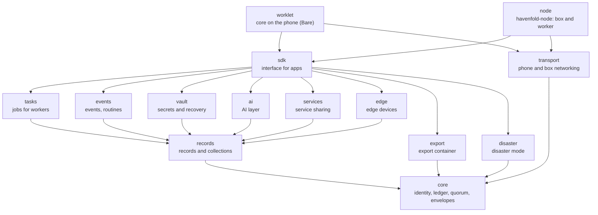
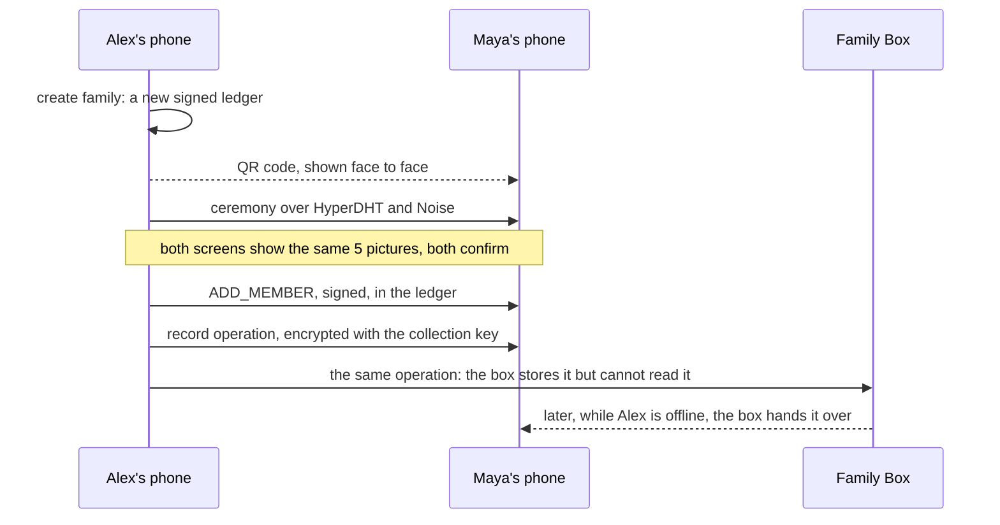

# Havenfold

**Havenfold turns the devices a family or a small business already owns into their own end-to-end encrypted
cloud, with no accounts and no centre.**

Website: [havenfolddev.com](https://havenfolddev.com)

[](https://github.com/havenfold/havenfold/actions/workflows/check.yml)
[](LICENSE)


[Türkçe: README.tr.md](README.tr.md)

## Why Havenfold

Most homes and small shops have a drawer of devices that still work: an old laptop, a retired phone, a tablet
nobody uses. Meanwhile their photos, documents and passwords live with cloud companies, and when a company shuts a
service down or raises its prices, the data goes with it or becomes expensive to keep. Havenfold turns those spare
devices, together with the family's phones, into the family's (or the team's) own cloud: people join face to face,
every device keeps its own keys, content is end-to-end encrypted, and no single device or company sits in the
middle. Even we cannot see your content, and we do not know who you are.

## Status

> **Pre-alpha.** Do not use Havenfold for real data. Interfaces, wire formats and on-disk formats may change
> without notice until the first tagged release.

| Component | State | Verified where | Missing |
|-----------|-------|----------------|---------|
| Ledger and ceremony (`core/core`) | Implemented: signed membership ledger, roles, quorum, proposals, in-person ceremony with 5 pictures | Unit tests on Node.js and Bare; multi-process tests on a local HyperDHT testnet | Hardware-backed device certificate (the P-256 fields are empty today) |
| Record layer (`core/records`) | Implemented: collections, encrypted signed operations, epoch keys, cutoffs, files, sync | Unit tests on Node.js and Bare; multi-device tests (two phones and a box) | Use in a real home |
| Task layer (`core/tasks`) | Implemented: capabilities, placement, worker checks, first-use approval, continuous tasks | Unit tests on Node.js and Bare; end-to-end test with a worker on a local testnet and a stand-in for Podman (`node/test/task-network.js`) | A worker running real jobs in a real home |
| Events and routines (`core/events`) | Implemented: event records, routines, rules, cases, notification ladder | Unit tests on Node.js and Bare | Use in a real home |
| Vault (`core/vault`) | Code exists: Shamir shares, thresholds, recovery, rotation | Unit and multi-device tests | Independent audit; it is not released before one |
| Transport (`core/transport`) | HyperDHT and Noise sessions, ceremony over the network. Behind the `deneysel: true` flag on phones; always on in the node | Local testnet tests; a first two-phone trial in a product app ([RFC-0036](docs/rfc/RFC-0036-katilimda-uygulama-ve-aile-adi.md)) | Hold and Mailbox routes; testing across real home networks |
| AI layer (`core/ai`) | The deterministic parts: normalisation, filters, routing, local index, assistant rules | Unit tests on Node.js and Bare | Models and their task images; calling a model is platform code outside this repository |
| Node software (`node`) | Supervisor, `havenfold` command, box and worker cores, privilege helper, systemd units. Update verification (signed manifest, package digest, rollback guard) exists as components | Unit tests; full installation in a virtual machine (next row) | Real hardware. The running supervisor does not yet run the update flow or load task images from the manifest. Disk health (SMART) is not measured yet and is reported as empty; temperature is read from sysfs and a worker above 90 °C takes no tasks. The cores run on Node.js today, Bare is planned |
| Installer USB (`installer`) | ISO build, automated install with LUKS2 and TPM binding, erase mode | Built and installed end to end on GitHub Actions in a virtual machine (QEMU, swtpm, Secure Boot): [`install.yml`](.github/workflows/install.yml) | Real hardware ([what remains](installer/BENIOKU.md)) |
| OCR task image (`images/task-ocr`) | Container image for `hf.task.ocr`, with a source archive | Built and run through the node's code path on GitHub Actions (amd64): [`image.yml`](.github/workflows/image.yml) | arm64 build; a real node |
| Phone apps | Not in this repository | — | They are separate, closed product repositories (Yuva) |
| Mailbox (blind envelope store) | Not in this repository yet | — | Moves here later, under AGPL-3.0 |
| Security | Audit package prepared ([`docs/audit/`](docs/audit/)) | Internal review rounds only | **No independent security audit yet** |
| Real use | — | — | **Havenfold has not yet run in a real home** |

The design is fixed in writing: more than 35 RFCs in [`docs/rfc/`](docs/rfc/) define the protocol, the layers and
their limits, and the code follows them, except where an RFC says a step is still open. The code is checked by tests on
two runtimes and by many internal review rounds. It has not been used for real yet, and nobody outside the project has
audited it. That is why it is pre-alpha. "Approved" (Onaylandı) on an RFC means approved by one person, the project
owner; see [GOVERNANCE.md](GOVERNANCE.md).

## In five sentences

1. Identity lives on the device. There are no user accounts on any server.
2. People join a community (a family or a team) face to face, through a short ceremony and signatures.
   Devices join through the same ceremony, but they never vote.
3. There is no centre inside a community: no main device, no main server, no main node. When a device is
   switched off, lost or stolen, the community keeps working.
4. Content is end-to-end encrypted. Relay services only carry sealed envelopes. Devices share work, but
   Havenfold never pretends they are one giant computer.
5. The core is open source.

## What Havenfold is not

- **Not a cluster operating system.** It does not merge the RAM and CPUs of several devices into one machine.
  Each task runs on one device; the largest single task a community can run is always shown.
- **Not a cloud service.** Data stays on the community's own devices. A cloud provider is only an optional
  accelerator that the user chooses.
- **Not an account system.** There is no sign-up, no password reset, no server that knows who you are.
- **Not a surveillance tool.** Adults cannot be monitored in secret. There is no face recognition database
  and no per-employee tracking.
- **Not a new cryptosystem.** Havenfold only uses libsodium (audited) and the widely used Holepunch libraries,
  with well-known algorithms. New constructions are protocol design and go to independent review.

## How it works



Arrows mean "depends on"; edges that follow from other edges are left out (the full lists are in each
`package.json`). `core` depends on no other Havenfold package.



- **Ledger and ceremony.** Every community has a signed, hash-chained ledger of members, devices, roles and
  collections. Joining happens in person: a QR code, then both screens show the same 5 pictures, then signatures.
- **Roles.** People vote, devices do not. Boxes, workers and cameras take part in no decision, so a stolen
  device cannot take over the community. Quorums and limits count people, not devices.
- **Record layer.** Shared data lives in collections whose readers and writers are in the ledger. Each change is
  an encrypted, signed operation; devices merge operations field by field and reach the same state in any order.
  When someone leaves, a new key epoch starts and a signed cutoff ends their writes.
- **Task layer.** A phone can hand a job (OCR, backup, later transcription) to a worker such as an old laptop.
  The worker checks the request against the ledger, runs it in a container without network access, returns the
  result and deletes its copy. A person's data never goes to a worker without that person's first-use approval.
- **Vault.** Keys that must survive a lost phone are split into Shamir shares held by family members and by
  devices with a TPM. No single holder, the box included, can open them alone.

The architecture walkthrough is [`docs/mimari.md`](docs/mimari.md) (Turkish); the English summary is
[`docs/en/OVERVIEW.md`](docs/en/OVERVIEW.md).

## Try it in five minutes

You need Node.js 22 (the version CI tests; Node.js 24 is not supported yet), npm and git, on Linux or macOS.

```bash
git clone https://github.com/havenfold/havenfold.git
cd havenfold
npm ci
(cd worklet && npm ci)
npm run demo
```

The demo starts each device as a separate process running the real core, on a local HyperDHT testnet on
`127.0.0.1`. Nothing leaves your machine, and everything is deleted at the end. Output of a real run:

```text
Havenfold demo: every device below is a separate process running the real core, on one machine.
Network: a local HyperDHT testnet on 127.0.0.1; nothing leaves this machine. Data: temporary directories.

  ✓ Started 2 devices: Alex's phone, Maya's phone (no accounts: each device makes its own keys)
  ✓ Alex created family "Rivera" (a new signed ledger on Alex's phone)
  ✓ Maya opened Alex's QR code; both phones showed the same 5 pictures: Pepper, Bicycle, Cheese, Bird, Crown
  ✓ Both confirmed; Maya joined as a parent (168 ms)
  ✓ Alex wrote a note; it appeared on Maya's phone in 27 ms: "Wi-Fi password is on the fridge"
    (the record is encrypted with the collection key and signed by Alex; only family members can read it)
  ✓ Stopped all processes and deleted the temporary directories (608 ms in total)
```

`npm run demo -- --box` adds a Family Box. These lines follow the note:

```text
  ✓ Alex added the Family Box with the same ceremony (pictures: Clover, Leaf, Star, Clover, Rocket); it has no vote (124 ms)
  ✓ The box keeps a sealed copy of the note but has no key for it (reading it on the box returns nothing)
  ✓ Maya's phone was off; Alex wrote another note, then Alex's phone was switched off too
  ✓ Maya's phone came back and got the note from the box in 246 ms: "Dentist on Tuesday at 10"
```

Pictures and timings change from run to run. The demo is [`scripts/demo.js`](scripts/demo.js); it reuses the
helpers of the end-to-end tests in [`worklet/test/`](worklet/test/).

## Getting started (developers)

Requirements: Node.js 22 (see [`.nvmrc`](.nvmrc); CI tests only 22, and some steps fail on 24 today), npm, git; Linux or macOS.

[Bare](https://github.com/holepunchto/bare) is Holepunch's small JavaScript runtime for mobile and embedded use.
On phones the Havenfold core runs inside a Bare worklet, so the core packages are tested on both Node.js and
Bare. Bare comes in as the `bare-runtime` devDependency; there is nothing extra to install.

```bash
npm ci                    # root workspace: core/*, sdk, tools/export-open, node
(cd worklet && npm ci)    # the phone package has its own lockfile
```

Fast path while you work on one package:

```bash
cd core/records && npx brittle-node test/*.js
```

`npm test` runs [`scripts/check.sh`](scripts/check.sh), the same check CI runs: every package's tests on
Node.js, the core packages and the SDK again on Bare, the installer and service tests, independent regeneration of
the protocol test vectors, the SPDX header and dependency license checks, derivation-label checks, coverage
thresholds for critical modules, the phone package's own checks and a short fuzzing run. It takes about
5 minutes on a GitHub Actions runner and longer on a laptop.

## Running a Family Box (experimental, needs spare hardware)

A Family Box is a Linux machine that stays on, holds sealed copies and vault shares, and keeps the community
reachable. Today it needs a spare machine with Ubuntu Server 24.04 and a TPM 2.0 chip, and a phone running a
Havenfold-based app to scan its QR code (the phone apps are not in this repository).

```bash
sudo bash node/deploy/havenfold-install-sudo.sh
havenfold status
havenfold join --role kutu
```

The script header lists exactly what it changes and how to remove it. It does not touch SSH, the network,
the firewall or the disks. For new machines, the Installer USB in [`installer/`](installer/BENIOKU.md) installs
everything, including disk encryption; it has been verified in a virtual machine on GitHub Actions but not yet on
real hardware.

## Repository layout

| Path | What it is | License |
|------|------------|---------|
| `core/core` | `@havenfold/core`: identity, key derivation, signatures, ledger, policy, quorum, sync, envelopes | MPL-2.0 |
| `core/records` | `@havenfold/records`: record layer: collections, records, encrypted operations, sync, files (RFC-0001) | MPL-2.0 |
| `core/tasks` | `@havenfold/tasks`: task layer: capabilities, task envelopes, worker checks, first-use approval, placement, coordinator, continuous tasks (RFC-0002) | MPL-2.0 |
| `core/vault` | `@havenfold/vault`: vault: Shamir shares, threshold, backup index, vault envelope, share requests and rotation (RFC-0004); not released before an independent audit | MPL-2.0 |
| `core/vault/bare-crypto` | A small `crypto` shim so that a vault dependency also runs on Bare | MPL-2.0 |
| `core/events` | `@havenfold/events`: event records, type catalogue, routines, rules, cases, notification ladder, cards (RFC-0006) | MPL-2.0 |
| `core/transport` | `@havenfold/transport`: phone and box transport over HyperDHT: pair rendezvous, sessions with HELLO, ceremony (RFC-0028); off by default on phones | MPL-2.0 |
| `core/ai` | `@havenfold/ai`: shared AI code for phones and workers: normalisation, filters, routing, extraction, index, assistant, child mode (RFC-0013) | MPL-2.0 |
| `core/services` | `@havenfold/services`: service sharing: service cards, directory, QR card, encrypted packages, consent and revocation (RFC-0010) | MPL-2.0 |
| `core/edge` | `@havenfold/edge`: edge devices: run profiles, placement checks, edge configuration with visible monitoring, encrypted camera frames (RFC-0008) | MPL-2.0 |
| `core/export` | `@havenfold/export`: export container: an Argon2id and XChaCha20-Poly1305 stream around a ZIP archive (RFC-0014) | MPL-2.0 |
| `core/disaster` | `@havenfold/disaster`: disaster mode: messages and seals, recipient checks, state machine, store-and-forward, local network discovery (RFC-0012) | MPL-2.0 |
| `worklet` | `@havenfold/worklet`: the core as it runs inside a phone app: persistent state, command channel, sync | MPL-2.0 |
| `node` | `havenfold-node`: supervisor, `havenfold` command, local IPC, health, signed updates, privilege helper, systemd units (RFC-0007) | MPL-2.0 |
| `installer` | Installer USB, installation on an existing Ubuntu, erase mode (RFC-0007) | MPL-2.0 |
| `images` | Task images: `task-ocr` (a container); `task-backup` is only a contract, because backup is a built-in job | Apache-2.0 |
| `sdk` | `@havenfold/sdk`: the interface products use, with TypeScript types (RFC-0015) | Apache-2.0 |
| `protocol` | Number allocations (event types, command ranges) and test vectors | Apache-2.0 |
| `services/receiver` | Reference receiver for service packages (RFC-0010); separate server software, never shipped in a product or on a phone | AGPL-3.0-only |
| `tools/export-open` | Opens an export container without installing Havenfold | Apache-2.0 |
| `scripts` | `check.sh` (the full check), the demo, and the license, SPDX, vector and coverage tools | MPL-2.0 |
| `test/fuzz` | Saved inputs for the fuzz tests (`scripts/fuzz.js`) | MPL-2.0 |
| `docs` | Architecture, RFCs, audit package, SDK guide, release process; English documents in `docs/en/` | CC BY 4.0 |
| `arastirma` | Research written before the founding; historical, in Turkish | CC BY 4.0 |

Code comments and most design documents are in Turkish; see [Language](#language).

## Compared with

| Project | What it does well | How Havenfold differs |
|---------|-------------------|------------------------|
| [Syncthing](https://syncthing.net/) | Mature, reliable peer-to-peer file sync with no accounts | Havenfold syncs structured records with roles, permissions and key epochs, and hands work to devices; it is far younger |
| [Nextcloud](https://nextcloud.com/) | A complete self-hosted suite with many apps | Nextcloud needs a server, an administrator and user accounts. Havenfold has no accounts and no machine everything depends on, but nothing like Nextcloud's breadth |
| [Matrix](https://matrix.org/) | Open, federated, end-to-end encrypted messaging at scale | Matrix accounts live on homeservers; Havenfold identities live on devices, and communities are small and closed |
| [Home Assistant](https://www.home-assistant.io/) | Local home automation with a very large integration ecosystem | Havenfold is not an automation hub but an encrypted data and device layer. Running Home Assistant on a worker is planned for a later phase |
| [Keet](https://keet.io/) and Holepunch | Proven peer-to-peer networking and apps without servers in the middle | Havenfold uses Holepunch's HyperDHT and Bare, and adds a community ledger, roles, records, tasks and a vault on top |

## Language

The project's first team and first users are Turkish. Package, directory, file, class, method, event, error and
command names are English. Code comments, commit messages, the RFCs and most design documents are still in Turkish
and are being translated. This README, the contribution files and the documents in [`docs/en/`](docs/en/) are in
English, and the [glossary](docs/en/GLOSSARY.md) explains the Turkish terms that remain.

Some values keep their Turkish spelling because they travel between devices, are signed into the ledger or are
stored on disk, and changing them would break devices already in use. These are protocol labels, for example the
role names `ebeveyn` (parent) and `cocuk` (child), key derivation labels such as `hf/toren/…`, record types such as
`hf.sos.alindi`, and the codes carried in `TASK_REJECT` and edge stream messages. In code they are reached through
English constant names.

Where a translation and the Turkish original differ, the Turkish original prevails. Issues, pull requests and
reviews are welcome in English or Turkish.

## Documentation

- Founding document: [`KURUCU-BELGE.md`](KURUCU-BELGE.md) (Turkish, authoritative) and
  [`docs/en/FOUNDING-DOCUMENT.md`](docs/en/FOUNDING-DOCUMENT.md) (English). Principles, architecture, names,
  numbers, licensing and roadmap.
- [`docs/en/OVERVIEW.md`](docs/en/OVERVIEW.md): a two-page English overview.
- [`docs/en/RFC-INDEX.md`](docs/en/RFC-INDEX.md): every RFC with a short English summary.
- [`docs/en/GLOSSARY.md`](docs/en/GLOSSARY.md): the Turkish terms in code and documents, in English.
- [`docs/rfc/`](docs/rfc/): the RFCs. Every change to the protocol or the core goes through one.
- [`docs/mimari.md`](docs/mimari.md): architecture walkthrough for new developers, tied to files and functions.
- [`docs/audit/`](docs/audit/): audit package: cryptographic inventory, key life cycle, attack surface, threat
  model, known limits.
- [`docs/sdk-rehberi.md`](docs/sdk-rehberi.md): SDK guide for product developers.
- [`docs/surum.md`](docs/surum.md): how a release is built and signed.

## Roadmap

| Phase | Goal | Where it stands |
|-------|------|-----------------|
| 0 · Founding | Founding document, the four base RFCs, the repository | Done; more than 35 RFCs approved |
| 1 · Home Machine v0 | Record, task and event packages; `havenfold-node`; OCR and backup tasks; erase mode; public repository | Packages, node software, OCR image and Installer USB exist, and the repository is public. Next: the Home Machine running in real homes |
| 2 · Yuva Defteri v0 | First product apps on the core; transcription and local language model tasks | Product apps are being built in separate repositories |
| 3 · Vault and expansion | Vault release, Installer USB for everyone, Windows/macOS and Raspberry Pi workers, **independent security audit** | Not started; the audit package is ready |
| 4 · Opening and hardware | Container apps, local service tunnel, Home Assistant integration, Yuva Kutusu and Mekan Kutusu hardware | Not started |

Next steps: the Home Machine running in real homes, an independent security audit, and the first tagged release
(`v0.1.0-alfa`), whose release manifest is signed offline with the release root key
([`docs/surum.md`](docs/surum.md)); no release has been published yet.

## Licensing

Havenfold uses several licenses on purpose. Each package states its license in `package.json`, each source file
carries an SPDX line (MPL-2.0 files also carry the MPL-2.0 Exhibit A notice below it), and the full texts are in
[`LICENSES/`](LICENSES/). Markdown files carry no SPDX line; the directory's `LICENSE` file and this section cover them.

- **MPL-2.0** for the core, the phone package, the node software and the installer. File-level copyleft: you
  may ship the core inside a closed product, but changes to the core's files must be published. MPL-2.0 is
  compatible with app store distribution.
- **Apache-2.0** for the test vectors and number allocations, the SDK, `export-open` and the task images, so anyone
  can implement Havenfold without hesitation. It includes a patent grant.
- **AGPL-3.0-only** for server-side reference code: today `services/receiver`, later the Mailbox and the
  relay when they move here.
- **CC BY 4.0** for documentation, including `KURUCU-BELGE.md`, `arastirma/` and the README files.

The root [`LICENSE`](LICENSE) file is MPL-2.0 and applies wherever no other license is stated. See also
[`NOTICE`](NOTICE). Copyright © 2026 Eser Teknoloji and contributors.

Havenfold publishes its innovations openly as a defensive publication: Eser Teknoloji files no patent
applications for them, and contributors' patent licenses come from MPL-2.0 §2.1(b) and Apache-2.0 §3.

## Commitments

- Published code will not be relicensed under a more restrictive license.
- A free feature will not be moved to a paid tier.
- If the project is sold, the trademark and the repository will be transferred to a foundation.

## Contributing, security, governance

- [CONTRIBUTING.md](CONTRIBUTING.md): how to contribute. Contributions are accepted under the
  Developer Certificate of Origin (`Signed-off-by`); there is no CLA.
- [SECURITY.md](SECURITY.md): how to report a vulnerability (90-day coordinated disclosure).
- [GOVERNANCE.md](GOVERNANCE.md): who decides and how.
- [TRADEMARKS.md](TRADEMARKS.md): use of the Havenfold, EserX, Yuva and Mekan names.
- [CODE_OF_CONDUCT.md](CODE_OF_CONDUCT.md).

Havenfold is developed by Eser Teknoloji. Products built on it are separate, closed products: [Yuva](https://yuvaapp.org)
for families (Yuva Defteri, Acil, Pati and Bakım) and, in a later phase, [Mekan](https://mekanapp.com) for workplaces.

### Origins

The first code of the core came from Yuva Hat, Eser Teknoloji's family messaging app; the copied files and their
source commits are listed in [`core/core/KAYNAK.md`](core/core/KAYNAK.md). Yuva Hat's history will be moved into
this repository later.
