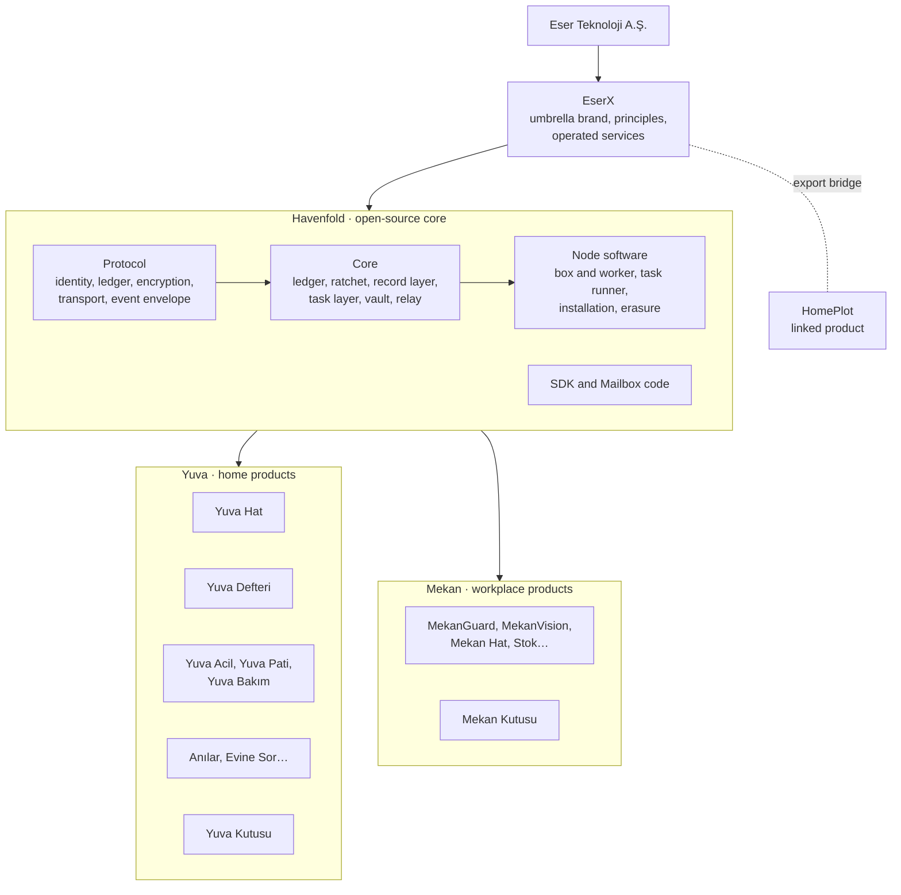
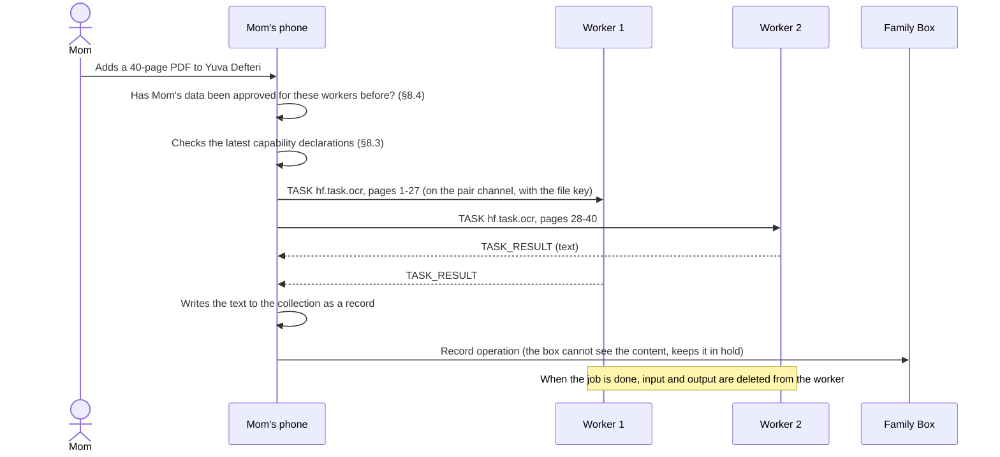

> English translation of the Havenfold Founding Document, version 1.24 (25 October 2026). The Turkish original (`KURUCU-BELGE.md`) is authoritative; where the two differ, the Turkish text prevails (§0).

# Havenfold Founding Document

> Version 1.24 · 25 October 2026 · Eser Teknoloji
> Status: **In force.** Kerem approved 1.0 on 23 October 2026. 1.1 incorporates the approved RFC-0001–0004 (same day). 1.2 incorporates the approved RFC-0005–0016 (same day). 1.3 incorporates the decision to make Yuva Defteri a separate app, and RFC-0017 (same day). 1.4 incorporates the scope of Yuva Defteri (RFC-0018) (same day). 1.5 incorporates the addenda that came back from implementation (RFC-0019) (same day). 1.6 incorporates the decisions from the ledger review (RFC-0020) (same day). 1.7 incorporates the decisions from the vault and container review (RFC-0021) (same day). 1.8 incorporates the decisions from the team review (RFC-0022) (same day). 1.9 incorporates implementation addenda 3, the crisis meaning layer and the AI core decisions (RFC-0023) (same day). 1.10 incorporates the command channel between the app and the core on the phone, and the graded response in crisis detection (RFC-0024) (same day). 1.11 incorporates the class of a new file and the missing commands of the channel (RFC-0025) (same day). 1.12 incorporates update security on the node (RFC-0026) (same day). 1.13 incorporates the persistence of the core on the phone, vault recovery, the personal bridge and the derivation rule (RFC-0027), and the phone transport (RFC-0028) (24 October 2026). 1.14 incorporates making Yuva Acil, Yuva Pati and Yuva Bakım separate apps (RFC-0029) (same day). 1.15 incorporates limited writing by guests (RFC-0030) (same day). 1.16 incorporates SOS fields and the caregiver's SOS (RFC-0031) (same day). 1.17 incorporates time of day in rules, the multi-day window and the closing event (RFC-0032) (same day). 1.18 incorporates the public opening schedule and the additions that came out of the opening work (RFC-0033) (same day). 1.19 incorporates several families on one phone (RFC-0034) (25 October 2026). 1.20 incorporates the narrowing of the opening gate (RFC-0035) (same day). 1.21 incorporates the app announcement and the family name at joining (RFC-0036) (25 October 2026). 1.22 incorporates per-person SOS delivery (RFC-0037) (25 October 2026). 1.23 incorporates the pre-opening content corrections (RFC-0038) (same day). 1.24 adds the screen edge rule (§16.2) (same day; Kerem).
> This document is the top document for all software under EserX. It is read from start to finish before any new app, module, device support or repository is started.

---

## 0. How to use this document

| Topic | Rule |
|------|-------|
| Who reads it | Everyone who writes code, documentation or product decisions in EserX: Kerem, every Claude session, every agent machine, and later, outside contributors. |
| When it is read | When starting a new app or module, when opening a new repository, in any work that touches the protocol or the core, and when the architecture of a product changes. |
| Approved RFCs | Approved RFCs (`docs/rfc/`) are a binding part of this document. Where this document summarizes a topic and links to an RFC for detail, the RFC prevails on the detail. Approved today: RFC-0001 record layer, RFC-0002 task layer, RFC-0003 ledger v2.1, RFC-0004 vault, RFC-0005 Mekan team community, RFC-0006 events and routines, RFC-0007 node software and updates, RFC-0008 containerless worker and Android edge device, RFC-0009 Yuva Bağlantı, RFC-0010 service sharing, RFC-0011 container apps and local tunnel, RFC-0012 disaster mode, RFC-0013 AI layer, RFC-0014 export container, RFC-0015 SDK common fields, RFC-0016 addenda to approved documents, RFC-0017 multiple apps in the same family, RFC-0018–0038 (full list: `docs/rfc/README.md`). |
| Precedence | On architecture, principles, names and number allocation, **this document** prevails. From the moment a number or field allocated by this document is written into code and recorded in `KARARLAR.md`, **`KARARLAR.md`** is binding at the byte level. Product documents follow both. |
| Conflict | If a product document conflicts with this document, the product document is corrected. If this document is wrong, it is changed by the procedure in §23. No one silently acts differently. |
| Change | Only through a written change proposal (RFC) and Kerem's approval. Every change increments the version and adds a row to §22. |
| Language | Turkish. When the repository is made public, an English version is written; where they conflict, the Turkish prevails. |

---

## 1. Executive summary

**Havenfold is the open-source core that turns the devices in a home or workplace into one secure local cloud.** Phones, old laptops, old Androids, cameras and the boxes Eser will sell speak the same protocol, join the same community and appear as one whole. All of Eser's products run on top of this core.

**Havenfold in five sentences:**

1. Identity lives on the device. There are no user accounts on any server.
2. People join a community (a family or a team) through an in-person ceremony and signatures. Devices are added through the same ceremony but do not vote.
3. There is no center inside the community: no main device, no main server, no main node. When a device is switched off, lost or stolen, the community does not lock up.
4. Content is end-to-end encrypted. Eser's services carry only sealed envelopes. Home devices share the work, but the lie of "one giant computer" is not told.
5. The core is open source. The products, the operated services and the trained models belong to Eser.

**Why it exists:** Homes and workplaces have devices that still work but sit unused. Wiped and made secure, they can become the family's or the business's own cloud. When cloud companies shut down, data is lost; in Havenfold, data stays with its owner.

**Status today (25 October 2026):**

- In code and tested in this repository: the record layer, the task layer, the vault, events and routines, the phone and box transport, the on-device parts of AI, the core of disaster mode, the node software, the Installer USB and the OCR task image. The tests run on Node and on Bare (`npm test`).
- It has not run in a real home yet. No independent security audit has been done; the vault is not released before the audit (§13.3).
- The phone apps (Yuva Hat, Yuva Defteri, Yuva Acil, Yuva Pati, Yuva Bakım) are developed in separate, closed repositories. Yuva Hat's communication backbone (HyperDHT + Noise, Aile Defteri (Family Ledger), Double Ratchet, Posta Kutusu (Mailbox), doorbell ticket) runs inside that app today; moving the core into this repository is in §18.4.

---

## 2. Layer diagram



| Layer | Name | What | Whose | Open? |
|--------|----|----|-------|---------|
| Company | **Eser Teknoloji** (ESER TEKNOLOJİK PAZARLAMA A.Ş.) | Owner, developer, seller | — | — |
| Umbrella | **EserX** | Brand of the product family, shared principles (§3), operated services: Mailbox operation, service gateway (in Türkiye; RFC-0010), AI gateway ("Dışarı sor" / "Ask outside" and the Yuva Aile cloud quota; RFC-0013), Yuva Bağlantı infrastructure (Bağlantı gateway, Bağlantı relay, transfer store; RFC-0009) | Eser | The brand and service operation are Eser's. The gateways' protocol is open; their operation is Eser's. |
| Core | **Havenfold** | Protocol, core code, node software, SDK, Mailbox code | Eser starts it, the community contributes | **Open source** (§17) |
| Home products | **Yuva** | Yuva Hat, Yuva Defteri, Yuva Acil, Yuva Pati, Yuva Bakım, Anılar, Yuva Kutusu… Each is a separate app and is installed on its own (RFC-0017, RFC-0029). | Eser | Closed |
| Workplace products | **Mekan** | MekanGuard, MekanVision, Mekan Hat, Stok, Kuyumcu, Mekan Kutusu… | Eser | Closed |
| Linked product | **HomePlot** | Measurement-based space design. It has its own cloud and connects to Havenfold through export (§15.4). | Eser | Closed |

### 2.1 Name mapping (old name → new name)

Old names stay in code and in older documents for a while. Everything newly written uses the new name.

| Old name | New name | Note |
|---------|---------|-----|
| EserX Protokolü, YUVA Protokolü v2 | **Havenfold Protocol v2** | The version number does not change, only the name. |
| EserX Çekirdek, YUVA Çekirdeği, YUVA Worklet | **Havenfold Core** | The code stays in the Yuva Hat repository under the name `@yuva/worklet`; for the move, see §18.4. |
| Kutu yazılımı (box software), `yuva-kutu` package, Mekan Edge Runtime | **Havenfold Node** (`havenfold-node`) | §9. |
| Event namespace `x.` | **`hf.`** | `x.` has not been used in code yet; it is removed before it is used. |
| Kasa ve Evin Dosyası (Vault and Home File; Yuva catalog) | **Yuva Defteri** | §15.2. |
| EserX (umbrella) | **EserX** (unchanged) | It is written EserX. |

### 2.2 Names that can be confused

- **Aile Defteri (Family Ledger) / ledger:** The community's signed membership record. It is part of the protocol. In the app it is shown to the user as the **"family record"** ("aile kaydı") (§15.1).
- **Yuva Defteri:** The family's shared information and vault product, with the @Yuva assistant inside. It is a separate app installed on its own. It is a product, not a part of the protocol.
- **Aile Kutusu (Family Box):** The box **role** (in software, on an old device).
- **Yuva Kutusu / Mekan Kutusu:** The **hardware** Eser sells. It runs one box identity and one worker identity together (§6.1).
- **Yuva Bakım / Bakım Masası:** Yuva Bakım is the elderly and child care app. Bakım Masası (Care Desk) is the medication and appointment section of Yuva Defteri.

---

## 3. Principles

EserX's ten principles (umbrella document §3) apply as they are. If a feature violates any of them, it is not released:

1. No accounts; identity lives on the device.
2. In-person joining; remote joining is an exception with extra locks.
3. One vote per person; devices, boxes and cameras do not vote.
4. No one can read the content; Eser's services carry only sealed envelopes.
5. Data stays in place; the cloud is an accelerator the user chooses.
6. Leaving the community requires approval; with a one-time, time-limited, clearly scoped package.
7. Visible monitoring; an adult cannot be monitored in secret.
8. Guidance, not diagnosis.
9. No lock-in; data is exported in an open format.
10. Honest language: never say "There is no server." Say "Even we cannot see your content, and we do not know who you are."

Havenfold adds seven principles to these:

| # | Principle | Meaning |
|---|------|--------|
| H1 | **Centerless cluster** | There is no permanent manager node inside the community. The device that wants the work distributes it (§8.5). No control-plane server, Tailscale/Headscale or k3s control node is used. |
| H2 | **One protocol, one core** | Phones, boxes, workers and Eser's hardware run the same core. No second implementation of the protocol is written. |
| H3 | **Devices do not vote** | Boxes, workers, cameras and watches take part in no decision. A stolen device cannot take over the community. |
| H4 | **Separate the role, separate the knowledge** | The one that sees traffic metadata (the box) and the one that sees the content of the work (the worker) are separate identities. An identity sees only what its role requires. If both run on the same hardware, they run as two separate identities, in two separate processes, with separate keys (§6.1); the user is told about this. |
| H5 | **Honest "one machine"** | Devices are shown on screen as one machine, but RAM and processors are not merged. The "largest single job" limit is always stated. |
| H6 | **Safe retirement** | Every device that leaves the community is securely erased, and a record of this is kept. The battery, temperature and health of old devices are monitored. |
| H7 | **We do not write our own crypto** | Only the algorithms in §13.2 and audited libraries. A new construction is protocol design, not an algorithm; it goes to independent audit. |

**Never done:**

- Merging the RAM and processors of devices under one operating system (MOSIX, Kerrighed style). The network is thousands of times slower than local memory; when one device drops, the whole system crashes.
- Making an iPhone or iPad a node that does computation. iOS does not allow background work.
- Adding game consoles to the cluster.
- Writing our own encryption algorithm or our own camera recording system (NVR) from scratch.
- In Mekan, monitoring employees individually, building a face recognition database, or recognizing emotions.
- Downloading code to the phone remotely (store rule). Every product is its own app; an app's modules ship inside that app.

---

## 4. Core concepts

| Concept | Definition | In Yuva | In Mekan |
|--------|-------|---------|----------|
| **Community** | Security boundary. It has its own ledger and keys. Its type is `aile` (family) or `ekip` (team). | Immediate family | Business team |
| **Place** | Physical location. | Main home, summer house | Branch, warehouse |
| **Person (member)** | A human in the community. Votes according to role. Limits, quorums and vault thresholds count persons. Identified in the ledger by a permanent person identity (RFC-0017). A phone is a member of at most 3 families; it has a separate identity and person ID in each family, and the families do not see each other (RFC-0034). | Parent, adult, child | Owner, manager, employee, temporary |
| **Primary identity** | The person's identity that votes, counts toward the person limit and holds a vault share. Every person has exactly one primary identity. | The first Yuva app on the phone | The first Mekan app on the phone |
| **Secondary identity** | The same person's identity in another EserX app or on another of their own devices. At most 4 per person. Does not vote, does not count toward the limit, does not hold a vault share; carries the person's role and read/write permissions (RFC-0017). | Yuva Defteri on the same phone, the person's tablet | The person's second work app |
| **Box** | A non-voting member role that carries traffic: relay, hold, doorbell, backup store. Does not see content. | At most 1 | §6.2 |
| **Linked device** | A device added to the community that is not a member. Classes: worker, edge device, accessory. | Old laptop, old tablet, camera | Edge PC, tablet |
| **Worker** | A linked device that does work: OCR, speech-to-text, backup, image analysis, local model. Sees the content of the work given to it. | Old laptop | Mekan edge PC |
| **Edge device** | A linked device that senses or displays: camera, sensor, screen. | Old Android camera, TV | Cash register tablet |
| **Accessory** | A device for notifications and approvals only. | Watch | — |
| **Guest** | A non-member person with time-limited, narrow access (caregiver, guest). Their own device is introduced through a ceremony (§6.3, `GRANT`). | Caregiver | Subcontractor |
| **Collection** | An encrypted compartment of shared data. Its readers and writers are in the ledger. | "Tüm Aile" (Whole Family), "Ebeveynler" (Parents) | "Ekip" (Team) |
| **Record** | A single item of information in a collection. | Wi-Fi password, medication list | Shelf, supplier |
| **Task** | A job a member gives to a worker. | OCR this 40-page document | Analyze the camera |
| **Capability** | A declaration of what a device can do (§8.3). | "I can do OCR" | "OpenVINO available" |
| **Event** | A signed, standard record (§12). | Coki went to the litter box | Stock on a shelf ran low |
| **Routine** | A learned normal band for a subject and event type. Runs on the phone (RFC-0006). | Mom's morning medication | Morning opening time |
| **Rule** | A fixed condition independent of learning. Runs on the phone or on a worker (RFC-0006). | No food for 12 hours | Cold room above 8 °C |
| **Case** | The shared state of a deviation or a rule trigger; the notification ladder is tied to it. Its identity is deterministic (RFC-0006). | "Mom did not take her medication" | "The cold room warmed up" |
| **Card** | The subject's face in the community chat (RFC-0006). | Coki's card | The cold room's card |
| **Service** | A business outside the community, called through an approved package. It is not a member or a guest; it does not see the ledger or the keys (RFC-0010). | Veterinarian, maintenance | Security company, supplier |
| **Ev Makinesi (Home Machine) / Mekan Makinesi (Venue Machine)** | The display of all linked devices on one card (§8.8). | Home Machine | Venue Machine |
| **Leaving the community** | Four routes: bond, personal bridge, service sharing, export. There is no other route. Export is done with the Havenfold container (RFC-0014). | Umbrella §9 | Umbrella §9 |

---

## 5. Architecture

### 5.1 Components

| Component | What it does | Where it runs | Status today |
|---------|----------|----------------|---------------|
| **Protocol** | Identity, ledger events, pair secret, ratchet, rendezvous, handshake, envelope, doorbell ticket, event envelope, test vectors | Document | Number tables and test vectors in `protocol/`; the protocol's text is in the RFCs |
| **Core** | The protocol's code, JavaScript | Bare Worklet on the phone; Node 22 on the node today (§9.1) | In code and tested: `core/core` (initially copied from Yuva Hat, `core/core/KAYNAK.md`); the phone package is `worklet/` |
| **Record layer** | Collections, records, sync, files | Inside the core | In code and tested (`core/records`, §7) |
| **Task layer** | Capability declaration, task messages, placement, continuous tasks | Inside the core | In code and tested (`core/tasks`, §8) |
| **Vault** | Shamir shares, recovery | Inside the core | In code and tested (`core/vault`); not released before an independent audit (§10, §13.3) |
| **Node software** | Runs the box and the worker 24/7: core + supervisor + health + updates + erasure. Target: the cores on Bare; today the box, the worker and the supervisor run on the Node 22 shipped with the package (§9.1). Work that needs root privileges is done by the `havenfold-yetki` helper. | Linux (first), then Windows and macOS (RFC-0008) | In code and tested (`node/`); has not run in a real home yet. Detail: RFC-0007. |
| **Installer USB** | Installation, erase mode | Linux | In code and tested (`installer/`; §9.2, §9.5) |
| **SDK** | The TypeScript interface through which products use the core. Common fields and helpers are in RFC-0015. | Product apps | `@havenfold/sdk` (`sdk/`), with TypeScript types |
| **Mailbox** | Blind envelope store and doorbell gate | Cloudflare Worker | Live; its code is not in this repository yet (§18.4) |
| **Service gateway** | Stores and delivers service packages; publishes the service directory. Its protocol is open; its operation is Eser's. | Eser's server, in Türkiye | **To be written** (RFC-0010). Package code `core/services`, reference receiver `services/receiver` |
| **AI gateway** | Forwards "Ask outside" text anonymously to a language model provider; counts the Yuva Aile cloud quota; does not store the text. Its protocol is open; its operation is Eser's. | Eser's server, in Türkiye | **To be written** (RFC-0013) |
| **Task images** | OCR, audio, backup, image jobs | Container on the worker; distributed as an `oci-archive` file with the digest in the manifest | `images/task-ocr` in code and tested; `hf.task.backup` is a built-in job. The others are to be written (§8.7) |

### 5.2 What each device can be

| Device | Core | Box | Worker | Edge device | Note |
|-------|----------|------|------|----|-----|
| iPhone | Bare Worklet | ✗ | ✗ | Old iPhone only: screen edge device, in the foreground | Member phone: holds a share, gives approvals, shows the panel. |
| Android phone (a member's) | Bare Worklet | ✗ | ✗ | ✗ | Member phone. |
| Old Android phone/tablet | Bare Worklet | ✓ (Yuva Hat box mode) | ✗ | ✓ camera, screen, sensor | No Docker, no heavy work. Box and edge device are never on the same device (RFC-0008). |
| Old laptop/desktop (converted to Linux) | Bare/Node | ✓ | ✓ | — | The main worker. |
| Old laptop (Windows/macOS, not wiped) | Bare/Node | ✓ only with always-on approval | ✓ OCR and speech-to-text only, containerless | — | Phase 3. Tray app (RFC-0008). |
| Intel tablet (converted to Linux) | Bare/Node | ✓ | ✓ light | ✓ screen | 2–4 GB RAM. |
| Raspberry Pi (4 GB+) | Bare/Node | ✓ | ✓ light | ✓ sensor bridge | ARM64, Phase 3. |
| Yuva Kutusu / Mekan Kutusu | Bare/Node | ✓ | ✓ | ✓ sensor | Eser hardware, two identities. |
| Android TV / Google TV | Bare Worklet | ✗ | ✗ | ✓ screen | Phase 4. |
| Old Chromecast | — | ✗ | ✗ | Passive screen only | No critical tasks are given. |
| IP camera, old DVR/NVR | — | ✗ | ✗ | Source | Connected to a worker; only the video is read (§6.7). |
| Smartwatch | Through the phone app | ✗ | ✗ | Accessory | Notifications and approvals. |
| Game console, e-reader | — | ✗ | ✗ | ✗ | Not supported. |

**Minimum hardware for a worker:** x86-64 (roughly 2012 and later) or ARM64; 4 GB RAM (8 GB recommended); 64 GB disk; wired network recommended.

### 5.3 Example flow: Mom has a document OCR'd



---

## 6. Community, membership and devices

> In a team community, the "parent" rules in this document are read as owner or manager (including §6.8, §9.5 and §10.2). Detail: RFC-0005 §14.

### 6.1 Entities in the ledger

The ledger holds four kinds of entities:

1. **Members** (`members`): The identities of persons, and the box. Today's code and rules stay as they are.
   - Each family membership of a phone is a separate identity; identities on the same phone are separate persons, per family (RFC-0034).
   - A person can have one primary identity and at most 4 secondary identities. A secondary identity is tied to the person by the `personOf` field (RFC-0017).
   - A secondary identity carries the person's role. It does not vote, does not count toward the person limit and does not hold a vault share.
   - A second EserX app on the same phone becomes a secondary identity through the local channel that the operating system opens only to apps of the same developer, with biometric approval. The person's other devices are added through an in-person ceremony.
   - An identity's app is in `APP_ATTACH` for a secondary identity, and for every identity in its own `hf.uygulama` record; an unknown app is not counted as "absent". A person's app is "present", "absent" or "unknown"; a person cannot hide their apps from the family (RFC-0036).
2. **Linked devices** (`devices`, new): Worker, edge device, accessory.
   - They do not count as members, do not vote and do not count toward the `policy.maxMembers` limit.
   - They do not publish PREKEYs and do not join the message chat.
3. **Guests** (`grants`, new): Non-member persons with time-limited access.
4. **Collections** (`collections`, new): The compartments of shared data and their permissions.

**Combined device.** A Yuva Kutusu, a Mekan Kutusu, or a single old laptop that will be both box and worker carries two separate identities:

- One `ADD_MEMBER { role: 'kutu' }` membership and one `DEVICE_ATTACH { class: 'isci' }` record.
- Two separate processes run (`havenfold-kutu`, `havenfold-isci`). They have separate key files and separate vaults.
- Two ceremonies are done back to back in one installation session: first the box, then the worker. The identities are shown on the same card through `hostId` (RFC-0007).
- The box process does not see content; the worker process does not see traffic metadata. But because the disk and the operating system are shared, someone who takes over the device can see both. The installation screen says so.

### 6.2 Limits

| Limit | Yuva | Mekan |
|-------|------|-------|
| Person members | 8 (in code `HARD_MAX_MEMBERS=8`; an increase needs an RFC) | 32 (`HARD_MAX_MEMBERS_EKIP`); above 8 a box is mandatory |
| Secondary identities per person | 4 | 4 |
| Parents (Yuva) / owners (Mekan) | 2 (`MAX_PARENTS=2`) | At most 3 owners (`MAX_OWNERS`) |
| Box | 1 (in code `BOX_LIMIT`, per family) | 1 per place |
| Linked devices (worker + edge device + accessory) | 16 | 16 per place, 64 in total |
| Active guests | 4 | 8 |
| Communities a box or linked device can be a member of | 1 | 1 |
| Families a phone can be a member of | 3 (does not change with payment; guest access does not count; a phone in the child role needs parental permission; RFC-0034) | Team: separate RFC |

**Counting persons:** The person, parent, owner and boxless team limits count only primary identities; secondary identities are outside the limits in both families and teams (RFC-0017 §4.3).

**Mekan column:** Team roles (owner, manager, employee, temporary), quorums, assignment to places and team size are in RFC-0005. A team without a box can have at most 8 persons; the 9th person requires at least one active box. Mekanapp keeps working as it does today until it finishes stages M0–M4 (§15.5).

### 6.3 New ledger events (protocol v2.1 and v2.2)

> Detail and binding text: **RFC-0003**; for 34–35, **RFC-0017**. The table below is a summary. Team signatures are in RFC-0005 §6.2.

| No | Event | Who signs (Yuva) |
|----|------|--------------------|
| 13 | `DEVICE_ATTACH` | New device + any parent |
| 14 | `DEVICE_DETACH` | Any parent, or the device itself |
| 15 | `PLACE` | Any parent |
| 16 | `BEING` | Any parent |
| 17 | `GRANT` | Guest device + any parent |
| 18 | `REVOKE` | Any parent |
| 19 | `SHARE_CONSENT` | The owner of the data; a parent for a child's data |
| 20 | `KIND` | Only the founder at seq 1; exempt from the level gate. `ekip` is valid through RFC-0005. |
| 21 | `COLLECTION` | Normal: any parent. Vault: all parents. Personal: only its owner. |
| 22 | `PROTOCOL_LEVEL` | Any parent |
| 23 | `TASK_PERMIT` | Any parent |
| 24 | `ASSIGN` | Team only: any owner; if the target is an employee, a temporary member or a device, a manager within their management scope may also sign (RFC-0005) |
| 25 | `TERM` | Team only: any owner, or a manager within their management scope (RFC-0005) |
| 26 | `NOTICE` | Team only: any owner; camera notice (RFC-0005) |
| 34 | `APP_ATTACH` | New secondary identity + the person's primary identity; no other approval needed (RFC-0017, level 2.2) |
| 35 | `APP_PRIMARY` | New primary identity + old primary identity; if the old one does not sign, a 72-hour wait and veto (RFC-0017, level 2.2) |
| 36 | `GRANT_WRITE` | Any parent; permission for a guest to drop items for allowed collections, kinds and subjects (RFC-0030, level 2.3) |

Numbers 27–33 are reserved: 27–29 RFC-0005, 30–31 RFC-0010, 32 RFC-0009, 33 RFC-0012.

**Transition: the version gate.** Today's code rejects unknown event types. The "tolerate the unknown" rule in version 1.0 of this document was removed, because it could silently leave old and new clients on different chains. It is replaced by this procedure:

1. A client that knows 2.1 declares this in `HELLO.caps` and `JOIN_HELLO.caps`.
2. After all active members have declared 2.1 and no pending members remain, a parent writes `PROTOCOL_LEVEL`.
3. Events 13–21, 23 and 24–26 can only be written after that.
4. Once the level is written, an old client cannot join. An old client that remains stops loudly and asks for an update.

The next store release of Yuva Hat contains all of v2.1.

**Level 2.2 (RFC-0017):** The same procedure repeats. The capability bit is `COKLU_UYGULAMA = 8192`. When all active members declare this bit, `PROTOCOL_LEVEL { level: '2.2' }` is written; events 34–35 can only be written after that. Before the level arrives, a second app cannot join as a separate person; it waits in personal mode without a family.

**Level 2.3 (RFC-0030):** The same procedure. The capability bit is `MISAFIR_YAZAR = 16384`. Event 36 can only be written after that. Before the level arrives, the product shows the "let the caregiver write" option as disabled.

**Other rules:**

- Devices and guests cannot vote on any event (`DEVICE_CANNOT_VOTE`).
- A secondary identity signs only its own `APP_ATTACH`, `PREKEY`, `LEAVE` and `APP_PRIMARY` events, and `COLLECTION` changes in the person's personal collection (`SECONDARY_IDENTITY_CANNOT_VOTE`).
- A guest cannot give tasks and cannot write to any collection.
- `DEVICE_DETACH` and `REVOKE` written by a parent count as strong in a fork.
- If the parent who granted a guest access leaves the family, that guest access lapses automatically.

### 6.4 Device and guest joining ceremony

- The ceremony is the same code as the member and box ceremony. The `kind` in the QR: `1` box, `2` linked device, `3` guest, `4` secondary identity (the person's other device; RFC-0017).
- On a headless Linux device, the QR is drawn in the terminal (`havenfold katil`). The ceremony is in person.
- **5 pictures** are compared on the two screens (`sas/v2`).
- There is no secret on the Installer USB or in the image. The ceremony is the only way to join.
- A second app on the same phone is not a new person. Its ceremony is pairing over the local channel plus biometric approval by the primary identity (RFC-0017 §6.2).
- A guest (caregiver) installs a Yuva app on their own phone and chooses "join as guest". A guest cannot get a secondary identity.
- In member and guest ceremonies, if the newcomer announced the `AILE_ADI` bit, the family side sends the family name in `JOIN_HELLO`; the newcomer shows it on the 5-picture screen. A member compares the name with `JOIN_LEDGER` (`FAMILY_NAME_MISMATCH`); a guest does not compare, it stores the name. No name is sent in box, device and secondary-identity ceremonies (RFC-0036).

### 6.5 The device's pair secret and the hold seal

- A pair secret is derived between the device and each member. The anchor is the digest of the `DEVICE_ATTACH` event; for a guest, the digest of the `GRANT` event.
- Devices and guests do not publish PREKEYs and do not set up a ratchet.
- All in-community envelope types (0x80–0xFE) are sealed with the K12 seal on the hold and Mailbox path. If a type that is valid only in a direct session arrives from the hold, it is dropped. The box cannot see the keys and results it carries (RFC-0003 §6.4).

### 6.6 The ledger a device and a guest see

| Who | What they get |
|-----|---------|
| Linked device | **The full ledger**, the same as the box. Because the event chain is linked by digests, bodies cannot be removed. The device verifies the authority of the task sender itself. |
| Guest | **Guest view** (`GUEST_VIEW`): only the persons, events and epochs of their own collections. The view is signed by the parent who granted the guest access. No `LEDGER_*` messages are sent to a guest. |

### 6.7 Cameras and old DVRs

IP cameras and old DVRs cannot run the core. They are not added to the community; they are introduced to a worker as a **source**:

- The worker reads only the RTSP/ONVIF video from the camera.
- The camera's internet access is blocked, its default password is changed, and its cloud and P2P features are turned off. The installation wizard asks for this step by step.
- Video does not leave the community. Events travel encrypted (§8.6).

An **Android edge camera** is different from an IP camera:

- It is added to the community as an edge device (`DEVICE_ATTACH { class: 'uc' }`). It has no open port.
- Video goes only to the `UC_CONFIG` targets signed by a parent, inside the Noise session.
- The camera stream goes only over a direct connection; the box relay and the Mailbox are not used.
- Detail: RFC-0008 §11.

### 6.8 Device removal, loss, theft

| Situation | What happens |
|-------|---------|
| Normal retirement | The erasure flow in §9.5. `DEVICE_DETACH` is written last. |
| Theft / loss | Any parent, with a single signature, writes `DEVICE_DETACH { wipe: true }`. The pair secrets set up with the device become invalid. If the device held a vault share, the vault secret is rotated (§10.3). Data on the device is encrypted with keys it cannot open on its own. |
| If the device comes back | It sees in the ledger that it was removed. If `wipe: true`, it deletes its own keys and data. |
| A person's phone changes or is lost | The primary identity's `ROTATE_DEVICE` also deactivates the secondary identities on the same phone; if the old phone did not sign, a wipe order is also sent to them. The apps on the new phone are added again (RFC-0017 §4.3). |
| Device silent for 30 days | Parents get the question "The old laptop has not been seen for 30 days. Remove it?" It is not removed automatically. |
| Guest access expires | The expiry rule in RFC-0003 §5.5. |

---

## 7. Record layer (shared data)

> Detail and binding text: **RFC-0001**. This section is a summary.

The shared data of all products, such as Yuva Defteri, Home Machine, Yuva Bakım, Yuva Pati and Mekan Stok, lives in this layer. A new app does not write its own sync system; it uses this one.

### 7.1 Why our own layer

- Keyhive brings its own membership and key model, and is still "pre-alpha".
- Automerge and Yjs only do merging; encryption, authorization and sync would still be our job.
- Hypercore/Autobase brings a separate replication and writer model.

The record layer is a small layer built on top of the existing ledger, pair channels and encryption: no new algorithm, no new dependency.

### 7.2 Model and merging

- **Collections** defined in the ledger, **records** inside them, and signed, encrypted **operations** that change records (`put`, `del`, `append-event`).
- **Merging:** Last writer wins at field level. First `hlc`, then writer identity (the larger wins), then operation identity.
- **Clock:** `hlc` is 48 bits of milliseconds + a 16-bit counter. It is for ordering only; it is not used in authorization decisions.
- **Order independence:** No rule depends on a device's clock or on the order in which messages arrive; every device reaches the same state from the same data.
- **No compaction (v1).** Deleted records are cleaned up after one year, based on the collection's data.
- **Time-limited record:** A record that carries `_t` and `_keep` is cleaned up with all its operations when it expires. The threshold again depends on the collection's data. Detail: RFC-0006 §14.

### 7.3 Authorization and cutoff

- Every operation carries the ledger point the writer saw (`ledgerSeq` + digest). Authorization is checked against authority intervals computed from the ledger.
- **Cutoff:** When a writer's authority ends, the remaining readers publish a signed list of that writer's operations that were valid up to that moment. The union of the cutoffs is applied. Backdated operations not on the list are excluded.
- A writer cannot publish a cutoff for itself, for its old phone, or for another identity of the same person (secondary identity) (RFC-0017 §5).

### 7.4 Encryption and epoch keys

- Every collection has epoch keys. The writer, record, time and content are inside the ciphertext. The box and the Mailbox see only the collection identity, the epoch and the size.
- **A new epoch starts:**
  - when a reader leaves;
  - when a device changes without the old device signing;
  - when a reader is added to a `history: false` collection;
  - in vault collections, every time a device is removed.
- Any member who is a reader at that moment generates and signs the epoch key. An epoch can have more than one key; no operation is lost.
- Boxes and workers do not receive collection keys. A guest receives only the keys of their own collections.
- The keys of a vault collection are in the Archive layer on the phone, which is unlocked with biometrics.

### 7.5 Files

- Large data (photos, PDFs, audio) is stored separately from the record, as content-addressed files.
- Every upload uses a new, random file key.
- Files do not go to the Mailbox.
- A delete request is signed; only the uploader or a parent can delete.

### 7.6 Collection rules

| Topic | Rule |
|------|-------|
| Types | `genel` (general), `kisisel` (personal), `bakici` (caregiver), `olaylar` (events). Sensitivity: `normal`, `kasa` (vault). |
| Personal collection | Only its owner creates and changes it. The owner is the person: the person's primary and secondary identities read and write (RFC-0017). **No one, including a parent, can add themselves.** This is the technical guarantee of a teenager's private conversation with the assistant (§15.2). **Teams have no personal collections**; a person's personal data lives in their own family. |
| Single-reader collection | Every change also requires that person's signature. |
| Vault | Signatures of all parents; no task access, no device writers, no guests. In a team, all owners sign the Vault; readers are owners and managers only (RFC-0005 §8.3). |
| Writer | A writer must also be a reader. A guest cannot write. |
| Write-only device | Devices such as cameras only add new events to the `olaylar` collection with a drop key; they cannot read or change. |
| Device change | `uye:` permissions move to the new phone when the phone changes. |
| Person | `uye:` permissions are given to the person; they apply to all of the person's identities (RFC-0017 §5). |
| Subject field | Who or what a record is about is in the `_subj` field; it is written with prefixes such as `uye:`, `yer:`, `device:` (RFC-0006 §4.3). In a team, the subjects `rol:<rol>` and `yer:<yer>/rol:<rol>` are added (RFC-0005 §8.3). |
| Reserved fields | The single list of fields starting with `_` is in RFC-0015 §2. A product cannot define a new `_` field. |

### 7.7 Default collections (Yuva)

| Collection | Readers | Writers | Sensitivity | Task access | History |
|------------|------|-------|------------|---------------|--------|
| Whole Family (Tüm Aile) | All members | Parent, adult, child | normal | ✓ | ✓ |
| Parents (Ebeveynler) | Parents | Parents | normal | ✓ | ✓ |
| Vault (Kasa) | Parents | Parents | kasa | ✗ | ✓ |
| Personal:<member> (Kişisel) | That member | That member | normal (optionally kasa) | ✗ (the member can enable it) | ✓ |
| Caregiver:<guest> (Bakıcı) | Guest + parents | Parents | normal | ✗ | ✗ |
| Events:<place> (Olaylar) | Parent, adult | Parent, adult + write-only devices | normal | ✓ | ✓ |
| Shares (Paylaşımlar) | Parent, adult | Parent, adult + rule-running worker | normal | ✗ | ✓ |

- Adults also write to the Events collection; this way they can say "I'm on it" and close the case (RFC-0006).
- Shares is the audit record of service sharing; its type is `olaylar` (RFC-0010 §10).
- Yuva Defteri's product collections (Kalkan (Shield), Kalkan:<protected>, Sağlık (Health):<member>) follow the rules in §7.6.
- **A guest (caregiver) is never the writer of any collection.** If a parent grants permission with `GRANT_WRITE`, the guest can **drop** sealed events into a single collection that is neither vault nor personal, for the allowed event types and subjects; they cannot read, correct or delete that collection (RFC-0030).
- **Every guest can send an SOS.** No separate permission is needed: only `hf.sos` is dropped into Whole Family, only with the guest's own `grant:` subject (level 2.3, RFC-0031 §4.1).
- Every identity announces its own app to Whole Family with an `hf.uygulama` record; only the identity itself writes it (writer class `kendi`); a person cannot hide it (RFC-0036).
- The core of every member who receives an SOS writes its own `hf.sos.alindi` record into the same collection (device delivery; no read receipts); only that member writes it; none is written for a silent SOS (RFC-0037).

### 7.8 Default collections (Mekan)

> Detail and binding text: **RFC-0005 §8.4**.

| Collection | Readers | Writers | Sensitivity | Task access | History |
|------------|------|-------|------------|---------------|--------|
| Team (Ekip) | Owner, manager, employee | Same | normal | ✓ | ✓ |
| Management (Yönetim) | Owner, manager | Same | normal | ✓ | ✓ |
| Vault (Kasa) | Owners | Owners | kasa | ✗ | ✓ |
| Place:<branch> (Yer) | Owners + the manager, employees and temporaries assigned to that place | Same | normal | ✓ | ✓ |
| Events:<branch> (Olaylar) | Owners + that place's managers | Same + devices of continuous tasks | normal | ✓ | ✓ |
| Guest:<name> (Misafir) | Guest, owners, the one who granted guest access | Owners, the one who granted guest access | normal | ✗ | ✗ |
| Shares (Paylaşımlar) | Owner, manager | Same + rule-running worker | normal | ✗ | ✓ |

- A temporary member sees only the `Yer:<şube>` collection of their own place; they do not see `Ekip`.
- Erasure reports, KVKK records and departure receipts are written to `Yönetim`. It takes the place of "Parents" in a family.
- Camera events are not broadcast to employees as a group. A manager shares an event with the person concerned by hand.

## 8. Task layer

> Detail and binding text: **RFC-0002**. This section is a summary.

### 8.1 Scope

The task layer distributes work among the community's devices. There is no central scheduler (H1). A task is a signed message: the requesting member sends it to a worker, the worker does it and sends the result back.

### 8.2 Envelope numbers

| Range | What |
|--------|----|
| 0x80–0x8B | Record layer: `REC_VV`, `REC_OPS`, `REC_KEY`, `REC_KEY_REQ`, `BLOB_REQ`, `BLOB_DATA`, `BLOB_DEL`, `REC_IDS`, `REC_CUTOFF`, `REC_PRUNE`, `REC_BUCKETS`, `REC_BUCKET_IDS` |
| 0x90–0x97 | Task layer: `TASK`, `TASK_ACCEPT`, `TASK_REJECT`, `TASK_PROGRESS`, `TASK_RESULT`, `TASK_CANCEL`, `NODE_CAPS`, `TASK_DELEGATION` |
| 0x98–0x9F | `RETIRE_BEGIN`, `RETIRE_LIST`, `GUEST_VIEW`, `KASA_SHARE_REQ`, `KASA_SHARE_RES`, `GUEST_REVOKED`, `KASA_VERSION_REQ`, `KASA_VERSION_RES` |
| 0xA0–0xE7 | Later RFCs: 0xA0–0xA7 RFC-0009, 0xA8–0xAF RFC-0011, 0xB0–0xB7 RFC-0012, 0xB8–0xBF RFC-0013, 0xC0–0xC7 RFC-0006, 0xC8–0xCF RFC-0005, 0xD0–0xD7 RFC-0010, 0xD8–0xDF RFC-0007, 0xE0–0xE7 RFC-0008 |
| 0xE8–0xEF | RFC-0017: `0xE8 APP_PAIR_REQ`, `0xE9 APP_PAIR_OK` (local channel only), `0xEA APP_LOCAL_SYNC` |
| 0xF0–0xF7 | RFC-0019: `0xF0 BLOB_HAVE` |
| 0xF8–0xFE, 0xFF | Free; 0xFF reserved |

Full table: RFC-0003 §10. When written into code, it is recorded in `KARARLAR.md` as K19.

### 8.3 Capability declaration

- Every worker, edge device and box sends `NODE_CAPS` to the members it is connected to: processor, memory, disk, battery, temperature, the task types it can do, the "largest single job" (`maxTaskRamMB`), status.
- The declaration also goes to the coordinator worker. It does not go to the Mailbox.
- A device above 90 °C or unplugged does not accept work.
- Memory reserved for container apps is subtracted from the "largest single job" calculation. A node that hosts apps also sends `NODE_CAPS` (RFC-0011).

### 8.4 Who can give tasks, what a worker sees

- **Who can give tasks:** Parents and adults can give every type. A child can give none by default; this can be enabled with `TASK_PERMIT`. A guest cannot give tasks. A box can give only backup jobs. Only a parent gives continuous tasks; in Mekan, an owner or a manager within their management scope.
- **In Mekan:** Owners and managers give every type. Employees give OCR, audio and local model jobs. Temporary members cannot give tasks. Task types that measure individual persons are forbidden in teams. A camera task does not run in a place where no notice (`NOTICE`) has been written. Detail: RFC-0005 §12, §13.
- **A worker verifies every task against its own copy of the ledger:** the requester's authority, the type permission, the collection's task access, resources, duration, replay, and that the task was sent to this worker.
- **What a worker sees:** A worker sees the content of the files given to it and the file keys; it does not see the collection key. Vault data never goes to a worker.
- **First-use approval:** If a member's data is going to a worker for the first time, the member is asked. An unapproved worker is not selected for that member's jobs.
- **When the job is done:** Inputs, outputs and keys are deleted from the worker.

### 8.5 Placement and the coordinator

- The phone that requests the work places it. The choice is deterministic: load and core ratio, being plugged in, identity order.
- The candidate worker's `NODE_PROFILE.features` declaration must match what the task requires (RFC-0008).
- Divisible jobs are split in proportion to the number of cores. Example: 40 pages, 4 + 2 cores → 27 + 13.
- For long jobs, the phone grants a time-limited, signed **coordinator authority**. The document lists the workers, types, collection, inputs and the maximum number of parts. A task coming from another device is processed only with such a document.

### 8.6 Continuous tasks

- Jobs such as camera, sensor and Bakım are continuous tasks lasting up to 30 days.
- The worker drops events into the `olaylar` collection as a write-only device.
- Only rules run on the worker. Routines, cases and the notification ladder are on the phone. None of them run on the box (RFC-0006 §12).

### 8.7 Runtime environment and task types

- On a Linux worker, each type is a signed OCI image. It runs with Podman, as a non-root user, with the network off, read-only inputs and limited resources.
- A camera task accesses only the registered camera, in a separate network namespace.
- The image digest must be in the signed release manifest.
- Windows and macOS workers run according to RFC-0008: only with signed native wrappers (OCR text, audio), inside AppContainer / App Sandbox, with the network off.

| Type | What | Phase |
|-----|----|-----|
| `hf.task.backup` | Store encrypted backup blocks (built in) | 1 |
| `hf.task.ocr` | Text from a PDF or photo | 1 |
| `hf.task.transcribe` | Transcribe an audio recording | 2 |
| `hf.task.llm` | Short job with a local model | 2 |
| `hf.task.embed` | Search vectors from text chunks (RFC-0013) | 2 |
| `hf.task.vision` | Events from camera video (continuous) | 3 |

An erasure report is not a task; the erasure environment of the Installer USB produces it (§9.5).

### 8.8 Home Machine card

The phone draws a single card from the latest capability declarations:

```
Home Machine
6 cores · 16 GB memory · 410 GB free space · 2 devices on
Largest single job: 6.5 GB
Now: 1 job running (OCR, 62%)
```

- The "largest single job" line is always visible (H5).
- When the card is opened, each device appears separately; each has a "Retire" button.
- In Yuva it is found under "Ayarlar → Ev Makinesi" (Settings → Home Machine), in Mekan under the name "Mekan Makinesi" (Venue Machine).

## 9. Node software (`havenfold-node`)

### 9.1 Parts

| Part | What | Source |
|-------|----|--------|
| Core | Protocol, ledger, records, tasks, vault | Havenfold Core (the same code as on the phone) |
| Supervisor | Task runner, container management, health, updates | Adapted from the Mekan Edge Runtime agent (Node/TypeScript) |
| Device bridge | Serial port, USB, RTSP sources | From the Mekan device bridge |
| Ceremony interface | Terminal QR, the text equivalent of the 5 pictures, the `havenfold` command | New |
| Service | systemd units: `havenfold-kutu`, `havenfold-isci`, `havenfold-denetci`, `havenfold-yetki` (socket-activated root helper with a fixed list of operations; RFC-0007) | New |
| Runtime | Target: the cores on Bare (RFC-0007 §4.1). Today the box, the worker and the supervisor run on the Node 22 shipped with the package; the Bare core runs on the phone. Support for Node 22 ends in April 2027; the move happens before that. | — |

This arrangement resolves a contradiction between two documents. According to 09, Yuva Kutusu ran the core from the phone; according to the Yuva catalog, its core was Mekan Edge Runtime. The correct answer: **the protocol core is the same as on the phone; the operating layer comes from Mekan Edge Runtime.**

**Mekan-specific code** (camera pipeline, jeweler, POS) does not go inside the supervisor. It runs as separate, closed processes or task images and talks to the supervisor through a local interface (§17.1).

### 9.2 Installation

| Route | For whom | How | Phase |
|-----|------|-------|-----|
| **Installer USB** (recommended) | Laptops, desktops and Intel tablets to be converted to Linux | Ubuntu Server 24.04 LTS automated installation image: wipes the disk, installs, loads `havenfold-node`, shows the ceremony QR at first boot. There is no secret on the USB. | 1 (by hand), 3 (for everyone) |
| Existing Ubuntu | Devices that already run Linux | The `havenfold kur` script | 1 |
| Windows/macOS, without wiping | People who also use the computer for other things | Tray app, containerless worker (RFC-0008) | 3 |
| Converting from inside Windows | — | Not reliable because of Secure Boot, BitLocker and UEFI. **Not done**; the USB route is used. | — |
| Old Android | Box or edge device | Yuva Hat box mode (09 §1.2) | Yuva S2 |
| Raspberry Pi | Light worker, sensor bridge | Ubuntu Server ARM64 + `havenfold kur` | 3 |

- **Operating system standard:** Ubuntu Server 24.04 LTS. Mekan edge devices and our current workers run this version. A newer LTS becomes the standard through an RFC after it has been tested on our own devices. The desktop edition is not installed.
- **Device identity key:** If TPM 2.0 is present, the identity key is wrapped by the TPM. If there is no TPM, the key sits in a file. This is the node counterpart of the honesty note in 04 §2.1: the certificate does not prove that the key is in hardware.
- **Disk encryption:**
  - On a node with a TPM installed from the Installer USB: LUKS2 + Clevis, automatic unlock bound to PCR 7. After the ceremony, the recovery key moves to a parent's phone and is written to the Vault collection. Protection against an attacker who boots the same machine with another signed system is limited (RFC-0007 §8.5).
  - On the `havenfold kur` route, the disk may be unencrypted. The interface says so.
  - If there is no TPM, disk encryption is not set up, because a node that asks for a password at boot cannot run unattended. In that case:
    - If the disk of a node without a TPM is stolen, its identity and hold metadata (who, to whom, when) are exposed. Content is not: envelopes are end-to-end encrypted.
    - **A node without a TPM does not hold a vault share** (§10).
    - The installation screen says this clearly.
- **Vault share and identity:** Sealed to the TPM without PCRs. The PCR 7 binding of disk encryption puts no condition on the shares (RFC-0004 §3.1).
- **Wi-Fi password:** Not on the Installer USB; it is asked locally at first boot.

### 9.3 Settings that turn a laptop into a server (installation does them itself)

- It does not sleep when the lid is closed (`HandleLidSwitch=ignore`); sleep targets are disabled.
- The screen backlight turns off after 60 seconds.
- Battery charge is limited to 60–80%: first through the kernel's `charge_control_*_threshold` interface, then through the manufacturer's protection mode. If neither exists, the card shows a "no battery limit" warning. Detail: RFC-0007 §10.1.
- `unattended-upgrades` installs only security patches. If a restart is needed, nodes restart one at a time, at night (RFC-0007 §12.7).
- A wired network is recommended; if Wi-Fi is used, the card says so.

### 9.4 Updates and signatures

- There is no remote code download on phones; everything comes through store updates.
- **Root key:** An offline Ed25519 release key. It sits on Kerem's hardware key. There is a **backup root key** stored in a separate place; its digest is committed in advance in every manifest (RFC-0007 §12.2). It is not on agent machines, in CI or on GitHub. Its public half is pinned on every node at installation.
- **Release manifest:** CI builds the package and the images. Kerem signs, with the root key, the manifest containing the version number, the package digests and the task image digests. A node installs only packages and images that match the digests in this manifest.
- **Product manifests:** Eser's closed task images come with the same root, in a separate manifest.
- **Also signed with the same root:** The catalog key of the app selection (RFC-0011) and the model manifest (RFC-0013).
- **Sharing within the community:** Updates can be shared from node to node. A file whose digest does not match is dropped.
- **Downgrade protection:** A node installs a version lower than the installed one only with explicit approval from a parent's phone.
- Channels: `kararli` (stable), `deneme` (testing). Family devices are on `kararli`. Changing the channel also requires parent approval.
- **Freeze attack:** If the download source hides a new version, the phone notices this through the version floor and warns after 30 days (RFC-0007 §12.3).
- **Honest note:** The update server (GitHub Releases or Eser's server) sees the IP address and version of nodes that request updates (T11).

### 9.5 Retirement and secure erasure

A running system cannot erase its own boot disk and then verify it. A device that has left cannot write a report to the community. So the order is as follows:

1. **Move:** A parent says "Retire". The holds, backups and file copies on the device are moved to other nodes. Whatever cannot be moved is listed, and approval is requested.
2. **Erasure environment:** The node writes an **erasure ticket** to the EFI partition (with `retireNonce`). The device boots from the Installer USB's **erase mode**. Erasure is done in this environment, which runs from memory; the ticket ties the erasure to this retirement.
3. **Report key:** The erasure environment generates its own single-use report key in memory; the device's own operating system never sees this key. Its public half is shown on screen as a QR in the `HFK1` format, and the parent's phone scans it.
4. **Sanitize:**

   | Disk | Method |
   |------|--------|
   | NVMe | `nvme sanitize` (crypto erase or block erase) |
   | SATA SSD | ATA Sanitize or Secure Erase |
   | HDD | Single-pass overwrite + verification by reading |
   | eMMC | Full overwrite + `mmc sanitize`; "could not be verified" is written in the report |
   | Disk with LUKS | First destroy the LUKS header and key slots, then the method above |

   Block erase is chosen before crypto erase. `blkdiscard` (TRIM) does not count as sanitization. If the disk does not support the sanitize command, the report says "Cleaned, could not be verified; physical destruction recommended". On an SSD, verification by reading is meaningless because the controller moves data elsewhere; on an SSD, verification relies on the drive's sanitize status report.
5. **Report:** In the same session, the erasure environment signs the report with the report key: serial number, model, method, tool version, the drive's status response, date, and the parent who started the operation. The report moves to the parent's phone by QR (detail: RFC-0003 §8). For a multi-disk device, a report set is produced; the digest of the set goes into `DEVICE_DETACH` (RFC-0007 §13.5). The phone writes the report as a record to the "Parents" collection. The report follows the sanitization certificate format in NIST SP 800-88 Rev. 2 (September 2025) and IEEE 2883-2022. In Mekan, this record is the KVKK proof of destruction.
6. **Remove:** A parent writes `DEVICE_DETACH { wipe: true }` (`REMOVE_MEMBER` if it is a box). If the device holds a vault share, the vault secret is rotated (§10.3).

Steps 3–5 cannot be done on a stolen or unreachable device. Protection comes from the data being encrypted with keys the device cannot open on its own (§6.8).

**On an old Android:** Factory reset, a check that device encryption is on, and a reminder to remove the Google account (FRP) (RFC-0008 §9.5).

**A device whose operating system is not wiped** (tray app, old Android) produces an `uygulama-verisi-silindi` (app data deleted) report. The report carries the label "the device's own statement" and is a different type from the erasure report (RFC-0008 §9).

### 9.6 Battery and hardware health

- Battery percentage, health, cycle count and temperature are reported through `NODE_CAPS`.
- If battery health drops below 60% or the temperature stays high, parents get the warning "Remove the battery or retire the device".
- The thresholds are in RFC-0007 §11.2: warning at 60%; maintenance state at 40% or at 50 °C; clean shutdown at 15% when unplugged.
- Once a year a reminder comes: "Check the batteries of the box and the workers: any swelling or heat?" (09 §1.2).
- A device with a swollen battery is not added. The installation screen asks for a visual check.

---

## 10. Vault (Shamir shares)

> Detail and binding text: **RFC-0004**. This section is a summary.

### 10.1 What it protects

- **YA (Yedek Anahtarı, Backup Key):** Encrypts each member's backup index. The backup contains Archive messages, attachments, personal collection keys and first-use approvals. Backup blocks are encrypted with a new, random key on every upload.
- **KRA (Kasa Kurtarma Anahtarı, Vault Recovery Key):** Encrypts the envelope that contains the epoch keys of each vault collection.

If a member has not set up the vault, their personal collection cannot be recovered when their phone is lost. The interface says this at setup.

### 10.2 Share holders and threshold

- **Person side:** The primary identities of parents and adults, and paper shares kept outside the home (at most 2). A secondary identity does not hold a share (RFC-0017). **A child's phone does not hold a share.** In Mekan, the person side is owners, managers and employees; temporary members do not hold shares (RFC-0005 §14).
- **Device side:** The box and workers with a TPM. A device share is held only on a Linux container node whose TPM seal has been verified. A node without a TPM, the tray app (Windows, macOS) and an old Android box do not hold shares (RFC-0008).
- **A paper share kept at home does not count.**
- **Several families:** Shares, backups and recovery are per family; when a phone is lost, each family is handled separately (RFC-0034).
- **YA:**
  - The owner of the secret chooses the share holders.
  - The threshold is calculated from the number of persons only: 2 for 3 or fewer, 3 for 4 or more.
  - Device shares can be at most threshold − 2. So even one person together with all the devices in the home cannot open someone else's backup.
  - Recovery must be possible with persons alone.
- **KRA:**
  - The share holders are the vault's readers, paper shares and devices. An adult who is not a reader does not hold a share.
  - Device shares can be at most threshold − 1.
  - Recovery must remain possible even if any one reader's phone is lost.
- **A child's backup:** In the default setting, the two parents together can open a child's backup. The interface states this clearly; the child can choose "paper shares only". The guarantee in §7.6 that "a parent cannot add themselves to a personal collection" covers access through the ledger. Recovery from backup is a separate, explicit trust that the owner gives to the people they choose.

### 10.3 Issuing and rotating shares

- **Issuing a share:** A share is issued only to the current device of the secret's owner (YA) or to a reader of the vault (KRA).
- **Waiting:** For a device change made without the old device signing, there is a 72-hour wait in all roles, and a notification goes to the old device.
- **Approval:** A share holder on the person side approves with biometrics.
- **Rotation:** When a share holder leaves, or after a recovery, the same secret is not split again; a new secret is generated. In case of theft, backup blocks are also re-uploaded with new keys. Printing a new paper share is requested.
- **Library:** `shamir-secret-sharing` (Apache-2.0, audited by Cure53 and Zellic), version pinned.

### 10.4 Which question from earlier documents it closes

- 09 §15 Q3 ("should the threshold be greater than 2"): closed by the rules above.
- The "distributed vault" proposal in the strategy report has been merged into this vault.

## 11. Network and transport

| Order | Route | What it carries | Who sees what |
|------|-----|----------|--------------|
| 1 | Direct connection (HyperDHT + Noise) | Everything | The other side sees the IP |
| 2 | Box (relay and hold) | Everything, encrypted | Box: who, to whom, when, what size |
| 3 | Mailbox (Cloudflare) | Envelopes and the doorbell. Not files, tasks, `NODE_CAPS` or `NODE_HEALTH` | IP, time, random address |
| 4 | The family's own Cloudflare Tunnel (for the box) | Encrypted stream | IP, time, size |
| 4b | Yuva Bağlantı relay (Eser, paid) | Sessions where one end is a node, encrypted UDP. Blind; tokens are per device. | Both ends' IPs, time, size, daily pairing token |
| 5 | Disaster mode (local network, Bluetooth LE, Wi-Fi Direct, Multipeer) | Full session on a local network without internet; short text over Bluetooth and Wi-Fi links | A nearby family device; a stranger sees only that a Havenfold device exists |

Endpoints operated by Eser or an outside party that are not in-community transport routes:

| Endpoint | What it carries | Who sees what |
|----|----------|--------------|
| Transfer store (Eser, Yuva Bağlantı) | Large files, at most 14 days, with a transfer-specific key | IP, time, size |
| Update source | Manifests, packages, images | IP, time, version |
| AI gateway (Eser) | Only "Ask outside" text and a coupon, out of the community | IP, time, text |
| Service gateway (Eser, Türkiye) | Service packages, only out of the community | IP, time, size, target service |

- **No Tailscale, Headscale, WireGuard network or VPN is used for in-community connections.** HyperDHT hole punching, the box opening a port, the family's own Tunnel and the Bağlantı relay are enough (09 §8, RFC-0009 §4).
- **Who provides the Cloudflare Tunnel (09 Q6):** Eser does **not** provide random subdomains, because if it did, it would learn which IP belongs to which family. The Tunnel is only an optional choice for technical families, with the family's own Cloudflare account. The default routes are port opening and hole punching.
- **The Bağlantı relay is not a Tunnel or a VPN (HF11).** Eser cannot connect family devices to each other. There is no permanent family address; the pairing token changes every day; tokens are per device. The family–IP link that Eser sees is at Mailbox level (RFC-0009 §9.2).
- **Large transfers:** Files do not go to the Mailbox. If there is no direct route and Yuva Bağlantı is enabled, they pass through the transfer store, for at most 14 days, with a transfer-specific key (RFC-0009 §7).
- **The edge camera stream** goes only over a direct connection; the box relay and the Mailbox are not used (RFC-0008).
- **Fully serverless mode** (umbrella §7) also exists in Havenfold: the Mailbox and the doorbell are switched off entirely, and transport happens only through routes 1, 2 and 5. The cost (the iPhone fetches only when the app is opened) is told to the user.
- **Disaster mode:** The core side is in RFC-0012: states, local links, message format, store-and-forward, flooding and battery rules. A full session is set up on a local network; over Bluetooth only short text goes. The screens, the SOS flow and the earthquake threshold are Yuva Acil's job (RFC-0029).
- **Several families on one phone:** The families share the phone's single HyperDHT node. They cannot be linked at the key level, but they can be linked at the IP level; the user is told (RFC-0034 §6).
- **Local service tunnel (Phase 4):** The phone reaches the web interface of a container app (§14.2) running on a worker through a tunnel opened inside the Noise session. The app's port is not opened to the home network or the internet. The tunnel runs inside the Noise session set up with the node; on the phone there is only a listener on `127.0.0.1`, protected by a session cookie. Detail: RFC-0011 §9.

---

## 12. Event envelope

The event envelope in umbrella document §8 applies with the following changes. Detail: RFC-0006.

| Namespace | Whose |
|----------|-------|
| `hf.` | Havenfold core: `hf.device.offline`, `hf.task.done`, `hf.backup.verified`, `hf.wipe.done`, `hf.sos` (fields: RFC-0031), `hf.sos.alindi` (not an event; RFC-0037) |
| `yuva.` | Yuva products: `yuva.pet.eat`, `yuva.defter.reminder` |
| `mekan.` | Mekan products: `mekan.stok.raf.azaldi` |

- **An event is a record**, not a separate envelope. It is written to collections (§7). Events from write-only devices are sealed with `dropKey` (§8.6).
- The fields of the umbrella envelope map to record fields. `confidence` is `_conf`, an integer percentage (0–100). `sig` is the signature of the record operation.
- The one that opens an event is **the phone or the worker**. The worker only runs rules; routines, cases and the notification ladder are on the phone. The box does not open events.
- **On Yuva Kutusu, the earthquake warning is opened by the worker identity**; the box identity only carries it. The list of nearby devices in the warning comes only from the worker's own sessions; the box's link history is not passed to the worker (H4, RFC-0012 §10).

---

## 13. Security model

### 13.1 Threats and expected behavior

| # | Threat | Expected behavior |
|---|--------|-------------------|
| T1 | The box is stolen | The disk holds encrypted envelopes, an encrypted backup and vault shares; the limits on shares are in §10.2, and on their own they open no secret. Content is not opened. On a box without a TPM, identity and hold metadata are exposed. A parent removes it with a single signature, and the vault secret is rotated. |
| T2 | A worker is stolen | The data of the job running at that moment may be in memory; past jobs have been deleted. There is no collection key. With a TPM, it may hold a vault share within the limits of §10.2; without a TPM, it holds none. A parent removes it with a single signature. |
| T3 | Malware on a worker | It sees only the files and file keys of the jobs given to it. The network is off in the container. Without a member's first-use approval, it never receives that member's data. The erasure report is produced by the erasure environment on the USB, not by the worker. |
| T4 | A phone is lost | Umbrella §5.4 and the 11-guvenlik flows. Backup and vault come back through §10. |
| T5 | Coercion | A duress PIN silently wipes the device. |
| T6 | Eser's services are compromised | The Mailbox sees only encrypted bytes. The family list, content and collections are not at Eser. |
| T7 | Malicious update | The phone updates only from the store. A node installs only packages in a manifest signed with the root key; downgrades and channel changes require parent approval (§9.4). |
| T8 | Adding a fake device | The ceremony is in person. The QR refreshes every 60 seconds. 5 pictures are compared. A parent signs with biometrics. |
| T9 | An old DVR or camera is compromised | Its internet access is blocked. The worker connects to the camera only to read. The camera is not a member of the community. |
| T10 | A task image has been altered | The image digest is in the signed manifest. If it does not match, the job does not run. |
| T11 | The update server is monitored | The server sees the nodes' IPs and versions. It does not see content or family information. |
| T12 | A removed member keeps writing | `ledgerSeq` authority check, readers' signed cutoffs and a new epoch key (§7.3, §7.4). |
| T13 | A parent tries to access someone else's personal data | A parent cannot change a personal collection (§7.6). Without first-use approval, a member's data does not go to a worker (§8.4). |
| T14 | A Mekan product turns into an employee monitoring tool | Three layers: release manifest review, worker checks, and the `_subj` rule in the record layer. In a team, an image that measures persons, recognizes faces or reads license plates does not run (RFC-0005 §12.1). |
| T15 | A departing employee keeps reading work data | New epoch key, cutoff, HELLO rejection; work data on the device is deleted. Old data kept with a modified app is the accepted limit (RFC-0005 §10). |
| T16 | The service gateway is compromised | Content is not opened; the package is encrypted to the service's key. Metadata is exposed. Because replies carry the service's signature, fake replies cannot be written (RFC-0010 §18). |
| T17 | Fake service | Verification in the Eser directory, an offline directory key, a revocation list. A service added in person shows "Not verified by Eser" (RFC-0010 §5). |
| T18 | Prompt injection: a hidden instruction in a document steers the assistant | The assistant has no hands; fixed prompt, data framing, output checks; exfiltration routes are closed (RFC-0013 §10). |
| T19 | Altered model file | Model manifest signed with the root key, chunk and file digests; `seq` cannot go backwards. The model is data only (RFC-0013 §15). |
| T20 | A compromised device floods wake-ups | Wake-ups are signed; the sender must be a writer of the collection; a limit of 30 per hour; the same step only once (RFC-0006 §11). |
| T21 | The root key is stolen | Switch to the backup root committed in advance; the thief cannot make their own key the root (RFC-0007 §12.2). |
| T22 | An edge camera is watched without authorization | The stream is opened only by `UC_CONFIG` targets signed by a parent; a child or a guest cannot be a target (RFC-0008 §11). |
| T23 | Software with administrator privileges on a containerless worker | There is no protection against this; it is stated at the ceremony and at first-use approval. Vault shares and vault data do not go to this device (RFC-0008 §15). |
| T24 | The Bağlantı service is compromised | The relay and the store see only encrypted bytes; the link between token and subscription is not stored. In the worst case, IP and volume information is exposed (RFC-0009 §12). |
| T25 | Malicious container app | It reaches only its own data and the permissions given to it; it has no network route to Havenfold keys or to the node (RFC-0011 §15). |
| T26 | Another app on the phone connects to the local tunnel listener | Without the session cookie, the request does not go into the tunnel (RFC-0011 §9.3). |
| T27 | Tracking via Bluetooth | A rotating, padded tag list; only the existence of a Havenfold device leaks (RFC-0012 §15). |
| T28 | Malicious disaster carrier | It cannot open or change a message or fake a delivery; it can only delay or drop it (RFC-0012 §15). |
| T29 | Another app on the phone tries to become a secondary identity | The local channel is open only to Eser's signed apps; the primary identity approves with biometrics; a secondary identity does not vote or hold shares (RFC-0017 §15). |
| T30 | Two families' memberships are linked to the same phone | A random identity per family; no shared key, person ID or token; linking at the IP level is an accepted limit (RFC-0034 §12). |
| T31 | A member changes someone else's app information | Writer class `kendi`: only operations of the identity that created the record enter the view; `_subj` equals the writer and is not resolved (RFC-0036 §3.3). |
| T32 | A member writes an SOS receipt on someone else's behalf | Writer class `kendi`; no receipt for a silent SOS (RFC-0037 §5). |

### 13.2 Algorithms

**Inside the protocol**, only the following are used:

| Algorithm | Where it is used |
|-----------|---------------|
| Noise IK | Connection handshake |
| X25519 | Key agreement, `crypto_box_seal` |
| Ed25519 | Signatures |
| XChaCha20-Poly1305 | Encryption |
| BLAKE2b and labeled derivation | Digests and key derivation (protocol §1.1) |
| Double Ratchet | Messages |
| P-256 hardware key | On the phone |
| HMAC-SHA256 | Doorbell |
| Shamir GF(256) | Vault |
| Argon2id | Key derivation from PINs and passwords; the export container's password (RFC-0014) |
| `crypto_secretstream_xchacha20poly1305` | Export container (RFC-0014) |

Library: `sodium-native` (libsodium). Adding to the list requires an RFC and independent review.

**Known exception:** Yuva Hat's current call framing uses ChaCha20-Poly1305 (IETF); it is not in this table. By default it moves to XChaCha20-Poly1305 in the next call version (RFC-0008).

**Outside the protocol**, the standard mechanisms of the operating system and tools are used:

- LUKS2, TPM 2.0 (tpm2-tss), Ed25519 for package and image signatures.
- TLS: Mailbox, updates, model downloads and gateways.
- SHA-256: ISO and OCI image digests, token and key digests in the gateways.
- Store receipt verification (ES256/X.509). Only for the display gate on the device.
- The operating system's key storage and package signing mechanisms (RFC-0008).
- The Mekan license key (Ed25519; RFC-0005 §13.2) and the service directory key (Ed25519, offline; RFC-0010 §5.1). Both are separate from the release root key.

### 13.3 Audit

- Every change that touches crypto code requires a second review: an agent on another machine + Kerem's approval.
- The independent security audit is done after the opening, in Phase 3; the vault is not released before the audit. The audit is not a condition for the opening (RFC-0033 §2.5); the README says plainly that no audit has been done yet.
- Every protocol change passes the same test vectors on iOS, Android, the node and the Mailbox.

---

## 14. App model

### 14.1 Core apps (phone and node)

- Eser's products (Yuva Hat, Yuva Defteri, Yuva Acil, Yuva Pati, Yuva Bakım, Mekan Hat…) use the core through the SDK: ledger, records, tasks, events, vault.
- **Every product is its own app and can be installed on its own.** It carries the Havenfold core inside; it creates and joins a family without the other apps. The modules inside an app (e.g. Yuva Hat's box mode, Yuva Pati's edge mode) ship with the app; no code is downloaded remotely (store rule).
- **Multiple apps in the same family:** The same person's apps count as one person in the ledger: one is the primary identity, the others are secondary identities (§6.1, RFC-0017). The apps open each other through deep links; content is not written into the link, it passes through the local channel.
- **Notifications:** Each app shows its own notifications. On a device, an event is notified by only one app: messages and calls by the messaging app (Yuva Hat, Mekan Hat); Defter reminders and the assistant by Yuva Defteri; cases and the notification ladder by the app of the product that registered the event type. If that app is not on the device, the person's primary identity on that device notifies (RFC-0017 §9).
- A product that needs a task type either proposes the task image to Havenfold (open) or writes its own closed image (like the Mekan camera images). A closed image also follows the rules in §8.7.

### 14.2 Container apps (node only, Phase 4)

- Ready-made software such as Home Assistant, Immich, Paperless-ngx, Jellyfin and Vaultwarden runs on a worker.
- Format: an OCI image pinned by digest + a `havenfold.yaml` manifest. The app runs only on a worker. Shortened example (full version: RFC-0011 §4):

```yaml
format: 1
id: org.home-assistant.core
version: 2026.10.2
image:
  amd64: ghcr.io/home-assistant/home-assistant@sha256:...
needs: { ramMB: 1024, diskGB: 10 }
ui:
  - { name: Interface, port: 8123 }   # the local tunnel opens here
network: []                 # lan, internet; empty by default
devices: []                 # USB/Zigbee explicitly if needed
data: []                    # in v1, a single value: node-status
```

- **Origin:** Eser's selection (manifest and image digest signed with the catalog key) or a user addition (off by default, with a red warning).
- Only a parent installs, updates and removes an app.
- Apps are not given Bluetooth (v1).

- Container apps **cannot read** Havenfold collections. Data sharing happens only through an explicit permission in the SDK and with user approval.
- Home Assistant is not a competitor; it is an app (umbrella §17.1 decision 6). Havenfold nodes appear in Home Assistant as read-only devices. The reverse direction is a separate RFC.
- The content of container apps is not end-to-end encrypted. But it is at home, it is not open to the internet, and it is reached through the local service tunnel. The interface says so.

---

## 15. Products on top of Havenfold

This section lists the products the core must support and which Havenfold layer each one uses. The products' own decisions (release contents, screens, prices, hardware) live in the product repositories; product repositories are separate and closed (§18.1). Every product document starts with a **"Havenfold compatibility table"** (§19).

### 15.1 Yuva Hat

The family's messaging and calling app; the first app of the Havenfold core (§18.4). It uses the ledger, pair channels, the ratchet, the Mailbox and the doorbell ticket; with protocol v2.1 it adds devices and guests and shows the Home Machine card (§8.8); the old-Android box mode and the edge `ekran` (display) mode live in this app. In the interface the ledger is shown as the **"family record"** ("aile kaydı"), because "Yuva Defteri" is a product name; the `ledger`/defter names in the protocol and the code do not change. It contains no AI: `@Yuva` in a chat opens Yuva Defteri (RFC-0017 §10). Its open-source licenses screen shows the MPL-2.0 notice of the Havenfold Core and a link to the source.

### 15.2 Yuva Defteri

The family's shared knowledge, vault and assistant; a separate app (RFC-0017, RFC-0018). It uses the record layer (§7), the vault (§10), the task layer (heavy jobs go to a worker in the home: `hf.task.ocr`, `hf.task.transcribe`, `hf.task.llm`, `hf.task.embed`) and the AI layer (§16.3, RFC-0013). The assistant is called `@asistan` in the core and `@Yuva` in Yuva; the call is local and the answer is visible only to the person who asked.

- **Children and teenagers:** The assistant does not imitate a "friend" persona for a child and does not prolong engagement. A teenager's private conversation with the assistant is in their own Personal collection and is closed to parents (§7.6). On a crisis signal it does not diagnose; it directs to an adult in the family and to a helpline.
- **Health:** It keeps records and reminders; it gives no medical advice (principle 8).

### 15.3 Other Yuva products

| Product | What it uses from Havenfold |
|---------|------------------------------|
| **Yuva Acil** (separate app) | `hf.sos` (RFC-0031) and disaster mode (RFC-0012). An SOS is received and shown in every Yuva app (RFC-0029 §4). |
| **Yuva Pati** (separate app) | Being (`BEING`), the event and routine engine (`yuva.pet`), a collection, service sharing with the vet (RFC-0010); the edge mode in the camera version. |
| **Yuva Bakım** (separate app) | The event and routine engine (`yuva.bakim`, `yuva.cocuk`), guest (caregiver); in the camera version an edge camera and a continuous `hf.task.vision` on the worker (RFC-0029). |
| Anılar | Files (§7.5), persistent backup on the worker, `hf.task.vision`, `hf.task.transcribe` (RFC-0018). |
| Yuva Kamera | Not a separate app: the edge mode is in the app of the product that uses it, and an edge device belongs to one product (RFC-0008, RFC-0029 §3). |
| Yuva Kutusu (hardware) | Box identity + worker identity + sensors (§6.1, RFC-0012 §10). |
| Evine Sor, Kuş Penceresi | Edge camera + task + event; where they live is decided later (RFC-0029 §9). |

**Camera and pricing rule:** If analysis runs on a device in the home (box or worker), it is free. If it runs in the cloud, it counts against a paid plan's quota. A human's service (vet, care specialist) is a service add-on (HF25).

### 15.4 HomePlot

Measurement-based space design; a separate product with its own cloud that is not moved into the Havenfold core. Its link to Havenfold is **export** (umbrella §9, path 4): with the user's approval it leaves the home plan in Yuva Defteri and the camera coverage map in Mekan as records and files. HomePlot's cloud is a service the user knowingly chooses (principle 5); Havenfold data does not go there on its own.

### 15.5 Mekan

Workplace products; the `KIND = ekip` (team) community (RFC-0005), limits in §6.2, collections in §7.8.

- **Mekan Kutusu** is a Havenfold node: box identity + worker identity. Mekan-specific code runs as separate, closed processes and closed task images (§9.1); camera images follow the `hf.task.vision` contract.
- **Mekan Hat** is the workplace twin of Yuva Hat: the same core, an `ekip` community.
- **Move:** Today's Mekan products move to Havenfold in stages M0–M4 (RFC-0005 §16). There is no identity mapping; every person rejoins through the ceremony.
- No feature that scores employees individually moves to Havenfold (umbrella §11.1, rule 1; RFC-0005 §12.1).

---

## 16. Privacy, law, stores and AI

### 16.1 Law

- **KVKK:**
  - In a local installation, the user is the data controller.
  - Eser is in the position of data processor for the Mailbox, Yuva Bağlantı and the gateways.
  - The service gateway and the AI gateway are hosted in Türkiye.
  - Cloudflare requires standard contractual clauses and a notification to the Authority (umbrella §16, the KVKK list in the store folder). The Bağlantı relay and the transfer store also go on the cross-border transfer list.
  - Health data is a special category; it is kept locally and in the Vault or Parents collection. It can also be kept in its owner's personal collections (Personal, Sağlık:<member>).
- **EU AI Act Art. 50:** The assistant says it is AI at the first interaction. AI output is marked (Art. 50(2)): route label, `[YZ]` mark, `_ai` and `_aiyol` fields (RFC-0013 §13).
- **Cameras:** Inside the home, narrow angle and person masking. In Mekan, a notice text and a sign are mandatory. Face recognition and license plate reading are off by default and locked in Mekan.
- **Hardware sales:** When Yuva Kutusu and Mekan Kutusu are sold, Eser counts as the manufacturer: WEEE (AEEE) registration, CE/RED. Branding the device of a manufacturer (ODM) that already has a CE file is the cheapest route.
- These items are general information; a lawyer's opinion is obtained before launches.

### 16.2 Store rules (binding for every app)

- **Platform-specific text:**
  - App Store material does not mention Android, Google, Play, Huawei or APK.
  - Play material does not mention iPhone, iOS, Apple, Face ID or CallKit.
  - No shared description is written.
  - The rule applies to texts, screenshots, review notes and in-app text.
  - Web pages linked from both stores mention no platform name.
- The words "beta", "early access" and "waiting list" are not used. Invitation-based entry is described as a security feature.
- No code is downloaded into the app remotely.
- For an app that adds an AI feature, the age rating and the child target audience declaration on Play are checked again. Ratings are per app: one app's AI does not affect another's rating.
- Apps recommend each other only with a link to their own store: the App Store version links to the App Store, the Play version to Play (RFC-0017 §12).
- For an Android edge device, a foreground service declaration on Play (`camera`, `specialUse`) and a prominent disclosure for the camera are mandatory (RFC-0008).
- Disaster mode requests Bluetooth permissions; the justification is written in platform-specific text (RFC-0012).
- The local service tunnel's web view has no outbound links and no JavaScript bridge (RFC-0011).
- **Screen edges (Kerem, 25 October 2026; pay particular attention):** No element of the app sits under or over the system bars.
  - The bottom tab bar, buttons, bottom sheets and floating buttons sit **entirely above** the system's bottom inset (`insets.bottom`): bottom edge = `insets.bottom` + at least 8 pt. Nothing is subtracted from the inset (such as `insets.bottom - 16`). Only on iOS may a design place a floating bar just above the home indicator; on Android, never.
  - Android 15 and later draw the app edge to edge (`edgeToEdgeEnabled`); the app leaves room for the status bar at the top and, at the bottom, for the three-button navigation bar (about 48 dp) or the gesture line (about 16–24 dp). With the keyboard open, the input field and the bottom button stay above the keyboard.
  - Every app has a unit test for this: for `insets.bottom` 0, 24 (gesture line), 34 (iPhone) and 48 (three-button Android), the bottom edge of the bottom bar is above the inset.
  - Before every release, all tabbed screens and bottom sheets are checked by eye on a real Android phone with **three-button navigation** and with gesture navigation, and in the iPhone simulator. Screen tour screenshots do not catch this, so the tour alone is not relied on.

### 16.3 AI rules

1. Everything that touches family or team data runs on the device or on the worker at home.
2. A general question that contains no family data goes to the cloud without identifying information if the user explicitly says "ask outside". The label "Asking outside" appears in the interface.
3. Sensitive and heavy work is done only in a verifiable confidential cloud (similar to Apple Private Cloud Compute), with consent given in advance by a parent. This route is Phase 4 and opens after legal review.
4. No information extracted by AI is saved without approval.
5. Every answer shows its source ("I know this from Mr. Mehmet's note in November").
6. The model on the phone does "short work when an event arrives". An assistant that continuously processes every message is not built (battery, heat, reliability).
7. Models are data, not code. They are downloaded from a signed manifest; prompts and schemas are not downloaded.
8. Defense against content injection: the assistant has no hands; every side effect happens through a user tap.
9. Child mode cannot be turned off: no friend imitation and no mechanics that prolong engagement.
10. Logs do not leave the device; there is no AI telemetry.
11. The assistant states that it is AI at the first interaction.

Detail: RFC-0013.

---

## 17. License, contribution and trademark

### 17.1 Licenses

| Part | License | Why |
|-------|--------|-------|
| Protocol (number tables and test vectors; its text is in the RFCs), SDK | Apache-2.0 | So that anyone can implement it without hesitation; includes a patent clause. |
| **Havenfold Core** (the code that also runs on phones) | **MPL-2.0** | Compatible with store distribution, file-level copyleft. AGPL or GPL code cannot be distributed on the App Store after it has received outside contributions. Use of the MPL core inside closed products is free; only changes in the core files are made open. |
| **Node software** (supervisor, ceremony interface, installation tool) | **MPL-2.0** | Mekan Kutusu and Yuva Kutusu run this supervisor together with closed products. If AGPL were chosen, after outside contributions Mekan's changes would also have to be made open. |
| Mailbox and Bağlantı service code | AGPL-3.0 | It is a separate server software, not embedded in the product. Anyone can install it on their own account; whoever modifies it and offers it as a service opens their code. |
| Service request receiver (reference code) | AGPL-3.0 | Same reasoning as the Mailbox (RFC-0010). |
| Export container opening tool (`export-open`) | Apache-2.0 | So that anyone can open their own data without installing Havenfold (principle 9). The `@havenfold/export` library is part of the core, MPL-2.0 (RFC-0014). |
| Havenfold task images | Apache-2.0 (the tools inside under their own licenses) | Some tools are GPL or AGPL (Ghostscript, used by OCRmyPDF, is AGPL). These tools run as separate processes and do not go onto the phone. With every image, a complete source archive is published, downloadable from the same place (GPLv3 §6). |
| Documents: `docs/`, `KURUCU-BELGE.md`, `arastirma/`, the README and BENIOKU files | CC BY 4.0 | So that anyone can quote and translate them. |
| Yuva and Mekan products, HomePlot, service gateway, AI gateway, Mekan panel, trained models, Mekan and Bakım task images | **Closed** (Eser's) | Revenue and competition. Because all copyright is held by Eser, Eser can open them at any time. |

**Change:** This table replaces umbrella §14. In umbrella §14, EserX Core was "AGPL", and the Yuva and Mekan apps were "AGPL + contributor agreement".

**Dependency rule:**

- Code that goes into the core, the node software and the phone uses only libraries licensed under MIT, BSD, ISC, Apache-2.0 and MPL-2.0. AGPL, GPL and LGPL are not used.
- GPL and AGPL tools are used only in task images, as separate processes, with a source archive.
- Current dependencies (the Holepunch family, `sodium-native`) are suitable.
- Closed products cannot use AGPL dependencies.

**License notices:**

- Source files state the license of their directory with an SPDX line. MPL-2.0 files carry the MPL-2.0 Exhibit A notice right below the SPDX line (`scripts/spdx.js`).
- `.md` files carry no SPDX line; the `LICENSE` file of the directory and the licensing rule in the README cover them.
- The copyright line is in the `NOTICE` file at the root: "Copyright © 2026 Eser Teknoloji and contributors."

### 17.2 Contribution

- Contributions are accepted with the **DCO** (`Signed-off-by`). No contributor license agreement (CLA) is required.
- The README states this commitment: "Published code will not be relicensed under a more restrictive license. A free feature will not be moved to a paid tier. If the project is sold, the brand and the repository will be transferred to a foundation."
- Setting up a foundation or association is considered no earlier than two years after the repository is made public.

### 17.3 Trademark and name

- The real protection comes from the trademark, not the license. The names "Havenfold", "EserX", "Yuva" and "Mekan" may not be used as product names without permission (`TRADEMARKS.md`). The names are unregistered; registration is planned.
- When the `havenfold.io` and `havenfold.org` domains are registered, the project addresses move there (§18.1). A search and an application for classes 9 and 42 are made at TÜRKPATENT through an attorney; both come after the opening (RFC-0035).

---

## 18. Repository, GitHub and working arrangement

### 18.1 GitHub

- Havenfold lives in a separate **organization** on GitHub: `github.com/havenfold`.
- The organization does not depend on one person: a second organization owner (a trusted person from Eser) is added.
- Two-factor authentication is mandatory in the organization.
- The organization's contact address is `info@havenfolddev.com`. When `havenfold.io` is registered it becomes `hello@havenfold.io` and `security@havenfold.io`. Security reports are received through GitHub private vulnerability reporting (RFC-0035).
- In the public repository `main` is protected: no direct push; a PR, a green `kontrol` and one approval are required (RFC-0033 §5).
- Commits use GitHub's noreply address so that no personal email appears in the public repository.
- **Product repositories are separate and closed.** Open code goes only into Havenfold.

### 18.2 Layout of the Havenfold repository

One repository (monorepo):

```
havenfold/
  KURUCU-BELGE.md        this document
  README.md, README.tr.md English and Turkish introduction
  LICENSE, LICENSES/     license texts (§17.1)
  NOTICE                 copyright line
  docs/
    rfc/                 change proposals (RFC-0001…)
    en/                  English translations
    …                    technical documents (architecture, audit package, SDK guide)
  arastirma/             pre-founding research reports (Turkish, as they are)
  protocol/              number tables and test vectors; the protocol's text is in the RFCs
  core/                  core packages (@havenfold/core, kayit, gorev, kasa, olay, kap, yz, afet, hizmet, uc, tasiyici)
  worklet/               the core package on the phone
  node/                  havenfold-node: supervisor, ceremony interface, systemd units
  installer/             Installer USB (installation and erase mode; RFC-0007 §8–10, §13)
  images/                task images (task-ocr; later task-transcribe, task-llm…)
  sdk/                   TypeScript SDK
  services/              reference servers (hizmet-alicisi; the Mailbox after it is moved)
  tools/export-open/          tool that opens an export container
```

- npm scope: `@havenfold/*`.
- The public repository starts with a new, clean history: the closed repository becomes `havenfold/havenfold-arsiv`, and a snapshot of the cleaned tree enters the new `havenfold/havenfold` as its first commit (RFC-0033 §5).
- `AGENTS.md`, `kollar/` and the machine arrangement belong to the working archive and are not in the public repository.

### 18.3 Working rules

- Every change goes in through a PR. There is no direct push to `main` and no `--force`.
- Secret files never enter the repository and are not read, printed or copied: `.p8`, `.p12`, `.key`, `.env*`, tokens, signing keys.
- The release root key (§9.4) and the store signing keys are not on development machines or in CI.
- External contribution rules are in `CONTRIBUTING.md`.

### 18.4 Moving the core out of Yuva Hat

| Stage | What | When |
|-------|----|----------|
| A | New core packages (records, tasks, vault, device events) are written in the Havenfold repository as separate packages, with their own tests. Yuva Hat's worklet is not touched. | Phase 1 |
| B | Yuva Hat uses these packages as version-tagged git dependencies. The compatibility rule (§6.3) goes into the store release. | Start of Phase 2 |
| C | `worklet/`, `packages/protocol` and `services/posta-kutusu` are moved to Havenfold with their history. Yuva Hat depends on `@havenfold/core`. | After Yuva Hat's store approval and the first trial with 10 families |

While the store review is in progress, Yuva Hat's code, branches and builds are not changed.

---

## 19. How a new app, module or repository starts

This list is applied in full for every new piece of work.

1. **Read this document.** Write down the product's place in §2: Yuva, Mekan, a linked product, or part of Havenfold?
2. **Check the name.** Does it clash with existing names (§2.1, §2.2)? Do a web and GitHub search for trademark clashes.
3. **Fill in the Havenfold compliance table** and put it at the start of the product document:

   | Question | Answer |
   |------|-------|
   | Community type | family / team |
   | Roles used | … |
   | Collections (readers, writers, sensitivity, taskAccess, history) | … |
   | Record types (namespaced) | … |
   | Event types | … |
   | Task types and images (open/closed); any continuous tasks? | … |
   | Device classes | phone / box / worker / edge device / accessory / guest |
   | Where it runs | phone / node / both |
   | App | its own app / a module of which app (§14.1) |
   | Data leaving the community | none / bond / personal bridge / service sharing / export |
   | Cloud use | none / a service the user chooses (which one, why) |
   | AI | none / on device / on worker / in the cloud (§16.3) |
   | Interaction with children | none / yes (rules in §15.2) |
   | Price | free / which plan (rule in §15.3) |
   | Licensed dependencies | no AGPL/GPL in a closed product (§17.1) |

4. **Check the principles.** Does it violate any of the 17 principles in §3? If it does, it is not built, or this document changes through an RFC.
5. **If a core change is needed**, it is not made in the product repository. An RFC is written for Havenfold (`docs/rfc/`); once approved, the change is made in Havenfold.
6. **Repository:** A product repository is separate and closed. Open code goes only into Havenfold. The product repository links to this document.
7. **Apply the store rules** (§16.2) from the start.
8. **Testing:** Everything that touches the protocol passes the test vectors. No crypto is written (H7).
9. **Documentation:** Product documents are numbered, in Turkish, and written in short sentences. The first document is `00-genel-bakis.md` and contains the compliance table.

---

## 20. Roadmap

| Phase | Time | Havenfold | Products | Exit criterion |
|-----|-------|-----------|---------|--------------|
| **0 · Founding** | October–November 2026 | This document is approved. The `havenfold` organization and the private repository are opened. The research goes into `arastirma/`. RFC-0001 record layer, RFC-0002 task layer, RFC-0003 ledger v2.1 and compatibility rule, and RFC-0004 vault are written. | Yuva Hat store review (not touched). | Document approved, repository open, four RFCs written. |
| **1 · Home Machine v0** | November–December 2026 | Record, task and device event packages. `havenfold-node` (Linux). `hf.task.backup`, `hf.task.ocr`. Terminal ceremony. The Installer USB's erase mode. **When the gate (§20.2) is complete, the repository is made public (RFC-0033; target 2–3 November 2026).** | In our home: two old laptops join as workers, and the Home Machine card appears on the developer screen. | 14 days without interruption in our own home: two workers on the list, an OCR job and a backup job running, one device erased with erase mode, its report recorded, and added again. |
| **2 · Yuva Defteri v0** | December 2026–February 2027 | Move stage B. `hf.task.transcribe`, `hf.task.llm`. | Compatibility rule, Home Machine screen and the "aile kaydı" (family record) name in Yuva Hat. Ledger v2.2 (RFC-0017). Yuva Defteri v0 as a separate app (@Yuva, Chat to Plan, share menu). Old Android box mode (Yuva S2). Yuva Acil v0 (SOS, family status, emergency plan); an SOS screen in every Yuva app (RFC-0029). | At least half of the 10 trial families add a record to Defter once a week. |
| **3 · Vault and expansion** | March–May 2027 | Vault (Shamir). Installer USB for everyone. Windows/macOS containerless worker. Raspberry Pi. Move stage C. Independent security audit. RFC-0005 Mekan (approved; move M0–M4). Yuva Bağlantı: access ladder (a)–(c) free, relay and transfer store (RFC-0009). | Yuva Defteri v1 (vault) and v1.5 (Family Shield). Aile Ağı (Family Network) (Yuva S3). Yuva Acil v1 (disaster mode screens), Yuva Pati v0–v1, Yuva Bakım v0–v1 (RFC-0029). | Audit findings closed. A non-technical person can add a laptop with the Installer USB in 15 minutes. |
| **4 · Opening and hardware** | June 2027 → | Container apps and the local service tunnel. Home Assistant integration. | Mekan Kutusu on Havenfold. Yuva Kutusu hardware (Yuva S4). Camera editions of Yuva Pati and Yuva Bakım; Yuva Acil earthquake warning (RFC-0029). | Mekan Kutusu and Yuva Kutusu run on Havenfold. |

### 20.1 Defensive publication

Havenfold's technical innovations are published openly: the time-limited face-to-face invitation, the erasure beacon, the blind mailbox and doorbell ticket, two-layer hardware wrapping.

- Eser does not file patent applications for these innovations.
- Open publication prevents others from obtaining patents on these innovations.
- Contributors' patent licenses are already in the licenses: MPL-2.0 §2.1(b) and Apache-2.0 §3.

The decision is HF67 (RFC-0035, RFC-0038).

### 20.2 The gate for going public

The repository is not made public until all of the following are complete:

- [ ] Home Machine v0 runs in at least three homes. *Meaning (RFC-0033 §3):* in three separate homes a box and at least one worker have joined through the ceremony, one `hf.task.ocr` and one `hf.task.backup` task have finished, and the Home Machine card shows the devices. There is no duration requirement; "14 days without interruption" stays as the Phase 1 exit criterion. **After the opening (RFC-0035).**
- [x] `LICENSE` files and an SPDX header in every source file; Exhibit A in MPL files, `NOTICE` at the root (`scripts/spdx.js`, §17.1).
- [x] English `README.md`: vision, a "what it is not" section, installation, status warning, the no-relicensing commitment.
- [x] `CONTRIBUTING.md` (DCO), `CODE_OF_CONDUCT.md`, `SECURITY.md` (90-day coordinated disclosure), `TRADEMARKS.md`, `GOVERNANCE.md`.
- [x] An English version of this document (`docs/en/FOUNDING-DOCUMENT.md`).
- [x] Threat model documents (records, tasks, vault): `docs/audit/`.
- [ ] `kollar/`, internal notes, machine names and personal information cleaned up. A secret scan done. The public repository starts with a clean history (§18.2, RFC-0033 §5); no machine paths remain in the `node/deploy/` defaults and `scripts/` does not refer to `kollar/`. Done on opening day with `scripts/public-repo.sh`.
- [ ] `havenfold.io` and `havenfold.org` registered, trademark application filed. `security@`, `hello@` and `conduct@havenfold.io` work. **After the opening (RFC-0035).**
- [x] The patent decision is recorded in §22 (§20.1): defensive publication; Eser files no patent application (HF67, RFC-0035, RFC-0038).
- [ ] Source archives of the task images published (§17.1). Published in the same place when the images are published (`images/source-archive.sh`; RFC-0035).
- [ ] CI: tests, lint, amd64/arm64 builds, signed release manifest. *Meaning (RFC-0033 §3):* CI produces the manifest unsigned; Kerem signs it offline with the release root key (§9.4). The gate passes when the first tagged release's manifest is signed by Kerem. **The signed first release comes after the opening (RFC-0035);** tests, lint and builds stay in the gate. Tests, the shell check and the amd64 build run in `.github/workflows/`; arm64 once the repository is public (RFC-0033 §3).

---

## 21. Not doing for now

These are not forgotten; when the time comes, they are opened through an RFC.

| Topic | Why not now | When to look again |
|------|-------------------|------------------|
| k3s, Nomad, Kubernetes | Unnecessary load in a home with two or three devices; conflicts with H1 | If Mekan has a branch with 10+ workers |
| Converting to Linux from inside Windows | Secure Boot, BitLocker, UEFI are fragile | Never, or through community contribution |
| TV and Chromecast app | Fragile, low value | Phase 4 |
| App store, "Works with Havenfold" certification, revenue sharing | No ecosystem | After going public |
| Sharing a linked family's worker (09 Q2) | Changes the bond model | After Aile Ağı (Family Network) |
| Federation between households, Meshtastic | Scope. Regulatory note on LoRa: RFC-0012 §12. | After Yuva S4 |
| Confidential cloud AI (PCC-like) | Law and cost | Phase 4, after legal review |
| Pet re-identification (which cat) | Model work | After Pati |
| Certified refurbished device sales, carrier partnerships | Business model not mature | After Yuva Kutusu |
| RFC for teams larger than 32 persons (group encryption) | In v1, per-person envelopes are enough up to 32 persons; no customer need today | At the first customer need |

---

## 22. Decisions

### 22.1 Decisions made with this document

| # | Decision | Rationale |
|---|-------|---------|
| HF1 | The open-source core is named **Havenfold**. Structure: Eser Teknoloji → EserX → Havenfold → Yuva, Mekan. | Kerem, 22 October. The core is not given a company or product name; a neutral name for the community. |
| HF2 | The umbrella is written **EserX**. | Kerem, 23 October. |
| HF3 | No center inside the community. The ledger governs the cluster; the phone that wants the work distributes it. | Umbrella principle "no main device" and D13. |
| HF4 | Phones, boxes and workers run the same core. No second protocol is written. | 09 §13 and H2. |
| HF5 | New device classes (worker, edge device, accessory) and guests. They are not members, do not vote and do not count toward the 8-person limit. In Yuva, at most 16 devices and 4 guests. | At most 1 box. The box sees traffic metadata; if every old laptop became a box, this information would multiply. |
| HF6 | Ledger v2.1 events 13–23. First the compatibility rule goes into the store release, then `PROTOCOL_LEVEL`. | Today's code rejects unknown events. |
| HF7 | Shared data lives in our own record layer (§7). | A small, auditable layer on top of the existing ledger and encryption. |
| HF8 | Record authority is checked with `ledgerSeq` and the cutoff set; `hlc` is for ordering only. | Clocks are not used in security decisions (04 §8.1). |
| HF9 | A task carries the file key. The worker sees the content of the work, not the collection key. Vault data does not go to workers. First-use approval per member. | H4 and privacy. |
| HF10 | Envelope types 0x80–0x86 for the record layer, 0x90–0x97 for the task layer. | Today's types end at 0x7F. |
| HF11 | Tailscale, Headscale and VPNs are not used inside the community. Eser does not provide Cloudflare Tunnel addresses. | HyperDHT, the box and the family's own Tunnel are enough. Closes 09 Q6. |
| HF12 | Node = Bare core + supervisor from Mekan Edge Runtime. Ubuntu Server 24.04 LTS; Node 22 or later (RFC-0021). Today the cores also run on Node 22 (§9.1). | Resolves the contradiction between 09 and the Yuva catalog. |
| HF13 | No secrets on the Installer USB. Joining only through the ceremony. | Principle 2. |
| HF14 | Erasure is done in the USB's erase mode, the report is signed in the same session, and `DEVICE_DETACH` is written last. `blkdiscard` does not count as sanitization. | A running system cannot verify its own disk. |
| HF15 | Vault: threshold 2 with 4 or fewer share holders, 3 with 5 or more. Device side at most t−1. Paper shares kept outside the home are on the person side. When a share holder leaves, the secret is rotated. A node without a TPM does not hold a share. | Closes 09 Q3; resistance to theft. |
| HF16 | A parent cannot change a personal collection. | Privacy of teenagers and spouses. |
| HF17 | Continuous tasks, drop keys and write-only devices. The routine engine does not run on the box. | Cameras and Bakım. |
| HF18 | Licenses §17.1: core and node MPL-2.0, Mailbox AGPL-3.0, products closed. | Store compatibility and Mekan's closed code. Replaces umbrella §14. |
| HF19 | Contributions with the DCO, no CLA. | Community trust. |
| HF20 | The release root key is offline, with Kerem. Downgrades require parent approval. | Supply chain security. |
| HF21 | GitHub: the `havenfold` organization; a second owner and mandatory two-factor authentication. Product repositories are separate and closed. | Transferability; the organization does not depend on one person. |
| HF22 | Yuva Defteri = Kasa ve Evin Dosyası (Vault and Home File) + assistant. Yuva Defteri is a separate app; multiple apps in the same family work according to RFC-0017. It is developed in a separate repository. | To reach more people: someone who does not use the messaging app can still use Yuva Defteri (Kerem, 23 October). The earlier rationale (a single notification source) is met by the notification rule in §14.1. |
| HF23 | In the app, the text "aile defteri" (family ledger) becomes "aile kaydı" (family record). | So it is not confused with the product name. After the store review. |
| HF24 | Event namespace `hf.` instead of `x.`. | The core is now Havenfold. |
| HF25 | Camera analysis is free at home, from the Yuva Aile quota in the cloud, and human services are an add-on. | Resolves the contradiction between D24 and the Bakım plans. |
| HF26 | HomePlot is not moved into the core; it connects through export. | A separate cloud product. |
| HF27 | Mekan's roles and move are in RFC-0005. Employee scoring is not moved. Closed Mekan images contain no AGPL dependency. | The code knew only Yuva roles; umbrella §11.1; license compliance (§17.1). |
| HF28 | The patent decision depends on Yuva Hat's first public release; it is also part of the repository opening gate. Closed by HF67: defensive publication. | The code inside the app is readable. |
| HF29 | RFC-0001–0004 are approved and are a binding part of this document (1.1). | Kerem, 23 October. Passed three independent reviews. |
| HF30 | The transition is done with the version gate (`PROTOCOL_LEVEL`), not the "tolerate" rule. Replaces HF6. | Prevents silent divergence. |
| HF31 | In the record layer, authority is protected by cutoffs. Readers sign the cutoff, the union is applied, and a writer cannot publish its own cutoff. Detail of HF8. | A deterministic result that does not depend on clocks or ordering. |
| HF32 | No compaction in the record layer in v1. | To keep determinism; family data is small. |
| HF33 | A linked device receives the full ledger; a guest receives only the guest view, cannot give tasks and cannot write. | Chain integrity and guest privacy. |
| HF34 | Vault: in YA, device shares ≤ threshold − 2, threshold from the number of persons; the owner of the secret chooses the share holders; a child's phone does not hold a share. Replaces HF15. | So that one person + the devices at home cannot open someone else's backup. |
| HF35 | The erasure report key is generated by the Installer USB's erasure environment. Detail of HF14. | The device's own operating system is not trusted. |
| HF36 | In the closed repository `main` branch protection was only a written rule; in the public repository GitHub branch protection is on (RFC-0033 §5). Detail of HF21. | GitHub's free plan does not allow it for private repositories. |
| HF37 | Mekan team community (RFC-0005): owner (at most 3), manager, employee, temporary; hierarchical quorum; 32 persons, a box above 8; events 24–26. A departing employee's work data is deleted. In a team, images that measure persons, recognize faces or read license plates do not run; a notice is a precondition of a camera task. Apache- or MIT-licensed models in Mekan images. Detail of HF27. | The code knew only Yuva roles; umbrella §11.1; license compliance. |
| HF38 | An event is a record (RFC-0006). The case key is deterministic; each phone notifies only its own user; only rules on the worker; time-limited records are cleaned up. | No second sync path; no double notifications. |
| HF39 | Node (RFC-0007): core on Bare, supervisor on Node; root work by `havenfold-yetki`; LUKS2 + Clevis, PCR 7; backup root key committed in advance; channel changes require approval; erasure ticket and report set. | Resistance to supply chain attacks and root key theft. |
| HF40 | Containerless worker and Android edge device (RFC-0008): Windows and macOS workers do only OCR and audio; the tray app and an old Android box do not hold shares; the edge camera stream goes only over a direct connection. | Limited trust in a device whose operating system is not wiped. |
| HF41 | Yuva Bağlantı (RFC-0009): access ladder, blind and paid Bağlantı relay, per-device tokens, large transfers for at most 14 days. HF11 stays as it is. | Access from outside the home; what Eser sees stays at Mailbox level. |
| HF42 | Service sharing (RFC-0010): service identity through the Eser directory or an in-person card; the package is encrypted to the service's key and requires approval; revocation is `SHARE_CONSENT`; a rule lasts at most 30 days; the family does not pay per package; the gateway is in Türkiye. | The approved route out of the community (principle 6). |
| HF43 | Container apps (RFC-0011): only on a worker, pinned by digest, managed only by a parent; origin is Eser's selection or a user addition with a warning; no Bluetooth; the local tunnel runs inside Noise. | So that apps cannot reach Havenfold keys. |
| HF44 | The core side of disaster mode (RFC-0012): full session on a local network, short text over Bluetooth, store-and-forward. The earthquake warning is opened by the worker identity. | In-family communication when there is no internet or electricity; H4. |
| HF45 | AI layer (RFC-0013): platform models with the Turkish acceptance test; only the embedding model on the phone; models are data; the assistant call is local; child mode cannot be turned off; no automatic alert in a crisis. | §16.3; EU AI Act Art. 50. |
| HF46 | Export is done with the common Havenfold container (RFC-0014); the opening tool `export-open` is Apache-2.0. | Principle 9: no lock-in. |
| HF47 | The single list of record fields reserved for the core is in RFC-0015 §2; there is no writer field; the `HIDE_PRESENCE` bit. | So that products cannot imitate core fields or the writer. |
| HF48 | RFC-0005–0016 are approved and are a binding part of this document (1.2). Their addenda have been incorporated into RFC-0001–0004 (RFC-0016). | Kerem, 23 October. |
| HF49 | Person and secondary identity (RFC-0017): a person has one primary identity and at most 4 secondary identities. Limits, quorums and vault thresholds count persons, in both families and teams. A secondary identity does not vote or hold shares; it carries the person's role and permissions. It is added on the same phone through the local channel and biometrics, and on another device through an in-person ceremony. If the primary identity is lost, it is handed over with the old signature, or with a 72-hour wait and veto. On a device, an event is notified by only one app. | When every product is a separate app, the same human is not counted twice and does not vote twice. |
| HF50 | Scope of Yuva Defteri (RFC-0018): Defter, Vault, Family Shield and Care Desk are in Yuva Defteri; Story Archivist moved to Anılar. Where the other Yuva products live is decided later. | Yuva Defteri is defined as the family's information, documents, safety and health; stories are Anılar's job (Kerem, 23 October 2026). |
| HF51 | The addenda that came back from implementation are in RFC-0019 (formats left open, review decisions, `BLOB_HAVE` 0xF0); every RFC ends with an error codes table. | The gaps left open in the RFCs while writing code, and the holes found in review, were decided in one place (Kerem, 23 October 2026). |
| HF52 | An event's effect comes only from its body and the roles of its signers; the signature that determines the mode is written in the body with a flag. A pending primary identity handover is tied to the primary identity it was written for; a guest recognizes the successor only with proof from the old signer or a box witness (RFC-0020). | Prevents the same event from permanently splitting the family with different signature sets, and prevents a stolen device from knocking out the new phone (Kerem, 23 October 2026). |
| HF53 | The vault warning goes out without waiting, and the 72 hours are counted from the warning; an approval is valid for 10 minutes; combining selects the version from the index. The export container is a canonical ZIP, and the password cost on the phone is limited (RFC-0021). | Prevents the warning window from depending on the attacker, shares with fake versions, and ZIP bombs (Kerem, 23 October 2026). |
| HF54 | In a team, an expired temporary member's access is cut on every route; a primary identity handover follows the same rule as a phone change; a manager changes phones only within their own scope; leaving does not apply an event rejected in the current ledger, and the owner's device is not fully wiped (RFC-0022). | Prevents privilege escalation in a team, reading another place's data, and fake erasure (Kerem, 23 October 2026). |
| HF55 | In crisis detection, a meaning layer with the embedding model on the phone runs alongside the word list; a child always has a visible Help button. AI fields are saved only with a token that has passed the platform's approval screen and is bound to the target collection and class (RFC-0023). | The word list missed more than a third of crises in sentences it had not seen; approvals could be produced without the approval screen (Kerem, 23 October 2026). |
| HF56 | The app talks to the core on the phone (Bare Worklet) through the command channel in RFC-0024; the approval token does not pass from the channel to the app. Crisis detection has two levels: the full crisis screen when certain, a small Help line under the answer when borderline (RFC-0024). | One contract between the app and the core; crises are not missed, but a child is not frightened by an unwarranted crisis screen (Kerem, 23 October 2026). |
| HF57 | A file newly added on the phone and not tied to any record is of class `aile`; a file tied to a record in a vault collection is `kasa` (RFC-0025). | So that scanning a document and adding it to Defter does not force it to be recorded only in the Vault (Kerem, 23 October 2026). |
| HF58 | On the node, the state the root helper trusts lives only in root's directory; the helper does not run from the version being updated; a downgrade requires parent approval, and a withdrawn version is not installed; rollback is independent of the new code (RFC-0026). | Prevents a compromised supervisor from gaining root privileges and a broken update from becoming permanent (Kerem, 23 October 2026). |
| HF59 | The core on the phone does not open without the platform key; vault keys are in a separate file sealed with the Archive key (Arşiv anahtarı) and are erased from memory on lock; a rolled-back or deleted file is not silently accepted. Vault recovery is done with a signed share request and the biometric approval of the holder's phone; the recovery envelope is regenerated at every epoch change. New derivation labels are length-prefixed (RFC-0027). | Even if a phone is stolen or its backup is restored, family data and the vault are protected; recovery happens only with the knowing approval of share holders (Kerem, 24 October 2026). |
| HF60 | Phones find each other with rendezvous keys derived per pair and changing every hour; there is no topic announcement; the session is bound to the Noise handshake by the HELLO signature. In v1 there is no Mailbox or doorbell; the box is always the listening side (RFC-0028). | An outside observer cannot work out who is talking to whom; the battery and traffic budget moves to the box (Kerem, 24 October 2026). |
| HF61 | Yuva Acil, Yuva Pati and Yuva Bakım are separate apps; no product modules remain in Yuva Hat. Edge mode is in the app of the product that uses it, and an edge device is tied to a single product. SOS is received and shown in every Yuva app; sending, "İyiyim" (I'm OK) and disaster mode are in Yuva Acil. The `yuva.bakim` namespace belongs to Yuva Bakım; Defter's dose event is `yuva.defter.*` (RFC-0029). | Each product reaches more people through its own door; receiving is in every app so that no SOS is missed (Kerem, 24 October 2026). |
| HF62 | A guest (caregiver) is never the writer of any collection, but can drop sealed events into the collection a parent has allowed with `GRANT_WRITE`, for the allowed types and subjects; they cannot read, correct or delete (RFC-0030). | A caregiver who cannot write is pointless; a caregiver who reads sees the family's information (Kerem, 24 October 2026). |
| HF63 | `hf.sos` carries optional fields: route, location, short text, battery, disaster link, silent. The duress PIN sends a silent SOS. Every guest can drop an `hf.sos` into Whole Family in their own name (RFC-0031). | So that a caregiver can also send an SOS (Kerem, 24 October 2026); the same SOS is not shown twice with the disaster message. |
| HF64 | A rule can be evaluated with a fixed window tied to the local time of day and with a window of at most 7 days; a closing event resolves the case. Resolution is a computed state, not a record; a guest's event also resolves it (RFC-0032). | Evening feeding and a morning sign are not left to product code; the family is not alerted after the caregiver gives the food (Kerem, 24 October 2026). |
| HF65 | Going public is separated from Phase 4 and tied to the gate (§20.2); target 2–3 November 2026. The public repository starts with a clean history. Mac gets an exception to write code for the opening work (it ends with the opening). Protocol additions that came out of the opening branches (device session and ceremony, transport frame limit, cores on Node until request 151, management and Podman sockets, `.zip` package, separate `SHA256SUMS` for the ISO, ticketless erase report, `havenfold ilk-ayar`, file permissions instead of SO_PEERCRED, task contract and result delivery, task channel commands 250–255). | The gate's code work is measured in days; the schedule is set by outside work (RFC-0033). |
| HF66 | A phone is a member of at most three families. Each membership is a separate random identity; the families do not see each other in the protocol. The phone runs a separate core instance per family and shares one HyperDHT node; every family-specific command names the family. A phone in the child role joins another family only with parental permission; the SOS of a person with several families goes to all their families; recovery is per family (RFC-0034). | An elderly parent's home is a separate home (Yuva Bakım YB6); the core family stays inside (Kerem, 25 October 2026). |
| HF67 | The repository is opened without waiting for three homes, the domains, the trademark application or a signed first release. **Patent: defensive publication.** Havenfold's innovations are published openly; Eser files no patent application for them; open publication prevents others from obtaining patents on these innovations; contributors' patent licenses are in MPL-2.0 §2.1(b) and Apache-2.0 §3 (Kerem 25 October 2026; wording RFC-0038). Contact is `info@havenfolddev.com` and GitHub private vulnerability reporting. | The priority is to introduce the project and start working (RFC-0035). |
| HF68 | An identity's app is not in the ledger but in the `hf.uygulama` record the identity writes itself (`APP_ATTACH.appId` stays valid for a secondary identity); a person's app is "present", "absent" or "unknown"; a person cannot hide their apps from the family. In member and guest ceremonies the family name travels in the family side's `JOIN_HELLO` if the newcomer announced the bit; a guest sees it too. Renaming is needed and will be written in a separate RFC (RFC-0036). | In the Yuva Acil trial, a person who joined with the primary identity showed as "no Acil"; a joiner could not see which family they were joining before approving (Kerem, 25 October 2026). |
| HF69 | "Received" for an SOS is device delivery: when the recipient's core decrypts the SOS record, it writes its own signed `hf.sos.alindi` record into the same collection (writer class `kendi`, 7 days). There are no read receipts. On the sender's side each person is "received", "waiting" or "unknown"; the disaster path uses `ALINDI`. A person who chose "don't show my last seen" also writes it (SOS exception); everyone who can read the SOS sees the receipt. No receipt is written for a silent SOS (RFC-0037). | Yuva Acil could not show the sender who had received it; "seen" information creates pressure within a family, and "I'm on it" is already a voluntary signal (25 October 2026). |
| HF70 | Pre-opening content (RFC-0038): §15 is limited to the products the core supports; product details live in the product repositories. Patent wording: defensive publication. No domain status sentences, personal GitHub details or local paths in the public repository; `AGENTS.md`, `kollar/` and the machine arrangement stay in the working archive. Documents (founding document, `arastirma/`, README included) are CC BY 4.0; `.md` files carry no SPDX line; MPL files carry Exhibit A; the copyright line is in `NOTICE`. `arastirma/2` and `arastirma/4` stay in the closed archive. | The public repository introduces the project, not the products' internal decisions (Kerem, 25 October 2026). |
| HF71 | No element of the app sits under the system bars; bottom elements sit entirely above the system's bottom inset, nothing is subtracted from the inset on Android; every app has a test for this and a pre-release check on a real Android phone with three-button navigation (§16.2). | On a Samsung phone the tab bar overlapped the navigation buttons; four apps had the same bug (Kerem, 25 October 2026). |

### 22.2 Changes to earlier documents

| Document | Old | New |
|-------|------|------|
| Umbrella §2 | EserX Protocol, Core and Services | The Protocol and Core are Havenfold's. EserX: brand, principles and operated services. |
| Umbrella §8 | Namespace `x.`; events opened by "the box or the phone" | `hf.`; events opened by the phone or the worker |
| Umbrella §12.3 item 1 | Single monorepo: `eserx/`, `yuva/`, `mekan/` | Havenfold monorepo + separate product repositories (§18) |
| Umbrella §14 | Core AGPL; products AGPL + CLA | §17.1 |
| 04 §10 | "Unknown events are ignored" (not in code) | The §6.3 compatibility rule goes into the store release |
| 09 §1 | Box is the only device role | The box stays; in addition, worker, edge device, accessory, guest |
| 09 §10, §15 Q3 | Shamir threshold open; "old shares invalid" | HF15 |
| 09 §15 Q6 | Who provides the Tunnel | HF11 |
| 18 §3 | Statements about the caregiver | The caregiver is not a member but a guest (`GRANT`) |
| 19 (catalog) | Kasa ve Evin Dosyası separate; Yuva Kutusu core is Mekan Edge Runtime | Merged into Yuva Defteri; node = Bare core + supervisor |
| Yuva Hat interface | "Aile defteri" | "Aile kaydı" |
| This document 1.0 §6.3 | Compatibility rule that tolerates unknown events | Version gate (RFC-0003 §2) |
| This document 1.0 §6.6 | Reduced ledger for devices | Full ledger for devices, `GUEST_VIEW` for guests |
| This document 1.0 §7 | Cutoff set inside `REC_KEY`; the "first signer" generates the key; compaction exists | `REC_CUTOFF`, readers' signed keys, no compaction (RFC-0001) |
| This document 1.0 §8.8 | `hf.task.wipe-report` task | The erasure report is produced by the erasure environment on the USB |
| This document 1.0 §10.2 | Vault threshold from the total number of shares; a child's phone is a share holder | RFC-0004 §3 |
| 09 §11 | The box sends `ALARM` | The worker opens the earthquake warning; the box only carries it (RFC-0012 §10) |
| This document 1.1 §6.2 | Mekan column undefined until RFC-0005 | Team limits (RFC-0005) |
| This document 1.1 §9.4 | A single offline root key | Root + backup root committed in advance (RFC-0007) |
| This document 1.1 §14.2 | `needs.class`, `local-tunnel` network permission | RFC-0011 manifest |
| This document 1.1 §21 | MLS for large teams, Phase 3 | RFC for teams larger than 32 persons, at the first customer need |
| This document 1.2 HF22, §14.1, §15.1, §15.2 | Yuva Defteri as a "Defter" tab inside Yuva Hat; modules only inside Yuva Hat; notifications only from Yuva Hat | Yuva Defteri a separate app; every product its own app; every app shows its own notifications, and on a device an event is notified by a single app (RFC-0017) |
| This document 1.2 §6.1, §6.2 | One member = one device identity | Person + primary identity + at most 4 secondary identities; limits count persons (HF49) |

Once this document is approved, notes showing these changes are added to the umbrella document, 04, 09, 18 and 19.

---

## 23. Changing this document

1. A change proposal is written as `docs/rfc/RFC-NNNN-kisa-ad.md`: problem, proposal, affected sections, alternatives, rollback path.
2. Kerem approves.
3. The document is updated. The version increments: 1.x → 2.0 if the meaning changes, 1.0 → 1.1 if it is an addition. A decision row is added to §22.
4. The affected product documents are corrected in the same PR or right after it.

---

## 24. Sources

| Document | What |
|-------|----|
| `arastirma/1-cihaz-platformu.md` | Pre-founding research: turning old laptops and tablets into nodes: installation, orchestration, erasure, tablets, backup (22 October 2026) |
| Strategy report and name pre-check | Open-source strategy (market, competitors, license, business model) and the pre-check of the Havenfold name (22 October 2026). They stay in the closed working archive and are not in the public repository (RFC-0038). |
| `arastirma/3-aile-asistani.md` | Pre-founding research: a family-owned assistant: needs, competitors, architecture, security, concepts (22 October 2026) |
| EserX `cati/eserx-cati-dokumani.md` | Principles, concepts, roles, encryption, transport, event envelope, purchase mechanisms |
| EserX `yuva/docs/09-aile-kutusu.md` | Box role, ceremony, relay, hold, doorbell, backup |
| EserX `yuva/docs/01`, `18`, `19`, `20` | Yuva scope and pricing, Aile Ağı (Family Network), app catalog, decisions |
| Yuva Hat `docs/03`, `04`, `10`, `11`, `12`, `17`, `packages/protocol/KARARLAR.md` | Architecture, protocol, Mailbox, security, storage, technical decisions |
| EserX `mekan/docs/00`, `01` | Mekan overview and catalog |
| EserX `cati/fikri-mulkiyet-ve-kamu.md` | Technical innovations and publication dates |

**Points the reports did not know and this document corrects:**

- The reports were written without knowing about Yuva Hat. Instead of the new messaging (MLS + Iroh), blind push relay, main node, registration token and Tailscale/Headscale they propose, our protocol, the Mailbox, the ceremony and the centerless ledger are used.
- No second core is written in Rust or Go.
- Frigate is not put into Mekan.
- The price, market and timeline figures in the reports are hypotheses, not decisions.
