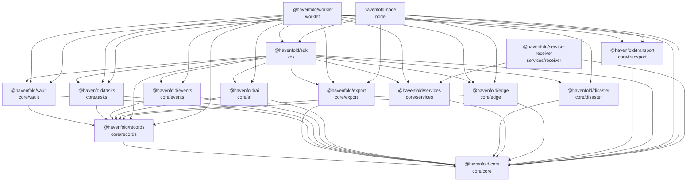
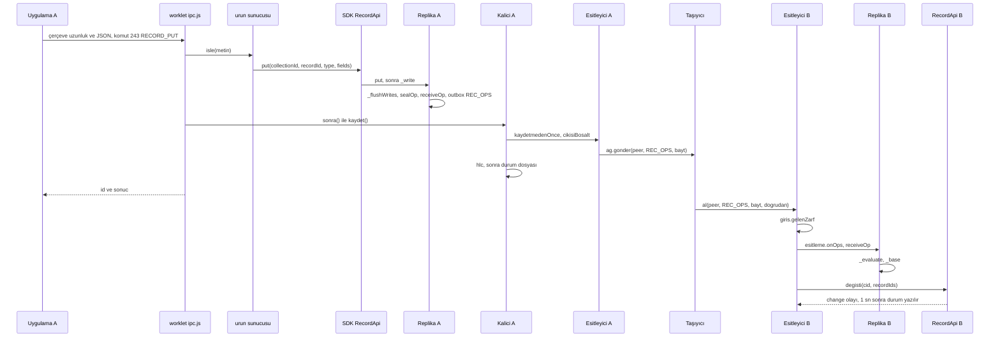

# Havenfold mimarisi (yeni katılan geliştirici için)

> 24 Ekim 2026; 25 Ekim 2026'da güncellendi. Bu belgedeki her teknik iddia bir dosyaya, mümkünse bir işleve bağlıdır. RFC'de olup kodda olmayan
> şeyler **"RFC'de; kodda henüz yok"** diye ayrı yazılmıştır. Satır numaraları yazıldığı günün koduna göredir; kod
> değiştikçe kayabilir, işlev adı esastır.

## 1. Bu belge kimin için, nasıl okunur

Havenfold'a ilk kez kod yazacak geliştirici için. Önce §2'deki paket şemasına, sonra §3'teki "bir kaydın yolculuğu"na
bakın. Kalan bölümler bu yolculuğun durduğu yerleri açar. Kurallar ve ilkeler `KURUCU-BELGE.md`'dedir; mimari kararlar
`docs/rfc/`'dedir (onay durumu her RFC'nin başında ve `docs/rfc/README.md`'de yazar). Ürün ekibi için
yazılmış komut ayrıntıları `docs/sdk-rehberi.md`'dedir.

Okurken üç şeyi aklınızda tutun:

- Çekirdek kodu taşıyıcı bilmez. `Replika` gönderilecekleri `outbox`'a koyar (`core/records/replica.js` başlık yorumu);
  SDK ağa yazmak için çağıranın verdiği `gonder`'i kullanır (`sdk/api.js` başlık yorumu).
- Ağdan gelen her zarf tek giriş noktasından geçer: `giris.gelenZarf` (`core/core/protocol/ingress.js` 43–64). SDK'nın
  bu kapıyı kullanan yerleri `ENTRY_POINTS` listesindedir (`sdk/api.js` 1006).
- Çekirdek paketleri Bare'de de çalışır; `scripts/check.sh` `core/*` ve `sdk/` içinde Node'a özel modülü (`fs`,
  `net` …) yasaklar.

## 2. Paketler ve bağımlılık yönü

Bağımlılıklar her paketin `package.json` `dependencies` alanından alınmıştır. Kök `package.json` çalışma alanları:
`core/*`, `sdk`, `tools/export-open`, `node`. `worklet` kök çalışma alanında değildir; kendi `package-lock.json`'ı vardır ve
`@havenfold/*` paketlerini `file:../core/...` yollarıyla alır (`worklet/package.json`).

Ok "bağımlıdır" demektir. Döngü yoktur. `core` hiçbir `@havenfold` paketine bağlı değildir. Dış bağımlılıklar az ve
sabit sürümlüdür: hepsinde `b4a`, `sodium-native`, çoğunda `compact-encoding`. `kasa` ayrıca `shamir-secret-sharing`;
`tasiyici` ve `worklet` `hyperdht`; `afet` `@hyperswarm/secret-stream` ve `streamx`; `node` `bare-fs`, `bare-path`,
`dbus-next` ve `streamx`; `worklet` ayrıca `bare-fs` kullanır. `services/receiver` kök çalışma alanında değildir;
`package.json`'unda bağımlılık yazmaz, `@havenfold/services` ve `@havenfold/core`'u `require` eder (`receiver.js`, `tools.js`).

| Paket | Tek cümlelik görevi | Ana dosyalar |
|-------|---------------------|--------------|
| `core/core` | Kimlik, kdf, defter (olaylar, yeter sayı, öneriler, eşitleme), zarf türleri, tek giriş noktası, HELLO, çift sırrı, emanet mührü. Başlangıç kodu Yuva Hat'tan kopyalanmıştır (`core/core/KAYNAK.md`). | `ledger/ledger.js`, `ledger/quorum.js`, `ledger/proposals.js`, `ledger/sync.js`, `ledger/v21.js`, `ledger/v22.js`, `ledger/team.js`, `protocol/envelope.js`, `protocol/ingress.js`, `protocol/hello.js`, `core/identity.js`, `core/pairs.js`, `messaging/seal.js`, `crypto/kdf.js` |
| `core/records` | Kayıt katmanı: koleksiyon, kayıt, şifreli işlem, dönem anahtarı, kesim, dosya, eşitleme, kutunun kör emaneti (RFC-0001). | `replica.js`, `operation.js`, `key.js`, `permission.js`, `cutoff.js`, `merge.js`, `hlc.js`, `sync.js`, `file.js`, `box.js`, `guest.js` |
| `core/vault` | Shamir payları, eşik, yedek dizini, kasa zarfı, pay isteme, teslim ve döndürme (RFC-0004). `index.js` başlığı: bağımsız denetimden önce yayına girmez. | `share.js`, `threshold.js`, `envelope.js`, `backup.js`, `request.js`, `delivery.js`, `rotation.js` |
| `core/tasks` | Görev katmanı: yetenek bildirimi, görev zarfları, işçi denetimi, ilk kullanım onayı, yerleştirme, koordinatör, sürekli görev (RFC-0002). | `audit.js` (`Isci`), `request.js`, `placement.js`, `coordinator.js`, `approval.js`, `delivery.js`, `standing.js`, `capability.js` |
| `core/events` | Olay kaydı, tür kataloğu, rutin, kural, vaka, bildirim merdiveni, kart (RFC-0006). | `index.js` ve aynı adlı dosyalar |
| `core/export` | Dışa aktarma kabı: Argon2id + XChaCha20-Poly1305 akışı, içinde ZIP (RFC-0014). | `export.js`, `zip.js`, `archive.js` |
| `core/disaster` | Afet modunun çekirdeği: türetmeler, afet mesajı ve mührü, alıcı denetimi, durum makinesi, sakla-ilet, yerel ağ keşfi (RFC-0012). Telefon köprüleri (Bluetooth, Wi-Fi Direct, Multipeer) platform kodudur. | `derivation.js`, `message.js`, `audit.js`, `status.js`, `store.js`, `engine.js`, `local.js`, `limit.js` |
| `core/services` | Hizmet paylaşımı: hizmet kartı, hizmet dizini, QR kartı, paket gövdesi ve şifrelemesi, takma ad, onay yorumu ve iptal (RFC-0010). | `card.js`, `package.js`, `reply.js`, `approval.js`, `encoding.js`, `preview.js` |
| `core/edge` | Uç cihaz çekirdeği: çalışma profili, yerleştirme özellik denetimi ve kasa payı adaylığı, uç yapılandırması ve görünür izleme, kamera akışı ve çerçeve şifrelemesi (RFC-0008). | `edge.js`, `profile.js`, `config.js`, `stream.js`, `frame.js`, `screen.js`, `sensor.js`, `erasure.js` |
| `core/transport` | Telefon ve kutu taşıyıcısı: HyperDHT üstünde çift buluşması, HELLO ile oturum, tören (RFC-0028). Telefonda `deneysel: true` bayrağıyla açılır; düğümde açıktır. | `transport.js`, `network.js`, `ceremony.js` |
| `core/ai` | Yapay zekanın belirlenimci parçaları: normalleştirme, engel süzgeci, yönlendirme, dizin, gömme dizini, @asistan, çocuk modu (RFC-0013). Model çağırma platformdadır (`core/ai/index.js` başlığı). | `search-index.js`, `embedding.js`, `extraction.js`, `assistant.js` |
| `sdk` | Ürünlerin kullandığı arayüz: `RecordApi`, `LedgerApi`, `TaskApi`, `EventApi`, `VaultApi`, `AiApi`, `CeremonyApi`, ekip, köprü, kap (RFC-0015). Lisansı Apache-2.0 (`sdk/package.json`). | `api.js`, `vault.js`, `ai.js`, `ceremony.js`, `team.js`, `bridge.js`, `export.js`, `index.d.ts` |
| `worklet` | Telefondaki çekirdek paketi: kalıcı durum, Bare Kit IPC çerçeveleri, başlatıcı, eşitleyici, görev kanalı; taşıyıcıyı `core/transport`'den bayrakla açar. | `start.js`, `persistence.js`, `ipc.js`, `synchronizer.js`, `task-channel.js`, `example/product.js` |
| `node` | Düğüm yazılımı: denetçi, `havenfold` komutu, yerel IPC, sağlık, sürüm ve güncelleme, yetki yardımcısı, kutunun pay tutucusu, systemd birimleri (RFC-0007, RFC-0026). | `supervisor.js`, `ipc/*`, `command.js`, `update.js`, `release.js`, `privilege-helper.js`, `box-share.js`, `tpm.js`, `systemd/*` |
| `tools/export-open` | Kabı açma aracı; yalnız `sodium-native`'e bağlıdır (`tools/export-open/package.json`), `@havenfold/export`'a değil. | — |
| `services/receiver` | Hizmet paketlerinin referans alıcısı ve paket açma aracı (RFC-0010 §13.1, §13.2). Lisansı AGPL-3.0-only. | `receiver.js`, `tools.js`, `server.js` |

Kodda olmayanlar (bilinçli olarak yazılmıştır): `KURUCU-BELGE.md` §2'deki "ratchet" ve "Posta Kutusu kodu" bu depoda
yoktur; `core/core/crypto/pair.js` yalnız `ratchetRoot` alt anahtarını türetir, `messaging/seal.js` yalnız Posta Kutusu
mührünü yapar. RFC-0005 kod yeri olarak `core/defter` içinde `ekip/` modülü
yazar; kod `core/core/ledger/team.js`'tedir.

## 3. Bir kaydın yolculuğu

Örnek: telefon A'da kullanıcı bir kayıt yazar, telefon B'de kayıt görünür. Örnek ürün sunucusu
`worklet/example/product.js`'tir; gerçek ürünün sunucusu kendi deposundadır (dosyanın başlık yorumu).

Adım adım:

1. **Kanal çerçevesi.** Uygulama Bare Kit IPC'ye `uzunluk(4 B, büyük sonlu) ‖ UTF-8 JSON` yazar; uzunluk 1..1 MiB
   (`worklet/ipc.js` `cerceveYaz`, `Ayirici`, `EN_COK`). Sınır dışı uzunlukta worklet `channel` olayını yollar ve akışı
   kapatır (`Ayirici` `durOnGecersiz`; RFC-0027 §5 d). Çerçeveler sıraya sokulmaz, her biri hemen sunucuya verilir
   (`ipc.js` başlık yorumu). Komut numaraları RFC-0024'tedir; SDK'nın eklediği numaralar `sdk/api.js` `CHANNEL_COMMAND`.
2. **Başlatıcı.** `start()` tek örnektir (`ALREADY_STARTED`), `Kalici`'yi kurar, ürünün sunucusunu `urunSunucusu(c)` ile
   alır ve `ipcBagla({ sonra })`'ya bağlar; `sonra` her komuttan sonra durumu yazar (`worklet/start.js` 72–192).
3. **Ürün sunucusu.** `isle(metin)` JSON'u çözer, `{ $b }` baytlarını açar ve 243'ü `c.nesneler.kayit.put(...)`'a verir
   (`worklet/example/product.js` 83, `isle` 103–121).
4. **SDK.** `RecordApi.put` `_ai`, `_aiyol` alanlarını reddeder (`AI_APPROVAL_REQUIRED`), `_yaz` kasa kilidini denetler
   (`_kasaDenetle` → `VaultApi.touch`, kilitliyse `VAULT_LOCKED`), alanları doğrular (`sdk/common.js`
   `validateFields`) ve `Replika.put`'u çağırır (`sdk/api.js` 180–194).
5. **Replika.** `put` yeni kayıtta `recordId = hash('hf/rec-new/', ben, recNonce)` üretir; `_write` yazma yetkisini
   denetler (`NO_PERMISSION`), HLC'yi ilerletir ve yazımı `writeQueue`'ya koyar (`core/records/replica.js` 466–501).
   HLC ilerlerken `Hlc.persist` kancası çağrılır (`core/records/hlc.js` 26, 35); telefonda bu kanca `hlc` dosyasını yazar
   (`worklet/persistence.js` `Kalici._hlcYaz`). Yani saat, işlem gönderilmeden önce kalıcıdır (RFC-0001 §6).
6. **Şifreleme ve imza.** `_flushWrites` o anki dönemin anahtarı varsa işlemi `I.sealOp` ile mühürler, kendi
   `receiveOp`'una verir ve `outbox`'a `REC_OPS` koyar; anahtar yoksa yazım kuyrukta bekler (`replica.js` 503–520).
   Biçim `core/records/operation.js` başlığındadır: XChaCha20-Poly1305 (dönem anahtarı, rastgele nonce, AD =
   `hash('hf/rec-ad/', familyId, collectionId, epochSeq, keyId)`), `opId = hash('hf/rec-op/', …, nonce, ct)`, imza
   Ed25519 `hash('hf/rec-op-sig/', familyId, opId)` üstünde.
7. **Çıkış kutusu ve eşitleyici.** `Kalici.kaydet()` önce `kaydetmedenOnce`'u çağırır; başlatıcı bunu
   `Esitleyici.cikisiBosalt`'a bağlar (`start.js` 178, `persistence.js` `kaydet`). `_cikis` `REC_OPS`'u koleksiyonun
   çevrimiçi okuyucularına ve oturumu açık kutuya yollar; `REC_KEY`/`REC_CUTOFF` alıcı çevrimdışıysa bellekte bekler
   (`worklet/synchronizer.js` 150–181). Giden her zarf `typeAllowed(..., 'giden')` süzgecinden geçer (`_gonder` 80–84).
   Ağ kancası (`ag`) verilmezse eşitleyici kurulmaz; çıkış kutusu diske yazılır ama gönderilmez (`start.js` 176;
   `worklet/BENIOKU.md` "Bilinen sınırlar").
8. **Taşıyıcı.** Eşitleyici yalnız `ag.gonder(peerHex, type, bytes)` bilir. Bugün iki uygulama vardır:
   - Testte **boru yönlendiricisi**: her cihaz ayrı süreçtir, ana süreç zarfları taşır (`worklet/test/helpers/multi.js`
     `BoruAgi`, `worklet/test/multi-device.js`).
   - **Deneme taşıyıcısı** `DhtTasiyici` (HyperDHT + Noise, çift başına saatlik buluşma anahtarları, HELLO doğrulanmadan
     zarf işlenmez; çerçeve `tür(1) ‖ gövde`; `core/transport`). `deneysel: true` olmadan `EXPERIMENTAL_DISABLED`: telefonda
     uygulama `start({ tasiyici: { deneysel: true } })` ile açar, düğümde (kutu, işçi) bayrak koddadır ve taşıyıcı açıktır.
     Tasarım RFC-0028'dedir (onaylı).
     Emanet (HOLD) ve Posta Kutusu yolu bu sürümde yoktur (aynı başlık yorumu): **RFC'de; kodda henüz yok.**
9. **Karşı telefonda giriş.** `Esitleyici.al` zarfı önce `giris.gelenZarf`'tan geçirir (yol kuralı, oturum izni,
   kanonik çözme); dosya, öneri ve kasa payı türleri `SDK_GIRISLI`'dır, kendi SDK giriş noktaları aynı kapıyı çağırır
   (`synchronizer.js` 29–31, 253–271). Reddedilen zarf `reddedilen` sayacına yazılır.
10. **Doğrulama.** `REC_OPS` için `esitleme.onOps` her öğeyi `Replika.receiveOp`'a verir (`core/records/sync.js`
    183–186). `_base` sırası: çözme (anahtar yoksa `bekliyor` / `NO_KEY`) → defter dalı (`LEDGER_BEHIND`,
    `LEDGER_FORK`) → yazar ve imza (`INVALID_SIGNATURE`) → yetki (`NO_PERMISSION`) → ekip kuralları → işlem türü → dönem
    (`EPOCH_MISMATCH`) (`replica.js` 286–344). Kesin retlerin bir kısmı mezara girer (`TOMB_CODES`, 30–31).
    Sonra temizlik, ileri saat (`FUTURE_CLOCK`) ve kesim denetimi gelir (`_evaluate` 256–284).
11. **Kayıt görünümü.** Durum geçerli işlemler kümesinin fonksiyonudur; alan düzeyinde son yazan kazanır
    (`core/records/merge.js` başlığı). `Replika.records`/`get` görünümü buradan kurar (`replica.js` 447–463).
    Eşitleyici değişen kayıtlar için `RecordApi.changed`'yi çağırır (`synchronizer.js` `_islemler` 381–392); `change`
    olayı başlatıcıyı uyarır, durum 1 sn sonra diske yazılır (`start.js` `kirli`, `GECIKMELI_MS`).

Eşitlemenin özet mesajları (bağlanınca kim neyi eksik biliyor): telefon ↔ telefon `REC_VV → REC_IDS → REC_OPS`,
telefon ↔ kutu 256 kovalı `REC_BUCKETS → REC_BUCKET_IDS → REC_OPS` (`core/records/sync.js` başlığı;
`synchronizer.js` `_ozetGonder` 97–114). Defter `LEDGER_REQ`/`LEDGER_EVENTS` ile gider (`_selamla` 86–95).

## 4. Defter

Defter topluluğun üyelik ve yetki kaydıdır; kayıt verisi taşımaz. RFC'ler: RFC-0003 (v2.1), RFC-0017 (v2.2),
RFC-0005 (ekip), RFC-0020, RFC-0022.

- **Olaylar.** Türler `core/core/ledger/encoding.js` `T` (19–52): 0–12 temel (GENESIS, ADD_MEMBER, REMOVE_MEMBER …),
  13–23 v2.1 (DEVICE_ATTACH, GRANT, COLLECTION, PROTOCOL_LEVEL, TASK_PERMIT …), 24–26 ekip (ASSIGN, TERM, NOTICE),
  34–35 v2.2 (APP_ATTACH, APP_PRIMARY). `eventHash = hash('ledger-event', encodeUnsigned(e))`; imzalar özete girmez;
  çözme kanoniktir (aynı dosyanın başlığı).
- **Uygulama.** `Ledger.apply` önce `check` ile tam doğrular: sürüm, sıra, zincir (`CHAIN_BROKEN`), düzey kapısı
  (`LEVEL_TOO_LOW`), sertifika ve tek kimlik kuralı, imzalar, yeter sayı; doğrulama düşerse durum değişmez
  (`core/core/ledger/ledger.js` 223–275).
- **Yeter sayı.** Salt çoğunluk tablosu ve rol tablosu birlikte; oy veren aktif telefon üyesidir, `cocuk` imzalar ama
  sayılmaz, `kutu` hiçbir hesaba girmez (`core/core/ledger/quorum.js` başlığı). Aile rolleri `ebeveyn`, `yetiskin`,
  `cocuk`, `kutu`; ekip rolleri `sahip`, `yonetici`, `calisan`, `gecici`, `kutu` (`ledger/policy.js` 18–21). Ekipte
  GENESIS dışındaki olaylar `ledger/team.js`'ten denetlenir (başlık yorumu).
- **Öneriler.** Yeter sayısı eksik olay öneri olur: `LedgerApi._dene` `apply` düşerse ve eksik imza hatasıysa
  `Proposals.add` (`sdk/api.js` 817–829). Öneri `LEDGER_PROPOSE` ile gider, imzalar `sign` ile eklenir, 24 saatte
  toplanamazsa düşer (`core/core/ledger/proposals.js` `PROPOSAL_TTL_MS`, `PROPOSABLE`).
- **Düzeyler.** `LEVELS = ['2.0', '2.1', '2.2']`; düzey yalnız yükselir (`core/core/ledger/v21.js` 12–14).
  Yükseltme `LedgerApi.raiseLevel` → `PROTOCOL_LEVEL` olayı (`sdk/api.js` 650–654). Kişi, ana kimlik ve ek
  kimlikler v2.2'dedir; sınırlar ve kasa eşikleri yalnız ana kimlikleri sayar (`ledger/v22.js` başlığı).
- **Eşitleme ve çatallanma.** `ledger/sync.js` (`answerReq`, `ingest`, `forkWinner`).
- **Kimlik.** ÜKA (Ed25519) + ÜDA (X25519) + cihaz sertifikası (`core/core/core/identity.js`). Cihaz sertifikası
  bugün spike sürümüdür: P-256 imzası (`dbaPub`, `dbaSig`) boştur, dolu imza reddedilir
  (`core/core/crypto/device-cert.js` `verifyDeviceCert`). Donanım kanıtı **RFC'de; kodda henüz yok.**

## 5. Kasa ve Arşiv katmanı

RFC'ler: RFC-0004 (kasa), RFC-0021, RFC-0027 §1, §1a, §1b, §5 b, g, h.

- **Kasa koleksiyonu.** `sensitivity === 'kasa'` olan koleksiyondur (`worklet/persistence.js` `_kasaCidleri`). İşçiye
  gitmez: işçi `KOLEKSIYON_KAPALI` der (TASK_REJECT kodu) (`core/tasks/audit.js` `_denetle` madde 4).
- **Kilit.** `VaultApi` 5 dakika işlemsizlikte kilitlenir (`sdk/vault.js` `LOCK_MS`, `locked`, `touch`); başlatıcı
  30 sn'de bir yoklar (`start.js` `KASA_DENETIM_MS`). 224 UNLOCK `unlock(archiveKeyHex)`, 19 LOCK `lock()`
  (`sdk/vault.js` `VAULT_COMMAND`).
- **Arşiv anahtarı.** Uygulama başlatmada Arşiv katmanının açık anahtarını (`archivePubHex`) verir; telefonda gizli
  yarısı yalnız 224 UNLOCK'ta gelir (`start.js` parametreleri, `persistence.js` `arsivAc`). Gizli anahtarın biyometriyle
  açılan platform kasasında durması `KURUCU-BELGE.md` §7.4 ve RFC-0004'tedir; o kısım platform kodudur, **bu depoda
  yok**.
- **`arsiv` dosyası.** Kasa koleksiyonlarının dönem anahtarları, bekleyen yazımları, çıkıştaki `REC_KEY`/`REC_CUTOFF`,
  bekleyen `REC_KEY`'ler, gönderilecek pay baytları ve tutulan paylar her biri ayrı `crypto_box_seal` ile Arşiv açık
  anahtarına mühürlenir (`persistence.js` `_kasaOgeleri`, `_muhurle`). Dosyanın ilk parçası `"HFA2" ‖ sayaç ‖ açık anahtar`
  (`_arsivDosya`, `_arsivOku`). Kilitliyken yeni öğe mühürlenip eklenir (açık anahtar yeter), anahtarlar bellekten
  sıfırlanarak silinir (`_arsivYaz`, `_kasaBirak`).
- **Kilit açma.** `arsivAc` önce bütün öğeleri çözer ve denetler; biri bozuksa hiçbiri uygulanmaz (`STATE_CORRUPT`).
  Sonra anahtarlar replikaya, yazımlar kuyruğa döner ve kilitliyken gelen kasa kayıtları için `changed` yayılır
  (`persistence.js` `arsivAc`). LOCK `arsivKilitle`: arsiv son hâliyle yazılır, kasa nesneleri bellekten çıkar, kasa kaynaklı
  açılan dosyalar silinir (`start.js` `kilitlenince`).
- **Arşiv anahtarı taşıma (389).** `arsivTasi` bütün öğeleri eski gizli anahtarla açıp yeni açık anahtara mühürler;
  yeni anahtar deneme mühürlemesiyle denetlenir; durum yazılamazsa `ARCHIVE_MOVED_STATE_WRITE_FAILED` (`persistence.js`
  `arsivTasi`; RFC-0027 §5 h).
- **Kilitliyken anahtar üretimi.** Kilitliyken anahtarı arsivde olan kasa dönemi için yeni anahtar üretilmez
  (`persistence.js` `_nesneleriKur` içindeki `replika.otomatikAnahtar`).
- **Paylar.** Shamir yalnız `shamir-secret-sharing` ile (`core/vault/share.js` başlığı); rastgelelik `sodium.randombytes_buf`
  (`core/vault/random.js`). YA (Yedek Anahtarı) üyenin yedek dizinini, KRA (Kasa Kurtarma Anahtarı) kasa zarfını
  şifreler (RFC-0004 §2 tablosu; `core/vault/backup.js`, `core/vault/envelope.js`). Pay sahipleri ve eşik `core/vault/threshold.js`.
- **Pay teslimi.** `KASA_SHARE_PUT (0xF1)` / `KASA_SHARE_ACK (0xF2)`, yalnız doğrudan oturum ya da emanet; Posta
  Kutusu'ndan gelirse `MAILBOX_FORBIDDEN` (`core/vault/delivery.js` başlığı, `ingress.js` 53). Telefonda gönderen
  `VaultApi.outgoing`'i eşitleyici yollar (`synchronizer.js` `_kasa`). Kutu payı `node/box-share.js` `KutuPaylari.payAl`
  ile alır, TPM mühürlü dosyaya yazar, sonra alındı döner.

## 6. Telefondaki kalıcılık

Kod: `worklet/persistence.js`. RFC: RFC-0027 §5, RFC-0001 §6.

| Dosya | İçerik | Kaynak |
|-------|---------|--------|
| `kimlik` | memberId, imza ve kutu anahtar çiftleri, cihaz sertifikası; bir kez yazılır | `Kalici._ac` |
| `hlc` | son HLC, 8 bayt; her işlemden önce | `Kalici._hlcYaz` |
| `durum` | tek anlık görüntü: defter, replika (kasa anahtarları hariç), dosya dizini, görülme, onaylar, kasa dizinleri, kutunun emaneti; `kimlikOzet`, `sayac`, `arsivOzetleri` | `Kalici._ozetlik`, `_durumYaz` |
| `arsiv` | kasa öğeleri, Arşiv anahtarına mühürlü (§5) | `_arsivDosya` |
| `kilit` | dizin kilidi (süreç kimliği) | `kilitAl`, `kilitBirak` |
| `dosyalar/<blobId>` | dosya parçaları; parçalar zaten dosya anahtarıyla şifreli (`core/records/file.js`) | `DiskDeposu` |
| `gomme/<collectionId>` | anlamsal arama dizini, koleksiyon başına | `Kalici.gommeSaklama` |

Korumalar:

- **Biçim.** Her dosya `"HFW1" ‖ sürüm ‖ kip ‖ gövde`. Şifreli kipte gövde `nonce(24) ‖ XChaCha20-Poly1305`, anahtar
  `derive(platform anahtarı, 'hf/worklet/kalici')`, AD dosya adını içerir; böylece bir dosya başka adın yerine
  konamaz (`persistence.js` 16–19, `Depo.yaz`, `Depo.oku`). Platform anahtarı zorunludur (`NO_KEY`); açık kip yalnız
  `testKipi`'nde, telefon paketinde derleme anında kapalıdır (`#mode` → `mode-phone.js`, `Depo` kurucusu).
- **Atomik yazım.** Geçici dosya, `fsync`, yeniden adlandırma, dizin `fsync` (`atomikYaz`). Dosya önce, durum sonra
  yazılır (başlık yorumu). Değişmeyen durum yazılmaz (`_durumYaz(degismediyseAtla)`).
- **Silme ve geri alma.** `kimlik` ile `durum` birlikte vardır ya da yoktur; `durum` kimliğin özetini taşır (uyuşmazsa
  `STATE_CORRUPT`). Her yazımda `sayac` artar, worklet `{ olay: 'persisted', veri: { sayac } }` yollar; uygulamanın
  verdiği sayaçtan küçükse `STATE_ROLLED_BACK` (`_ac`, `_durumuAc`, `start.js` `olay`).
- **Yan dosyalar.** `arsiv`'in özeti `durum.arsivOzetleri`'nde olmalı; arsiv değişirken önce durum iki özetle, sonra
  arsiv, sonra durum tek özetle yazılır. `hlc` durumdaki replika saatinden geride olamaz (`_yanDosyalar`).
  RFC-0027 §5 g "`durum` `hlc` özetini taşır" der; kod özet değil saat karşılaştırması yapar.
- **Geri yükleme yeniden doğrular.** Diskteki olay ve işlemler çekirdeğin doğrulamasından yeniden geçer; geçmezse
  `STATE_CORRUPT` (`_durumuAc`, `replikaKur`, `kutuKur`).
- **Göç.** Durum sürümleri arası `GOCLER` (1 → 2: kimlik özeti ve sayaç eklenir). Açık kipten şifreli kipe tek seferlik
  göç `Depo.goc`: kimlik önce, durum en son; durum şifreliyken açık dosya `STATE_MODE_MISMATCH`.
- **Tek örnek.** Aynı dizin ikinci kez açılmaz (`DIR_LOCKED`); kilit sahibinin canlılığı `/proc` ile denetlenir,
  `/proc` yoksa (iOS) eski kilit bırakılmış sayılır (`surecYasiyor`).
- **Açılan dosyalar.** `RECORD_OPEN` çözülmüş dosyayı yalnız geçici `acilanDizin`'e yazar; başlatmada, kapatışta, LOCK'ta
  (kasa kaynaklılar) ve 10 dakikada silinir (`start.js` `ACILAN_OMUR_MS`, `dosyaYaz`). `attach({ path })` çekirdeğin
  kendi dizininden okuyamaz (`dosyaOku`).
- **Gömme dizini.** `gomme/` dosyaları aynı `Depo` ile şifrelenir (`gommeSaklama`). Kodda bu dosyalar `durum`'un
  sayacına ya da özet listesine bağlı değildir ve `Depo.goc`'un listesinde yoktur.

## 7. Görev ve işçi

RFC: RFC-0002; `KURUCU-BELGE.md` §8. Zarf türleri `TASK 0x90` … `TASK_DELEGATION 0x97`
(`core/core/protocol/envelope.js` 40–47).

- **İsteyen telefon.** `TaskApi.run` adayları bulur (`core/tasks/placement.js` `adaylar`, belirlenimci sıra),
  `Yerlestirici` ile parçalar; her parça için `Gr.istek.gorevKur` ilk kullanım onayını (`NO_APPROVAL`), tür iznini
  (`TUR_IZNI_YOK`) ve süreyi denetleyip görevi imzalar, `gonder(isci, Z.TASK, bayt)` yollar (`sdk/api.js` 471–554,
  `core/tasks/request.js` 17–30). Gelen `TASK_ACCEPT/REJECT/PROGRESS/RESULT` `TaskApi.receive`'dan, `giris.gelenZarf`
  üstünden girer (555–572).
- **İlk kullanım onayı.** Kişi başına, telefonda saklanır, aileyle paylaşılmaz (`core/tasks/approval.js` `OnayDefteri`);
  worklet onu `durum`'a yazar (`persistence.js` `_ozetlik` `onay`).
- **İşçi denetimi.** `Isci._denetle` sırası: doğru işçi, imzalar (doğrudan ya da koordinatörün alt görevi), isteyenin
  o anda ve bugün üye olması, `TASK_PERMIT`, koleksiyonun görev erişimi ve kasa olmaması, ekip kuralları, tür/sürüm ve
  bellek, durum, süre, tekrar; ilk tutmayan `TASK_REJECT { code }` olur (`core/tasks/audit.js` `Isci` 54, `_denetle` 103–193).
- **Koordinatör ve sürekli görev.** `core/tasks/coordinator.js` (`TASK_DELEGATION`, en çok 24 saat), `standing.js`
  (en çok 30 gün, yalnız ebeveyn; işçi olayı `REC_DROP` ile bırakır).
- **Sonucun teslimi.** Görev zarfları Posta Kutusu'na gitmez, `NODE_CAPS` emanete de gitmez (`core/tasks/delivery.js`
  `yolUygun`); sonucu koleksiyona isteyen telefon yazar.
- **İşçi çekirdeği.** Kutuyla aynı yığın (`node/worker.js` `isciyiBaslat`; kutu.js'in TPM, platform ve Arşiv anahtarı,
  boş uygulama kanalı, yönetim soketi ve tören akışı paylaşılır): worklet kalıcı katmanı (`/var/lib/havenfold/isci/
  cekirdek`, `havenfold ilk-ayar`'ın açtığı kimlik; ikinci kimlik üretilmez), eşitleyici (rolü `cihaz`: yalnız defter
  eşitlemesi), taşıyıcı (`cihazlar: true`; işçi dinler, telefon arar), tören (`core/transport/ceremony.js` `isciDavet`:
  `TOREN.CIHAZ`, taslak `DEVICE_ATTACH { class: 'isci' }`, imzacılar işçi ve ebeveyn; `havenfold katil --rol isci`).
  Görev zarfları ağ kancasında `IsciAgi`'ye ayrılır: bağlanan üyelere imzalı `NODE_CAPS`; gelen her zarf
  `giris.gelenZarf`'tan (myRole `cihaz`); `TASK` `Isci.al` ile işçinin kendi (eşitlenen) defteriyle denetlenir; girdiler
  isteyenden `BLOB_REQ` ile çekilip çözülür; `gorevYurut` denetçiye çalıştırtır; tek ve küçük çıktı `TASK_RESULT.inline`,
  çok dosya yeni anahtarla şifreli `BLOB_DATA`; isteyen bağlı değilse `SonucKutusu`. `TASK_CANCEL` → `TASK_CANCEL`.
  Görev başlayınca isteyene `TASK_PROGRESS { pct: 0, note: 'basladi' }`; denetçinin `GOREV_ILERLEME`'si 10 saniyede
  bir iletilir (`teslim.IlerlemeSiniri`). Görülen taskId'ler deadline'larına kadar `/var/lib/havenfold/isci/gorev-kayit/
  gorulen.json`'dadır: yeniden başlayan işçi aynı görevi `REPLAY` ile reddeder (`IsciAgi._gorulenYaz`, `_gorulenYukle`).
- **Kurtarma anahtarı** (RFC-0007 §8.5, §13.6). İşçi, töreni yapan ebeveyn (`core/core/protocol/recovery.js`
  `torenEbeveyni`: `DEVICE_ATTACH`'ı imzalayan etkin ebeveyn) bağlanınca anahtarı denetçiden (`RECOVERY_KEY`, IPC
  22 → yetki yardımcısının `luks-kurtarma oku`'su) alır ve `NODE_RECOVERY { kind: 'luks-kurtarma' }` ile yollar;
  yalnız o ebeveynin imzalı, doğrudan gelen `alindi`'siyle sildirir. Telefonda eşitleyici (`_kurtarmaAl`) anahtarı
  Kasa'ya, yoksa Ebeveynler'e `hf.node.luks-kurtarma` kaydı olarak yazar. Denetçi yardımcıya soketinden bağlanır
  (`node/privilege-socket.js`; aşağıda **Güncelleme**).
- **Düğümde çalıştırma.** Denetçi işçi soketinden `GOREV_HAZIRLA`/`GOREV_BASLAT` alır ve `calistir` kancasını çağırır
  (`node/supervisor.js`); kanca `node/podman.js` `PodmanCalistirici`: havenfold-task'ın Podman API soketi
  (`/run/havenfold/podman/podman.sock`) üstünden ağsız, salt okunur köklü, yetkisiz, sınırlı konteyner; imaj yalnız
  `@sha256:` ile ve `imajYukle`'nin doğruladığı kayıttan. `MERHABA`'nın ardından denetçi işçiye `SAGLIK_ANLIK` verir
  (ölçümler ve kayıtlı imaj türleri; işçi imzalar). Görev imajları `images/` (`task-ocr`; `task-backup` yalnız
  sözleşme, yerleşik iş).
- **Telefonda.** `start` taşıyıcıyı cihazlarla açar; `Kalici` `TaskApi`'ye eşitleyicinin gönderimini verir
  (`kayitKancalari.gorevGonder`); eşitleyici işçiden gelen `NODE_CAPS`'i yetenek defterine, `TASK_ACCEPT/REJECT/
  PROGRESS/RESULT`'u `TaskApi.receive`'a verir, işçinin `BLOB_REQ`'ini dosya deposundan cevaplar; işçiyle kayıt özeti ve
  öneri alışverişi yoktur. `TaskApi.tick` (zaman aşımı ve yeniden deneme) `start`'ta 5 saniyede bir yürür, `kapat()`
  durdurur. Ürün tarafında kanal komutları 250 `TASK_REQUEST`, 251 `TASK_CANCEL`, 252 `MACHINE`, 253 `DEVICES`, 254
  `TASK_CONSENT`, 255 `STANDING_START` (RFC-0002 Ek: RFC-0033 §9 s); sunucu tarafı `worklet/task-channel.js`
  `taskChannel` (ürün sunucusu katar), ilerleme ve sonuç `task` olayı. Vektör `protocol/vectors/channel-task.json`.
- **Uçtan uca sınama.** `node/test/task-network.js`: yerel testnet'te worklet telefon çekirdeği işçiyle tören yapar, işçinin
  defteri eşitlenir; uygulama tarafı yalnız kanal komutlarıyla cihazları ve kartı okur, onay verir, `hf.task.ocr`
  ister (paketteki `cekirdek/isci.js` süreci sahte podman'la çalıştırır), ilerleme ve sonucu `task` olayıyla alır,
  konteynerde bekleyen ikinci işi iptal eder; işçinin kurtarma anahtarı telefona geçer ve düğümde silinir; işçi yeniden
  başlayınca aynı kimlikle ailededir.

## 8. Kutu (`node/` ve kör emanet)

RFC: RFC-0007, RFC-0026, RFC-0001 §12.2, RFC-0004 §3.1.

- **Kör emanet.** Kutu okuyucu değildir: yazarı, saati, içeriği görmez; koleksiyon kimliğini, dönemi ve boyutu görür.
  İşlemi yalnız o koleksiyonun okuyucusunun ya da yazar cihazın oturumundan kabul eder; yalnız yazarın imzalı
  `REC_PRUNE`'u ile ya da 30 gün okuyucusuz kalınca siler (`core/records/box.js` başlığı, `Kutu.accept`, `prune`, `gc`).
  Kutu dönem anahtarı almaz (`replica.js` `generateKey`: "kutu ve işçi koleksiyon anahtarı almaz").
- **Telefon paketinde kutu.** Çekirdeğin kendi kimliği defterde `kutu` rolündeyse emanet `durum`'da tutulur
  (`persistence.js` `Kalici.kutu`, `kutuKur`) ve gelen `REC_OPS` `Kutu.accept`'e gider (`synchronizer.js` `_isle`).
  Çok cihazlı test kutuyu bu yolla, ayrı bir süreçte çalıştırır (`worklet/test/multi-device.js`).
- **Düğüm süreçleri.** systemd birimleri `node/systemd/`; giriş dosyaları `node/bundle/` (`cekirdek/kutu.js`,
  `cekirdek/isci.js`, `denetci/ana.js`, `yetki/ana.js`, `bin/havenfold`), paket düzeni `node/scripts/pack.sh`
  (`<sürüm>/node`, `bare`, `bin/`, `cekirdek/`, `denetci/`, `lib/`; yardımcı kendi `lib/` kopyasıyla `yetki/`).
  RFC-0007 §4.1 çekirdekleri Bare'de ister; kod bugün Node modülleri kullandığı için kutu ve işçi birimleri paketteki
  Node ile çalışır (Bare desteği İstek 151'e kadar). Mantık `node/box.js` `ana`, `node/worker.js`,
  `node/supervisor-main.js`, `node/privilege-main.js` (soketsiz `deneme-denetle`, `pil-uygula`; soket kipi SO_PEERCRED'siz
  açılmaz). Yönetim soketlerinin tek tanımı `node/command.js` `YONETIM_SOKETI`; denetçininki
  `/run/havenfold/denetci-yonetim/yonetim.sock` (RFC-0026 f: `/run/havenfold/denetci/` çekirdeklerin dizinidir).
- **Denetçi.** Kimlik anahtarı görmez, defter tutmaz; her çekirdeğe ayrı soketten bağlanır ve isteği o soketin
  kapsamına uygular (`node/supervisor.js` başlığı). Yerel IPC çerçevesi `uzunluk(u32be) ‖ IPC_MSG`, en çok 1 MiB
  (`node/ipc/frame.js`); türler `node/ipc/types.js` (1–23 RFC-0007, 24–30 öneri). Karşı ucun kullanıcısını veren
  `kimlikBul` dışarıdan verilmek zorundadır; pakette SO_PEERCRED eklentisi yok (`node/ipc/socket.js` başlığı).
- **Güncelleme.** Kök yetkili yardımcı her isteği kendisi doğrular, güvendiği durum yalnız kökün dizinindedir
  (`node/privilege-helper.js` başlığı; RFC-0026). Soket kipi (`node/privilege-socket.js`, RFC-0033 §9 l):
  `/run/havenfold/yetki/yetki.sock`, dizin 0750 ve soket 0660 `root:havenfold-denetci`; dizine yalnız denetçi girer,
  yardımcı soketten gelen isteği denetçi sayar ve işlem başına kendi kuralıyla denetler; systemd soketle açar (`Accept=no`),
  boşta 30 sn sonra kapanır. Denetçi `yetkiIstemcisi` ile istek başına bağlanır (`supervisor-main.js`). Sürüm kök anahtarının gizli yarısı düğümde yoktur, yalnız doğrulama
  vardır (`node/release.js` başlığı). Akış `node/update.js`.
- **Kutunun pay tutması.** `KutuPaylari`: pay önce TPM mühürlü `paylar.muhur`'a yazılır, sonra alındı döner
  (`node/box-share.js` başlığı). `sistemTpm()` tpm2-tools ile TPM'nin depolama hiyerarşisinde 32 baytlık bir anahtarı
  mühürler; `muhurle`/`ac` bu anahtarla XChaCha20-Poly1305'tir. TPM ya da araçlar yoksa `NO_TPM`: kutu cihaz payı
  tutmaz. Taklit mühür yalnız testte (`node/tpm.js` başlığı; `node/test/d76-tpm.js`).

## 9. Yapay zeka dizini (kısaca)

RFC: RFC-0013 §9, RFC-0023. Dizin yalnız telefondadır; kutu ve işçi dizin tutmaz; dizin yedeğe girmez
(`core/ai/search-index.js` başlığı). Anlamsal katman `GommeDizini`: platformun gömme kancası, vektörler int8, parça özeti
saklandığı için değişmeyen parça yeniden gömülmez, model değişirse dizin yeniden kurulur, cihaz sınırı 100 000 parça
(`core/ai/embedding.js` 1–13). SDK'da `AiApi({ gom, gommeSaklama })` (`sdk/ai.js` 54–80); telefonda saklama
`Kalici.gommeSaklama()`. `AiApi`'yi worklet kurmaz, ürün kurar (`worklet/BENIOKU.md` "Bilinen sınırlar",
`start.js` örnek kullanımı). Model çağırma platform kodundadır (`core/ai/index.js` başlığı).

## 10. Testler ve denetim

- **Tek komut:** `npm test` = `bash scripts/check.sh` (kök `package.json`). Sırayla: çekirdek paketlerinde Node'a özel
  modül yasağı, vektör JSON'ları, Yuva Hat vektörlerinin `SHA256SUMS`'u, lisans ve sabit sürüm denetimi
  (`scripts/license-check.js`), her paketin Node testleri, `core/*` ve `sdk/`'nin Bare testleri, SDK rehberi tablolarının
  güncelliği (`scripts/guide-gen.js --denetle`), vektörlerin bağımsız yeniden üretimi (`scripts/vector-check.js`),
  worklet'in kendi denetimi (`worklet/scripts/check.sh`), bulanık test (`scripts/fuzz.js --ornekler`, `--kisa`).
- **Vektörler:** `protocol/vectors/*.json` (record, vault, task, channel, ledger-v21, ai …) ve
  `core/core/test/vectors/`. Kural: kol yalnız kendi yeni vektör dosyasını ekler, var olan dosya değişmez
  (`CONTRIBUTING.md`).
- **Uçtan uca:** `worklet/test/multi-device.js` (iki telefon ve kutu, üç süreç, boru yönlendiricisi),
  `worklet/test/transport.js` (yerel testnet üstünde tören ve eşitleme; dış ağa bağlanmaz).
- **Saldırı testleri:** `worklet/test/attack*.js`; kalıcılık için `worklet/test/persistence.js`.

## 11. Sözlük

| Terim | Anlamı | Kodda |
|-------|--------|-------|
| Defter | Topluluğun imzalı, zincirli üyelik ve yetki olayları | `core/core/ledger/ledger.js` `Ledger` |
| Topluluk, aile, ekip | Defterin türü: `aile` ya da `ekip` | `Ledger.kind`, `ledger/team.js` |
| Kayıt | Koleksiyondaki alanlar kümesi; durum geçerli işlemlerden hesaplanır | `core/records/merge.js` |
| İşlem | Şifreli, imzalı tek yazım (`REC_OP`; cihazın bıraktığı `REC_DROP`) | `core/records/operation.js` |
| Koleksiyon | Okuyucusu, yazarı ve duyarlılığı olan kayıt kümesi; defterde `COLLECTION` olayı | `Ledger.collections` |
| Dönem | Koleksiyonun okuyucu kümesinin geçerli olduğu aralık; her dönemin ayrı anahtarı | `core/records/permission.js`, `key.js` |
| Kesim | Yetkisi biten yazarın geçerli işlem listesinin imzalı sonu | `core/records/cutoff.js` |
| Replika | Bir topluluğun kayıt verisi: işlemler, anahtarlar, kesimler, çıkış kutusu | `core/records/replica.js` `Replika` |
| HLC | Karma mantıksal saat; yalnız birleştirme sırası, yetki kararı değil | `core/records/hlc.js` |
| Kasa | `sensitivity: 'kasa'` koleksiyon; anahtarları Arşiv'de, 5 dk'da kilitlenir | `sdk/vault.js`, `worklet/persistence.js` |
| Arşiv katmanı | Telefonda kasa anahtarlarının mühürlendiği katman; açık anahtarı `archivePubHex` | `persistence.js` `arsivAc`, `_muhurle` |
| YA, KRA | Yedek Anahtarı, Kasa Kurtarma Anahtarı; Shamir ile paylara bölünür | `core/vault/share.js`, RFC-0004 §2 |
| Pay, tutucu | Shamir payı ve onu tutan kimlik | `core/vault/delivery.js`, `node/box-share.js` |
| Kutu | Ailenin sürekli açık düğümü; okumaz, kör emanet tutar, oy vermez | `core/records/box.js`, `ledger/quorum.js` |
| İşçi | Görev çalıştıran cihaz; koleksiyon anahtarı almaz | `core/tasks/audit.js` `Isci` |
| Emanet | Kutu üstünden çevrimdışı alıcıya bırakılan mühürlü zarf (HOLD) | `core/core/messaging/seal.js`, `core/tasks/delivery.js` |
| Posta Kutusu | Kör zarf deposu (Cloudflare Worker); kodu bu depoda yok | `KURUCU-BELGE.md` §5.1 |
| Öneri | Yeter sayısı eksik, imza bekleyen defter olayı | `ledger/proposals.js` |
| Düzey | Defterin protokol düzeyi: 2.0, 2.1, 2.2 | `ledger/v21.js` `LEVELS` |
| Çift sırrı | İki kimlik arasında defterden türeyen sır; buluşma ve mühür bundan | `core/core/core/pairs.js` |
| Tek giriş noktası | Ağdan gelen her zarfın geçtiği süzgeç ve kanonik çözücü | `core/core/protocol/ingress.js` `gelenZarf` |
| Platform anahtarı | Uygulamanın verdiği 32 B; telefondaki dosyaları şifreler | `worklet/persistence.js` `Depo` |
