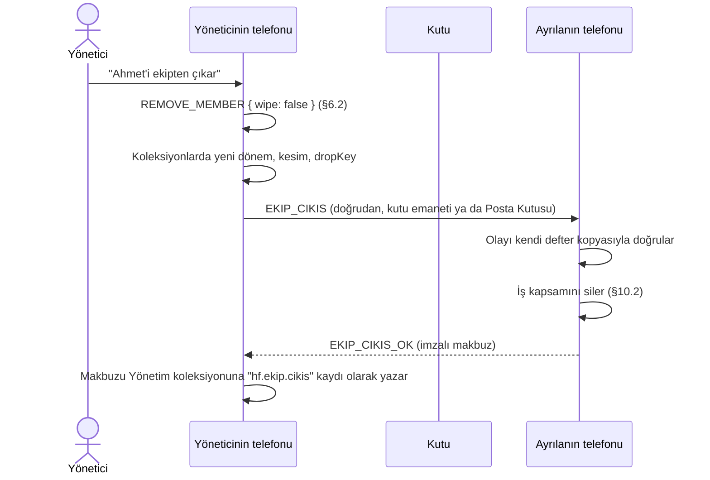

# RFC-0005 — Mekan: ekip topluluğu, roller, yerler ve büyük ekipler

> Durum: **Onaylandı** (Kerem, 23 Ekim 2026) · 23 Ekim 2026 · Yazan: Havenfold çekirdek ekibi · Onay: Kerem
> Kurucu belge: §4, §6.2, §6.3, §7.7, §8.4, §15.5, §16.1, §17.1, §21, §22 (HF27). Çatı: §5.3, §5.4, §6, §9, §11, §17.3, §17.4 (A9, A10).
> Bağımlılık: RFC-0003 (defter v2.1, `KIND`, `PLACE`, `GRANT`, `COLLECTION`, `TASK_PERMIT`), RFC-0001 (koleksiyon, dönem, kesim), RFC-0002 (görev, sürekli görev), RFC-0004 (kasa). Hizmet paylaşımı: RFC-0010. Olay kaydı ve `_subj`: RFC-0006.
> Kod yeri: `havenfold/core/defter` içinde `ekip/` modülü (`quorum-ekip.js`, `ekip-durum.js`); `policy.js` ve `ledger.js`'te küçük değişiklikler. Mekan Hat bu modülü SDK ile kullanır.

## 1. Sorun

Kurucu belge Mekan'ı `ekip` topluluğu olarak tanımlıyor, ama bugünkü defter yalnız aileyi biliyor:

- `policy.js`'te `ROLES` yalnız `ebeveyn`, `yetiskin`, `cocuk`, `kutu`. `MAX_PARENTS = 2`, `HARD_MAX_MEMBERS = 8`.
- `quorum.js` her eklemede oy veren üyelerin salt çoğunluğunu istiyor. 30 kişilik bir işletmede bir çalışanı eklemek 16 imza isterdi.
- `GENESIS` kurucuyu her zaman `ebeveyn` yapıyor.
- RFC-0003 §5.8, `KIND = 'ekip'`'i bu RFC onaylanana kadar `EKIP_HENUZ_YOK` ile reddediyor.

Ayrıca iş yerinin aileden farklı kuralları var (çatı §11.1): çok şube, yer başına kutu, süreli stajyer, işten çıkışta temizlik, çalışan izleme yasağı, kamera aydınlatması. Bunların hiçbiri defterde yok. Bugünkü Mekanapp da e-posta hesabı, açık metin bulut olayları, Firebase ve Tailscale kullanıyor; EserX ilkeleriyle çelişiyor.

## 2. Öneri özeti

- `KIND = 'ekip'` geçerli olur. Ekip kodu ayrı bir yeter sayı işlevidir; aile yolu bayt bayt aynı kalır.
- Roller: `sahip` (en çok 3), `yonetici`, `calisan`, `gecici`, `kutu` (yer başına 1). Yeter sayı hiyerarşiktir; salt çoğunluk kuralı ekipte yoktur.
- Kurucu `KIND` olayıyla `sahip` olur.
- Üç yeni defter olayı: 24 `ASSIGN` (yere atama), 25 `TERM` (geçici süre), 26 `NOTICE` (kamera aydınlatması). 27–29 ayrılmıştır.
- Koleksiyon izinlerine `yer:<yer>/rol:<rol>` öznesi eklenir. Şube koleksiyonları bununla kurulur.
- v1'de ekip en çok **32 kişi**dir. 8 kişiyi aşan ekip en az bir kutu ister. 32'nin üstü ayrı bir RFC'nin işidir.
- Ayrılan çalışanın cihazı iş verisini siler ve imzalı makbuz döner. Birebir sohbetleri silinmez. Koruma yeni dönem anahtarlarından gelir.
- Kişi başına puanlayan görev türleri, yüz tanıma ve plaka okuma ekipte çalışmaz. Kamera görevi, yerin aydınlatma kaydı olmadan başlamaz.
- Kişisel köprü: kişi yalnız kendi durumunu, her seferinde elle onaylayarak öbür topluluğuna geçirir.
- Mekanapp Havenfold'a aşama aşama taşınır; plan kapalı ürün belgelerindedir (§16).

## 3. Tanımlar

| Ad | Anlam |
|----|-------|
| **Ekip** | `KIND = 'ekip'` olan topluluk. Bir işletme, bütün şubeleriyle tek bir ekiptir (çatı §11.1 kural 5). |
| **Sahip** (`sahip`) | İşletmenin sahibi ya da ortağı. Veri sorumlusu adına karar verir. |
| **Yönetici** (`yonetici`) | Bir ya da birkaç yerin sorumlusu. |
| **Çalışan** (`calisan`) | Ekipteki kişi. Karar imzalamaz. |
| **Geçici** (`gecici`) | Stajyer, taşeron, sezonluk. Süresi `TERM` ile yazılır. |
| **Kutu** (`kutu`) | Bir yerin kutusu. Oy vermez (H3). |
| **Yönetim** | Aktif ve bekleyen olmayan sahipler ile yöneticiler. |
| **Yer** | `PLACE` olayıyla tanımlı şube, depo, çiftlik, ofis. |
| **Yere atama** | Bir kişinin, kutunun ya da cihazın hangi yerlere bağlı olduğu (`ASSIGN`). |
| **Yönetim alanı** | Bir yöneticinin atandığı yerlerin kümesi. |
| **İş kapsamı** | Ekibin koleksiyonları, dosyaları, grup sohbetleri, defter kopyası, kasa payları ve görev geçmişi. İşletmenindir. |
| **Kişisel kapsam** | Bir kişinin ekipteki birebir sohbetleri ve ekleri. Kişinindir (çatı §11 tablosu). |

"Herhangi bir sahip" her yerde "aktif, bekleyen olmayan bir sahip telefonu" demektir. Kutu ve bağlı cihaz hiçbir zaman "sahip" ya da "yönetici" sayılmaz.

## 4. Ekip topluluğunun kuruluşu

### 4.1 Kuruluş sırası

Ekip her zaman şu üç olayla başlar:

| seq | Olay | Not |
|-----|------|-----|
| 0 | `GENESIS` | Bugünkü gövde. `familyName` işletmenin adıdır. `policy.maxMembers ≤ 8` (aile kuralıyla doğrulanır, çünkü tür henüz bilinmez). |
| 1 | `KIND { kind: 'ekip' }` | Tek imzacı kurucu. **Etki:** kurucunun rolü `ebeveyn`'den `sahip`'e döner; `L.kind = 'ekip'` olur. |
| 2 | `PROTOCOL_LEVEL { level: '2.1' }` | Kurucu imzalar. Ekipte tek üye kurucu olduğu için RFC-0003 §2.2'deki yazma koşulu kendiliğinden sağlanır. |

- Ekipte `GENESIS`, `KIND` ve `PROTOCOL_LEVEL` dışındaki **her** olay `level = '2.1'` ister (`LEVEL_TOO_LOW`). Ekipte eski istemci hiç bulunmadığı için 2.0 olaylarının da kapıdan geçmesi kimseyi dışarıda bırakmaz.
- Kuruluş akışı (komut 280) bunlardan hemen sonra şunları yazar: `POLICY` (ekip politikası, §5.2), ilk `PLACE`, kurucunun `ASSIGN`'ı ve varsayılan koleksiyonlar (§8.4).

### 4.2 Ekip desteğinin kapısı

- `KIND = 'ekip'`'i kabul eden istemci bu RFC'nin **tamamını** uygular. Kısmi destek yoktur.
- Bu RFC'yi bilmeyen istemci (Yuva Hat'ın bugünkü 2.1 sürümü gibi) seq 1'de `EKIP_HENUZ_YOK` ile durur. Bu yüzden bir ekip defterini hiç tutamaz; katılımı da tören sırasında gürültülü biçimde başarısız olur.
- Bu nedenle ekip için yeni bir `HELLO` yetenek biti gerekmez. Kapı `KIND` olayının kendisidir.
- 24–26 numaralı olaylar ailede geçersizdir. Bu RFC'yi bilen istemci `TEAM_ONLY`, bilmeyen istemci `UNKNOWN_EVENT` der. İki durumda da olay reddedilir; ailede sessiz ayrışma olmaz.

### 4.3 Koda yerleşim

| Dosya | Değişiklik |
|-------|------------|
| `policy.js` | `ROLES` yerine `ROLES_BY_KIND = { aile: ['ebeveyn','yetiskin','cocuk','kutu'], ekip: ['sahip','yonetici','calisan','gecici','kutu'] }`. `ROLES` aile listesine eşit olarak dışa açık kalır. Yeni sabitler: `HARD_MAX_MEMBERS_EKIP = 32`, `MAX_OWNERS = 3`, `EKIP_KUTUSUZ_SINIR = 8`. `validatePolicy(p, kind = 'aile')`: ekipte `2 ≤ maxMembers ≤ 32`. `MAX_PARENTS` ve `HARD_MAX_MEMBERS` değişmez. |
| `quorum.js` | `checkQuorum` başında: `if (L.kind === 'ekip' && e.type !== T.GENESIS) return checkQuorumEkip(L, e, body, signers, newId)`. Aile dalı hiç değişmez. |
| `ekip/quorum-ekip.js` | §6'daki tablo. |
| `ledger.js` | `kind`, `assignments`, `terms`, `notices` durum alanları; `KIND` mutasyonu (§4.1); `_signPubFor` içinde §6.1 kuralları; `mergeSigs` içinde ekipte `calisan` ve `gecici` imzalarının atlanması (bugün `cocuk` gibi). `authorityIds()` yeni yardımcı: ekipte yönetim, ailede ebeveynler. `parentIds()` aile için aynen kalır. |
| `sync.js` | `parentSigned` yerine `authoritySigned`: ailede ebeveyn, ekipte sahip ya da yönetici imzası. Ekipte `signerCount` yalnız yönetim imzalarını sayar. |
| `proposals.js` | `PROPOSABLE` kümesine `ASSIGN`, `TERM`, `NOTICE` eklenir. |
| `encoding.js` | `T.ASSIGN = 24`, `T.TERM = 25`, `T.NOTICE = 26` ve gövdeleri. |

Aile testlerinin hepsi değişmeden geçmek zorundadır (§18, vektör 1).

## 5. Roller ve sınırlar

### 5.1 Roller

| Rol | En çok | Oy | Görev verebilir | Pay tutar (RFC-0004) |
|-----|--------|----|-----------------|----------------------|
| `sahip` | 3 | Evet (kendi kurallarıyla) | Her tür, sürekli dahil | Evet |
| `yonetici` | Ekip sınırına kadar | Yönetim alanında | Her tür, sürekli dahil | Evet |
| `calisan` | Ekip sınırına kadar | Hayır | §13.1 | Evet |
| `gecici` | Ekip sınırına kadar | Hayır | Hayır | Hayır |
| `kutu` | Yer başına 1 | Hayır | Yalnız `hf.task.backup` | Cihaz tarafında |

Çatı §17.3'teki "sahip sayısı 3 yeterli mi" sorusu kapanır: **3**. Ortaklık 3'ü aşarsa sözleşmeyle bir ortak yönetici olur. Gerekçe: her sahip eklemesi bütün sahiplerin imzasını ister; sahip sayısı arttıkça işletme kilitlenmeye yaklaşır.

### 5.2 Ekip sınırları

| Sınır | Değer | Sabit / kural | Hata |
|-------|-------|---------------|------|
| Kişi üye (telefon: sahip + yönetici + çalışan + geçici) | 32 | `HARD_MAX_MEMBERS_EKIP`; politika daha düşük tutabilir | `MEMBER_LIMIT` |
| Kutusuz ekipte kişi üye | 8 | 9. kişiyi eklerken en az bir aktif kutu olmalı | `BOX_REQUIRED` |
| Sahip | 3 | `MAX_OWNERS` | `OWNER_LIMIT` |
| Kutu | Yer başına 1; toplam ≤ aktif yer sayısı | §8.1 | `BOX_LIMIT`, `PLACE_BOX_LIMIT` |
| Aktif yer | 8 | RFC-0003 §5.3 ile aynı | `PLACE_LIMIT` |
| Bağlı cihaz | Yer başına 16, ekipte toplam 64 | §8.2 | `PLACE_DEVICE_LIMIT`, `DEVICE_LIMIT` |
| Etkin misafir (`GRANT`) | 8 | Taşeron firmanın tek seferlik işi | `GUEST_LIMIT` |
| Varlık (`BEING`) | 256 | Raf, makine, hayvan | `BEING_LIMIT` |
| Koleksiyon | 64 | RFC-0003 ile aynı | `COLLECTION_LIMIT` |
| Bir kutu ya da cihazın topluluğu | 1 | Kurucu §6.2 | `IDENTITY_ALREADY_EXISTS` |

- Sayım kuralı RFC-0003 §4'teki gibidir: yalnız `active = true` öğeler sayılır.
- Kutusuz sınırın gerekçesi §11.2'dedir. Kutu sonradan çıkarılırsa var olan üyeler kalır; yalnız yeni ekleme durur.
- Politikadaki `removeQuorum` ve `addQuorum` ekipte kullanılmaz. Ama `validatePolicy` bugünkü değerleri istemeye devam eder; alanlar aynı metni taşır.

## 6. Yeter sayı

### 6.1 İmza kuralları

| Kural | Hata |
|-------|------|
| Kutu yalnız kendi `ADD_MEMBER`'ını (yeni üye olarak), kendi `LEAVE`'ini ve tanık olarak sahibin `ROTATE_DEVICE`'ını imzalar. | `BOX_CANNOT_VOTE` |
| Geçici yalnız kendi `ADD_MEMBER`'ını (yeni üye), kendi `ROTATE_DEVICE`'ını (yeni cihaz), kendi `PREKEY`'ini ve kendi `LEAVE`'ini imzalar. | `TEMPORARY_CANNOT_VOTE` |
| Çalışanın imzası, aşağıdaki tabloda açıkça istenmedikçe sayılmaz. Olayda bulunabilir; geçerliliği etkilemez. `mergeSigs` sonradan eklemez. | — |
| Bağlı cihaz ve misafir RFC-0003 §5'teki gibidir. | `DEVICE_CANNOT_VOTE` |
| Uzaktan eklenmiş ve bekleyen üye imzalayamaz (K11, K15). | `PENDING_MEMBER` |

### 6.2 Olay tablosu

`S` = aktif sahipler, `Y` = aktif yöneticiler, `yeni` = olayın getirdiği yeni kimlik, `hedef` = olayın konusu olan üye. "Yönetim alanında" = hedefin eski ve yeni yerlerinin hepsi imzalayan yöneticinin atandığı yerlerdir.

| No | Olay | Ekipte gereken imzalar | Ek kurallar ve hatalar |
|----|------|------------------------|------------------------|
| 0 | `GENESIS` | Yalnız kurucu (bugünkü gibi) | Kurucu `KIND` ile sahip olur |
| 1 | `ADD_MEMBER` | `yeni` + davet eden + rol kuralı: **sahip** → bütün `S`; **yonetici** → herhangi bir sahip; **calisan**, **gecici** → herhangi bir sahip ya da yönetici; **kutu** → herhangi bir sahip | Davet eden sahip ya da yönetici olmalı (`NO_INVITE_PERMISSION`). Rol `ROLES_BY_KIND.ekip` içinde (`INVALID_ROLE`). §5.2 sınırları. **Uzaktan:** sahip, yönetici ve çalışan için bütün `S` + 24 saat (K11, K15); geçici ve kutu uzaktan eklenemez (`INVALID_ROLE`). |
| 2 | `REMOVE_MEMBER` | **sahip** hedef → diğer sahiplerin salt çoğunluğu; **yonetici** → herhangi bir sahip; **calisan**, **gecici** → herhangi bir sahip ya da yönetim alanında bir yönetici; **kutu** → herhangi bir sahip | Hedef kendini oylayamaz (`TARGET_CANNOT_SELF_VOTE`). Son sahip atılamaz (`LAST_OWNER`). K16 vetosu sahip için aynen geçerli. |
| 3 | `LEAVE` | Yalnız ayrılan | Son sahip, kutu dışında başka üye varken ayrılamaz (`LAST_OWNER`) |
| 4 | `ROTATE_DEVICE` | `yeni` + şunlardan biri: eski cihaz; ya da hedef **calisan**/**gecici** ise herhangi bir sahip ya da yönetici, hedef **yonetici** ise herhangi bir sahip. Hedef **sahip** ve eski cihaz imzalamıyorsa: diğer bütün `S`; başka sahip yoksa herhangi bir yönetici; o da yoksa bir kutu tanık. | Eski cihaz imzalıyorsa ya da hedef sahip değilse hemen geçerli. Sahip için eski cihaz imzası yoksa K16 düzeni: 72 saat bekleme + `ACTIVATE_MEMBER` + veto. Kutu değiştirilemez, yeniden eklenir. |
| 5 | `POLICY` | Bütün `S` | `validatePolicy(p, 'ekip')`; `maxMembers` mevcut kişi sayısından küçük olamaz |
| 6 | `PLAN` | Tek imzacı, herhangi bir sahip | `product ∈ {'mekan', 'hizmet:<kategori>'}` (`PLAN_PRODUCT`). §13.2 |
| 7 | `PREKEY` | Sahibi (bugünkü gibi); geçici dahil, kutu hariç | — |
| 8 | `SET_ROLE` | **→ sahip**: bütün `S` + hedef. **sahip →** başka rol: hedef + diğer bütün `S`. **yonetici, calisan, gecici arasında:** herhangi bir sahip; **calisan ↔ gecici** ayrıca yönetim alanında bir yönetici | `OWNER_LIMIT`, `LAST_OWNER`. `kutu` rolüne ya da rolünden geçiş yok (`INVALID_ROLE`). Geçiciye dönen üye için §9 geçerlidir. |
| 9 | `LINK` | Bütün `S` + köprü | Köprü sahip ya da yönetici (`INVALID_BRIDGE`). v1'de ailedeki gibi yalnız saklanır. |
| 10 | `UNLINK` | Herhangi bir sahip | — |
| 11 | `INTRO` | Yalnız köprü | — |
| 12 | `ACTIVATE_MEMBER` | Herhangi bir sahip; sahip cihaz değişiminde bekleyen sahibin kendisi de (K16) | Saate bakılmaz (K15) |
| 13 | `DEVICE_ATTACH` | Yeni cihaz + herhangi bir sahip ya da yönetici | `placeId` sıfır olamaz (`PLACE_REQUIRED`); yönetici yalnız kendi yerlerine ekler (`OUT_OF_SCOPE`); §8.2 sınırları |
| 14 | `DEVICE_DETACH` | Herhangi bir sahip ya da yönetici, ya da cihazın kendisi | Yönetimin yazdığı çıkarma çatallanmada güçlüdür (§6.3) |
| 15 | `PLACE` | Herhangi bir sahip | `kind ∈ {'sube','depo','ciftlik','ofis','diger'}` |
| 16 | `BEING` | Herhangi bir sahip ya da yönetici | `placeId` sıfır değilse yönetici yalnız kendi yerine yazar |
| 17 | `GRANT` | Misafir cihazı + herhangi bir sahip ya da yönetici | En çok 8. Koleksiyonlar `kind = 'bakici'` (ekipte arayüz adı "Misafir") |
| 18 | `REVOKE` | Herhangi bir sahip ya da yönetici | Misafirliği veren yönetim üyesi ayrılınca misafirlik düşer (RFC-0003 §5.12, "ebeveyn" yerine "sahip ya da yönetici") |
| 19 | `SHARE_CONSENT` | `ownerId` sıfır → herhangi bir sahip; `ownerId` bir üye → o üye **ve** herhangi bir sahip | Ayrıntı RFC-0010 |
| 20 | `KIND` | Yalnız seq 1'de kurucu | `'ekip'` geçerlidir |
| 21 | `COLLECTION` | §8.3'teki tablo | `kisisel` türü ekipte yok (`NO_IN_TEAM_PERSONAL`) |
| 22 | `PROTOCOL_LEVEL` | Herhangi bir sahip | Ekipte seq 2 |
| 23 | `TASK_PERMIT` | Herhangi bir sahip | §13.1 varsayılanları, §12 yasakları değiştiremez |
| 24 | `ASSIGN` | Herhangi bir sahip; hedef çalışan, geçici ya da bağlı cihazsa yönetim alanında bir yönetici de olur | §7.1 |
| 25 | `TERM` | Herhangi bir sahip ya da yönetim alanında bir yönetici | §7.2 |
| 26 | `NOTICE` | Herhangi bir sahip | §7.3 |

**Yönetim alanının hesaplanması:** İmzalayan yöneticinin olay anındaki (`seq`'ten önceki) `ASSIGN` kaydına bakılır. Hedefin atama kümesi boşsa yönetici o hedefi yönetemez; yalnız sahip yönetir. Kural yalnız defter verisine bakar; belirlenimcidir.

### 6.3 Çatallanma (K10)

```js
const authoritySigned = (e, L) => e.sigs.some((s) => {
  const r = L.member(s.memberId)?.role
  return L.kind === 'ekip' ? (r === 'sahip' || r === 'yonetici') : r === 'ebeveyn'
})
const isStrong = (e, L) => e.type === T.REMOVE_MEMBER || e.type === T.ROTATE_DEVICE || e.type === T.REVOKE ||
                           (e.type === T.DEVICE_DETACH && authoritySigned(e, L))
// Ekipte signerCount yalnız sahip ve yönetici imzalarını sayar.
```

Aile davranışı RFC-0003 §9'dakiyle aynıdır.

## 7. Yeni defter olayları

Gövdeler `compact-encoding` ile, `encoding.js`'teki `struct` düzeniyle kodlanır. Üçü de yalnız ekipte geçerlidir (`TEAM_ONLY`) ve `level = '2.1'` ister.

### 7.1 Olay 24 — `ASSIGN`

```
[ ['subjectId', fixed16], ['placeIds', c.array(fixed16)] ]
```

- Yeni liste öncekinin **yerine** geçer. Atama durumu: `assignments: Map<subjectHex, { placeIds, seq }>`.

| Konu | Kural | Hata |
|------|-------|------|
| Konu | Aktif bir üye (bekleyen dahil) ya da aktif bir bağlı cihaz | `NO_TARGET` |
| Telefon üyesi | 0–8 yer. Boş liste "hiçbir yere bağlı değil" demektir. | `INVALID_BODY` |
| Kutu | Tam 1 yer. O yerde başka aktif kutu olmamalı. | `PLACE_BOX_LIMIT` |
| Bağlı cihaz | Tam 1 yer. Yeni yerde aktif cihaz sayısı < 16. Cihazın `placeId`'si bu değerle değişir. | `PLACE_DEVICE_LIMIT` |
| Yerler | Her biri aktif, tekrar yok | `NO_PLACE`, `INVALID_BODY` |
| İmza | §6.2 satır 24 | `NO_OWNER_SIGNATURE`, `OUT_OF_SCOPE` |

- **Kaldırılan yer:** `PLACE { remove: true }` sonrası o yer bütün atama listelerinden okumada düşer. Kutusu yersiz kalır. Yersiz kutu, yeni bir `ASSIGN` alana kadar kutu sayımında yer tutar; bu yüzden yeni bir kutu eklenmeden önce ya yeniden atanır ya da çıkarılır.
- **Kayıt katmanına etkisi:** §8.5.

### 7.2 Olay 25 — `TERM`

```
[ ['memberId', fixed16], ['expiresAt', c.uint] ]
```

- Hedef aktif bir `gecici` olmalı (`NOT_TARGET_TEMPORARY`).
- Aynı üye için en büyük `seq`'li `TERM` geçerlidir. Süre uzatmak ya da kısaltmak yeni `TERM` yazmaktır.
- **Defter saate bakmaz** (K15). `expiresAt` yalnız telefonların ve kayıt katmanının yorumunda kullanılır (§9).
- **90 gün sınırı:** Olayı yazan telefon `expiresAt`'i en çok 90 gün sonrasına izin verir. Bu, RFC-0003 §5.5'teki gibi yazan tarafın kuralıdır, defter kuralı değildir. 90 günden uzun staj yeni `TERM` ile uzatılır; uzatma bir yönetim üyesinin bilinçli kararıdır.

### 7.3 Olay 26 — `NOTICE` (kamera aydınlatması)

```
[ ['placeId', fixed16], ['textBlobId', c.fixed32], ['signBlobId', c.fixed32], ['textVersion', c.string],
  ['cameraCount', c.uint], ['outbound', c.array(c.string)], ['remove', c.bool] ]
```

| Alan | Anlam |
|------|-------|
| `textBlobId` | Aydınlatma metninin (PDF) `blobId`'si. Dosya o yerin `Yer:<şube>` koleksiyonunda `mekan.aydinlatma` kaydıyla durur; yere atanan herkes okuyabilir. |
| `signBlobId` | Asılan levhanın fotoğrafının `blobId`'si. Aynı kayıtta durur. |
| `textVersion` | Metin şablonunun sürümü (ör. `mekan-aydinlatma-2026.1`). |
| `cameraCount` | Bu yerde görüntü alınan kamera sayısı. Bilgi içindir. |
| `outbound` | Metnin, görüntünün gidebileceğini açıkça yazdığı dış hizmetler: `hizmet:<serviceId hex>`. Boş liste "görüntü yerden çıkmaz" demektir. RFC-0010 §9.3 bu listeye bakar. |

- İmzacı: herhangi bir sahip. Aydınlatma veri sorumlusunun yükümlülüğüdür.
- Yer başına en büyük `seq`'li `NOTICE` geçerlidir. `remove = true` ise o yerde etkin aydınlatma yoktur.
- `textBlobId` ve `signBlobId` sıfır olamaz (`NOTICE_MISSING`). Defter dosyanın var olduğunu denetleyemez; dosyayı okuyan üyenin telefonu `blobId` uyuşmazlığını yöneticilere `mekan.aydinlatma.uyusmaz` olayı olarak bildirir.
- Kullanımı §12.2'dedir.

### 7.4 Olay 27–29

Bu RFC'ye ayrılmıştır, kullanılmaz. Ekipte gelecek bir olay bu aralıktan alınır.

## 8. Yerler

### 8.1 Yer başına kutu

- Her yerin en çok bir kutusu vardır. Kutu `ADD_MEMBER { role: 'kutu' }` ile eklenir, hemen ardından `ASSIGN` ile bir yere bağlanır. Tören akışı ikisini birlikte yazar.
- Toplam kutu sayısı aktif yer sayısını aşamaz (`BOX_LIMIT`).
- Mekan Kutusu birleşik cihazdır (kurucu §6.1): bir kutu üyeliği ve aynı yere bağlı bir `DEVICE_ATTACH { class: 'isci' }`.
- **Emanet sırası:** Telefon emanet ve röle için önce kendi yerlerinin kutusunu, sonra diğer kutuları kullanır. Kutular arasında ana kutu yoktur (H1).
- **Kutu ne görür:** Her kutu, kendisine emanet bırakan telefonların trafiğinin üst bilgisini görür. Çok şubeli işletmede bu, şubeler arası trafiğin bir kısmının başka şubenin kutusundan geçmesi demektir. İçerik görünmez. Kurulum ekranı bunu söyler.

### 8.2 Yer başına cihaz

- Ekipte her bağlı cihaz bir yere bağlıdır (`PLACE_REQUIRED`).
- Yer başına 16, ekipte toplam 64 aktif cihaz. Gerekçe: IP kameralar cihaz sayılmaz, bir işçinin kaynağıdır (kurucu §6.7). Bir şubede işçi, tablet ve ekranlar 16'yı aşmaz. 64, 8 yerin her birini doldurmadan çok şubeli dağılıma izin verir.
- "30 gün sessiz cihaz" sorusu (kurucu §6.8) o yere atanmış yöneticilere ve sahiplere gider.

### 8.3 Koleksiyon izinleri ve imzaları

**Yeni özneler (yalnız ekipte):**

| Öğe | Anlam |
|-----|-------|
| `rol:sahip`, `rol:yonetici`, `rol:calisan`, `rol:gecici` | O roldeki bütün aktif telefon üyeleri |
| `yer:<placeId hex>/rol:<rol>` | O yere atanmış ve o roldeki aktif telefon üyeleri |
| `uye:`, `grant:`, `device:` | RFC-0003 §5.9'daki gibi |

- `rol:ebeveyn`, `rol:yetiskin`, `rol:cocuk` ekipte geçersizdir; `yer:` ve ekip rolleri ailede geçersizdir (`INVALID_BODY`).
- `NOT_WRITER_READER` kuralı metin eşitliğiyle uygulanır: `writers` içindeki her `rol:`, `yer:` ve `uye:` öğesi `readers` içinde aynen bulunmalıdır.
- Özne, işlemin `ledgerSeq` anındaki atama ve rol durumuna çözülür (RFC-0001 §3).

**İmza (yukarıdan aşağı, ilk uyan geçerli):**

| Durum | Gereken imza | Hata |
|-------|--------------|------|
| `kind = 'kisisel'` | Ekipte yok. Kişinin kişisel verisi kendi ailesindedir. | `NO_IN_TEAM_PERSONAL` |
| Yeni ya da önceki `sensitivity = 'kasa'` | Bütün `S` | `NO_OWNER_APPROVAL` |
| `kind = 'olaylar'` ve değişiklik yalnız `writers` içindeki `device:` öğelerini ve/veya `dropKey`'i değiştiriyor | Herhangi bir sahip ya da (koleksiyonun bütün `yer:` öznelerinin yerleri yönetim alanındaysa) bir yönetici | `NO_MANAGEMENT_SIGNATURE` |
| Diğer | Herhangi bir sahip | `NO_OWNER_SIGNATURE` |

Üçüncü satır, yöneticinin sürekli kamera görevi başlatabilmesi içindir (RFC-0002 §10: telefon görevden önce `device:` yazarını ekler).

**Ek kural:** Ekipte `kasa` koleksiyonunun okuyucuları yalnız `rol:sahip`, `rol:yonetici` ya da sahip veya yönetici olan `uye:` öğeleri olabilir (`VAULT_RULE`). Kasa payları okuyuculara gittiği için (RFC-0004 §3.3) çalışan ve geçici kasa tutmaz.

### 8.4 Varsayılan ekip koleksiyonları

| Koleksiyon | Tür | Okur | Yazar | Duyarlılık | Görev | Geçmiş |
|------------|-----|------|-------|------------|-------|--------|
| Ekip | genel | `rol:sahip`, `rol:yonetici`, `rol:calisan` | aynı | normal | ✓ | ✓ |
| Yönetim | genel | `rol:sahip`, `rol:yonetici` | aynı | normal | ✓ | ✓ |
| Kasa | genel | `rol:sahip` | `rol:sahip` | kasa | ✗ | ✓ |
| Yer:<şube> | genel | `rol:sahip`, `yer:<şube>/rol:yonetici`, `yer:<şube>/rol:calisan`, `yer:<şube>/rol:gecici` | `rol:sahip`, `yer:<şube>/rol:yonetici`, `yer:<şube>/rol:calisan`, `yer:<şube>/rol:gecici` | normal | ✓ | ✓ |
| Olaylar:<şube> | olaylar | `rol:sahip`, `yer:<şube>/rol:yonetici` | aynı + sürekli görevin `device:` yazarları | normal | ✓ | ✓ |
| Misafir:<ad> | bakici | `grant:<id>`, `rol:sahip`, `uye:<veren>` | `rol:sahip`, `uye:<veren>` | normal | ✗ | ✗ |
| Paylaşımlar | olaylar | `rol:sahip`, `rol:yonetici` | aynı + kural çalıştıran işçi (RFC-0010 §10) | normal | ✗ | ✓ |

- Geçici yalnız kendi yerinin `Yer:<şube>` koleksiyonunu okur ve yazar. `Ekip` koleksiyonunu görmez.
- `Yer:<şube>` geçmişlidir: yeni gelen çalışan rafın, stokun ve yerin talimatlarının bugünkü halini görebilmelidir. Geçmişsiz koleksiyon, eski işlemleri vermediği için bugünkü durumu da eksik gösterirdi.
- Silme raporları (RFC-0003 §8), aydınlatma kanıtları dışındaki KVKK kayıtları ve ayrılış makbuzları (§10.4) `Yönetim` koleksiyonuna yazılır. Ailedeki "Ebeveynler" koleksiyonunun yerini tutar.
- Kamera olayları çalışanlara toplu yayımlanmaz. Bir olayın ilgili kişiye kart olarak gitmesi yöneticinin elle yaptığı bir paylaşımdır.

### 8.5 Kayıt katmanına etkisi

`ASSIGN` ve ekipteki `SET_ROLE`, `yer:` ve `rol:` öznelerinin üye kümesini değiştirir. RFC-0001'deki listeler şöyle genişler:

| RFC-0001 | Ekleme |
|----------|--------|
| §8.1 Yetkiyi bitiren olaylar | Bir yazarı, `yer:` ya da `rol:` öznesi yoluyla yazar listesinden düşüren `ASSIGN` ve `SET_ROLE` |
| §9.1 Yeni dönem | Bir okuyucuyu bir koleksiyonun okuyucuları arasından düşüren `ASSIGN` ve `SET_ROLE`; okuyucu ekleyen `ASSIGN`, koleksiyon `history: false` ise |
| §10.1 Bırakma anahtarı | `olaylar` koleksiyonunda okuyucu düşünce yeni `dropKey` aynen önerilir |

Kural RFC-0001'deki gibi belirlenimcidir: yalnız olay anındaki defter durumuna bakar.

## 9. Geçici rol ve süre

### 9.1 Kurallar

1. **Süresiz geçici yoktur.** `TERM` kaydı olmayan geçici, telefonlar için **süresi dolmuş** sayılır: ona anahtar, kayıt, grup mesajı ve dosya gönderilmez. Tören akışı `ADD_MEMBER`'dan hemen sonra `TERM` yazar.
2. **Süre dolunca (telefonların kendi saatiyle):**
   - Telefonlar o geçiciye anahtar ve veri göndermeyi keser.
   - Geçicinin kendi Mekan Hat'ı iş kapsamını siler (§10.2) ve "Erişim süren doldu" der. Kişisel kapsam kalır.
   - O yerin yöneticilerine ve sahiplere "Stajyerin süresi doldu, çıkarılsın mı?" önerisi gelir.
   - `TERM`'i yazan yönetim üyesi "süre dolunca kendiliğinden çıkar" seçtiyse, kendi telefonu `REMOVE_MEMBER`'ı sormadan imzalar. Bu bir defter alanı değil, o telefonun yerel ayarıdır (RFC-0003 §5.5'teki `GRANT` düzeni).
   - İki telefon aynı anda yazarsa ikinci olay `NO_TARGET` ile düşer. Çatallanmada K10 çözer.
3. **Kayıt katmanı (belirlenimci):** İşlemin `ledgerSeq` anında yazarı `gecici` ise, işlemin `hlc`'sinin milisaniye kısmı o üyenin geçerli `TERM.expiresAt` değerini aşamaz; aşan işlem geçerli kümeye girmez.
   - **Geçerli `TERM`:** Cihazın uyguladığı son defter durumunda o üye için en büyük `seq`'li `TERM`. Hiç `TERM` yoksa `expiresAt = 0` sayılır; geçicinin hiçbir işlemi geçerli değildir.
   - Kural yalnız işlemdeki `hlc` ile defterdeki değerleri karşılaştırır. Yerel saate ve geliş sırasına bakmaz; aynı defter ve aynı işlemlerle her cihaz aynı kümeye varır. Yeni bir `TERM` (uzatma ya da kısaltma) yazılınca küme yeniden hesaplanır (RFC-0001 §5 madde 4).
   - Geriye tarihli işlemler `REMOVE_MEMBER`'ın kesimiyle sınırlanır (RFC-0001 §8).
4. **Uzatma:** Yeni `TERM`, süresi dolmuş ama henüz çıkarılmamış geçiciyi geri açar. Telefonlar eksik dönem anahtarlarını `REC_KEY_REQ` ile verir.
5. **Rol değişimi:** Geçici `SET_ROLE` ile `calisan` olursa `TERM` yok sayılır. Çalışan geçiciye dönerse kural 1 hemen uygulanır.

### 9.2 Misafirden farkı

| | Geçici (`gecici`) | Misafir (`GRANT`) |
|-|-------------------|-------------------|
| Üye mi | Evet, 32 sınırına girer | Hayır |
| Defter | Tam defter | `GUEST_VIEW` |
| Yazabilir mi | Kendi yerinin koleksiyonuna | Hayır |
| Sohbet | Ekip sohbetleri ve birebir | Yok |
| Tipik | Stajyer, sezonluk çalışan | Tek işlik taşeron, denetçi |

## 10. Ayrılan çalışan: iş verisinin temizliği

Çatı §11.1 kural 3: "Çalışan atılınca iş sohbetlerinin anahtarları onun cihazından silinir. Kişisel sohbetleri silinmez."

### 10.1 İki katmanlı koruma

| Katman | Ne yapar | Neye dayanır |
|--------|----------|--------------|
| **Kriptografik** | Ayrılanın okuduğu her koleksiyonda yeni dönem başlar (RFC-0001 §9.1). Yazdığı koleksiyonlarda kesim yayımlanır. `olaylar` koleksiyonlarında `dropKey` yenilenir. Kasa payları döndürülür (RFC-0004 §6). Defterden çıktığı için HELLO'su reddedilir. | Defter ve anahtarlar. Ayrılanın iyi niyetine bağlı değildir. |
| **Yazılım** | Ayrılanın Mekan Hat'ı, cihazındaki iş kapsamını siler ve imzalı makbuz döner. | Uygulamanın doğru çalışması. Değiştirilmiş ya da ele geçirilmiş telefon silmeyebilir. |

**Dürüst sınır:** Ayrılan kişi, ayrılmadan önce gördüğü veriyi ekran görüntüsüyle ya da değiştirilmiş bir uygulamayla saklayabilir. Hiçbir yazılım bunu engelleyemez. Bu RFC'nin sağladığı: ayrıldıktan sonra yazılan hiçbir veriyi okuyamaz; dürüst çalışan uygulama eskisini de siler; silindiğinin kaydı tutulur.

### 10.2 İş kapsamı (silinen)

1. Ekibin bütün koleksiyonlarının dönem anahtarları, işlemleri, kesimleri ve yerel durumu.
2. Bu koleksiyonların dosyaları (önbellek dahil).
3. Ekipteki grup sohbetleri (`CONV_CTRL` ile açılanlar ve ekip geneli sohbet) ve ekleri.
4. Ekip defterinin kopyası.
5. Ekibe ait kasa payları, ilk kullanım onayları (RFC-0002 §7), görev geçmişi.
6. Bekleyen öneriler ve emanetler.

**Kalan (kişisel kapsam):** Birebir sohbetler ve ekleri, salt okunur. Sohbetlerde karşı tarafın görünen adı arşivde kalır. Mekan Hat bu sohbetleri "Ayrıldığın işletme" başlığı altında gösterir. Yeni mesaj gönderilemez, çünkü kişi artık defterde yoktur.

**Arayüz kuralı:** Mekan Hat birebir sohbet ekranında şunu yazar: "Bu sohbet sana aittir. İşten ayrılırsan sende kalır. İşle ilgili belgeyi ekip kanalına ya da kayıtlara koy." Böylece kişisel ve iş verisinin sınırı baştan bellidir.

### 10.3 Akış



**`REMOVE_MEMBER.wipe` alanının ekipteki anlamı:**

| `wipe` | Kapsam | Ne zaman |
|--------|--------|----------|
| `false` | İş kapsamı | İşten çıkış, staj bitişi |
| `true` | Tam: ekibe ait her şey, birebir sohbetler dahil | Kayıp ya da çalınmış telefon. Bugünkü `WIPE` (0x70) ve silme feneri aynen işler. |

**`LEAVE`:** Kendi isteğiyle ayrılan kişinin telefonu önce iş kapsamını siler, sonra `EKIP_CIKIS_OK`'u (`eventHash` 32 sıfır) yönetime gönderir, sonra `LEAVE`'i yazar.

**Sahip istisnası:** Başka sahiplerce çıkarılan sahibin telefonu iş kapsamını **kendiliğinden silmez**; yalnız yeni veriye erişimi biter. Gerekçe: sahip veri sorumlusunun kendisidir. Ortaklık uyuşmazlığında (çatı A9) bir tarafın elindeki kayıt yazılımla yok edilmez; konu sözleşmenin ve hukukun işidir. `wipe: true` yazılırsa (kayıp telefon) tam silme yine uygulanır. Kendi isteğiyle ayrılan sahibe "İş verisini bu telefondan silelim mi?" sorulur; varsayılan "Evet".

### 10.4 Mesajlar

```
EKIP_CIKIS (0xC8) {
  familyId : fixed32
  seq      : uint       // olayın defterdeki sırası
  event    : buffer     // REMOVE_MEMBER olayının kodlanmış hali (imzalarıyla)
}

EKIP_CIKIS_OK (0xC9) {
  familyId    : fixed32
  memberId    : fixed16
  eventHash   : fixed32   // REMOVE_MEMBER'ın özeti; LEAVE'den önce gönderilirse 32 sıfır
  scope       : uint      // 1 iş, 2 tam
  collections : uint      // silinen koleksiyon sayısı
  convs       : uint      // silinen grup sohbeti sayısı
  blobs       : uint      // silinen dosya sayısı
  finishedAt  : uint      // ms
  sig         : fixed64   // Ed25519(üye, hash('hf/ekip-cikis-ok/', familyId, gönderilen baytlar sig hariç))
}
```

**Ayrılan cihazın denetimi (`EKIP_CIKIS`):**

1. `event` bir `REMOVE_MEMBER`, hedefi kendisi.
2. İmzalar, kendi defter kopyasındaki anahtarlarla geçerli.
3. Kendi kopyasına göre §6.2 satır 2'deki yeter sayı sağlanıyor.
4. Sağlanmıyorsa (kopyası eski, imzalayanları tanımıyor) mesajı saklar ve kutuya bağlanmayı dener. HELLO'su "üye değil" ile reddedilirse ya da 7 gün boyunca hiçbir üyeye ve kutuya bağlanamazsa, imzacılardan en az biri kopyasında sahip ya da yönetici olmak koşuluyla siler.

**Makbuzun taşınması:** Ayrılan cihaz artık HELLO yapamaz. Makbuzu Posta Kutusu yoluyla, çift sırrından türeyen K12 mührüyle gönderir. Alıcı, Posta Kutusu'ndan gelen ve **son 30 günde çıkarılmış** bir üyeden gelen yalnız `0xC9` türünü kabul eder; başka türü atar.

**Makbuzun anlamı:** Makbuz, uygulamanın silmeyi yaptığına dair imzalı beyandır; kanıt değildir. Kayıt arayüzde "Ahmet'in telefonu iş verisini sildiğini bildirdi (24 Ekim 14:02)" diye görünür. Makbuz 30 gün gelmezse "Silme onayı gelmedi" yazar.

**Ayrılanın yedeği:** Ayrılanın ekip düğümlerindeki yedek blokları (RFC-0004 §4.5) çıkarılıştan 30 gün sonra bir sahibin telefonu tarafından `BLOB_DEL` ile silinir. Bloklar şifrelidir; işletme açamaz. 30 gün, kişinin kendi kişisel kapsamını yeni telefona taşıyabilmesi içindir.

## 11. Ekip büyüklüğü ve grup şifrelemesi

### 11.1 Karar: v1'de 32 kişi

| Maliyet | Yuva (8) | Ekip (32) | Neden kabul |
|---------|----------|-----------|-------------|
| Grup mesajı başına ratchet zarfı | 7 | 31 | Her zarf ~200 bayt; 31 zarf ~6 KB. İşlemci için önemsiz. |
| Grup mesajı başına gönderilen gövde | 7 kopya | 31 kopya | Metin küçük. Ekler bir kez yüklenir, anahtarları zarfla gider (07 §4). |
| Telefon başına çift sırrı ve ratchet | 7 | 31 | Hat katmanında birkaç KB. |
| Telefon başına DHT dinlemesi | 7–16 | Bütçeyle en çok 16 (§11.3) | Pil. |
| Defterde haftalık `PREKEY` | 8 | 32 | Yılda ~1.700 olay, ~0,5 MB. |
| Okuyucu çıkınca anahtar dağıtımı | 7 | 31 alıcı | Seyrek olay. |

- Kişi başına zarf (07 §4) **O(n)**'dir. 32'de bütün maliyetler doğrusal kalır ve ölçülebilir sınırdadır.
- Mekan'ın sahadaki ve hedefteki işletmeleri (kuyumcu, kafe, şarküteri, bar) 5–25 kişidir. 32 bunların hepsini karşılar.
- Çatı §6 ve §11'deki "16 kişiyi aşan ekipte MLS" ifadesi bu RFC ile "32 kişiyi aşan ekip" olur (§20).

### 11.2 Kutu zorunluluğu (8'in üstü)

- 9. kişi ancak aktif bir kutu varken eklenir (`BOX_REQUIRED`).
- Gerekçe: Büyük ekipte grup mesajının kopyaları çoğunlukla kutu emaneti yoluyla gider. Kutusuz büyük ekip, bütün emaneti Posta Kutusu'na yükler. Posta Kutusu'nun topluluk kotası (200 MB, 7 gün) ekipte de aynıdır ve 30 kişilik yoğun bir ekip sohbetinde bir haftadan kısa sürede dolar.
- Mekan zaten kutuyla (Mekan Kutusu) satılır. Bu kural ürünü değiştirmez; kutusuz büyük ekibin sessizce bozulmasını önler.

### 11.3 Dinleme bütçesi

Buluşma her çift için ayrı DHT sunucusu ister (04 §6). Ekipte telefon şu kuralla dinler:

1. Kendi yerlerinin kutuları ve diğer kutular (en çok 8);
2. Son 30 günde birebir yazıştığı kişiler, en çok yazıştığından başlayarak;
3. Toplam en çok **16** dinleme sunucusu (RFC-0028 §7 g: telefon kendi dinlediği çiftlerde bir sunucu açar; aradığı çiftler bütçeye girmez).

Bütçe dışındaki kişiler o telefona kutu emaneti ve zil yoluyla ulaşır. Bu yerel bir davranıştır; defteri ve uyumu etkilemez. Ailede (en çok 8) bütçe uygulanmaz.

### 11.4 32'nin üstü

- 32 kişiyi aşan bir işletme v1'de Havenfold'a taşınmaz. Bugünkü Mekanapp'te kalır (§16).
- Topluluğu bölerek sınırı aşmak desteklenmez. Çatı §11.1 kural 5 gereği bir işletme tek topluluktur; bağımsız işletmeler (ör. bir otelin ayrı alt firmaları) ayrı ekip kurar ve bağ ile bağlanır.
- **Büyük ekip RFC'si** şu tetikleyiciyle yazılır: 32'yi aşan ilk imzalı müşteri ya da aynı çeyrekte bu nedenle kaybedilen üç teklif. O RFC iki yolu karşılaştırır: MLS (RFC 9420) ve mevcut algoritmalarla kurulan "gönderen anahtarı" yapısı. MLS kurucu §13.2 listesinde olmadığı için H7 gereği listeye ekleme ve bağımsız denetim ister; ayrıca H2 gereği telefondaki aynı JavaScript çekirdeğinde çalışmalıdır. Bu RFC bu iki yoldan birini seçmez; seçim o RFC'nin işidir ve bugün bir müşteri ihtiyacı yoktur.

## 12. Mekan kuralları

### 12.1 Kişi başına ölçüm yok (çatı §11.1 kural 1)

Üç katmanda uygulanır:

| Katman | Kural | Hata |
|--------|-------|------|
| **Sürüm bildirimi** | Kök anahtarla imzalı sürüm bildiriminde (kurucu §9.4) her görev imajının girdisi `ekip: bool`, `kisiOlcer: bool`, `yuz: bool`, `plaka: bool` alanlarını taşır. `ekip: true` yalnız `kisiOlcer`, `yuz` ve `plaka` alanlarının üçü de `false` olan imaja verilir. Bildirimi imzalayan kişi bu incelemeyi yapar. | — |
| **İşçi** | Ekipte işçi, sürüm bildiriminde `ekip: true` olmayan türü kabul etmez. `TASK_PERMIT` bunu açamaz. | `TYPE_FORBIDDEN_IN_TEAM` |
| **Kayıt** | Ekipte bir cihazın bıraktığı kayıtta (`REC_DROP`) `_subj` alanı (RFC-0006 §4.3) yalnız `yer:`, `varlik:`, `device:`, `kayit:` ile başlayabilir ya da `topluluk` olabilir. `uye:` ya da `grant:` özneli, ya da `_subj` taşımayan cihaz kaydı geçerli kümeye girmez ve mezar listesine yazılır. Görüntü kaynağı kişi değil, `_obs` alanındaki `kaynak:` başvurusudur. | `PERSON_EVENT` |

**`kisiOlcer` ne demek:** İmaj şunlardan birini üretiyorsa `true`'dur:

- bir kişiyi oturumlar arasında yeniden tanıma;
- kişi başına sayaç, süre ya da puan;
- belirli bir çalışanı adlandıran ya da bir üyeye bağlayan çıktı.

Mekânın durumu (ör. "kasa 5 dakikadır boş", "rafta ürün azaldı", "kapıdan 40 kişi girdi") kişi ölçümü değildir.

- `staff_scoring.py` ve "Personel Analizi"nin kişi bazlı kısmı hiçbir imaja girmez (kurucu §15.5).
- İnsanın yazdığı kayıtlar (yöneticinin notu) bu kuralın dışındadır. Kural, otomatik izlemeyi engeller.

### 12.2 Kamera aydınlatması (çatı §11.1 kural 2)

- **Görev ön koşulu:** Ekipte işçi, bir kamera kaynağı kullanan görevi (sürekli `hf.task.vision` ve onun sözleşmesine uyan `mekan.task.*` türleri) yalnız şu koşulla kabul eder: işçinin defterdeki yerinde (`placeId`) etkin bir `NOTICE` vardır. Yoksa `NO_DISCLOSURE`.
- **Kurulum:** Kamera ekleme sihirbazı önce aydınlatma metnini (şablon + işletme bilgisi) ve levha fotoğrafını ister, ikisini `Yer:<şube>` koleksiyonuna yazar, sonra sahibin imzasıyla `NOTICE`'i yazar. Kamera ancak bundan sonra işçiye kaynak olarak tanıtılır.
- **Çalışanın görmesi:** Bir yere atanan kişinin Mekan Hat'ı ilk açılışta o yerin aydınlatma metnini gösterir. Metin değiştiğinde (`textVersion` değişir) yeniden gösterir.
- **Kaldırma:** `NOTICE { remove: true }` yazılınca o yerdeki işçiler kamera görevlerini bir sonraki denetimde (en geç sürekli görevin yenilenmesinde) reddeder; çalışan görevi telefon iptal eder.

### 12.3 Yüz tanıma ve plaka okuma (kurucu §16.1)

- Ekipte v1'de **kapalı ve kilitlidir**. "Kilitli" demek açma yolunun olmaması demektir: ne ayar, ne `TASK_PERMIT`, ne sahip imzası açar.
- Sürüm bildiriminde `yuz: true` ya da `plaka: true` olan imaj ekipte çalışmaz (§12.1).
- Açılması ayrı bir RFC ve hukuki görüş ister. Gerekçe: KVKK Kurulu kararları mesai takibinde yüz verisini açık rıza olsa bile ölçüsüz buluyor (kuruluş öncesi strateji raporu; kapalı arşivde).

## 13. Görev izinleri ve abonelik

### 13.1 Ekipte `TASK_PERMIT` varsayılanları

| Özne | Varsayılan |
|------|------------|
| `sahip` | Her tür; sürekli görev dahil |
| `yonetici` | Her tür; sürekli görev yalnız yönetim alanındaki işçiye |
| `calisan` | `hf.task.ocr`, `hf.task.transcribe`, `hf.task.llm`; sürekli görev yok |
| `gecici` | Hiçbiri |
| `kutu` | Yalnız `hf.task.backup` |
| Misafir | Hiçbiri |

- RFC-0003 §5.11'deki karar kuralı aynen işler. `TASK_PERMIT` §12'deki yasakları açamaz.
- RFC-0002 §10'daki "Mekan'da sahip ya da yönetici verebilir" ifadesinin ayrıntısı budur.

### 13.2 `PLAN` ekipte

- `product = 'mekan'`: Mekan'ın yer aboneliği. `storeReceiptJws` alanı mağaza fişi değil, **Eser lisans belgesidir**: Eser'in lisans anahtarıyla (Ed25519, JWS `EdDSA`) imzalı `{ familyHint, places, expiresAt }`. Açık anahtar Mekan Hat'ta ve Mekan'ın kapalı denetçi eklentisinde sabittir. Bu anahtar protokolün dışındadır (kurucu §13.2, "paket ve imaj imzası için Ed25519").
- `familyHint = hash('hf/ekip-lisans/', familyId)[0..8]`. Eser lisansı yazarken işletmenin tam `familyId`'sini değil bu ipucunu alır.
- `product = 'hizmet:<kategori>'`: RFC-0010 §11. Ekipte sürekli kural paketleri zaten `PLAN mekan` aboneliğine dahildir; bu ürün yalnız Mekan dışından alınan bir hizmet eklentisi içindir.
- **Abonelik bitince (varsayılan, değiştirilebilir):**
  - Ekip içi mesajlaşma, arama, defter, kayıtlar, Havenfold görevleri **hiç durmaz**. Gerekçe: ilke 9 (kilitlenme yok); işletme kendi verisine her zaman erişir ve dışa aktarabilir.
  - Mekan'ın kapalı görev imajları (`mekan.task.*`) bitişten sonra 30 gün daha çalışır, sonra durur. Denetimi çekirdek değil, Mekan'ın kapalı denetçi eklentisi yapar (kurucu §9.1).
  - Yeni imaj sürümleri ve destek durur.

## 14. Diğer RFC'lerin ekipte okunuşu

Onaylı RFC'lerde "ebeveyn" geçen kurallar ekipte şöyle okunur:

| Yer | Ailede | Ekipte |
|-----|--------|--------|
| RFC-0001 §9.2 anahtarı kim önce üretir | Önce ebeveynler | Önce sahipler, sonra yöneticiler, sonra diğerleri; her grupta `memberId` sırası |
| RFC-0001 §9.2 misafirli koleksiyonda anahtar | Yalnız ebeveyn | Sahip ya da yönetici |
| RFC-0001 §11.2 `BLOB_DEL` | Yükleyen ya da ebeveyn | Yükleyen ya da sahip |
| RFC-0002 §6.2 madde 3, sürekli görev | Yalnız ebeveyn | Sahip ya da yönetici (§13.1) |
| RFC-0002 §7 ilk kullanım onayı | Üye başına | Aynı. Çalışanın verisi bir işçiye ilk kez gidecekse çalışana sorulur. |
| RFC-0003 §5.5, §7 misafirliği veren ve `GUEST_VIEW` imzacısı | Ebeveyn | `GRANT`'ı imzalayan sahip ya da yönetici |
| RFC-0003 §8 silme raporunun koleksiyonu | Ebeveynler | Yönetim |
| RFC-0004 §3.1 kişi tarafı pay sahipleri | Ebeveyn, yetişkin | Sahip, yönetici, çalışan. Geçici pay tutmaz. |
| RFC-0004 §3.2 cihaz adayları sırası | Kutu, sonra TPM'li işçiler | Kutular (`memberId` sırası), sonra TPM'li işçiler. `D ≤ t − 2` aynen. |
| Kurucu §6.8 "30 gün sessiz cihaz" | Ebeveynlere | Cihazın yerindeki yöneticilere ve sahiplere |

## 15. Kişisel köprü (çatı §9, yol 2)

### 15.1 İlke

- Aynı kişi hem bir ailede hem bir ekipte olabilir. İki topluluk ayrı kimlik anahtarı kullanır ve birbirinin varlığını bilmez (çatı §4).
- Köprüde **otomatik akış yoktur**. Her geçiş, kişinin o an verdiği tek bir karardır.
- **Mekan'dan Yuva'ya hiçbir şey kendiliğinden gitmez; Yuva'dan Mekan'a da gitmez.**

### 15.2 Ne geçebilir

Yalnız kişinin **kendi yazdığı kendi durumu** geçer. İş verisi, kamera olayı, iş arkadaşı bilgisi, konum, kayıt ve dosya hiçbir zaman geçmez.

| Yön | Tür | Örnek |
|-----|-----|-------|
| Ekip → aile | `mekan.durum.giris` | "İşe vardım" |
| Ekip → aile | `mekan.durum.cikis` | "İşten çıktım" |
| Ekip → aile | `mekan.durum.gec` | "Mesai uzadı, geç geleceğim" |
| Ekip → aile | `mekan.durum.serbest` | Kişinin yazdığı kısa metin |
| Aile → ekip | `yuva.durum.gec` | "Geç kalacağım" |
| Aile → ekip | `yuva.durum.serbest` | Kişinin yazdığı kısa metin |

Kişi ayarlardan hangi türlerin **köprü düğmesi** göstereceğini seçer. Bu seçim yalnız kişinin telefonunda durur; işletme ya da aile bunu bilmez. Varsayılan: hiçbiri.

### 15.3 Akış

1. Kişi Mekan Hat'ta kendi durumunu yazar (ör. "Çıktım"). Seçtiği türlerden biriyse yanında "Aileme de gönder" düğmesi görünür.
2. Düğmeye basınca Mekan Hat bir `KOPRU` paketi üretir ve işletim sisteminin uygulamalar arası yoluyla Yuva Hat'a verir.
3. Yuva Hat paketi gösterir: "Mekan Hat'tan: Çıktım. Ailene gönderilsin mi?" Kişi hangi aileye ve hangi sohbete gideceğini seçer, onaylar.
4. Yuva Hat bunu kişinin kendi mesajı olarak, "iş" etiketli bir durum kartıyla gönderir. İşletmenin adı karta kendiliğinden girmez.

İki onay vardır: gönderen uygulamada düğme, alan uygulamada önizleme. İkinci onay, başka bir uygulamanın Yuva Hat'a sahte paket sokmasını da etkisiz kılar: paket ancak kişi onaylarsa ve kişinin kendi mesajı olarak gider.

### 15.4 Biçim

```
KOPRU {                     // ağa çıkmaz, yalnız aynı telefondaki iki uygulama arasında
  v     : uint              // 1
  from  : string            // 'ekip' | 'aile'
  type  : string            // §15.2 listesinden
  text  : string            // ≤ 280 bayt
  at    : uint              // ms
  nonce : fixed16           // tekrar engeli; alan uygulama 7 gün saklar
}
taşıma metni = 'hfkopru1:' + base64url(encode(KOPRU))   // ≤ 1 KB
```

- `familyId`, kimlik, üye adı, işletme adı, yer, koordinat **taşımaz**. Alan uygulama listede olmayan türü ve 280 baytı aşan metni reddeder.
- **Taşıma yolu:** Aynı geliştiricinin iki uygulaması arasında işletim sisteminin sağladığı kısıtlı yol kullanılır: iOS'ta ortak uygulama grubu kabı ve uygulamayı açan bağlantı; Android'de yalnız imza düzeyinde izinli, adı belirtilmiş hedefe giden niyet. Uygulama içi metinlerde ve mağaza malzemesinde bu adlar geçmez (kurucu §16.2).
- Köprü yalnız aynı telefonda çalışır. İki uygulama farklı telefonlardaysa köprü yoktur.
- Köprü için kriptografi gerekmez: paket kişinin kendi telefonundan çıkmaz ve alan uygulamada kişinin onayıyla kişinin kendi mesajı olur.

## 16. Mekanapp'in Havenfold'a taşınması

Mekan ürününün bugünkü yapısı ve aşama aşama taşınma planı kapalı ürün belgelerindedir (RFC-0038). Havenfold tarafı için bağlayıcı olan tek kural: Havenfold'a giren hiçbir Mekan görev imajı AGPL ya da GPL lisanslı model, kütüphane veya o lisansla eğitilmiş ağırlık içermez; kişi algılamada Apache-2.0 ya da MIT lisanslı modeller kullanılır (kurucu belge §17.1).

## 17. Numaralar

| Tür | Numara |
|-----|--------|
| Defter olayları | `24 ASSIGN`, `25 TERM`, `26 NOTICE`; `27–29` ayrılmış |
| Zarf türleri | `0xC8 EKIP_CIKIS`, `0xC9 EKIP_CIKIS_OK`; `0xCA–0xCF` ayrılmış. İkisi de emanet ve Posta Kutusu yolunda K12 mührüyle (`derive(pair, 'ctrl')`) kapatılır; `CTRL_TYPES` bunları kapsar. |
| HELLO yetenek biti | Yok (kapı `KIND`, §4.2) |
| Çekirdek komutları | `280 TEAM_CREATE`, `281 TEAM_ROLE`, `282 TEAM_ASSIGN`, `283 TEAM_TERM`, `284 TEAM_NOTICE`, `285 TEAM_REMOVE`, `286 TEAM_EXIT_STATUS`, `287 TEAM_PLACES`, `288 BRIDGE_PREPARE`, `289 BRIDGE_RECEIVE` |
| Türetme etiketleri | `hf/ekip-cikis-ok/`, `hf/ekip-lisans/` |
| Sabitler | `HARD_MAX_MEMBERS_EKIP = 32`, `MAX_OWNERS = 3`, `EKIP_KUTUSUZ_SINIR = 8`, yer başına cihaz 16, ekipte cihaz 64, ekipte misafir 8, ekipte varlık 256, dinleme bütçesi 16, `TERM` yazan tarafta en çok 90 gün |
| Yer türleri | `sube`, `depo`, `ciftlik`, `ofis`, `diger` |
| Hata kodları | `TEAM_ONLY`, `OWNER_LIMIT`, `LAST_OWNER`, `NO_OWNER_APPROVAL`, `NO_OWNER_SIGNATURE`, `NO_MANAGEMENT_SIGNATURE`, `NO_INVITE_PERMISSION`, `OUT_OF_SCOPE`, `BOX_REQUIRED`, `PLACE_BOX_LIMIT`, `PLACE_DEVICE_LIMIT`, `PLACE_REQUIRED`, `PLACE_LIMIT`, `BEING_LIMIT`, `NO_IN_TEAM_PERSONAL`, `TEMPORARY_CANNOT_VOTE`, `NOT_TARGET_TEMPORARY`, `NOTICE_MISSING`, `NO_DISCLOSURE`, `TYPE_FORBIDDEN_IN_TEAM`, `PERSON_EVENT` |

`EKIP_HENUZ_YOK` hata kodu kaldırılır.

## 18. Test vektörleri

`protocol/vectors/team.json`:

1. Aile vektörlerinin hepsi (`ledger.json`, `ledger-v21.json`) değişmeden geçer.
2. Kuruluş: `GENESIS` → `KIND ekip` → kurucunun rolü `sahip`. `KIND ekip` seq 2'de → geçersiz. `KIND ekip` sonrası seq 2'de `PROTOCOL_LEVEL` dışında bir olay (ör. `ADD_MEMBER`) → `LEVEL_TOO_LOW`.
3. `ASSIGN` ailede → `TEAM_ONLY`.
4. Çalışan ekleme: yönetici + yeni → geçerli. Çalışan + yeni → `NO_INVITE_PERMISSION`. 31 oy veren varken çoğunluk aranmaz.
5. 4. sahip → `OWNER_LIMIT`. İki sahipten biri ötekini çıkarır → geçerli. Tek sahip kendini `SET_ROLE` ile düşürür → `LAST_OWNER`.
6. Kutusuz ekipte 9. kişi → `BOX_REQUIRED`; kutu eklenip bir yere atanınca → geçerli. 33. kişi → `MEMBER_LIMIT`.
7. Aynı yere ikinci kutu → `PLACE_BOX_LIMIT`. Yer başına 17. cihaz → `PLACE_DEVICE_LIMIT`.
8. Yönetici, kendi yerinde olmayan çalışanı başka yere atar → `OUT_OF_SCOPE`. Sahip aynı olayı yazar → geçerli.
9. `yer:<A>/rol:calisan` okuyuculu koleksiyon: çalışan A'dan B'ye atanınca o koleksiyonda yeni dönem başlar; çalışanın yeni dönem anahtarı yoktur.
10. Geçici: `TERM` yok → telefon gönderim listesinde değil (SDK davranış testi). `expiresAt`'ten büyük `hlc`'li işlem → hariç. Yeni `TERM` → geri gelir.
11. `TERM` bir çalışana → `NOT_TARGET_TEMPORARY`.
12. `EKIP_CIKIS`: geçerli olay → iş kapsamı silinir, birebir sohbet kalır. Sahte imzalı olay → yok sayılır. Makbuzun imzası ve etiketi.
13. Çıkarılan sahip, `wipe: false` → iş kapsamı silinmez.
14. Cihaz kaydı `_subj: 'uye:…'` → `PERSON_EVENT`, mezar listesinde. `_subj` yok → `PERSON_EVENT`. `_subj: 'yer:…'` ve `_subj: 'topluluk'` → geçerli.
15. `NOTICE` olmayan yerde kamera görevi → `NO_DISCLOSURE`. `ekip: false` imaj → `TYPE_FORBIDDEN_IN_TEAM`.
16. Ekipte `kisisel` koleksiyon → `NO_IN_TEAM_PERSONAL`. Kasa okuyucusu `rol:calisan` → `VAULT_RULE`.
17. Çatallanma: yöneticinin yazdığı `DEVICE_DETACH` dalı güçlü; çalışan imzaları `signerCount`'a girmez.
18. `KOPRU`: kodlama; listede olmayan tür ve 281 baytlık metin → red; aynı `nonce` ikinci kez → red.

Her vektör telefonda (Bare) ve düğümde (Node 24) aynı sonucu verir.

## 19. Güvenlik değerlendirmesi

| Tehdit | Önlem |
|--------|-------|
| Ekip kodu aile kurallarını bozar | Ayrı yeter sayı işlevi; aile dalı değişmez; vektör 1 |
| Eski istemci ekip defterinde sessizce ayrışır | `KIND ekip`'i bilmeyen istemci seq 1'de durur |
| Yönetici kendine yetki toplar | Yönetici koleksiyon okuyucusu ekleyemez, rol veremez, sahip ekleyemez; yalnız yönetim alanında çalışır |
| Tek sahip ötekini çıkarır (iki sahipli işletme) | Çatı kuralı gereği mümkündür. Çıkarılan sahibin elindeki veri silinmez (§10.3); uyuşmazlık sözleşmenin konusudur. Her çıkarma defterde görünür ve bütün yönetime `hf.ekip.sahip-cikti` olayı gider. |
| Ayrılan çalışan veriyi okumaya devam eder | Yeni dönem, kesim, HELLO reddi. Eski veriyi değiştirilmiş uygulamayla saklayabilir; bu kabul edilen sınırdır (§10.1). |
| Eski bir yöneticinin anahtarıyla sahte `EKIP_CIKIS` | Cihaz, olayı kendi kopyasıyla doğrular. Kopyası eskiyse önce bağlanmayı dener (§10.4 madde 4). En kötü durumda zaten eski olan bir cihazın iş verisi silinir; veri diğer kopyalarda durur. |
| Süresi dolmuş geçicinin yazmaya devam etmesi | `hlc > expiresAt` işlemleri hariç; çıkarılınca kesim |
| Kamera ürünü çalışan izleme aracına döner | Sürüm bildirimi incelemesi, işçi denetimi, kayıt katmanındaki `_subj` kuralı (üç katman) |
| Aydınlatmasız kamera | İşçi `NOTICE` olmadan görüntü görevi almaz |
| Büyük ekipte Posta Kutusu dolar | 8'in üstünde kutu zorunlu; dinleme bütçesi |
| Kişisel köprüden iş verisi sızar | Yalnız kişinin kendi durum türleri; içerik alanı yok; iki onay |
| Başka bir uygulama köprüye sahte paket sokar | İmza düzeyinde izinli taşıma ve alan uygulamada önizleme onayı |
| Çok şubede bir kutu başka şubenin trafiğini görür | Yalnız üst bilgi; içerik şifreli. Telefon önce kendi yerinin kutusunu kullanır. Kurulumda söylenir. |
| Mekan lisans belgesi taklit edilir | Eser lisans anahtarıyla imzalı; abonelik yalnız kapalı Mekan imajlarını etkiler, ekip iletişimini değil |

## 20. Kurucu belgede değişecekler

| Bölüm | Değişiklik |
|-------|------------|
| §6 başı | Genel not: "Bu belgede 'ebeveyn' geçen kurallar ekip topluluğunda RFC-0005 §14'teki tabloyla okunur (sahip, yönetici)." Böylece §6.8, §9.5 ve §10.2'deki ebeveyn ifadeleri ekipte tek tek değiştirilmez. |
| §10.2 kişi tarafı | "Mekan'da sahip, yönetici ve çalışan telefonları; geçici pay tutmaz (RFC-0005 §14)." |
| §6.2 tablo, Mekan sütunu | Kişi üye **32** (`HARD_MAX_MEMBERS_EKIP`; 8'in üstü kutu ister). Sahip **3** (`MAX_OWNERS`). Kutu **yer başına 1**. Bağlı cihaz **yer başına 16, toplam 64**. Etkin misafir **8**. "RFC-0005'e kadar tanımsız" ifadeleri kalkar. |
| §6.2 "Mekan sütunu" paragrafı | "Bu bir açık soru değil, bilinçli bir erteleme kapısıdır" paragrafı yerine: "Ekip rolleri, yeter sayılar, yere atama ve ekip büyüklüğü RFC-0005'tedir." |
| §6.3 tablo | `KIND` satırı: "`ekip` RFC-0005 ile geçerlidir." Yeni satırlar: 24 `ASSIGN`, 25 `TERM`, 26 `NOTICE` (yalnız ekipte). Tablo başlığına not: "Ekipte imzalar RFC-0005 §6.2'dedir." |
| §7.6 | Yeni satır: "Ekipte `kisisel` koleksiyon yoktur; kişinin kişisel verisi kendi ailesindedir." Yeni özne `yer:<yer>/rol:<rol>`. |
| §7.7'den sonra yeni §7.8 | "Varsayılan koleksiyonlar (Mekan)": RFC-0005 §8.4 tablosu. |
| §8.4 | "Mekan'da: sahip ve yönetici her türü verir, çalışan OCR, ses ve yerel model işlerini verir, geçici görev veremez (RFC-0005 §13.1)." "Sürekli görevi yalnız ebeveyn verir" cümlesine: "Mekan'da sahip ya da yönetim alanındaki yönetici." |
| §7.6 "Kasa" satırı | "Tüm ebeveynlerin imzası" yanına: "Ekipte bütün sahiplerin imzası; okuyucular yalnız sahip ve yöneticiler (RFC-0005 §8.3)." |
| §13.2 "Protokolün dışında" paragrafı | "paket ve imaj imzası için Ed25519" ifadesine "ve Mekan lisans belgesinin imzası (Eser lisans anahtarı, Ed25519, RFC-0005 §13.2)" eklenir. Bu anahtar sürüm kök anahtarından (§9.4) ayrıdır. |
| §13.1 | Yeni satırlar: **T14** "Mekan ürünü çalışan izleme aracına dönüşür" → RFC-0005 §12.1'deki üç katman. **T15** "Ayrılan çalışan iş verisini okumaya devam eder" → RFC-0005 §10. |
| §15.5 tablo | "Topluluk" satırı: "`KIND = ekip`, RFC-0005." "Lisans" satırı: "Mekan görev imajlarında yalnız Apache/MIT lisanslı modeller (RFC-0005 §16)." "Taşıma" satırı: "Kapalı ürün belgelerinde (RFC-0005 §16)." Yeni satır: "Kuyumcu Uyum ve Ön Muhasebe Havenfold dışında, dışa aktarmayla bağlı." |
| §19 madde 3 | "aile / ekip (RFC-0005'ten sonra)" → "aile / ekip". |
| §20 Faz 3 | "RFC-0005 Mekan" maddesi bu RFC onaylanınca tamamlanmış sayılır. |
| §21 | "Büyük ekiplerde MLS / Mekan RFC-0005 kapsamında / Faz 3" satırı → "32 kişiyi aşan ekip (grup şifrelemesi RFC'si) / bugün müşteri ihtiyacı yok / 32'yi aşan ilk imzalı müşteri ya da bir çeyrekte üç kayıp teklif". |
| §22.1 | Yeni kararlar (sıradaki boş HF numaralarıyla): ekip rolleri ve hiyerarşik yeter sayı; ekipte 32 kişi ve 8'in üstünde kutu; ayrılan çalışanın iş kapsamı silinir, birebir sohbeti kalır, çıkarılan sahibin verisi silinmez; ekipte kişi ölçen, yüz tanıyan, plaka okuyan imaj çalışmaz; aydınlatma kamera görevinin ön koşulu; kişisel köprü yalnız elle ve yalnız kişinin kendi durumu; Mekan görev imajlarında yalnız Apache/MIT lisanslı modeller. |

**Çatı dokümanında değişecekler** (kurucu §22.2'ye satır olarak):

| Çatı | Eski | Yeni |
|------|------|------|
| §5.3 Mekan rolleri, "Plana göre" | Sınırsız görünüyor | Ekipte toplam 32 kişi; geçici "süre dolunca kendiliğinden" değil, süre dolunca erişimi durur ve çıkarma önerilir |
| §6 "Grup" satırı ve §11 "Grup şifreleme" | 16 kişiyi aşan ekipte MLS | 32 kişiye kadar kişi başına zarf; üstü ayrı RFC |
| §17.3 | Sahip sayısı 3 yeterli mi; çok şubede tek topluluk mu | 3; tek topluluk (RFC-0005 §5.1, §3) |

**Diğer onaylı RFC'lerde değişecekler** (ayrı RFC gerekmez; bu RFC onaylanınca o metinlere not düşülür):

| RFC | Değişiklik |
|-----|------------|
| RFC-0003 §5.8 | `EKIP_HENUZ_YOK` kalkar; `ekip` RFC-0005 ile geçerli. `KIND { kind: 'ekip' }` kurucunun rolünü `ebeveyn`'den `sahip`'e çevirir (RFC-0005 §4.1). |
| RFC-0003 §2.2 madde 5 | Ekipte `GENESIS`, `KIND` ve `PROTOCOL_LEVEL` dışındaki bütün olaylar `level = '2.1'` ister (RFC-0005 §4.1). Ailede kural değişmez. |
| RFC-0003 §5.3 | Ekip yer türleri RFC-0005 §17. |
| RFC-0003 §5.9 | Ekipte öznelere `rol:sahip|yonetici|calisan|gecici` ve `yer:<yer>/rol:<rol>` eklenir; `kisisel` yok. |
| RFC-0001 §7 | Ekipte iki ek koşul: `PERSON_EVENT` (RFC-0005 §12.1) ve geçicinin süre kuralı (§9.1 madde 3). |
| RFC-0001 §8.1, §9.1 | RFC-0005 §8.5'teki eklemeler. |
| RFC-0002 §6.2 | Ekipte iki ek denetim: `TYPE_FORBIDDEN_IN_TEAM`, `NO_DISCLOSURE`. |
| RFC-0003 §6.4 | Emanet ve Posta Kutusu mührünün kapsamına `0xC8–0xC9` eklenir (`derive(pair, 'ctrl')`). |

## 21. Uygulama sırası

1. `policy.js` ve `ROLES_BY_KIND`; `KIND ekip` mutasyonu; `checkQuorumEkip` iskeleti; vektörler 1–3.
2. Roller ve yeter sayı tablosu (olay 0–23); çatallanma; vektörler 4–6, 17.
3. `ASSIGN`, yer başına kutu ve cihaz, `yer:` öznesi, kayıt katmanına etkisi; vektörler 7–9, 16.
4. `TERM` ve geçici kuralları; vektörler 10–11.
5. `EKIP_CIKIS`, iş kapsamı silme, makbuz; vektörler 12–13.
6. Mekan kuralları: sürüm bildirimi alanları, işçi denetimleri, `NOTICE`, `PERSON_EVENT`; vektörler 14–15.
7. Dinleme bütçesi, kutu zorunluluğu ölçümü (32 kişilik deneme ekibiyle pil ve veri ölçümü).
8. Kişisel köprü (Mekan Hat ve Yuva Hat); vektör 18.
9. Mekanapp'in taşınması 1–6 bitince ve Mekan Kutusu düğüm olarak çalışınca (§16).
