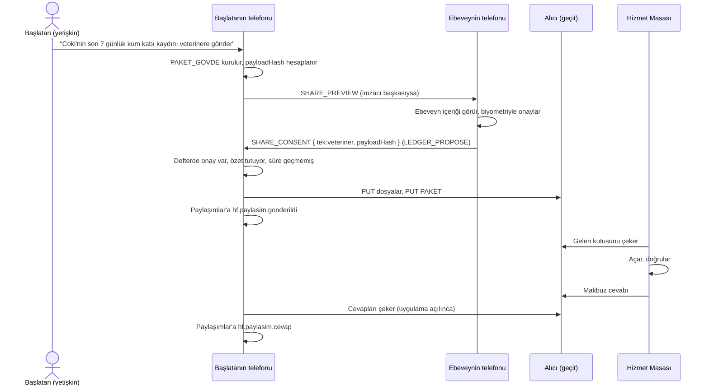

# RFC-0010 — Hizmet paylaşımı ve hizmet geçidi

> Durum: **Onaylandı** (Kerem, 23 Ekim 2026) · 23 Ekim 2026 · Yazan: Havenfold çekirdek ekibi · Onay: Kerem
> Kurucu belge: §2 (işletilen servisler), §3 ilke 1, 4, 6, 10; §4 (topluluk dışına çıkış), §6.3 (olay 19), §15.3, §16.1, §17.1. Çatı: §6 (dış paylaşım), §9 yol 3, §15.
> Bağımlılık: RFC-0003 §5.7 (`SHARE_CONSENT`), RFC-0001 (koleksiyon, kayıt, dosya biçimi, `append-event`), RFC-0002 (sürekli görev), RFC-0004 (yedek), RFC-0005 (ekip imzaları, `NOTICE`, `_subj` kuralı), RFC-0006 (kayıtların olay alanları).
> Kod yeri: `havenfold/core/hizmet` (`@havenfold/services`): paket, onay yorumu, dizin doğrulama. `havenfold/services/hizmet-alicisi`: referans alıcı. Hizmet geçidi ve Hizmet Masası Eser'in kapalı depolarındadır.

## 1. Sorun

Topluluğun verisi bazen dışarı çıkmalı: kedinin kum kabı kaydı veterinere, yaşlı annenin ilaç çizelgesi bakım uzmanına, şubedeki alarm karesi güvenlik firmasına, raftaki eksik tedarikçiye. Çatı §9 bunu "hizmet paylaşımı" diye tanımlıyor ve ilke 6 kuralını koyuyor: tek seferlik, süreli, kapsamı belli paket ve açık onay.

Bugün şunlar tanımlı değil:

- Hizmetin kim olduğu ve kullanıcı hesabı olmadan nasıl tanındığı.
- Paketin biçimi. RFC-0003 §5.7 `SHARE_CONSENT`'i yalnız onay kaydı olarak tanımlıyor ve "paket biçimi hizmet geçidinin RFC'sindedir" diyor.
- Onayı kimin verdiği, nasıl geri alındığı, süresinin nasıl işlediği.
- Eser'in işlettiği hizmet geçidinin neyi gördüğü ve ücretin nerede başladığı.

## 2. Öneri özeti

- **Hizmet** bir işletmedir; topluluğun üyesi ya da misafiri değildir. Kimliği bir Ed25519 imza anahtarı ile bir X25519 şifreleme anahtarıdır.
- Hizmet iki yolla tanınır: Eser'in imzaladığı **hizmet dizini** (doğrulanmış) ya da yüz yüze okutulan **hizmet kartı** QR'ı.
- **Paket**, tek kullanımlık bir anahtarla doğrudan hizmetin açık anahtarına şifrelenir. Eser'in geçidi yalnız kilitli paketi taşır.
- Paketin özeti, gönderilmeden önce defterdeki `SHARE_CONSENT`'e yazılır. Gönderilen ile onaylanan arasında kriptografik bağ vardır.
- İki tür paylaşım: **tek** (bir paket) ve **kural** (alarm gibi, en çok 30 günlük, önceden onaylı, her paketi kaydedilen akış).
- Hizmet aileye kendiliğinden yazamaz; yalnız aldığı pakete, süresi içinde cevap verebilir.
- Her gönderim ve cevap topluluğun **Paylaşımlar** koleksiyonuna kaydedilir.
- Yeni defter olayı yoktur. İptal, aynı `shareId` ile yazılan bir `SHARE_CONSENT`'tir. Böylece 2.1 istemcileriyle uyum bozulmaz.
- Aile ve işletme paket başına ödemez. Ücret hizmet sağlayıcının geçit aboneliğinde ve sürekli kural paketlerindedir.
- Geçit Türkiye'de barındırılır. Protokol açıktır; isteyen hizmet kendi alıcısını kurar.

## 3. Tanımlar ve kodlama

### 3.1 Tanımlar

| Ad | Anlam |
|----|-------|
| **Hizmet** | Topluluğun dışında, onaylı paketle çağrılan sağlayıcı. Bir işletmedir. |
| **Kategori** | Hizmetin türü: `veteriner`, `bakim`, `saglik`, `guvenlik`, `usta`, `tedarikci`, `cagri`, `destek`. |
| **Hizmet kartı** | Hizmetin kendi imzaladığı kimlik ve adres bilgisi (§4). |
| **Hizmet dizini** | Eser'in doğruladığı kartların Eser imzalı listesi (§5). |
| **Paket** | Hizmete giden şifreli, tek kullanımlık veri (§7). |
| **Hizmet geçidi** | Eser'in işlettiği, paketleri saklayıp hizmete teslim eden servis (§13). Kodu kapalı, protokolü açık. |
| **Alıcı** | Paketleri kabul eden herhangi bir sunucu: Eser'in geçidi ya da hizmetin kendi kurduğu referans alıcı. |
| **Takma ad** | Bir üyenin bir hizmete görünen, o hizmete özel imza anahtarı (§7.4). |
| **Hizmet Masası** | Hizmetin paketleri açtığı Eser uygulaması (kapalı). |

**Hizmet, misafir ve bağ farkı:**

| | Hizmet | Misafir (`GRANT`) | Bağ (`LINK`) |
|-|--------|-------------------|--------------|
| Kim | İşletme (veteriner, güvenlik firması) | Kişi (bakıcı, taşeron) | Başka bir topluluk |
| Topluluğa girer mi | Hayır; defteri ve anahtarları hiç görmez | Kendi koleksiyonları için okur | Hayır; yalnız köprü kişi |
| Veri nasıl gider | Tek tek paket | Koleksiyon eşitlemesi | Geniş aile sohbeti |
| Süre | Paket başına | `GRANT` süresi | Koparılana kadar |
| Ne zaman seçilir | Bir uzmanın bir veriye bakması gerekiyorsa | Kişi bir süre evde ya da işte çalışacaksa | İki aile ya da iki işletme ilişkiliyse |

### 3.2 Kodlama

- Kodlama kuralları RFC-0001 §3'teki gibidir: `compact-encoding`, en kısa `c.uint`, seçimli alanda varlık bayrağı, imza gönderilen baytlar üzerinden, özete giren tamsayılar `u64be`.
- Etiketler `hf/share-*/` ve `hf/service-*/` biçimindedir; tam liste §16'da.
- Algoritmalar yalnız kurucu §13.2'dekilerdir: X25519, Ed25519, XChaCha20-Poly1305, BLAKE2b ve etiketli türetme. Yeni algoritma yoktur (H7).
- Geçitle konuşma HTTPS üzerindendir (kurucu §13.2, protokol dışı TLS). Topluluk içindeki mesajlar zarf türleriyle gider (§16).

## 4. Hizmet kimliği

### 4.1 Hizmet kartı

```
HIZMET_KARTI {
  serviceId  : fixed16       // hash('hf/service-id/', signPub)[0..16]
  signPub    : fixed32       // Ed25519; hizmetin kalıcı kimliği
  encPub     : fixed32       // X25519; paketlerin şifrelendiği anahtar
  keyVersion : uint          // encPub her değiştiğinde artar
  name       : string        // işletmenin adı
  category   : string        // §3.1
  region     : string        // il kodu, ör. 'TR-35'
  contact    : string        // açık adres ve telefon
  endpoint   : string        // https://… alıcının adresi
  accepts    : array<string> // kabul ettiği kayıt türleri, ör. 'yuva.pet.*'
  kural      : bool          // sürekli kural kabul eder mi
  maxMB      : uint          // tek paketin dosyalar dahil üst sınırı
  keepDays   : uint          // açılan paketi en çok kaç gün sakladığı (beyan)
  issuedAt   : uint          // ms
  sig        : fixed64       // Ed25519(signPub, hash('hf/service-card/', gönderilen baytlar sig hariç))
}
```

- Kartı hizmet kendisi imzalar. `serviceId` imza anahtarından türediği için başka bir hizmet aynı kimliği taşıyamaz.
- **Şifreleme anahtarının değişmesi:** Hizmet yeni `encPub` ile `keyVersion`'ı artırıp kartı yeniden imzalar. Uygulama, aynı `serviceId` için daha büyük `keyVersion`'lı geçerli kartı kabul eder; küçüğünü reddeder.
- **İmza anahtarının değişmesi:** Yeni bir `serviceId` demektir. Hizmet yeniden dizine girer ya da yeniden yüz yüze eklenir. Eski kimlik dizinin `revoked` listesine girer.
- Hizmetin gizli anahtarları Hizmet Masası'nda durur. Bir hizmetin birden çok cihazı varsa anahtarların bu cihazlara dağıtımı Hizmet Masası'nın işidir; protokol tek `encPub` görür.

### 4.2 Hesap konusu (ilke 1)

İlke 1 ("hesap yok") aileler ve ekipler içindir. Hizmet sağlayıcı Eser'in iş ortağıdır: sözleşmesi, faturası ve doğrulama kaydı vardır. Bu, ailenin ya da işletmenin Eser'de hesabı olmasını gerektirmez. Geçit hiçbir zaman aileyi ya da ekibi tanımaz (§13.3).

## 5. Hizmetin tanınması

### 5.1 Hizmet dizini (doğrulanmış yol)

```
HIZMET_DIZINI {
  version    : uint
  region     : string               // il kodu
  issuedAt   : uint
  validUntil : uint                 // en çok issuedAt + 14 gün
  cards      : array<buffer>        // HIZMET_KARTI kodlamaları
  revoked    : array<fixed16>       // son 90 günde dizinden çıkarılan serviceId'ler
  sig        : fixed64              // Ed25519(dizin anahtarı, hash('hf/service-dir/', gönderilen baytlar sig hariç))
}
```

- **Dizin anahtarı:** Eser'in çevrimdışı tuttuğu ayrı bir Ed25519 anahtarıdır. Sürüm kök anahtarından (kurucu §9.4) ayrıdır; ikisi farklı rollerdir. Uygulamalarda iki açık anahtar sabittir: geçerli ve sıradaki. Anahtar değişimi uygulama güncellemesiyle olur.
- **İndirme:** Uygulama dizini il bazında **bütün dosya** olarak indirir (`GET /v1/dizin/{region}`). Tek bir hizmeti sormaz; böylece Eser, ailenin hangi hizmete baktığını öğrenmez. Yalnız hangi ilin dizinini indirdiğini öğrenir.
- **Tazelik:** Uygulama dizini haftada bir ve her paylaşımdan önce, eskiyse, yeniler. `validUntil`'i geçmiş dizinle **yeni** paylaşım başlatılmaz; arayüz "Hizmet listesi güncel değil" der. Kural paylaşımları da bu denetimi yapar (§9.4).
- **Doğrulama koşulları** (Eser'in hizmeti dizine alması için):
  - Türkiye'de yerleşik işletme; vergi levhası, sözleşme.
  - Kategoriye göre meslek belgesi: veteriner hekim oda kaydı, sağlık kuruluşu ruhsatı, özel güvenlik izin belgesi, ustalık ya da esnaf kaydı.
  - KVKK taahhüdü: `keepDays` beyanına uymak, paketi `useUntil`'den sonra kullanmamak, gerekiyorsa VERBİS kaydı.
  - Hizmet Masası ya da referans alıcı kurulumu.
- Arayüzde dizindeki hizmet "Eser doğruladı" rozetiyle görünür.

### 5.2 Yüz yüze kart (kişinin kendi doğrulaması)

- Hizmet kendi kartını QR olarak gösterir: `hfh1:` + RFC 4648 base32 (büyük harf, dolgusuz) ile kodlanmış `HIZMET_KARTI` + 4 baytlık sağlama `hash('hf/service-card-qr/', kodlama)[0..4]`.
- Telefon kartın imzasını ve sağlamayı denetler. Dizinde aynı `serviceId` varsa dizindeki kart esastır.
- Arayüzde "Yüz yüze eklediniz, Eser doğrulamadı" rozeti görünür.
- Kart tazelemesi: `GET {endpoint}/v1/kart/{serviceId}`. Yalnız aynı `signPub` ile imzalı ve daha büyük `keyVersion`'lı kart kabul edilir.
- Bu yol kilitlenmeyi önler (ilke 9): Eser'le sözleşmesi olmayan bir hizmet de kendi alıcısını kurup paket alabilir.

### 5.3 Topluluğun bildiği hizmetler

- Eklenen her hizmet, Paylaşımlar koleksiyonuna (§10) `hf.hizmet.kart` kaydı olarak yazılır: kartın kendisi, tanınma yolu (`dizin` | `yuz-yuze`), ekleyen üye, tarih.
- Böylece ailedeki ya da ekipteki yetkili herkes aynı hizmet listesini görür.

## 6. Onay

### 6.1 `SHARE_CONSENT` alanları

RFC-0003 §5.7'deki gövde aynen kullanılır. Bu RFC alanların **yorumunu** tanımlar:

| Alan | Değer |
|------|-------|
| `shareId` | Rastgele 16 bayt |
| `service` | `hizmet:<serviceId, 32 hex>`; kişisel kaynakta `gizli:<commit, 64 hex>` (§6.3) |
| `scope` | `tek:<kategori>`, `kural:<kategori>`, `gizli` ya da `iptal` |
| `ownerId` | RFC-0003 §5.7: verinin sahibi üye; ortak veride 16 sıfır |
| `expiresAt` | `tek`: paketin gönderilebileceği son an. `kural`: kuralın bitişi. `iptal`: 0. |
| `payloadHash` | `tek` ve `gizli`: `hash('hf/share-payload/', PAKET_GOVDE kodlaması)`. `kural`: `ruleHash` (§9.1). `iptal`: 32 sıfır. |

**Yazan tarafın sınırları** (defter kuralı değil, çünkü `ts` yazana bağlıdır):

| `scope` | `expiresAt` en çok |
|---------|--------------------|
| `tek`, `gizli` | 7 gün sonrası |
| `kural` | 30 gün sonrası |

### 6.2 Kim imzalar

İmzacı kuralı defterde zaten denetlenir: ailede RFC-0003 §5.7, ekipte RFC-0005 §6.2.

| Veri | Aile | Ekip |
|------|------|------|
| Ortak veri (`ownerId` sıfır): evcil hayvan, ev, şube, raf | Herhangi bir ebeveyn | Herhangi bir sahip |
| Bir yetişkinin kendi verisi | O yetişkin | — |
| Bir çocuğun verisi (ortak koleksiyonlardaki) | Bir ebeveyn | — |
| Bir üyeyle ilgili iş verisi (ör. iş kazası raporu) | — | O üye **ve** bir sahip |

**Kim başlatır:** Kaynak koleksiyonun okuyucusu olan bir üye. Çocuk, geçici ve misafir başlatamaz. Başlatan imzacı değilse paketi imzacıya `SHARE_PREVIEW` ile gösterir (§8.1).

**Çocuğun kişisel koleksiyonu:** v1'de çocuk rolündeki üyenin `kisisel` koleksiyonundan hizmet paylaşımı **yapılmaz**. Gerekçe: Onayı ebeveyn verecekti, ama ebeveyn paketi görmeden onay veremez; görürse ergenin kişisel alanı (kurucu §7.6) delinir. İki güvenceden biri feda edilmez. Kriz durumunda kurucu §15.2'deki yönlendirme kuralı geçerlidir; o bir paket değildir.

### 6.3 Gizli onay (kişisel kaynak)

Bir yetişkin kendi `kisisel` koleksiyonundaki veriyi paylaşıyorsa (ör. kendi sağlık notu), onay defterde bütün aileye görünür. Hizmetin adı görünmesin diye:

- `service = 'gizli:' + hex(hash('hf/share-svc/', serviceId, salt))`, `salt` rastgele 32 bayt.
- `scope = 'gizli'`. Kategori yazılmaz.
- `salt`, hizmet ve ayrıntılar yalnız sahibin kendi kişisel koleksiyonundaki denetim kaydında durur (§10.3).
- Aile yalnız "Ayşe bir dış paylaşım yaptı" görür. Bu, onayın var olduğunu gizlemez; içeriğini gizler. Kural paylaşımı gizli yapılamaz.

### 6.4 Yorum kuralları

1. Bir `shareId` için defterdeki **ilk** `SHARE_CONSENT` onaydır.
2. Aynı `shareId`, aynı `ownerId` ve aynı `service` ile yazılan, `scope = 'iptal'` olan ilk olay **iptaldir** (§12.1). Başka tekrarlar yok sayılır.
3. Biçimi bozuk bir alan (bilinmeyen `scope`, yanlış uzunlukta hex) onayı **geçersiz sayar**: o onayla gönderim yapılmaz.
4. Kural paylaşımında, onayı imzalayan üyelerin hiçbiri aktif değilse (atıldı, ayrıldı) onay iptal edilmiş sayılır. Cihaz değişiminde `rotatedTo` zinciri izlenir (RFC-0003 §5.13). Bu, RFC-0003 §5.12'deki misafir kuralının karşılığıdır.

**Yeni ret kuralı yoktur.** Bu RFC defter doğrulamasına hiçbir koşul eklemez; yalnız yorum ekler. Gerekçe: Bu RFC'yi bilmeyen 2.1 istemcileri `SHARE_CONSENT`'i yalnız imzacısına bakarak kabul ediyor. Yeni istemci aynı olayı reddederse iki istemci sessizce ayrı zincirde kalırdı (RFC-0003 §2.1'deki tehlike). Bu yüzden 30–31 numaralı defter olayları kullanılmaz; ayrılmış kalır.

## 7. Paket

### 7.1 Gövde

```
PAKET_GOVDE {
  v         : uint            // 1
  serviceId : fixed16
  shareId   : fixed16         // SHARE_CONSENT.shareId
  seqNo     : uint            // tek: 0; kural: kuraldaki sıra
  kind      : string          // 'tek' | 'kural' | 'silme'
  category  : string
  title     : string          // ≤ 120 bayt
  note      : string          // ≤ 2 KB; kullanıcının yazdığı
  items     : array<{ type: string, fields: buffer }>   // ≤ 64; fields: RFC-0001 §4.3'teki { name, value } listesinin kodlaması
  files     : array<{ blobId: fixed32, fileKey: fixed32, size: uint, mime: string, name: string }>   // ≤ 8
  issuedAt  : uint            // ms
  useUntil  : uint            // hizmetin veriyi kullanabileceği son an; en çok issuedAt + 365 gün
  replyPub  : fixed32         // bu pakete cevap için tek kullanımlık X25519 açık anahtarı
  sender    : { pseudoPub: fixed32, label: string }    // label ≤ 64 bayt, kullanıcının seçtiği görünen ad
  ruleProof : { rule: buffer, delegation: buffer }?     // yalnız kural paketinde (§9)
  ref       : fixed16?        // yalnız 'silme' paketinde: silinmesi istenen packageId
}

PAKET_IC  { body: buffer, sig: fixed64 }
sig = Ed25519(imzalayan, hash('hf/share-pkg/', serviceId, body))
      imzalayan: tek ve silme → sender.pseudoPub'ın gizli yarısı; kural → delegation.delegatePub'ın gizli yarısı
```

- **İçerik kaynakla aynı değildir.** Telefon kayıttan yalnız kullanıcının seçtiği alanları alır. Önizleme ekranı paketin tam içeriğini gösterir.
- **Dosyalar yeniden şifrelenir.** Koleksiyondaki dosyanın kendi anahtarı hizmete verilmez. Her dosya RFC-0001 §11 biçimiyle, yeni ve rastgele bir `fileKey` ile yeniden şifrelenir. Böylece hizmet, ailenin dosya deposundaki hiçbir anahtarı öğrenmez.
- `files` ve `replyPub` rastgele değerler içerdiği için gövde, onaydan **önce** kesinleşir ve `payloadHash` onu bağlar (§8.1).
- `silme` paketi veri taşımaz; yalnız `ref` ile hizmetten bir paketi silmesini ister (§12.2). Onay gerektirmez, çünkü topluluk dışına yeni veri çıkarmaz.

### 7.2 Şifreleme (alıcıya giden)

```
PAKET {
  v          : uint           // 1
  serviceId  : fixed16
  packageId  : fixed16        // rastgele; shareId'den bağımsız
  keyVersion : uint           // kullanılan encPub'ın sürümü
  ephPub     : fixed32        // tek kullanımlık X25519
  nonce      : fixed24        // rastgele
  expiresAt  : uint           // teslim son anı; en çok gönderimden 7 gün sonra
  ct         : buffer
}
dh  = hash('hf/share-dh/', X25519(ephSecret, encPub), ephPub, encPub)
k   = derive(dh, 'hf/share-key/')
AD  = hash('hf/share-ad/', serviceId, packageId, u64be(keyVersion), ephPub, u64be(expiresAt))
ct  = XChaCha20-Poly1305(k, nonce, encode(PAKET_IC), AD)
```

- Her pakette yeni bir `ephSecret` üretilir ve gönderimden hemen sonra `sodium_memzero` ile silinir. Gönderen tarafta ileri gizlilik paket düzeyindedir.
- X25519 sonucunun 32 sıfır olması reddedilir (`INVALID_KEY`).
- Paylaşılan sır iki açık anahtarla birlikte özetlenir. Böylece `k`, kullanılan `ephPub` ve `encPub` çiftine bağlanır; aynı sır başka bir anahtar çiftiyle yeniden kullanılamaz.
- `packageId` ile `shareId` ayrıdır. Geçit `shareId`'yi görmez; aynı onaya ait kural paketlerini kimlikten birbirine bağlayamaz. Hizmet içeriden bağlar (`shareId`, `seqNo`).
- **Hizmetin denetimi:** `ct` çözülür; `sig` doğrulanır; `body.serviceId` kendi kimliği; `useUntil ≥ issuedAt`; kural paketinde §9.2'deki zincir. Biri tutmazsa paket atılır ve gönderene `makbuz` yerine `ret` cevabı gider (§8.3).

### 7.3 Dosyaların taşınması

- Dosya parçaları alıcıya ayrı yüklenir: `PUT /v1/b/{serviceId}/{blobId}/{index}` (§13.1).
- Toplam boyut hizmetin `maxMB` değerini ve 25 MB'ı aşamaz (`SIZE_OVERRUN`). Daha büyük veri (video arşivi) hizmet paylaşımıyla değil, dışa aktarmayla verilir (çatı §9 yol 4).

### 7.4 Takma ad

- Her üye, her hizmet için ayrı ve rastgele bir Ed25519 anahtar çifti üretir: **takma ad**. İlk paylaşımda üretilir.
- Gizli yarısı üyenin telefonunda Arşiv katmanında durur ve üyenin yedeğine girer (RFC-0004 §2). Telefon değişince yedekten geri gelir; hizmet aynı kişiyi tanımaya devam eder.
- **Neden takma ad:** Paket, üyenin topluluk kimlik anahtarıyla imzalansaydı iki hizmet anlaşarak aynı kişiyi eşleyebilirdi. Takma ad hizmete özeldir; hizmetler arası bağlantı kurulamaz.
- Hizmet, aynı takma addan gelen paketleri birbirine bağlar. Bu bilinçlidir: veteriner aynı hayvanın dosyasını tutabilmelidir.
- Defterdeki onay, takma ada değil üyenin topluluk kimliğine bağlıdır. Takma ad ile topluluk kimliği arasındaki bağı yalnız topluluğun Paylaşımlar kaydı bilir.

## 8. Tek seferlik paylaşım

### 8.1 Akış



1. **Hazırlık:** Başlatan, hizmeti ve kayıtları seçer. Telefon gövdeyi kurar. Dosyaları yeni anahtarlarla şifreler, ama henüz yüklemez.
2. **Önizleme:** İmzacı başlatanın kendisiyse önizleme kendi ekranındadır. Değilse `SHARE_PREVIEW` imzacıya gider. İmzacı paketin tam içeriğini, hizmetin kartını, rozetini (`Eser doğruladı` ya da `Yüz yüze`), `keepDays` ve `useUntil` değerlerini görür.
3. **Onay:** İmzacı biyometriyle onaylar ve `SHARE_CONSENT`'i imzalar. Özel nitelikli kategoride (`saglik`, `bakim`) onay ekranı açık rıza metnini içerir (§14).
4. **Gönderim koşulu:** Telefon şunları denetler. Biri tutmazsa göndermez:
   - defterde bu `shareId` için geçerli onay var (§6.4) ve iptal edilmemiş;
   - `payloadHash` gövdenin özetine eşit;
   - kendi saatine göre `expiresAt` geçmemiş;
   - hizmet dizinde ve dizin güncel, ya da yüz yüze eklenmiş ve kartı geçerli.
5. **Gönderim:** Dosyalar ve paket alıcıya yüklenir. `ownerSecret` ve `replySecret` denetim kaydına yazılır.
6. **Kayıt:** Telefon Paylaşımlar'a `hf.paylasim.gonderildi` yazar (§10).

```
SHARE_PREVIEW (0xD0) {
  familyId : fixed32
  shareId  : fixed16
  card     : buffer                                   // HIZMET_KARTI
  body     : buffer                                   // PAKET_GOVDE (dosya anahtarları dahil)
  sources  : array<{ collectionId: fixed16, recordIds: array<fixed16> }>
  fromId   : fixed16
  sig      : fixed64   // Ed25519(fromId, hash('hf/share-preview/', familyId, gönderilen baytlar sig hariç))
}
```

- İmzacı, önizlemedeki dosyaları başlatandan `BLOB_REQ` ile çeker (RFC-0001 §11.2).
- İmzacı onay vermezse hiçbir şey yazılmaz; başlatanın telefonu taslağı 24 saat sonra siler.

### 8.2 Tekrar ve yeniden gönderim

- Aynı onayla en çok **bir** paket gönderilir (`seqNo = 0`). Alıcı 5xx dönerse aynı `PACKAGE_ERROR` baytları yeniden gönderilir; yeni paket üretilmez.
- Alıcı aynı `packageId`'yi ikinci kez `409` ile reddeder.

### 8.3 Cevap

Hizmet yalnız aldığı pakete, `useUntil`'e kadar ve en çok 16 kez cevap verebilir. Kendiliğinden yazamaz. Böylece hizmet kanalı reklam ya da istenmeyen mesaj yolu olamaz.

```
CEVAP {
  packageId : fixed16
  n         : uint            // 0'dan başlar
  ephPub    : fixed32
  nonce     : fixed24
  ct        : buffer          // XChaCha20-Poly1305(k, nonce, encode(CEVAP_IC), AD)
}
dh = hash('hf/share-reply-dh/', X25519(hizmetEph, replyPub), ephPub, replyPub)
k  = derive(dh, 'hf/share-reply-key/')
AD = hash('hf/share-reply-ad/', packageId, u64be(n), ephPub)

CEVAP_IC {
  kind  : string             // 'makbuz' | 'ret' | 'mesaj' | 'belge' | 'silindi'
  text  : string             // ≤ 4 KB
  files : array<{ blobId, fileKey, size, mime, name }>   // ≤ 4; toplam ≤ 10 MB
  at    : uint
  sig   : fixed64            // Ed25519(hizmet signPub, hash('hf/share-reply/', packageId, u64be(n), gönderilen baytlar sig hariç))
}
```

- `makbuz` paketi açıp doğruladığını, `ret` doğrulayamadığını, `silindi` bir silme isteğinin yapıldığını bildirir.
- Telefon cevabı `replySecret` ile açar, imzayı karttaki `signPub` ile doğrular. Geçersiz cevap atılır.
- Geçerli cevap Paylaşımlar'a `hf.paylasim.cevap` olarak yazılır. Dosyaları RFC-0001 §11 biçimiyle koleksiyona alınır.

## 9. Sürekli kural

Bazı hizmetler tek tek onayla çalışamaz: şubede alarm çaldığında güvenlik firmasına kare gitmeli, kimse uyanık olmasa da. Kural, ilke 6'yı şöyle karşılar: **onay önceden, açık ve süreli verilir; her paket yine tek seferlik, kapsamı belli ve kayıtlıdır.**

### 9.1 Kural

```
KURAL {
  ruleId    : fixed16         // = shareId
  serviceId : fixed16
  category  : string          // yalnız 'guvenlik', 'bakim', 'cagri'
  triggers  : array<string>   // olay türleri, ör. 'mekan.guvenlik.alarm', 'hf.sos'
  placeId   : fixed16         // 16 sıfır: topluluğun her yeri
  include   : array<string>   // 'olay' | 'kare' | 'klip' (klip ≤ 20 sn)
  maxPerDay : uint            // ≤ 50
  useDays   : uint            // her paketin useUntil = issuedAt + useDays; ≤ 90
  expiresAt : uint            // = SHARE_CONSENT.expiresAt
}
ruleHash = hash('hf/share-rule/', encode(KURAL))

DELEGE {
  ruleHash    : fixed32
  serviceId   : fixed16
  delegatePub : fixed32       // bu kural için üretilmiş Ed25519
  expiresAt   : uint
  sig         : fixed64       // Ed25519(takma ad, hash('hf/share-deleg/', gönderilen baytlar sig hariç))
}
```

| Kural | Neden |
|-------|-------|
| Yalnız `guvenlik`, `bakim`, `cagri` kategorileri ve kartında `kural: true` olan hizmet | Kural yalnız gerçekten beklenmeyen olaya cevap gereken işlerde |
| En çok 30 gün; yenilemek yeni onaydır | Unutulmuş sonsuz akış olmasın |
| Günde en çok 50 paket | Bozuk bir sensör bütün gün kare göndermesin |
| `include` içinde ses yok | Kamera kaydında ses ayrı bir mahremiyet konusudur |
| Yurt dışı hizmete kural yok | §14 |
| Kişisel kaynaktan kural yok | §6.3 |

### 9.2 Kuralın kurulması ve çalışması

1. Yetkili üye (ailede ebeveyn, ekipte sahip ya da yönetim alanında yönetici) kuralı kurar. Onay §6.2'deki imzacıdan alınır; `payloadHash = ruleHash`.
2. **Kim çalıştırır:**
   - Tetikleyici bir kamera ya da sensör olayıysa: o yerdeki, ilgili sürekli görevi çalıştıran **işçi**. Kutu çalıştırmaz, çünkü içerik görmez.
   - Tetikleyici `hf.sos` ise: SOS'u başlatan telefonun kendisi.
3. Üye bir `DELEGE` imzalar ve işçiye `SHARE_RULE` gönderir:

```
SHARE_RULE (0xD1) {
  familyId       : fixed32
  consentSeq     : uint       // SHARE_CONSENT olayının seq'i
  rule           : buffer     // KURAL
  card           : buffer     // HIZMET_KARTI
  delegation     : buffer     // DELEGE
  delegateSecret : fixed64    // delegatePub'ın gizli anahtarı
  pseudoPub      : fixed32    // kuralı kuranın bu hizmetteki takma adı; pakette sender.pseudoPub olur
  label          : string     // hizmete görünen ad
  fromId         : fixed16
  sig            : fixed64    // Ed25519(fromId, hash('hf/share-rule-msg/', familyId, gönderilen baytlar sig hariç))
}
SHARE_RULE_ACK (0xD2) { ruleId: fixed16, accepted: bool, code: string, sig: fixed64 }   // işçi, 'hf/share-rule-ack/'
```

4. **İşçinin denetimi:** Biri tutmazsa `accepted: false` ve kod döner.

   | # | Denetim | Kod |
   |---|---------|-----|
   | 1 | `consentSeq`'teki olay bir `SHARE_CONSENT`; `scope = 'kural:<category>'`; `payloadHash = ruleHash`; §6.4'e göre iptal edilmemiş | `NO_APPROVAL` |
   | 2 | `fromId` aktif ve yetkili üye (madde 1) | `UNAUTHORIZED` |
   | 3 | `DELEGE` imzası `pseudoPub` ile geçerli; `DELEGE.ruleHash` kuralın özeti; `delegatePub` gizli anahtarla eşleşiyor | `INVALID_SIGNATURE` |
   | 4 | Kart imzası geçerli; `kural: true` | `NOT_SERVICE_ELIGIBLE` |
   | 5 | İşçi Paylaşımlar koleksiyonunda `device:` yazarı (§10.1) | `NO_RECORD` |
   | 6 | Ekipte, kamera içeriği varsa: §9.3 | `NO_DISCLOSURE` |
   | 7 | Ücret: §11.3 | `ABONELIK_YOK` |

5. **Tetiklenince:** İşçi olay anında, kendi bellekteki veriden paketi kurar (`kind: 'kural'`, `seqNo` artar, `ruleProof` dolu), `delegateSecret` ile imzalar, şifreler ve gönderir. Aynı anda Paylaşımlar'a `REC_DROP` ile `hf.paylasim.gonderildi` olayı bırakır.
6. **Durma:** İşçi şu durumlardan birinde kuralı siler, `delegateSecret`'i sıfırlar ve göndermeyi keser:
   - defterde iptal görür (§6.4 kural 2 ya da 4);
   - kendi saatine göre `expiresAt` geçer;
   - günlük sınıra ulaşır (o günün geri kalanı için);
   - kendisi topluluktan çıkarılır.

**Hizmetin kural denetimi:** `ruleProof.delegation` imzası `body.sender.pseudoPub` ile geçerli olmalı; aynı `shareId`'li bütün paketlerde `sender.pseudoPub` aynı olmalı; paket imzası `delegatePub` ile geçerli olmalı; `ruleHash = hash('hf/share-rule/', ruleProof.rule)`; paket `expiresAt` ve `maxPerDay` içinde olmalı. Hizmet, kuraldan fazla gelen paketi açar ama `ret` cevabıyla bildirir.

### 9.3 Mekan'da aydınlatma bağı

Ekipte, `include` içinde `kare` ya da `klip` olan kural ancak kuralın yerinde (`placeId`; sıfırsa işçinin yeri) etkin bir `NOTICE` (RFC-0005 §7.3) varsa ve o `NOTICE`'in `outbound` listesi `hizmet:<serviceId>` içeriyorsa çalışır. Böylece çalışanlara verilen aydınlatma metni, görüntünün hangi firmaya gidebileceğini yazmış olur. Kural kurulurken telefon önce aydınlatma metnini bu hizmetle günceller ve sahibin imzasıyla yeni `NOTICE`'i yazar.

### 9.4 Dizin tazeliği

İşçi, dizinden gelen hizmet için güncel dizini (`validUntil` geçmemiş) haftalık olarak kendisi çeker. Dizin eskirse ya da hizmet `revoked` listesine girerse kural durur ve yetkili üyelere `hf.paylasim.kural-durdu` olayı gider.

## 10. Denetim kaydı

### 10.1 Paylaşımlar koleksiyonu

| Topluluk | Tür | Okur | Yazar | Görev | Geçmiş |
|----------|-----|------|-------|-------|--------|
| Aile | olaylar | `rol:ebeveyn`, `rol:yetiskin` | aynı + kural çalıştıran işçinin `device:` | ✗ | ✓ |
| Ekip | olaylar | `rol:sahip`, `rol:yonetici` | aynı + kural çalıştıran işçinin `device:` | ✗ | ✓ |

- Tür `olaylar`'dır, çünkü kural çalıştıran işçinin kaydı ancak `append-event` ile bırakabilmesi gerekir (RFC-0001 §10). Üyeler `put` ile yazar.
- Kural kurulurken telefon, işçiyi `COLLECTION` olayıyla `device:` yazarı yapar; kural bitince kaldırır (RFC-0002 §10 düzeni).

### 10.2 Kayıt türleri

| Tür | Alanlar |
|-----|---------|
| `hf.hizmet.kart` | `card` (bytes), `trust` (`dizin` \| `yuz-yuze`), `addedBy`, `addedAt` |
| `hf.paylasim.gonderildi` | `shareId`, `packageId`, `serviceId`, `serviceName`, `category`, `kind`, `seqNo`, `payloadHash`, `ctHash` (= `hash('hf/share-ct/', PAKET baytları)`), `size`, `fileCount`, `sentAt`, `senderId`, `consentSeq`, `ownerSecret`, `replySecret`, `consentTextVersion` |
| `hf.paylasim.cevap` | `packageId`, `n`, `kind`, `text`, `files` (blobRef), `at` |
| `hf.paylasim.iptal` | `shareId`, `consentSeq`, `by`, `deletedAtGateway` (bool) |
| `hf.paylasim.kural` | `ruleId`, `rule` (bytes), `workerId`, `ack` (`accepted`, `code`) |

- Bu kayıtlar RFC-0006 kaydıdır: `_v = 1`, `_t` (olayın anı), `_subj = 'topluluk'`. İşçinin `REC_DROP` ile bıraktığı kayıtta `_subj` zorunludur; ekipte `_subj` taşımayan cihaz kaydı geçersizdir (RFC-0005 §12.1). Saklama süresi yoktur (`_keep` yok); KVKK süreleri `hf.saklama` ile uygulanır (RFC-0006 §14.2).
- `ownerSecret` ve `replySecret` kayıtta durur. Böylece koleksiyonun herhangi bir okuyucusu teslim edilmemiş paketi iptal edebilir ve cevapları okuyabilir; yalnız gönderen telefona bağlı kalınmaz.
- Paketin kendisi kaydedilmez; yalnız özetleri. İçerik zaten kaynak kayıtlarda durur.

### 10.3 Gizli paylaşımın kaydı

`gizli` onaylı paylaşımın bütün kayıtları (`salt` dahil) sahibin kendi `kisisel` koleksiyonuna yazılır. Paylaşımlar koleksiyonuna yazılmaz.

### 10.4 Arayüz

- Ayarlar → Paylaşımlar: kime, ne zaman, ne gitti; cevaplar; "İptal et", "Hizmetten silmesini iste".
- Kural paketi gidince yetkili üyelere bildirim: "Şube alarmı: Güven Güvenlik'e 1 kare gönderildi."

## 11. Ücret kancaları

Çatı §9: "Ücretli katman burada başlar." Aşağıdaki tutarlar **varsayılandır, değiştirilebilir**; son kararı Kerem verir.

### 11.1 Kim ne öder

| Kanca | Kim öder | Varsayılan |
|-------|----------|------------|
| Tek seferlik paket | Aile ve işletme ödemez | 0 |
| Hizmetin geçit aboneliği (Hizmet Masası) | Hizmet sağlayıcı | Aylık 750 TL + KDV; ayda 300 paket dahil; aşımda paket başına 3 TL |
| Sürekli kural, Yuva | Aile: hizmet eklentisi, `PLAN hizmet:<kategori>` (mağaza aboneliği) | Fiyatı hizmetle Eser birlikte belirler; Eser'in payı mağaza payından sonra %20 |
| Sürekli kural, Mekan | İşletme: yer aboneliğine dahil (`PLAN mekan`, RFC-0005 §13.2) | Yer başına ayda 200 kural paketi; aşım sözleşmedeki birim fiyatla |
| Kendi alıcısını kuran hizmet | Kimse Eser'e ödemez | 0 |

### 11.2 Kurallar

- **Aileden paket başına ücret alınmaz.** Paket başına ödeme, geçidin ödeyeni tanımasını gerektirirdi. Geçit aileyi tanımamalıdır (§13.3).
- Hizmetin aileye ya da işletmeye kestiği kendi faturası (muayene ücreti gibi) Eser'in konusu değildir.
- Hizmet eklentisi biterse **yalnız kural paketleri** durur. Tek seferlik paylaşım sürer. Aile ya da ekip içinde hiçbir özellik kapanmaz.
- SOS aile içinde her zaman ücretsizdir. SOS'un dış çağrı merkezine iletilmesi bir hizmettir ve hizmet eklentisine bağlıdır.

### 11.3 Ücretin denetimi

- Ücreti geçit değil, **gönderen cihaz** denetler. Geçit hiçbir zaman ailenin ödemesini görmez.
- Kural çalıştıran işçi ya da telefon, kendi saatiyle defterdeki `PLAN` olayına bakar: ailede `hizmet:<kategori>`, ekipte `mekan`. Süresi geçmişse `ABONELIK_YOK` ile durur ve yetkililere bildirir.
- `PLAN` doğrulaması bugünkü gibi cihazda yapılır (04 §4.2).
- Geçit yalnız hizmetin B2B kotasını sayar.

## 12. İptal ve süre

### 12.1 İptal

İptal, aynı `shareId` için `scope = 'iptal'`, `expiresAt = 0`, `payloadHash = 0`, aynı `ownerId` ve `service` ile yazılan bir `SHARE_CONSENT`'tir. İmzacı kuralı onayınkiyle aynıdır; ortak veride başka bir ebeveyn ya da sahip de iptal edebilir.

| Durum | İptalin etkisi |
|-------|----------------|
| Tek, henüz gönderilmedi | Hiç gönderilmez |
| Tek, gönderildi, hizmet çekmedi | Telefon `DELETE /v1/p/...` ile alıcıdan siler (`ownerSecret` ile) |
| Tek, hizmet açtı | Geri alınamaz. Arayüz bunu açıkça söyler ve "Hizmetten silmesini iste" önerir (§12.2). |
| Kural | İşçi iptali defterde görünce durur; alıcıda bekleyen paketleri siler; `delegateSecret`'i sıfırlar |

### 12.2 Silme isteği

- `kind: 'silme'` paketi, `ref` alanında bir `packageId` taşır. Veri taşımadığı için onay istemez.
- Hizmet Masası paketi ve dosyalarını siler, `silindi` cevabı döner.
- **Dürüst sınır:** Açılmış paketin silinmesi hizmetin dürüstlüğüne ve sözleşmesine dayanır. Kriptografi açılmış veriyi geri alamaz.

### 12.3 Süreler

| Süre | Ne | Kim uygular |
|------|----|-------------|
| `SHARE_CONSENT.expiresAt` | Gönderimin son anı (tek) ya da kuralın bitişi | Gönderen cihaz, kendi saatiyle |
| `PAKET.expiresAt` | Alıcıda teslim beklemenin son anı (≤ 7 gün) | Alıcı; geçince paketi ve dosyaları siler |
| `useUntil` | Hizmetin veriyi kullanabileceği son an | Hizmet Masası kendiliğinden siler; sözleşme bağlar |
| `keepDays` | Hizmetin beyan ettiği en uzun saklama | Hizmet Masası `min(useUntil, açılış + keepDays)` anında siler |

Defter hiçbir süreyi saatle karşılaştırmaz (K15). Süreler yalnız cihazların ve alıcının yerel kararlarıdır.

## 13. Hizmet geçidi

### 13.1 Alıcı arayüzü (açık protokol)

| Yöntem | Yol | Kim | Ne | Cevaplar |
|--------|-----|-----|----|----------|
| `GET` | `/v1/dizin/{region}` | Herkes | `HIZMET_DIZINI` (yalnız Eser geçidi) | 200, 404 |
| `GET` | `/v1/kart/{serviceId}` | Herkes | Güncel `HIZMET_KARTI` | 200, 404 |
| `PUT` | `/v1/b/{serviceId}/{blobId}/{index}` | Gönderen | Dosya parçası; başlık `x-hf-owner` | 201, 409, 413, 429 |
| `PUT` | `/v1/p/{serviceId}/{packageId}` | Gönderen | `PACKAGE_ERROR`; başlık `x-hf-owner` | 201, 409 tekrar, 410 hizmet yok, 413 boyut, 429 sınır |
| `DELETE` | `/v1/p/{serviceId}/{packageId}` | Gönderen | Teslim edilmemiş paketi ve dosyalarını siler; başlık `x-hf-owner-secret` | 204, 403, 404, 409 teslim edildi |
| `GET` | `/v1/r/{packageId}?after={n}` | Gönderen | Cevaplar; başlık `x-hf-owner-secret` | 200, 403 |
| `GET` | `/v1/inbox/{serviceId}?after={t}` | Hizmet | Yeni paketler; başlık `x-hf-auth` | 200, 401 |
| `POST` | `/v1/ack/{serviceId}/{packageId}` | Hizmet | Teslim alındı; alıcı paketi ve dosyaları hemen siler | 204, 401 |
| `PUT` | `/v1/r/{packageId}/{n}` | Hizmet | `CEVAP`; başlık `x-hf-auth` | 201, 401, 409, 410 süre doldu |

- `x-hf-owner = hex(hash('hf/share-owner/', ownerSecret))`; `ownerSecret` paket başına rastgele 32 bayt. Alıcı yalnız özeti saklar.
- `x-hf-auth = t ‖ nonce ‖ sig`, `sig = Ed25519(signPub, hash('hf/share-inbox/', serviceId, u64be(t), nonce, yöntem, yol))`. Alıcı ±5 dakika kabul eder ve aynı `nonce`'u 10 dakika içinde ikinci kez kabul etmez.
- Sınırlar: IP başına saatte 60 `PUT /p`; hizmet başına gelen kutusu sözleşmeyle.
- Cevaplar `useUntil` ya da 30 gün, hangisi önce gelirse, sonra silinir.

### 13.2 Eser'in geçidi neyi ekler

| Parça | Açık mı |
|-------|---------|
| Yukarıdaki arayüz ve biçimler | Açık (Apache-2.0, bu RFC) |
| Referans alıcı (`services/receiver`): arayüzün en küçük uygulaması ve paket açan komut satırı aracı | Açık, AGPL-3.0 (Posta Kutusu ile aynı gerekçe, kurucu §17.1) |
| Eser'in geçidi: dizin üretimi, hizmet doğrulama süreci, B2B faturalama, kota, kötüye kullanım koruması | Kapalı |
| Hizmet Masası (hizmetin uygulaması) | Kapalı |

### 13.3 Geçit neyi görür (dürüst dil)

| Görür | Görmez |
|-------|--------|
| Gönderenin IP adresi ve zamanı | Paketin ve dosyaların içeriği |
| Paket ve dosya boyutları | Gönderenin adı, takma adı, topluluk kimliği |
| Hedef hizmetin kimliği (dolayısıyla kategorisi) | Aile ya da işletme adı, `familyId`, üyeler |
| `packageId`, `x-hf-owner` özeti | Onay kaydı, `shareId`, kural ayrıntısı |
| Hizmetin IP'si, ne zaman çektiği, cevap boyutları | Cevapların içeriği |
| Hangi ilin dizininin indirildiği | Kişinin dizinde hangi hizmete baktığı |

**Kullanıcıya söylenen cümle:** "Paketinizin içini biz göremeyiz. Hangi hizmete, ne zaman ve ne büyüklükte gönderildiğini görürüz; kim olduğunuzu bilmeyiz."

- IP adresi kişisel veri sayılabilir. Geçit IP kayıtlarını 30 gün sonra siler. Faturalama için yalnız hizmet başına sayılar kalır.
- Aynı IP'den farklı hizmetlere giden paketler IP üzerinden ilişkilendirilebilir. Bu sınır yazılır; v1'de aracı katman eklenmez.

### 13.4 Barındırma

- Geçit Türkiye'de bir veri merkezinde çalışır. Cloudflare ve yurt dışı bulut kullanılmaz. Gerekçe §14.
- Posta Kutusu ile geçit ayrı servislerdir. Paketler Posta Kutusu'ndan geçmez.

## 14. KVKK

- **Yurt dışı aktarım:** Paketler özel nitelikli veri (sağlık, bakım, görüntü) taşıyabilir. Şifreli olsa da yurt dışı aktarım tartışmasını baştan kapatmak için geçit Türkiye'de barındırılır (§13.4) ve dizine yalnız Türkiye'de yerleşik hizmetler girer.
- **Yüz yüze eklenen yurt dışı hizmet:** Kartın `region` değeri ya da `endpoint` adresi Türkiye dışını gösteriyorsa arayüz "Bu paket yurt dışına gidecek" der ve açık rızayı ayrıca onaylatır. KVKK md. 9'a göre açık rıza yalnız arızi aktarımda dayanaktır; bu yüzden yurt dışı hizmete **kural kurulamaz**, yalnız tek seferlik paket gidebilir.
- **Roller:**
  - Yuva'da paylaşımı yapan kişi kendi verisinin ilgili kişisidir; ortak veride aile adına ebeveyn karar verir. Hizmet aldığı veri için ayrı veri sorumlusudur.
  - Mekan'da işletme veri sorumlusudur. Hizmet, sözleşmesine göre veri işleyen ya da ayrı veri sorumlusudur.
  - Eser, geçit için yalnız üst veriyi işleyen veri işleyendir.
- **Açık rıza:** `saglik` ve `bakim` kategorilerinde onay ekranı açık rıza metnini içerir. Metnin sürümü denetim kaydına (`consentTextVersion`) yazılır.
- **Çalışan görüntüsü:** Ekipte kamera içeren kural yalnız aydınlatma metni o hizmeti yazıyorsa çalışır (§9.3).
- Bu maddeler genel bilgidir; lansmandan önce avukat görüşü alınır (kurucu §16.1).

## 15. Hizmet tarafı

- **Hizmet Masası** (Eser, kapalı): gelen kutusunu çeker, paketleri açar, gösterir, cevaplar. `useUntil` ve `keepDays` dolunca paketi ve dosyalarını kendiliğinden siler. Kopyalama ve dışa aktarma ekranlarında "Bu veri <tarih>'e kadar kullanılabilir" yazar.
- **Referans alıcı:** Eser'le sözleşmesi olmayan hizmet kendi alıcısını kurabilir. Dizinde yer almaz; aileler onu yüz yüze ekler.
- **Eser destek:** Eser'in teknik desteği de dizinde `destek` kategorisinde bir hizmettir. Düğümün tanı paketi (sürüm, `NODE_CAPS` geçmişi, içeriksiz hata günlükleri) yalnız bu yolla ve tek seferlik onayla Eser'e gider. Uzaktan kabuk erişimi yoktur (RFC-0005 §16.1).

> **Açıklama 1 (25 Ekim 2026, inceleme A1):**
> 1. **Yüz yüze yol dizin istemez.** §5.1'deki "eski dizinle yeni paylaşım başlatılmaz" yalnız dizinden seçilen hizmet içindir. Yüz yüze eklenmiş, kartı geçerli hizmete dizin olmadan, eskiyken ya da uygulama yeni açılmışken paylaşılır (§8.1 adım 4, §5.2, ilke 9). Dizinler il başına ayrı tutulur ve kalıcı saklanır.
> 2. **Kart güncellemesi:** aynı `keyVersion`'da büyük `issuedAt` kazanır (adres, telefon değişikliği). Şifreleme her zaman geçerli kartların en büyük `keyVersion`'ının `encPub`'ına yapılır; dizin yalnız "Eser doğruladı" rozetinin ve `revoked` listesinin kaynağıdır. Rozet kayıttan değil güncel dizinden okunur.
> 3. **Bilinmeyen kategori ya da büyük `maxMB`** tek kartı geçersiz yapar, dizinin tamamını değil. `maxMB` gönderimde `min(maxMB, 25)`.
> 4. **`ownerId` kayıtlardan türetilir:** her öğenin `_subj`'u (`uye:<id>`) sahibidir; çağıranın beyanı değildir. Paket birden çok kişinin verisini içeriyorsa her sahibin (çocukta ebeveynin) onayı gerekir. `items` paket gövdesindeki `kaynaklar` ile birebir aynı olmalıdır.
> 5. **İki süre ayrıdır (§12.3):** `SHARE_CONSENT.expiresAt` gönderimin başlayabileceği son andır; `PAKET.expiresAt` gönderimden itibaren teslim penceresidir (gönderim anı + 7 gün), onayın süresine bağlanmaz.
> 6. **İptal biçimi:** iptal, `expiresAt = 0` ve `payloadHash = 0` olan `SHARE_CONSENT`'tir (§6.4 kural 2); §12.1 bununla aynı okunur. Koleksiyonun herhangi bir okuyucusu iptal edebilir ve iptal eden cihaz, Paylaşımlar kaydındaki `owner_secret` ile alıcıdan silme isteğini gönderir; iptal edilmiş ya da süresi geçmiş onayla yeniden deneme dahil hiçbir gönderim yapılmaz.
> 7. **Önizleme paketin tam içeriğidir:** öğelerin alanları ve gövde baytları imzacıya gösterilir (§8.1 adım 2).
> 8. **Hata kodları** §16'ya eklenir: `CARD_STALE`, `INVALID_QR`, `SUMMARY_MISMATCH`, `TERM_EXPIRED`. QR öneki büyük harf `HFH1:` (alfanümerik kip).

> **Açıklama 2 (25 Ekim 2026, inceleme A2):**
> 1. **Paket gövdesine aile içi kimlik girmez.** Öğelerin `_subj`'u ve alanlardaki `uye:<id>`, `grant:<id>` başvuruları pakete konmaz; kişi hizmete yalnız takma adıyla görünür (§7.4: hizmetler arası bağlantı kurulamaz). Sahip (madde 4, açıklama 1) yerelde, kaynak kaydın `_subj`'undan türetilir; imzacının telefonu da sahibi kendi kopyasındaki kaynak kayıttan bulur, başlatanın gönderdiği öğeden değil.
> 2. **Önizleme ile imza aynı içeriktir:** `onayla` ekranda gösterilen `payloadHash`'i alır; aynı `shareId` için ikinci `SHARE_PREVIEW` reddedilir. Önizleme başlatanın rolünü denetler (§18: çocuk, geçici, misafir başlatamaz). Başlatanın taslağı imzacının onay penceresi (7 gün) boyunca durur.
> 3. **Alıcı her paketi `PAKET.expiresAt`'te siler;** ack edilmiş paketin cevap penceresi `useUntil` ile sınırlıdır ve bitince cevaplar da silinir (§12.3). Pakete bağlanmamış dosyalar 1 saat içinde silinir; paket + dosyalar toplamı `min(maxMB, 25)` MB.
> 4. **Ters vekil arkasında** istemci adresi vekilin ilettiği başlıktan okunur (yalnız yapılandırılmış vekil için); adres sınırı tabloları 30 günde düşer.
> 5. **Protokol ekleri** §13.1'e işlenir: `GET /v1/b` (hizmet dosya çeker), `ack` gövdesinde u64 `useUntil`, inbox ve cevap listelerinin biçimi; vektör dosyası `service.json` (adım 4–5 maddeleri aynı dosyada). Cevap dosyalarının (`belge`) yüklenmesi açık noktadır (§21'e).

> **Açıklama 3 (25 Ekim 2026, inceleme A3):**
> 1. **İptal defter olayıdır, her okuyucu yazabilir:** koleksiyonun herhangi bir okuyucusu, yalnız iptal biçimindeki (`expiresAt = 0`, `payloadHash = 0`) `SHARE_CONSENT`'i yazabilir; defter bu biçimi imzacı olmayandan da kabul eder, başka biçimi kabul etmez. İptal eden cihaz Paylaşımlar'a `hf.paylasim.iptal` kaydı yazar. Yerel taslak işareti iptal yerine geçmez.
> 2. **İptal edilen ve süresi geçen taslaktan** açık gövde, paket baytları ve sırlar silinir; yalnız `{shareId, durum}` kalır.
> 3. **Önizleme kayıtlar eşitlendikten sonra gider** ve teslim edilene kadar kalıcı kuyrukta durur; başlatanın taslağı "önizleme gitti"yi yalnız teslimde yazar. Önizleme yalnız imzacıların üye oturumlarına gider, kutuya (kör emanet) gitmez; gelen önizleme oturum rolü süzgecinden geçer.
> 4. **Takma ad sırrı yedeğe girer** (Arşiv katmanı; §7.4: telefon değişince hizmet aynı kişiyi tanır).

## 16. Numaralar

| Tür | Numara |
|-----|--------|
| Defter olayları | Yeni olay yok. `30–31` bu RFC'ye ayrılmış, kullanılmaz (§6.4). |
| Zarf türleri | `0xD0 SHARE_PREVIEW`, `0xD1 SHARE_RULE`, `0xD2 SHARE_RULE_ACK`; `0xD3–0xD7` ayrılmış. Üçü de emanet ve Posta Kutusu yolunda K12 mührüyle (`derive(pair, 'ctrl')`) kapatılır; `CTRL_TYPES` bunları kapsar. `SHARE_RULE` gizli anahtar taşıdığı için yalnız doğrudan oturumda ya da mühürlü emanetle gider; Posta Kutusu yolu ona kapalıdır. |
| HELLO yetenek biti | Yok. Paylaşım topluluk içinde yeni bir yetenek gerektirmez; `SHARE_RULE`'u tanımayan işçi cevap vermez ve telefon kuralı "kurulamadı" diye gösterir. |
| Çekirdek komutları | `300 SERVICE_DIRECTORY`, `301 SERVICE_CARD_ADD`, `302 SHARE_PREPARE`, `303 SHARE_APPROVE`, `304 SHARE_SEND`, `305 SHARE_CANCEL`, `306 SHARE_LIST`, `307 RULE_SET`, `308 RULE_STOP`, `309 REPLY_FETCH` |
| Türetme etiketleri | `hf/service-id/`, `hf/service-card/`, `hf/service-card-qr/`, `hf/service-dir/`, `hf/share-svc/`, `hf/share-payload/`, `hf/share-pkg/`, `hf/share-dh/`, `hf/share-key/`, `hf/share-ad/`, `hf/share-ct/`, `hf/share-owner/`, `hf/share-inbox/`, `hf/share-preview/`, `hf/share-rule/`, `hf/share-deleg/`, `hf/share-rule-msg/`, `hf/share-rule-ack/`, `hf/share-reply-dh/`, `hf/share-reply-key/`, `hf/share-reply-ad/`, `hf/share-reply/` |
| Önekler | QR kartı `hfh1:` |
| Kategoriler | `veteriner`, `bakim`, `saglik`, `guvenlik`, `usta`, `tedarikci`, `cagri`, `destek` |
| Sınırlar | Paket ≤ 25 MB ve ≤ `maxMB`; ≤ 64 öğe, ≤ 8 dosya; `useUntil` ≤ 365 gün; teslim beklemesi ≤ 7 gün; cevap ≤ 16, her biri ≤ 10 MB; kural ≤ 30 gün, ≤ 50 paket/gün, `useDays` ≤ 90; dizin geçerliliği ≤ 14 gün |
| Hata kodları | `NO_APPROVAL`, `UNAUTHORIZED`, `INVALID_SIGNATURE`, `NOT_SERVICE_ELIGIBLE`, `NO_RECORD`, `NO_DISCLOSURE`, `ABONELIK_YOK`, `SIZE_OVERRUN`, `INVALID_KEY`, `INDEX_STALE` |

## 17. Test vektörleri

`protocol/vectors/service.json`:

1. `HIZMET_KARTI`: kodlama, `serviceId` türetimi, imza. `keyVersion` küçük kart → red.
2. `HIZMET_DIZINI`: imza; `validUntil` geçmiş dizinle yeni paylaşım → `INDEX_STALE`; `revoked` içindeki hizmet → red.
3. QR kartı: `hfh1:` kodlaması ve sağlama; tek bayt değişince → red.
4. Sabit `ephSecret`, `nonce` ve anahtarlarla `PACKAGE_ERROR`: `k`, `AD`, `ct`, `packageId`; hizmet tarafında açma.
5. `payloadHash`: gövdenin bir alanı değişince onay tutmaz → gönderim yok.
6. Takma ad imzası; başka hizmetin `serviceId`'siyle imza doğrulaması → red.
7. Onay yorumu: ilk `SHARE_CONSENT` onay; aynı `shareId` ikinci kez `tek` → yok sayılır; `iptal` → iptal; `ownerId` farklı `iptal` → yok sayılır; bozuk `scope` → geçersiz onay. Hepsinde defter olayı **kabul edilir** (2.1 uyumu).
8. Kural onayını imzalayan tek ebeveyn ailede `REMOVE_MEMBER` ile çıkar → kural iptal sayılır.
9. `KURAL` ve `DELEGE`: `ruleHash`; işçi denetimi 1–7'nin her biri için bir hata vektörü.
10. Ekipte `NOTICE.outbound` hizmeti içermiyor → `NO_DISCLOSURE`; içeriyor → kabul.
11. `CEVAP`: sabit anahtarlarla şifre ve imza; `n` tekrarı → red; `useUntil` sonrası cevap → alıcı `410`.
12. `x-hf-owner` ve `x-hf-auth` özetleri; aynı `nonce` ikinci kez → red.
13. `gizli` onay: `commit` türetimi; Paylaşımlar'a kayıt yazılmaz, kişisel koleksiyona yazılır.
14. Çocuğun kişisel koleksiyonundan paylaşım denemesi → SDK reddeder.

Her vektör telefonda (Bare), düğümde (Node 24) ve referans alıcıda aynı sonucu verir.

## 18. Güvenlik değerlendirmesi

| Tehdit | Önlem |
|--------|-------|
| Geçit paket içeriğini okumak ister | Paket hizmetin `encPub`'ına, tek kullanımlık anahtarla şifreli; geçitte anahtar yok |
| Geçit ele geçirilir | İçerik açılmaz. Üst veri (§13.3) açığa çıkar. Saldırgan sahte cevap yazamaz: cevaplar hizmetin `signPub`'ıyla imzalı. |
| Sahte hizmet dizine girer | Eser'in doğrulama süreci, meslek belgesi; dizin anahtarı çevrimdışı; `revoked` listesi ve 14 günlük geçerlilik |
| Yüz yüze eklenen sahte hizmet | Kişinin kendi doğrulamasıdır; arayüz "Eser doğrulamadı" der; kural yalnız `kural: true` kartta ve yetkili onayla |
| Gönderilen ile onaylanan farklı | `payloadHash` gövdeyi bağlar; gönderen cihaz özet tutmazsa göndermez; kayıtta `ctHash` |
| Yetkisiz üye dışarı veri çıkarır | Onay defterde imzacı kuralıyla; çocuk, geçici, misafir başlatamaz. Ele geçirilmiş telefon kendi görebildiği veriyi zaten çıkarabilir; bu RFC o durumu korumaz (RFC-0002 §6.1'deki dürüst sınır). |
| Kural sonsuz akışa döner | En çok 30 gün, günde 50 paket, iptal ve imzacının çıkışıyla durma |
| Ele geçirilmiş işçi kural anahtarıyla sahte paket yollar | Yalnız o kural, o hizmet ve `expiresAt`'e kadar; günlük sınır; her paket kayıtlı; işçi çıkarılınca durur |
| Hizmetler kişiyi eşleştirir | Hizmete özel takma ad; geçit `shareId` görmez |
| Hizmet aileye istenmeyen mesaj yazar | Hizmet yalnız aldığı pakete, `useUntil`'e kadar, en çok 16 kez cevap verir |
| Ergenin kişisel verisi ebeveyn onayıyla açılır | v1'de çocuğun kişisel koleksiyonundan paylaşım yok |
| Ailede bir yetişkinin hassas paylaşımı ifşa olur | `gizli` onay: defterde yalnız taahhüt |
| Çalışan görüntüsü habersiz firmaya gider | Ekipte `NOTICE.outbound` bağı |
| 2.1 istemcileriyle zincir ayrışması | Yeni defter olayı ve yeni ret kuralı yok |
| Açılmış paketin geri alınamaması | Dürüstçe yazılır; silme isteği ve sözleşme |

## 19. Kurucu belgede değişecekler

| Bölüm | Değişiklik |
|-------|------------|
| §4 tablo | Yeni satır: **Hizmet** — "Topluluğun dışındaki, onaylı paketle çağrılan işletme (veteriner, bakım, güvenlik firması, usta, tedarikçi). Üye ya da misafir değildir; defteri ve anahtarları görmez. RFC-0010." |
| §5.1 tablo | Yeni satır: **Hizmet geçidi** — "Hizmet paketlerini saklar ve teslim eder; hizmet dizinini yayımlar. Eser işletir, Türkiye'de. Protokol açık, kod kapalı; referans alıcı açık (AGPL-3.0). Yazılacak (RFC-0010)." |
| §6.3 tablo, satır 19 | "Paket biçimi ve alanların yorumu RFC-0010'dadır. İptal, aynı `shareId` ile `scope = 'iptal'` yazılan bir `SHARE_CONSENT`'tir; yeni olay yoktur." |
| §7.7 tablo | Yeni satır: "Paylaşımlar · Ebeveyn, yetişkin · Ebeveyn, yetişkin + kural çalıştıran işçi · normal · ✗ · ✓ (tür `olaylar`)". |
| §11 tablo | Yeni satır: "Hizmet geçidi (Türkiye) · Hizmet paketleri, yalnız topluluk dışına · IP, zaman, boyut, hedef hizmet". |
| §13.1 | Yeni satırlar: **T16** "Hizmet geçidi ele geçirilir" → RFC-0010 §18. **T17** "Sahte hizmet" → dizin doğrulaması, yüz yüze rozeti. |
| §9.4 ve §13.2 "Protokolün dışında" | Hizmet dizini anahtarı: Eser'in çevrimdışı tuttuğu, sürüm kök anahtarından ayrı bir Ed25519 anahtarı; yalnız hizmet dizinini imzalar (RFC-0010 §5.1). TLS kullanım yerlerine hizmet geçidi eklenir. |
| §15.3 "Kamera ve ücret kuralı" | "Bir insanın hizmeti hizmet eklentisidir" cümlesine "ücret kancaları RFC-0010 §11" eklenir. |
| §16.1 KVKK | Yeni madde: "Hizmet geçidi Türkiye'de barındırılır; dizine yalnız Türkiye'de yerleşik hizmetler girer; yurt dışı hizmete sürekli kural kurulmaz (RFC-0010 §14)." |
| §17.1 tablo | Yeni satır: "Hizmet alıcısı referans kodu · AGPL-3.0 · Posta Kutusu ile aynı gerekçe". "Hizmet geçidi" kapalı satırına "Hizmet Masası" eklenir. |
| §22.1 | Yeni kararlar (sıradaki boş HF numaralarıyla): hizmet kimliği iki yolla (Eser dizini, yüz yüze kart); paket hizmetin anahtarına şifreli ve `payloadHash` ile onaya bağlı; hizmete özel takma ad; iptal yeni olay değil `SHARE_CONSENT`'tir; kural en çok 30 gün ve günde 50 paket; aile paket başına ödemez; geçit Türkiye'de; çocuğun kişisel koleksiyonundan paylaşım yok. |

**Çatı dokümanında değişecekler:**

| Çatı | Eski | Yeni |
|------|------|------|
| §6 "Dış paylaşım" satırı | "Tek seferlik anahtar, süre sınırı" | "Hizmetin anahtarına tek kullanımlık anahtarla şifreli paket, defterde özetle bağlı onay, süre sınırı (RFC-0010)" |
| §15 "Hizmet" satırı | Kim ödediği yazılı değil | RFC-0010 §11: aile paket başına ödemez; hizmet geçit aboneliği öder; sürekli kural hizmet eklentisidir |
| §20 "Hizmet geçidi" | "Dış hizmetlere onaylı paket gönderen ücretli Eser servisi" | "Hizmet paketlerini saklayıp teslim eden Eser servisi. Aile ve işletme paket başına ödemez; ücret hizmetin aboneliğinde ve sürekli kuraldadır." |

**Diğer onaylı RFC'lerde değişecekler:**

| RFC | Değişiklik |
|-----|------------|
| RFC-0003 §5.7 | "Paket biçimi hizmet geçidinin RFC'sindedir" → "RFC-0010". Alan yorumları RFC-0010 §6. |
| RFC-0003 §6.4 | `CTRL_TYPES` 0xD0–0xD2'yi de kapsar. |

## 20. Uygulama sırası

1. `HIZMET_KARTI`, `HIZMET_DIZINI`, QR kartı; vektörler 1–3.
2. Paket gövdesi, şifreleme, takma ad, `payloadHash`; vektörler 4–6.
3. Onay yorumu ve iptal; vektörler 7–8, 13.
4. Referans alıcı (`services/receiver`) ve arayüz (§13.1); vektörler 11–12.
5. Telefon akışı: önizleme, `SHARE_PREVIEW`, onay, gönderim, Paylaşımlar kaydı, cevap çekme; vektör 14.
6. Eser'in geçidi ve Hizmet Masası (kapalı), ilk dizin: tek il, tek kategori (`veteriner`) ile deneme.
7. Sürekli kural: `SHARE_RULE`, işçi denetimi, `REC_DROP` kaydı; Mekan'da `NOTICE` bağı; vektörler 9–10. Bu adım sürekli görev (RFC-0002 §10) ve RFC-0005 ile birlikte gelir.
8. Ücret kancaları: hizmet eklentisi ürünleri ve B2B faturalama; hukuki görüş.

## Ek: referans alıcının sınırları (açılış öncesi bağımsız inceleme, 25 Ekim 2026)

Protokol ve paket biçimi değişmez; §13.1 alıcı arayüzüne iki ek ve referans alıcının (`services/receiver/`) sınırları:

- `GET /v1/inbox/{serviceId}?after={t}&afterId={packageId}` sayfalıdır: cevap `{ paketler, devam }`. Sıra `(t, packageId)`; bir sayfada kesin olarak en çok 100 paket ve 64 MiB (tek paket sınırdan büyükse yalnız o). İlk istek `after=0` (ya da `after`'sız), `afterId`'siz; sonraki her istek son alınan paketin `t`'si ve `packageId`'siyle. `afterId`'siz `after > 0` ve bozuk imleç `400`: yalnız `t` ile isteyen eski hizmet aynı `t`'de sayfaya sığmayan paketleri sessizce atlardı, bu yüzden geçiş zorunludur. `devam: true` ise hizmet hemen yeniden ister.
- `POST /v1/ack` gövdesindeki `useUntil` şimdiden sonra olmalıdır (`400`).
- Referans alıcı: boş dosya parçası `400`; sahip başına bir hizmette paketler ve dosyalar birlikte min(maxMB, 25 MiB) ve en çok 64 parça (`413`); adres başına saatte 256 MiB yükleme (`429`); hizmet başına 512 MiB (paket, dosya ve cevaplar birlikte), bütün depo 1 GiB ve 50 000 kayıt (`507`). HTTP katmanı gövdeyi belleğe almadan önce yolu denetler (bilinmeyen yol `404`, yanlış yöntem `405`, sahip başlığı olmayan yükleme `400`, taşınmayan hizmet `410`, yolun sınırını aşan bildirilen boy `413`); bir istemcinin en çok 8 eşzamanlı isteği olur (`429`) ve bütün isteklerin bellekte bekleyen gövdeleri birlikte en çok 256 MiB'dir (`503`). Ters vekil arkasında istemci adresi `x-forwarded-for`'un son değeridir; vekil adresi karşılaştırılırken IPv4'e eşlenmiş IPv6 (`::ffff:a.b.c.d`) IPv4 sayılır. IPv6 istemci adresi /64 önekiyle sayılır.
